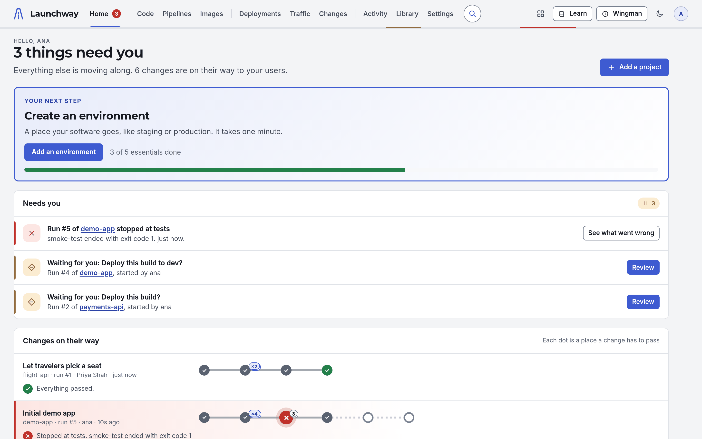

# Launchway

**CI/CD and Git hosting in one program you run yourself.** A database and Git are all it needs.

[](https://github.com/JK-Magic-Creations/launchway/actions/workflows/ci.yml)
[](https://jk-magic-creations.github.io/launchway/)
[](LICENSE)


## What works today

- **Pipelines as a graph.** Steps that can run together are drawn side by side. A failed Sortie (run) says
  which step failed and why, in plain words, and you can re-run from any step.
- **Delivery you can check.** Deployments are verified, wait for approvals when you ask them to, and
  roll back.
- **Git hosting.** Repositories with pull requests, reviews and merge rules, over HTTPS and SSH.
- **Shared pipelines.** Keep templates in a library in Git, pin a version, and give each one typed
  inputs.
- **One capability, every way in.** The web interface, the HTTP API, the command line and the MCP
  server do the same things.
- **Accessible.** The web interface is built and tested for WCAG 2.2 level AA.

| Home | A pull request | A failed Sortie |
|---|---|---|
| [](docs/demo.md) | [](docs/demo.md) | [](docs/demo.md) |

The pictures come from a demo server with made-up data; [see them all](docs/demo.md).

## Quick start

You need Go 1.27.4 or newer, Node 24 or newer, Git, and Podman or Docker for steps that run in
containers.

```sh
git clone https://github.com/JK-Magic-Creations/launchway.git
cd launchway
make run          # then open http://127.0.0.1:8080
```

This builds Launchway, makes a small demo repository and starts a server on your machine, with no
sign-in because it listens only on a loopback address. Turn on sign-in before anyone else can reach a
server. Launchway is early software.

## Learn more

- [Documentation](https://jk-magic-creations.github.io/launchway/): the [overview](docs/start/overview.md),
  [tutorials](docs/tutorials/index.md), the [user guide](docs/guide/index.md),
  [how-to guides](docs/howto/index.md) and [reference](docs/reference/index.md).
- Learn: the same documentation is inside the product, under **Learn** in the top bar.
- [Roadmap](https://jk-magic-creations.github.io/launchway/roadmap.html) ([as a list](docs/roadmap-list.md)):
  what is built and what is next.
- [Contributing](CONTRIBUTING.md), [security policy](SECURITY.md) and [versions and support](SUPPORT.md).

## License

Launchway is free software under the [GNU Affero General Public License, version 3](LICENSE).
[LICENSING.md](LICENSING.md) explains what that means for you.

## Words

Launchway's own words (Base, Wing, Squadron, Wingman, Clearance, Logbook and the rest) are listed in the [vocabulary](docs/reference/vocabulary.md); every one can be renamed. These are ordinary words used descriptively. Launchway is not affiliated with or endorsed by any military service.
