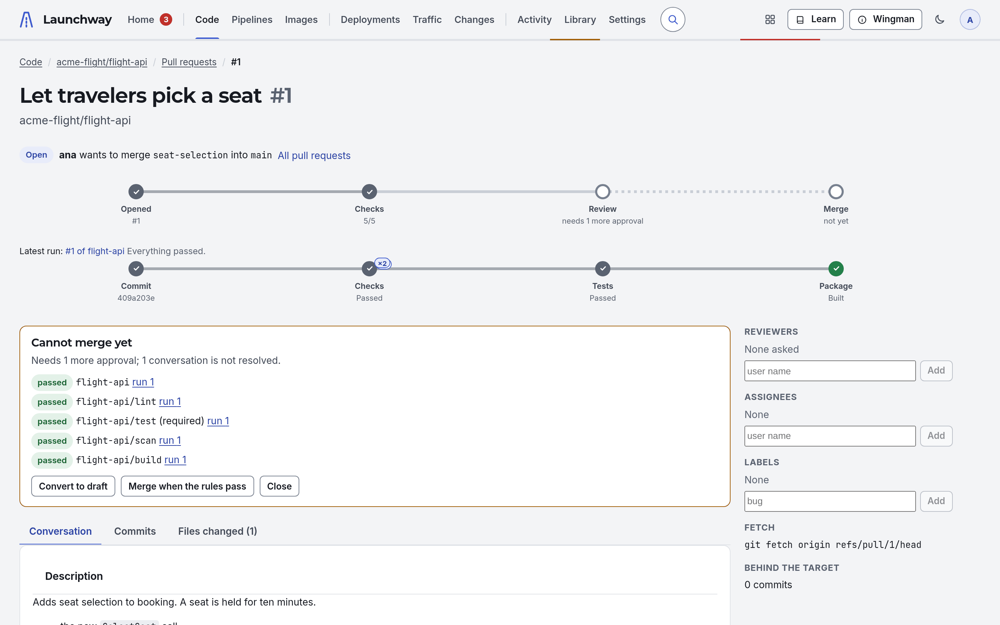
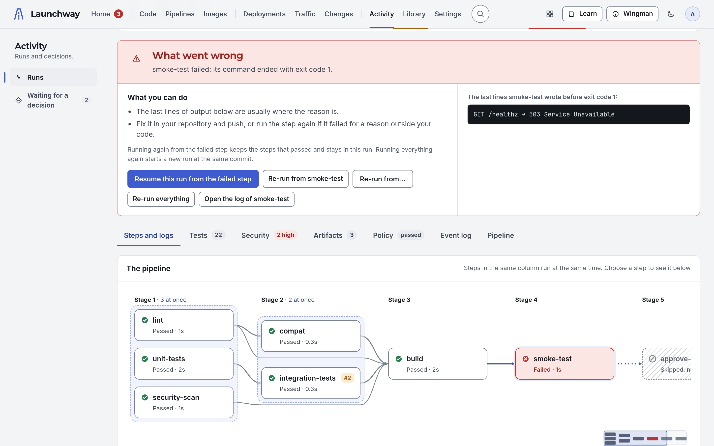

# Launchway

**CI/CD and Git hosting in one program you run yourself.** A database and Git are all it needs.

[](https://github.com/JK-Magic-Creations/launchway/actions/workflows/ci.yml)
[](https://jk-magic-creations.github.io/launchway/)
[](LICENSE)


## What works today

**Build and test**

- **Pipelines as a graph.** Steps that can run together are drawn side by side. A failed Sortie (run) says
  which step failed and why, in plain words, and you can re-run from any step. ([Pipelines](docs/guide/pipelines.md))
- **Shared pipelines.** Keep templates in a library in Git, pin a version, and give each one typed
  inputs; start a new repository from a ready-made starter. ([Libraries](docs/guide/libraries.md), [starters](docs/guide/starters.md))
- **Fast repeat runs.** Build caches shared by every Station, scoped so a pull request cannot poison the
  main branch. ([Build caches](docs/guide/build-caches.md))
- **Debriefs.** Every Sortie gets a Debrief (run summary): test results, coverage and flaky tests, for
  that Sortie and over time. ([Debrief](docs/guide/debrief.md), [test results](docs/guide/test-reports.md))
- **Security on by default.** Scans for vulnerabilities and leaked secrets, Standing orders (policies) that
  can block a merge or a Launch, and Maintenance (dependency updates) that opens the update pull requests for you.
  ([Security findings](docs/guide/security-findings.md), [Standing orders](docs/guide/standing-orders.md),
  [Maintenance](docs/guide/dependency-updates.md))
- **Bring your pipelines.** The importer turns an existing pipeline file into a Launchway one.
  ([Move your pipelines](docs/guide/move-your-pipelines.md))

**Deliver**

- **Delivery you can check.** Launches are verified against your metrics and logs, wait for Clearances
  when you ask them to, and can return to base (roll back) on their own when something is wrong.
  ([Deployments](docs/guide/deployments.md), [verification](docs/guide/verification.md))
- **Switches.** A Switch (feature toggle) turns a feature on or off without a new Launch: rules, segments,
  percentage rollouts, schedules, approvals and history, with Go and JavaScript SDKs and OpenFeature providers. ([Switches](docs/guide/feature-toggles.md))
- **Releases.** Cut, sign and promote releases, with checklists and downloads.
  ([Releases](docs/guide/releases.md), [verified commits](docs/guide/verified-commits.md))
- **Insights.** Deployment frequency, lead time, change failure rate and time to restore, from what
  Launchway already records. ([Measuring delivery](docs/guide/measuring-delivery.md))

**Code and work**

- **Git hosting.** Repositories with pull requests, reviews and merge rules, over HTTPS and SSH; browse,
  search and edit code in the browser. ([Pull requests](docs/guide/pull-requests.md), [Git over SSH](docs/guide/git-over-ssh.md))
- **Your Git host, or ours.** Connect repositories that live on another Git host and keep the same
  features. ([Outside hosts](docs/guide/outside-host.md))
- **Work tracking.** Items, boards, sprints and their links to code. ([Tracking work](docs/guide/tracking-work.md))

**Everywhere**

- **One capability, every way in.** The web interface, the HTTP API, the command line and the MCP
  server do the same things, so an AI assistant can work with Launchway too. ([Agents](docs/guide/agents.md))
- **Runs where you run.** One program and a database, on a laptop, a single server or Kubernetes, with
  Stations that only ever connect out. ([Install](docs/howto/install-in-ten-minutes.md))
- **Accessible.** The web interface is built and tested for WCAG 2.2 level AA.

| Home | A pull request | A failed Sortie |
|---|---|---|
| [](docs/demo.md) | [](docs/demo.md) | [](docs/demo.md) |

The pictures come from a demo server with made-up data; [see them all](docs/demo.md).

## Quick start

You need Go 1.27.4 or newer, Node 24 or newer, Git, and Podman or Docker for steps that run in
containers.

```sh
git clone https://github.com/JK-Magic-Creations/launchway.git
cd launchway
make run          # then open http://127.0.0.1:8080
```

This builds Launchway, makes a small demo repository and starts a server on your machine, with no
sign-in because it listens only on a loopback address. Turn on sign-in before anyone else can reach a
server. Launchway is early software.

## Learn more

- [Documentation](https://jk-magic-creations.github.io/launchway/): the [overview](docs/start/overview.md),
  [tutorials](docs/tutorials/index.md), the [user guide](docs/guide/index.md),
  [how-to guides](docs/howto/index.md) and [reference](docs/reference/index.md).
- Learn: the same documentation is inside the product, under **Learn** in the top bar.
- [Roadmap](https://jk-magic-creations.github.io/launchway/roadmap.html) ([as a list](docs/roadmap-list.md)):
  what is built and what is next.
- [Platform plan](https://jk-magic-creations.github.io/launchway/plan/): the whole plan chapter by chapter,
  with its diagrams and the screen designs for what comes next (under **Screens**).
- [Contributing](CONTRIBUTING.md), [security policy](SECURITY.md) and [versions and support](SUPPORT.md).

## License

Launchway is free software under the [GNU Affero General Public License, version 3](LICENSE).
[LICENSING.md](LICENSING.md) explains what that means for you.

## Words

Launchway's own words (Base, Wing, Squadron, Wingman, Clearance, Logbook and the rest) are listed in the [vocabulary](docs/reference/vocabulary.md); every one can be renamed. These are ordinary words used descriptively. Launchway is not affiliated with or endorsed by any military service.
