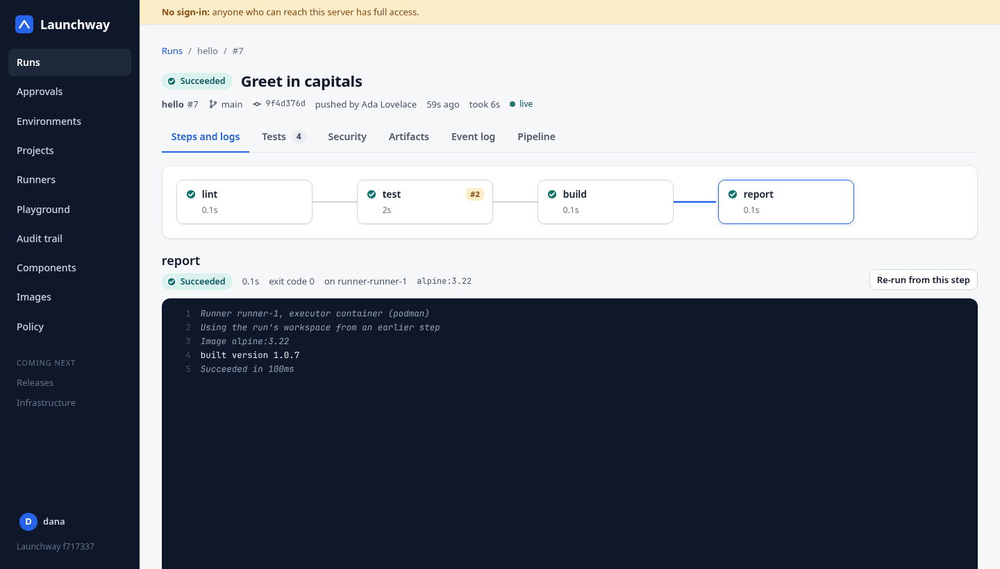

# Launchway

**Build, test and deliver software on infrastructure you control.**

[](https://github.com/JK-Magic-Creations/launchway/actions/workflows/ci.yml)
[](https://jk-magic-creations.github.io/launchway/)
[](LICENSE)

Launchway is a build and delivery platform for teams: it builds each change, tests it, scans it,
and takes it to production through approvals, policy checks and GitOps deployments. It runs on
your own servers or Kubernetes, with several servers sharing one PostgreSQL database, runners
that only connect outbound, and secrets that never reach the server. Every run is a durable record
of events, so runs survive crashes, resume from the step that failed, and show what was delivered,
how it was checked and who approved it.



## Quick start

You need Go 1.27.4+, Node 24+, Git, and Podman or Docker.

```sh
git clone https://github.com/JK-Magic-Creations/launchway.git
cd launchway
make run          # then open http://127.0.0.1:8080
```

## Documentation

**[jk-magic-creations.github.io/launchway](https://jk-magic-creations.github.io/launchway/)**
(the same pages are in [docs/](docs/index.md)):

- [What Launchway is](docs/start/overview.md), [concepts](docs/start/concepts.md) and
  [architecture](docs/start/architecture.md)
- [Quick start](docs/start/quick-start.md), [tutorials](docs/tutorials/index.md) and the
  [user guide](docs/guide/index.md)
- [Install and operate](docs/howto/index.md), [reference](docs/reference/index.md) and
  [security](docs/security/index.md)
- [Roadmap](https://jk-magic-creations.github.io/launchway/roadmap.html)
  ([as a list](docs/roadmap-list.md)): what is available, in progress and planned

Recently added, each described in the [user guide](docs/guide/index.md):

- artifacts, test attachments and hosted reports kept in the database, so several servers share
  them with nothing else to run ([where artifacts are kept](docs/artifacts.md));
- test reports in 13 formats, with coverage thresholds and the tools' own HTML reports
  ([test reports](docs/guide/test-reports.md));
- an MCP endpoint for AI agents, with the rights of the token they hold ([agents](docs/guide/agents.md));
- verification of deployments from metrics and logs, with optional AI models that explain and never
  turn a failure into a pass ([verification](docs/guide/verification.md), [AI models](docs/guide/ai.md));
- runner identities, join tokens and pools, and each runner's own limits
  ([runners on other machines](docs/guide/runner-identity.md)).

Launchway is early software. Turn on sign-in before anyone else can reach a server.

## Releases and verification

Releases are signed, with SBOMs and provenance, and rebuild byte for byte from their commit; see
[verifying downloads](docs/security/verify-downloads.md) and [versions and support](SUPPORT.md).
Runners install on Linux with `install.sh`, deb or rpm packages, or the runner-only Helm chart:
see [connect a runner](docs/howto/connect-runner.md).

## Contributing and security

See [CONTRIBUTING.md](CONTRIBUTING.md). Report security problems privately as described in
[SECURITY.md](SECURITY.md).

## Licence

Launchway is free software under the [GNU Affero General Public License, version 3](LICENSE)
(AGPL-3.0). [LICENSING.md](LICENSING.md) explains in plain language what that means for you and
how to get a commercial licence if you cannot use the AGPL. The copyright notice is in
[COPYRIGHT](COPYRIGHT).
