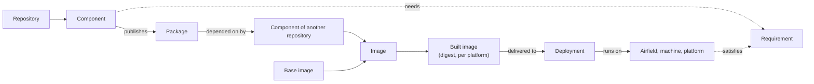

# The graph: what depends on what, what runs where, what it needs

Launchway keeps one graph that runs from code to what is built from it to what it needs and where it runs. It
answers questions that otherwise mean reading a dozen files and asking three teams:

- What is affected if this repository, package, base image or machine changes?
- In what order must these repositories be built, and what must be built again after this push?
- Where is this running, and what is in it?
- What does this software need, and what in my estate can run it?

The graph lives in the database Launchway already has (SQLite or PostgreSQL). There is no graph database and no
search service to run. Everything in it is read from things Launchway already holds: Git, pipelines, the results of
Sorties and what each Launch delivered.

This page is how it works and how to use it. The requirements file is in
[The requirements file](../reference/requirements-file.md); the commands are in [Command line](../reference/cli.md#launchway-graph)
and the routes in [HTTP API](../reference/http-api.md#the-software-graph).



## What is in it

A **node** is a thing. An **edge** is a relation between two things, with where it was found, how sure Launchway is
and when it held.

| Node | What it is |
|---|---|
| repository | A repository hosted by Launchway |
| package | A library or module, named by ecosystem: `go:example.com/lib`, `npm:@scope/name`, `python:name` |
| component | A buildable unit inside a repository: a module, a package, a Containerfile |
| requirement | One thing a component needs: an architecture, an amount of memory, a port, a data service |
| image | An image by name, without a tag; base images are images too |
| built | A concrete built image: a digest, per platform |
| pipeline | A repository's pipeline |
| Airfield | An environment |
| deployment | What runs in an Airfield for a project and service |
| machine, platform | A virtual machine or server; a cluster, a serverless runtime, a database or a queue |
| owner | A person or Squadron, from `CODEOWNERS` |
| commit | A commit that something was built from |

| Edge | Reads as |
|---|---|
| `depends-on` | a component depends on a package, with the version it asked for and the version it got |
| `contains` | a repository holds a component; a component publishes a package |
| `built-from` | an image is built from a base image (with the stage) or from a component; a built image from a commit |
| `builds` | a pipeline makes an image |
| `instance-of`, `includes` | a built image is one build of an image; it includes a package (from its list of components) |
| `delivered-to` | a built image was delivered to a deployment, with the digest and the time |
| `runs-on`, `hosts` | a deployment runs on an Airfield, machine or platform; a machine hosts a platform |
| `needs`, `satisfies` | a component needs a requirement; a machine or platform satisfies it |
| `configured-by`, `owned-by` | a machine is configured by an infrastructure repository; a thing is owned by someone |

Every edge says **who asserted it** (the source), **at which commit or time**, and **how sure**: *declared* (a
person wrote it down), *extracted* (read from a file or a result) or *inferred* (Launchway worked it out, and says
so). Every edge also says **when it held**. An edge is closed, never deleted, so you can ask "as of last Tuesday"
or "as of this commit".

## How it stays current

Small adapters called **sources** read one kind of data and say what they find. The store compares that with what
it held, so nothing changes if nothing changed; a dependency that moved to a new version closes the old edge and
opens a new one; a dependency that was removed is closed.

| Source | Reads | Gives |
|---|---|---|
| manifests | `go.mod`, `package.json`, `pyproject.toml`, requirements files (with the same readers the dependency updates use) | packages, components, `depends-on` with constraint and resolved version, owners from `CODEOWNERS` |
| containers | Containerfiles and Dockerfiles, and the image steps of `.launchway/pipeline.yaml` | base images by stage, what each pipeline builds and for which platforms |
| requirements | `.launchway/requirements.yaml`, the pipeline, Containerfiles, Kubernetes manifests, manifests | what each component needs, declared and inferred |
| sorties | the results of image steps | built images by digest and platform, the commit, and the components of the image's list of components |
| deployments | what is deployed now | deployments, and which digests each one runs |
| inventory, registry, infrastructure, clusters | machines and platforms with their discovered facts; registry contents; infrastructure state; cluster workloads | machines, platforms, `hosts`, `configured-by`, `runs-on` |

The last row is **typed adapters**: each is a small interface with tests that feed it fixtures. The work that owns
that data (host inventory, the registry, configuration as code) implements the interface when it arrives; nothing
here changes. Until then the graph simply has no machines, and the questions about placement say so.

A push to a repository's default branch is read at once. New results and new Launches are seen within about thirty
seconds. An administrator can read everything again (`launchway graph rescan`) or clear the graph and rebuild it
from scratch (`launchway graph rebuild`); the rebuilt graph equals what the pushes built. People's corrections (see
below) are kept.

Repositories in one installation find each other with no configuration: a Go module path, an npm package name or a
Python distribution name is the same node whoever mentions it, so a dependency in one repository meets the package
another repository publishes.

## What it answers

### What is affected if this changes

```
launchway graph impact package:go:example.com/lib
```

Everything a change reaches, with the way each thing is reached (the **why**), grouped by owner, with the
deployments that run an affected digest and the Airfield each is in. It works from a repository, a package, a
component, a base image, a machine or a platform. Only the things you may read are followed or counted.

### Build order and what must rebuild

```
launchway graph order -R team/app --upstream
launchway graph rebuild-set -R team/lib
```

Repositories are ordered providers first, in levels that can be built together. Two things make one repository
depend on another: it depends on a package the other publishes, or its Containerfile starts from an image the
other's pipeline builds. A **cycle** is reported with the path that closes it and a suggestion; the rest is still
ordered.

After a push, `rebuild-set` lists what must be built again, in order, and why.

#### Start dependents after a push

A push to a library repository runs the library's pipeline. The projects that build the repositories depending on it can start when that run ends well, each one after the projects it depends on, because each result starts the next level: providers build before consumers. This uses the same [triggers on results](result-triggers.md) as any other project's start, so the same two decisions apply: the project that depends on another makes the trigger, and the project depended on must allow it. **It is off until you ask for it.** Nothing is made by looking.

```
launchway run-triggers graph team-app            # what the graph says team-app depends on, in order, and what stands in the way
launchway run-triggers graph team-app --create   # make a trigger for each project that has allowed it
```

The first command lists the projects that build the repositories `team-app`'s repository depends on, lowest level first, and for each whether it has allowed `team-app` to trigger on its results and whether a trigger exists. The second makes a trigger named `graph-<project>` for each that allowed it (it starts a run of `team-app` when a run of that project ends well), and says plainly why it left out any that did not. A dependency you marked `ignore` or `pin` is not followed, and a cycle is shown, not followed. The projects are the ones the caller may read. Nothing crosses between projects but the result by reference. In the API it is `GET` and `POST /api/v1/projects/{name}/run-triggers/graph`, and the MCP tools are `get_graph_run_triggers` and `follow_graph_with_run_triggers`.

**You can always correct it.** An override says one repository is built before another (`before`), does not really
depend on another (`ignore`) or stays at a version of another, so a push to it does not rebuild it (`pin`). Every
override needs a reason, is shown wherever the order is shown, is audited, and can be taken away:

```
launchway graph override add --kind ignore --from team/app --to team/lib --reason "app only uses lib's test helpers"
```

### Where is it running, and what is in it

```
launchway graph where commit:team/app@3f2a9c1
launchway graph contents deployment:prod/shop/api
```

`where` finds the deployments a repository, package, commit or image reaches and says whether the digest that runs
contains it (exact) or it is reached through a dependency. `contents` goes the other way: the images, base images,
packages with the versions resolved, commits and repositories behind a deployment.

### What does it need, and what can run it

```
launchway graph needs repository:team/app
launchway graph placement component:team/app:Containerfile
```

`needs` gives each fact with where it came from: **declared** in `.launchway/requirements.yaml`, or **inferred**
by Launchway with the evidence ("EXPOSE 8080 in Containerfile", "resource requests of Deployment/api in
k8s/deploy.yaml"). A declared fact always wins; an inferred fact that differs is shown as advice and never applied.
Edit the file from the graph page: Launchway opens a pull request.

`placement` judges the machines and platforms in the graph against the needs: what satisfies them, what nearly
does (and what is missing), and the **gaps**: "needs device gpu:1: nothing satisfies it", or "each is available
somewhere, but nothing satisfies them together".

### A machine specification

```
launchway graph spec repository:team/app repository:team/worker --headroom 25 --format yaml
```

A neutral, structured description of a machine that can run components together: architecture, CPU, memory and
storage (with headroom added), devices, operating-system features, ports and data services, with where each
requirement came from. Things that cannot be reconciled (no architecture in common, the same port wanted twice)
are listed as conflicts, not chosen between. It is an **export**: the work that builds virtual machines, images and
infrastructure code turns it into a definition. Nothing is provisioned from it.

### Which deployments run a vulnerable version

```
launchway graph reach package:go:example.com/lib
```

For a package, the versions in use that have known advisories, what uses each, and the deployments that run them.
It needs the vulnerability data the dependency updates use; without it the answer says so.

## Who may see what

Every question is asked as you. A node or edge you may not read in its own place is not in any answer: it is not
listed, it is not followed, and it is not counted. A path that would run through a repository you cannot read is
not shown, and a node you may not read answers exactly as one that does not exist. Repositories use the same
access as the repository pages; deployments the same as the project; machines and platforms need a viewer role on
any project.

## Limits, and saying so

Every traversal is bounded by depth, by the number of nodes and by time (`--depth`, `--nodes`). When an answer
stops short it says so (`truncated`, and which limit), in the command line, the API and the page. On a graph of
about fifty thousand nodes and two hundred thousand relations the questions above answer in well under a second
to a few seconds; the numbers are in the quality notes.

## In the interface

A repository's **Graph** tab, and the **Graph** page for everything you may read, have five views: Explore (the
things next to a focus, as a table you can expand, filter by kind, and ask for the path between two; a picture
is one button away, and everything it shows is also in the table), What it affects, Build order (with your
corrections), What it needs (with the edit action and the machine specification) and Where it runs.

## Setting it up

It needs nothing beyond the server: it is on whenever the server runs, in the same database. Git hosting
gives it repositories; without it the graph holds projects, built images and deployments only.

`LAUNCHWAY_GRAPH_REGISTRIES` names the hosts behind the registry names pipelines use, so that an image a
pipeline plans to push (`registry: harbor`) and the image that was pushed (`harbor.example.com/...`) are the same
node: `LAUNCHWAY_GRAPH_REGISTRIES=harbor=harbor.example.com`. Several are separated by commas. Vulnerability
questions use the same data as dependency updates (`LAUNCHWAY_UPDATES_OSV_DIR` or `LAUNCHWAY_UPDATES_OSV_URL`).

## What is not here yet

- Starting the downstream builds by itself after a push. The list is available; the trigger is the next step.
- Machines and platforms from discovery, the registry, configuration as code and cluster inventory: the interfaces
  are in place and tested with fixtures; those parts plug in when they arrive.
- Code search and call graphs inside a repository.
- Continuous scanning of what runs: advisories are matched on request (`reach`), not on a schedule.
