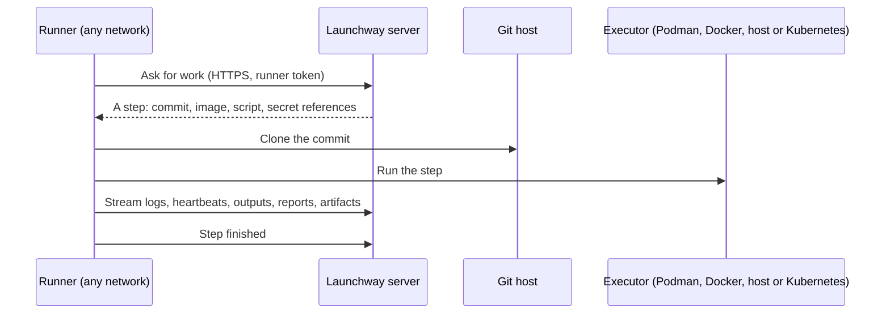

# Connect a Station (runner) {#connect-a-runner}

This guide connects a [Station](../glossary.md#runner) on another machine, or in another Kubernetes
cluster, to a Launchway server, so that steps run where the Station is. It is for operators. It also
covers where the Station token comes from, the executors, health checks, what the network must allow,
and deploy Stations with Ramp (Station (runner) pool) tokens.

> **Verified** on 2026-11-19 against commit f717337: a server built from a clean clone, with its
> built-in Station turned off, on SQLite on this machine; a second process, `launchway runner` with
> the Podman executor and a `runner.yaml`, connected to it and ran a two-step pipeline; its
> `/healthz` and `/readyz`; the token read from the server's data directory; a Station stopped with
> SIGTERM leaving the Station list at once; a wrong token's log message; two Stations in a kind
> cluster (Kubernetes executor, the manifest below with other namespace names) connecting out to that
> server, with four Sorties (runs) spread over them and the Station on the machine; the trailing-newline token
> mistake and its fix. **Not verified:** the Docker and host executors, a Station on another physical
> machine or behind a real firewall or proxy, HTTPS to the server, a deploy Station with a pool token
> (described from the code and the chart).
>
> Join tokens (below) were added when Station identities were merged; that section was not run for this guide, and comes from [Stations on other machines and clusters](../guide/runner-identity.md) and its tests.

## What you need

- A Launchway server that the Station can reach over HTTP or HTTPS, such as
  `https://launchway.example.com`. See [Install on one server](install-single-server.md) or
  [Install on Kubernetes](install-kubernetes.md).
- The Station token of that server (below).
- On the Station's machine: the `launchway` binary or the container image, Git, and for container
  steps Podman or Docker. For the Kubernetes executor: a namespace for step pods and credentials
  that may manage pods there.

> [!CAUTION]
> A Station with the **shared Station token** has no identity of its own: the server cannot tell such
> Stations apart, trusts the Station ID each one gives, and anyone who holds the token can take the
> work of the pool it serves, with that Flight's checkout and the secrets its steps ask for from
> the Station's own stores. Enrol Stations with a **join token** instead, give each pool the Flights (codebase)
> it serves, and set the Station's own `accept:` limits. See
> [Stations on other machines and clusters](../guide/runner-identity.md). Connect Stations only to
> servers you run and trust, and only Stations you run and trust to your server.

## How a Station connects {#how-a-runner-connects}



The Station makes every connection itself. The server never connects to a Station, so the Station can
sit behind NAT or a firewall that allows nothing in. While a step runs, the Station holds it on a
lease and renews it; if the Station disappears, the step runs again elsewhere.

## Find the Station token {#find-the-runner-token}

The server prints where its Station token is when it starts:

```text
  Runner token for other machines: /var/lib/launchway/runner-token
```

- **Set by you.** If the server has `LAUNCHWAY_RUNNER_TOKEN` in its Airfield (environment), that is the token,
  and the line says `LAUNCHWAY_RUNNER_TOKEN`.
- **Generated.** Otherwise the first server to start generates one and stores it in the database,
  so that every server sharing the database accepts the same Stations. Each server also writes it to
  `runner-token` in its data directory, readable only by the server's user.
- **With the Helm chart**, it is in the Secret `<release>-launchway-runner-token` (`launchway-runner-token`
  for a release called `launchway`), key `token`, unless you named your own with
  `runnerToken.existingSecret`:

```sh
kubectl -n launchway get secret launchway-runner-token -o jsonpath='{.data.token}' | base64 -d
```

Treat the token as a password. Anyone who has it can take steps, with their checkouts, from the
server.

## Install the Station service on Linux {#install-the-runner-service-on-linux}

On Debian, Ubuntu, RHEL and compatible systems with systemd, a release's `install.sh` installs the
Station as a service. It downloads the binary and `SHA256SUMS`, checks the binary's checksum and,
when [cosign](https://docs.sigstore.dev/cosign/system_config/installation/) is installed, the
signature on `SHA256SUMS`, and stops before installing anything if either does not match. Then it
creates the unprivileged system user `launchway-runner`, writes `/etc/launchway/runner.yaml`
(readable by root and that user) and `/etc/launchway/runner.env` (the credentials, root only), and
installs and starts a hardened systemd unit.

Make a join token on the Stations page (**Add a Station**, which also shows these commands with the
server's own version), then on the machine:

```sh
curl -fsSLO https://github.com/JK-Magic-Creations/launchway/releases/download/v1.4.0/install.sh
sudo sh install.sh --version v1.4.0 --server https://launchway.example.com --join lwj_…
```

The Station enrols on its first start: `install.sh` hands the join token to `launchway Station
--join` through `LAUNCHWAY_JOIN` in `runner.env`, and the Station keeps its identity in
`/var/lib/launchway-runner`. A release whose Station cannot enrol is refused. Use the same version as
the server (see [versions and support](https://github.com/JK-Magic-Creations/launchway/blob/main/SUPPORT.md)).

To check `install.sh` itself before running it, download it with `SHA256SUMS` and
`SHA256SUMS.sigstore.json` and check it as [Verifying downloads](../security/verify-downloads.md)
describes.

Other options (`sh install.sh --help` lists them all):

| Option | What it does |
|---|---|
| `--token-file FILE` | use the shared Station token or a Ramp's token from a file instead of `--join` |
| `--name NAME`, `--concurrency N` | the Station's name (default: the host name) and how many steps it runs at once |
| `--executor podman` or `docker` | run steps in containers; see the sandbox below |
| `--proxy URL`, `--no-proxy LIST` | an HTTP proxy for the server, Git and secret stores |
| `--ca-file FILE` | trust a private CA (or a proxy that inspects TLS) as well as the system's |
| `--require-signature` | refuse to install unless the signature was checked |
| `--public-key FILE` | check a release your organization signed with a key (cosign or openssl) |
| `--from-dir DIR` | install from a directory, such as an [air-gapped bundle](../security/verify-downloads.md#air-gapped-bundles), with no download |

Running it again with the same options changes nothing; with other options it updates the settings
and restarts the service. Upgrade and remove with:

```sh
sudo sh install.sh upgrade --version v1.5.0     # keeps the settings and the identity
sudo sh install.sh uninstall                    # add --purge to delete settings, workspaces and the user
```

### Packages

Every release also has `launchway-runner` deb and rpm packages for amd64 and arm64, with the same
unit and user. They install the service without enabling it, since it needs a server and a
credential first:

```sh
sudo apt install ./launchway-runner_1.4.0-1_amd64.deb      # or: sudo dnf install ./launchway-runner-1.4.0-1.x86_64.rpm
sudoedit /etc/launchway/runner.yaml                         # server: https://launchway.example.com
echo 'LAUNCHWAY_JOIN=lwj_…' | sudo tee -a /etc/launchway/runner.env >/dev/null
sudo systemctl enable --now launchway-runner
```

Settings files are kept on upgrade. Signed apt and yum repositories are generated with each
release; where they are served is announced with the release.

### The service's sandbox

The unit runs the Station as `launchway-runner` with no capabilities, `NoNewPrivileges`,
`ProtectSystem=strict` (it can write only `/var/lib/launchway-runner`), `ProtectHome`, `PrivateTmp`,
`PrivateDevices` and the kernel and control-group protections. With the default host executor,
steps run inside that sandbox: they cannot use `sudo` or write outside the Station's state
directory. `--executor podman` adds a drop-in that relaxes what rootless Podman needs (its setuid
helpers, user namespaces, `/dev/fuse`, a delegated cgroup); `--executor docker` adds the user to the
`docker` group, which is as good as root on that machine. The full list is in
[the packaging guide](https://github.com/JK-Magic-Creations/launchway/blob/main/packaging/README.md#the-runners-systemd-unit).

Alpine and other OpenRC systems are not supported by the installer or the packages; run the Station
image there. There is no Windows build.

> **Verified** with `make test-install`: `install.sh` (with a shared token and with a join token),
> the deb and rpm packages from the generated repositories, on Debian 12, Ubuntu 24.04 and Rocky
> Linux 9 in systemd containers: install, connect to a real server, run a pipeline, upgrade,
> uninstall. Releases are not published yet, so the download from GitHub was not; the test serves
> a locally built, key-signed release instead.

## Run a Station by hand {#run-a-runner-by-hand}

Write a `runner.yaml`. It takes the same settings as `runner:` in the server's configuration, plus
where the server is. Unknown settings are refused. The token is never in the file.

```yaml
# runner.yaml
server: https://launchway.example.com
name: build-2                 # default: the host name
data: ./work                  # workspaces; relative to this file
concurrency: 2                # steps at once
executor: podman              # auto, container, podman, docker, host or kubernetes
```

Start it with the token in the Airfield:

```sh
export LAUNCHWAY_RUNNER_TOKEN="$(cat runner-token)"
launchway runner --config runner.yaml --health-listen 127.0.0.1:8081
```

```text
INFO runner started name=build-2 executor="container (podman)" concurrency=2 server=https://launchway.example.com
```

Everything can also be given as flags, without a file:

```sh
launchway runner --server https://launchway.example.com --token "$LAUNCHWAY_RUNNER_TOKEN" \
  --name build-2 --executor podman --concurrency 2
```

A flag wins over `LAUNCHWAY_SERVER` and `LAUNCHWAY_RUNNER_TOKEN`, which win over the file. Prefer
the environment variable to `--token`, which other users of the machine can see in the process list.
The Station appears on the server's **Stations** page, and in `GET /api/v1/runners`:

```text
{"id":"runner-build-2","name":"build-2","executor":"container (podman)","version":"f717337","online":true,...}
```

New Sorties may now go to it. All of a Sortie's steps go to the Station that took its first step, as
long as that Station is seen, because they share its workspace; a busy Station leaves new runs to an
idle one.

Run it as a service (a systemd unit, for example) so that it restarts. On SIGTERM it stops its
steps, hands them back to be run again elsewhere, and tells the server it is leaving, so it leaves
the Station list at once. A Station that vanishes without that is listed as offline after two minutes
and forgotten after a day.

## Choose an executor

| Executor | Steps run | Use it when |
|---|---|---|
| `podman`, `docker` | In containers of the step's `image`, with that program | The machine has it. Each Sortie's containers share a workspace. |
| `container` | Like the above, with Podman or Docker, whichever is installed | You do not mind which. |
| `auto` (default) | In containers if Podman or Docker is installed, otherwise on the host | Trying it out. Name the executor for real Stations, so a missing Podman fails loudly. |
| `host` | Directly on the machine, as the Station's user, without containers | Only for pipelines you trust completely: a step can do anything that user can. |
| `kubernetes` | In a pod for each step in a namespace, through the Kubernetes API | The Station is in or near a cluster. |

The Kubernetes executor reads the usual kubeconfig, or the in-cluster configuration in a pod. Name
the context and namespace with `kubernetes.context` and `kubernetes.namespace` in `runner.yaml`, or
`--k8s-context` and `--k8s-namespace`. Step pods meet Pod Security `restricted` unless you turn that
off with `kubernetes.restricted: false` or `--k8s-unrestricted`. The other settings are in
[Station configuration](../reference/runner-config.md).

## Run a Station in another cluster {#run-a-runner-in-another-cluster}

The `launchway-runner` chart installs only Stations, connecting out to a server in another namespace,
cluster or machine. It shares its Station configuration, least-privilege RBAC and Pod Security
settings with the main chart, and can also install a deploy Station, proxy/CA settings and
NetworkPolicies.

```sh
kubectl create namespace launchway-runner
kubectl -n launchway-runner create secret generic launchway-runner-token \
  --from-literal=token="$(cat runner-token)"
helm install runners deploy/helm/launchway-runner -n launchway-runner \
  --set server.url=https://launchway.example.com \
  --set token.existingSecret=launchway-runner-token \
  --set runner.kubernetes.namespace=launchway-steps \
  --set runner.kubernetes.createNamespace=true
```

To enrol each Station with its own identity instead, create a Secret holding a join token and set
`runner.join.existingSecret` (and optionally `runner.join.existingSecretKey`, default `token`)
instead of `token.existingSecret`:

```sh
kubectl -n launchway-runner create secret generic launchway-runner-join \
  --from-literal=token='lwj_…'
helm install runners deploy/helm/launchway-runner -n launchway-runner \
  --set server.url=https://launchway.example.com \
  --set runner.join.existingSecret=launchway-runner-join \
  --set runner.kubernetes.namespace=launchway-steps \
  --set runner.kubernetes.createNamespace=true
```

From a release, install the chart archive instead of the directory:
`helm install runners https://github.com/JK-Magic-Creations/launchway/releases/download/v1.4.0/launchway-runner-1.4.0.tgz ...`
(checked as [Verifying downloads](../security/verify-downloads.md) describes). Its image is
`ghcr.io/jk-magic-creations/launchway-runner`, with the chart's version as the tag.

The chart creates the step namespace with Pod Security `restricted` and gives the Stations exactly
the Kubernetes executor's permissions there. `runner.labels` and `runner.accept` set identity labels
and runner-side work limits. See [the chart and deployment guide](https://github.com/JK-Magic-Creations/launchway/blob/main/deploy/README.md#runners-in-another-cluster)
for deploy Stations, image builders and signing, verification health sources, proxies, CA bundles,
and NetworkPolicy examples. Its values are checked by `values.schema.json`.

> [!WARNING]
> Create the token Secret with `--from-literal=token="$(cat runner-token)"`, as above, not with
> `--from-file`. The `runner-token` file ends with a newline, which `--from-file` keeps, and the
> Station then cannot send it: its log repeats
> `could not reach the server; retrying err="... invalid header field value for \"Authorization\""`
> and the pods never become ready.

A Station with a wrong token logs
`could not reach the server; retrying err="lease: a valid runner token is required (HTTP 401)"` and
keeps retrying.

## Health checks

With `--health-listen ADDRESS`, a Station (and a deploy runner) serves three endpoints:

- `/healthz` answers `ok` while the process is up;
- `/livez` answers `ok` while the loop that takes work from the server has polled within the last five minutes. A runner that is up but stuck answers 503 and the reason; a loop waiting for a free place is not stuck while the work that holds the places is within its time. The runner itself logs the stacks of its goroutines at error level and exits with an error when this has lasted, so that its supervisor starts it again;
- `/readyz` answers `ok` while the server has answered the runner within the last two minutes.

A runner also logs one line every ten minutes (`idle: 12 polls, last work 3m ago (...)`), so that a quiet log is never ambiguous.

```sh
curl -s http://127.0.0.1:8081/readyz
```

Use `/livez` and `/readyz` for liveness and readiness probes (the charts do). A Station that cannot reach the server is not ready, so a
rollout of Stations that cannot work stops instead of replacing working ones.

## What the network must allow

A Station needs only outbound connections:

- to the server's URL (HTTPS, or HTTP inside a trusted network);
- to the Git host, to clone each Sortie's commit and any [libraries](../glossary.md#library);
- to the image registries its steps use (through Podman, Docker or the cluster's nodes);
- with the Kubernetes executor, to the Kubernetes API;
- to its secret stores, such as Vault or OpenBao.

Nothing needs to reach the Station. Its health port is for local probes only. Behind a load balancer,
a Station may talk to any of the servers.

## Enrol a Station with a join token {#enrol-a-runner-with-a-join-token}

A Station enrolled with a join token has an identity of its own: a key that never leaves it, a place
in a pool, and leases that belong to it. This is the better way to connect a Station than the shared
token. Make a join token on the Stations page (**Add a Station**), or:

```sh
launchway runners join-token --pool web --ttl 1h
```

It is shown once. On the Station's machine:

```sh
launchway runner --server https://launchway.example.com --join lwj_… --config /etc/launchway/runner.yaml
```

The Station registers its public key, gets a Station ID, and from then on starts without the join
token. In Kubernetes with the chart, put a join token in a Secret and set `runner.join.existingSecret`.
The pools, the Station's own `accept:` limits, revoking and rotating keys are described in
[Stations on other machines and clusters](../guide/runner-identity.md).

## Deploy Stations and Ramps {#deploy-runners-and-runner-pools}

Deploy steps are done only by [deploy Stations](../glossary.md#deploy-runner): `launchway runner` with
a `deploy:` section, in or near the cluster that Argo CD manages, holding the token of a
[Ramp](../glossary.md#runner-pool). The shared Station token cannot take deploy work. The
server lists its pools, each with a token of its own (at least 32 characters, different from the
shared token and every other pool's) and the targets it may serve:

```yaml
# launchway.yaml on every server
environments:
  - { name: prod, target: prod-cluster, projects: [payments] }
runner_pools:
  - { name: deploy-prod, token_env: LAUNCHWAY_POOL_DEPLOY_PROD_TOKEN, targets: [prod-cluster] }
```

Make a pool token with `openssl rand -hex 24`, and give it to every server in the variable the pool
names.

The deploy Station then starts with that pool's token in `LAUNCHWAY_RUNNER_TOKEN` and a file with
`server:` and a `deploy:` section naming its targets, Applications and GitOps repositories. The Helm
chart can run one in the servers' own cluster (`delivery.deployRunner`, see
[Install on Kubernetes](install-kubernetes.md#deploy-runner)); the
[Station configuration reference](../reference/runner-config.md#deploy) has a complete deploy Station
file. A deploy Station can also enrol with a join token for a deploy pool that sets `require_identity`.

## What next

- [Station configuration](../reference/runner-config.md) for every setting.
- [Secrets](secrets.md) for the Station's secret stores.
- [Trust model](../security/trust-model.md) for what a Station can see.
- [Troubleshooting](troubleshooting.md).
