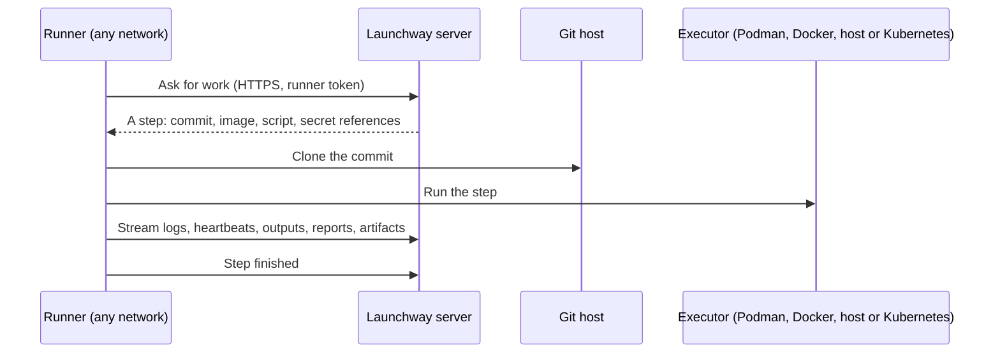

# Connect a runner

This guide connects a [runner](../glossary.md#runner) on another machine, or in another Kubernetes
cluster, to a Launchway server, so that steps run where the runner is. It is for operators. It also
covers where the runner token comes from, the executors, health checks, what the network must allow,
and deploy runners with runner pool tokens.

> **Verified** on 2026-11-19 against commit f717337: a server built from a clean clone, with its
> built-in runner turned off, on SQLite on this machine; a second process, `launchway runner` with
> the Podman executor and a `runner.yaml`, connected to it and ran a two-step pipeline; its
> `/healthz` and `/readyz`; the token read from the server's data directory; a runner stopped with
> SIGTERM leaving the runner list at once; a wrong token's log message; two runners in a kind
> cluster (Kubernetes executor, the manifest below with other namespace names) connecting out to that
> server, with four runs spread over them and the runner on the machine; the trailing-newline token
> mistake and its fix. **Not verified:** the Docker and host executors, a runner on another physical
> machine or behind a real firewall or proxy, HTTPS to the server, a deploy runner with a pool token
> (described from the code and the chart).
>
> Join tokens (below) were added when runner identities were merged; that section was not run for this guide, and comes from [Runners on other machines and clusters](../guide/runner-identity.md) and its tests.

## What you need

- A Launchway server that the runner can reach over HTTP or HTTPS, such as
  `https://launchway.example.com`. See [Install on one server](install-single-server.md) or
  [Install on Kubernetes](install-kubernetes.md).
- The runner token of that server (below).
- On the runner's machine: the `launchway` binary or the container image, Git, and for container
  steps Podman or Docker. For the Kubernetes executor: a namespace for step pods and credentials
  that may manage pods there.

> [!CAUTION]
> A runner with the **shared runner token** has no identity of its own: the server cannot tell such
> runners apart, trusts the runner ID each one gives, and anyone who holds the token can take the
> work of the pool it serves, with that project's checkout and the secrets its steps ask for from
> the runner's own stores. Enrol runners with a **join token** instead, give each pool the projects
> it serves, and set the runner's own `accept:` limits. See
> [Runners on other machines and clusters](../guide/runner-identity.md). Connect runners only to
> servers you run and trust, and only runners you run and trust to your server.

## How a runner connects



The runner makes every connection itself. The server never connects to a runner, so the runner can
sit behind NAT or a firewall that allows nothing in. While a step runs, the runner holds it on a
lease and renews it; if the runner disappears, the step runs again elsewhere.

## Find the runner token

The server prints where its runner token is when it starts:

```text
  Runner token for other machines: /var/lib/launchway/runner-token
```

- **Set by you.** If the server has `LAUNCHWAY_RUNNER_TOKEN` in its environment, that is the token,
  and the line says `LAUNCHWAY_RUNNER_TOKEN`.
- **Generated.** Otherwise the first server to start generates one and stores it in the database,
  so that every server sharing the database accepts the same runners. Each server also writes it to
  `runner-token` in its data directory, readable only by the server's user.
- **With the Helm chart**, it is in the Secret `<release>-launchway-runner-token` (`launchway-runner-token`
  for a release called `launchway`), key `token`, unless you named your own with
  `runnerToken.existingSecret`:

```sh
kubectl -n launchway get secret launchway-runner-token -o jsonpath='{.data.token}' | base64 -d
```

Treat the token as a password. Anyone who has it can take steps, with their checkouts, from the
server.

## Install the runner service on Linux

On Debian, Ubuntu, RHEL and compatible systems with systemd, the release's installer downloads the
binary and checksums, verifies them (including the Sigstore signature when cosign or a public key
is available), creates an unprivileged `launchway-runner` user, writes the configuration with safe
permissions, and installs a hardened systemd unit:

```sh
curl -fsSLO https://github.com/jk-magic-creations/launchway/releases/download/VERSION/install.sh
sudo sh install.sh --server https://launchway.example.com --join lwj_…
```

Use `--token-file /root/runner-token` instead of `--join` only for a shared runner or pool token.
`--require-signature` makes signature verification mandatory. `sh install.sh --help` describes
upgrades, removal, proxies, custom CAs and the Podman and Docker executors. The service sandbox and
the relaxations those executors need are in [the packaging guide](../../packaging/README.md); the
deb and rpm packages install the same unit and user. Alpine and other OpenRC systems are not
supported by the installer.

## Run a runner by hand

Write a `runner.yaml`. It takes the same settings as `runner:` in the server's configuration, plus
where the server is. Unknown settings are refused. The token is never in the file.

```yaml
# runner.yaml
server: https://launchway.example.com
name: build-2                 # default: the host name
data: ./work                  # workspaces; relative to this file
concurrency: 2                # steps at once
executor: podman              # auto, container, podman, docker, host or kubernetes
```

Start it with the token in the environment:

```sh
export LAUNCHWAY_RUNNER_TOKEN="$(cat runner-token)"
launchway runner --config runner.yaml --health-listen 127.0.0.1:8081
```

```text
INFO runner started name=build-2 executor="container (podman)" concurrency=2 server=https://launchway.example.com
```

Everything can also be given as flags, without a file:

```sh
launchway runner --server https://launchway.example.com --token "$LAUNCHWAY_RUNNER_TOKEN" \
  --name build-2 --executor podman --concurrency 2
```

A flag wins over `LAUNCHWAY_SERVER` and `LAUNCHWAY_RUNNER_TOKEN`, which win over the file. Prefer
the environment variable to `--token`, which other users of the machine can see in the process list.
The runner appears on the server's **Runners** page, and in `GET /api/v1/runners`:

```text
{"id":"runner-build-2","name":"build-2","executor":"container (podman)","version":"f717337","online":true,...}
```

New runs may now go to it. All of a run's steps go to the runner that took its first step, as
long as that runner is seen, because they share its workspace; a busy runner leaves new runs to an
idle one.

Run it as a service (a systemd unit, for example) so that it restarts. On SIGTERM it stops its
steps, hands them back to be run again elsewhere, and tells the server it is leaving, so it leaves
the runner list at once. A runner that vanishes without that is listed as offline after two minutes
and forgotten after a day.

## Choose an executor

| Executor | Steps run | Use it when |
|---|---|---|
| `podman`, `docker` | In containers of the step's `image`, with that program | The machine has it. Each run's containers share a workspace. |
| `container` | Like the above, with Podman or Docker, whichever is installed | You do not mind which. |
| `auto` (default) | In containers if Podman or Docker is installed, otherwise on the host | Trying it out. Name the executor for real runners, so a missing Podman fails loudly. |
| `host` | Directly on the machine, as the runner's user, without containers | Only for pipelines you trust completely: a step can do anything that user can. |
| `kubernetes` | In a pod per run in a namespace, through the Kubernetes API | The runner is in or near a cluster. |

The Kubernetes executor reads the usual kubeconfig, or the in-cluster configuration in a pod. Name
the context and namespace with `kubernetes.context` and `kubernetes.namespace` in `runner.yaml`, or
`--k8s-context` and `--k8s-namespace`. Step pods meet Pod Security `restricted` unless you turn that
off with `kubernetes.restricted: false` or `--k8s-unrestricted`. The other settings are in
[Runner configuration](../reference/runner-config.md).

## Run a runner in another cluster

The `launchway-runner` chart installs only runners, connecting out to a server in another namespace,
cluster or machine. It shares its runner configuration, least-privilege RBAC and Pod Security
settings with the main chart, and can also install a deploy runner, proxy/CA settings and
NetworkPolicies.

```sh
kubectl create namespace launchway-runner
kubectl -n launchway-runner create secret generic launchway-runner-token \
  --from-literal=token="$(cat runner-token)"
helm install runners deploy/helm/launchway-runner -n launchway-runner \
  --set server.url=https://launchway.example.com \
  --set token.existingSecret=launchway-runner-token \
  --set runner.kubernetes.namespace=launchway-steps \
  --set runner.kubernetes.createNamespace=true
```

To enrol each runner with its own identity instead, create a Secret holding a join token and set
`runner.join.existingSecret` (and optionally `runner.join.existingSecretKey`, default `token`)
instead of `token.existingSecret`:

```sh
kubectl -n launchway-runner create secret generic launchway-runner-join \
  --from-literal=token='lwj_…'
helm install runners deploy/helm/launchway-runner -n launchway-runner \
  --set server.url=https://launchway.example.com \
  --set runner.join.existingSecret=launchway-runner-join \
  --set runner.kubernetes.namespace=launchway-steps \
  --set runner.kubernetes.createNamespace=true
```

The chart creates the step namespace with Pod Security `restricted` and gives the runners exactly
the Kubernetes executor's permissions there. `runner.labels` and `runner.accept` set identity labels
and runner-side work limits. See [the chart and deployment guide](../../deploy/README.md#runners-in-another-cluster)
for deploy runners, image builders and signing, verification health sources, proxies, CA bundles,
and NetworkPolicy examples. Its values are checked by `values.schema.json`.

> [!WARNING]
> Create the token Secret with `--from-literal=token="$(cat runner-token)"`, as above, not with
> `--from-file`. The `runner-token` file ends with a newline, which `--from-file` keeps, and the
> runner then cannot send it: its log repeats
> `could not reach the server; retrying err="... invalid header field value for \"Authorization\""`
> and the pods never become ready.

A runner with a wrong token logs
`could not reach the server; retrying err="lease: a valid runner token is required (HTTP 401)"` and
keeps retrying.

## Health checks

With `--health-listen ADDRESS`, a runner serves two endpoints:

- `/healthz` answers `ok` while the process is up;
- `/readyz` answers `ok` while the server has answered the runner within the last two minutes.

```sh
curl -s http://127.0.0.1:8081/readyz
```

Use them for liveness and readiness probes. A runner that cannot reach the server is not ready, so a
rollout of runners that cannot work stops instead of replacing working ones.

## What the network must allow

A runner needs only outbound connections:

- to the server's URL (HTTPS, or HTTP inside a trusted network);
- to the Git host, to clone each run's commit and any [libraries](../glossary.md#library);
- to the image registries its steps use (through Podman, Docker or the cluster's nodes);
- with the Kubernetes executor, to the Kubernetes API;
- to its secret stores, such as Vault or OpenBao.

Nothing needs to reach the runner. Its health port is for local probes only. Behind a load balancer,
a runner may talk to any of the servers.

## Enrol a runner with a join token

A runner enrolled with a join token has an identity of its own: a key that never leaves it, a place
in a pool, and leases that belong to it. This is the better way to connect a runner than the shared
token. Make a join token on the Runners page (**Add a runner**), or:

```sh
launchway runners join-token --pool web --ttl 1h
```

It is shown once. On the runner's machine:

```sh
launchway runner --server https://launchway.example.com --join lwj_… --config /etc/launchway/runner.yaml
```

The runner registers its public key, gets a runner ID, and from then on starts without the join
token. In Kubernetes with the chart, put a join token in a Secret and set `runner.join.existingSecret`.
The pools, the runner's own `accept:` limits, revoking and rotating keys are described in
[Runners on other machines and clusters](../guide/runner-identity.md).

## Deploy runners and runner pools

Deploy steps are done only by [deploy runners](../glossary.md#deploy-runner): `launchway runner` with
a `deploy:` section, in or near the cluster that Argo CD manages, holding the token of a
[runner pool](../glossary.md#runner-pool). The shared runner token cannot take deploy work. The
server lists its pools, each with a token of its own (at least 32 characters, different from the
shared token and every other pool's) and the targets it may serve:

```yaml
# launchway.yaml on every server
environments:
  - { name: prod, target: prod-cluster, projects: [payments] }
runner_pools:
  - { name: deploy-prod, token_env: LAUNCHWAY_POOL_DEPLOY_PROD_TOKEN, targets: [prod-cluster] }
```

Make a pool token with `openssl rand -hex 24`, and give it to every server in the variable the pool
names.

The deploy runner then starts with that pool's token in `LAUNCHWAY_RUNNER_TOKEN` and a file with
`server:` and a `deploy:` section naming its targets, Applications and GitOps repositories. The Helm
chart can run one in the servers' own cluster (`delivery.deployRunner`, see
[Install on Kubernetes](install-kubernetes.md#deploy-runner)); the
[runner configuration reference](../reference/runner-config.md#deploy) has a complete deploy runner
file. A deploy runner can also enrol with a join token for a deploy pool that sets `require_identity`.

## What next

- [Runner configuration](../reference/runner-config.md) for every setting.
- [Secrets](secrets.md) for the runner's secret stores.
- [Trust model](../security/trust-model.md) for what a runner can see.
- [Troubleshooting](troubleshooting.md).
