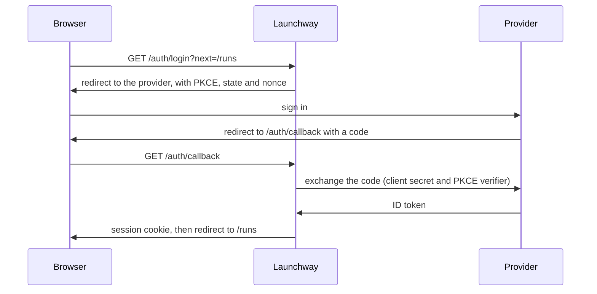

# Sign-in with OpenID Connect and roles

This guide turns on sign-in through your organisation's OpenID Connect provider, grants roles per
project with access bindings, and covers API tokens, sessions and the audit trail. It is for the
operator of a Launchway server.

> **Verified** on 2026-11-19 against commit f717337: Dex v2.45.0 in a container (static client and
> static users with groups) against a server on PostgreSQL 17; sign-in with headless Chromium
> (Playwright 1.65), directly and through an nginx TLS proxy; an admin, a viewer with an operator
> binding on some projects, and a person with no binding; `403` and `404` answers; API tokens made,
> limited, used by `launchway login` and `launchway runs`, and revoked; the limit on failed
> attempts (`429`); sign-out; the audit trail. **Not verified:** other providers (Keycloak, Okta,
> Entra ID, Authentik); environment-limited bindings in action on a real deployment (only that
> the configuration is accepted and checked).

## What you need

- A Launchway server reachable at a fixed address, normally over HTTPS behind a reverse proxy.
  See [Install on one server](install-single-server.md).
- Administrator access to an OpenID Connect provider.
- The names of the groups your provider can send for the people who will use Launchway.

## How sign-in works



Launchway finds the provider through its discovery document, checks the ID token's signature,
issuer, audience, expiry and nonce, and reads the username and the groups from the ID token or
from the provider's userinfo answer. Rights are worked out on every request from the access
bindings and the groups the provider gave at the person's latest sign-in. See
[Roles](../reference/roles.md) for every permission.

## Register Launchway with the provider

Create a client (an "application") with these settings:

| Setting | Value |
|---|---|
| Client type | confidential (it has a client secret) |
| Grant type | authorization code; PKCE with S256 may be required or optional |
| Redirect URI | `https://launchway.example.com/auth/callback`, exactly the `redirect_url` you configure |
| Scopes | `openid`, `profile`, `email`, `groups` (the default Launchway asks for) |
| Groups | a claim, normally `groups`, in the ID token or the userinfo answer, holding group names |

Most providers need a claim mapping or a scope setting before they send groups. Entra ID sends
group object IDs rather than names (use the IDs in `access`), and leaves groups out for people in
more than 200.

Choose a username claim that people cannot change themselves at the provider. `user:` bindings
and every record of who did what use it. The default is `preferred_username`, then `email`, then
`sub`.

### Example with Dex

This Dex configuration was used to check this guide. Dex v2.45.0 gives static users their
`groups`; v2.41.1 ignored that setting, so everyone signed in with no groups. Dex sends no
`preferred_username` for static users, so the username is the email address.

```yaml
# dex config.yaml
issuer: https://dex.example.com/dex
storage:
  type: memory
web:
  http: 0.0.0.0:5556
oauth2:
  skipApprovalScreen: true
enablePasswordDB: true
staticClients:
  - id: launchway
    name: Launchway
    secret: CHANGE-ME
    redirectURIs:
      - https://launchway.example.com/auth/callback
staticPasswords:
  - email: alice@example.com
    hash: "$2a$10$2b2cU8CPhOTaGrs1HRQuAueS7JTT5ZHsHSzYiFPm1leZck7Mc8T4W"   # "password"
    username: alice
    userID: "08a8684b-db88-4b73-90a9-3cd1661f5466"
    groups: [platform-admins]
  - email: bob@example.com
    hash: "$2a$10$2b2cU8CPhOTaGrs1HRQuAueS7JTT5ZHsHSzYiFPm1leZck7Mc8T4W"
    username: bob
    userID: "18a8684b-db88-4b73-90a9-3cd1661f5466"
    groups: [everyone]
```

Static passwords are for trying things out. In production, connect Dex to your directory.

## Configure Launchway

```yaml
# launchway.yaml
listen: 127.0.0.1:8080
server:
  trust_proxy: true          # only behind a reverse proxy that every client goes through
auth:
  mode: oidc
  oidc:
    issuer: https://dex.example.com/dex           # exactly as in the discovery document
    client_id: launchway
    client_secret_env: LAUNCHWAY_OIDC_SECRET      # or client_secret_file: /run/secrets/oidc-secret
    redirect_url: https://launchway.example.com/auth/callback
    # scopes: [openid, profile, email, groups]    # the default
    # username_claim: preferred_username          # the default; then email, then sub
    # groups_claim: groups                        # the default
  idle_timeout: 8h        # the default
  session_lifetime: 24h   # the default
  access:
    - { group: platform-admins,  role: admin }
    - { group: everyone,         role: viewer }
    - { user: bob@example.com,   role: operator, projects: ["payments-*"] }
```

The client secret is read from an environment variable or a file, never from the configuration
file. Give it to the server, then start it:

```sh
export LAUNCHWAY_OIDC_SECRET='the secret from the provider'
launchway server --config launchway.yaml
```

```text
  Launchway f717337 is listening on http://127.0.0.1:8080 (sign-in with https://dex.example.com/dex)
```

The server looks for the provider at start-up. If it cannot reach it, it logs a warning and keeps
trying; sign-in answers `502` until it can. The checks on the `auth` section stop the server with
every problem at once, for example:

```text
launchway: launchway.yaml: auth: oidc: issuer, client_id and redirect_url are required
oidc: give exactly one of client_secret_env or client_secret_file
access is empty, so nobody could do anything; add at least one binding
```

`redirect_url` must be this server's address followed by `/auth/callback`. `issuer` must match the
provider's discovery document exactly: `http://localhost:5556/dex` and `http://127.0.0.1:5556/dex`
are different issuers.

## Grant roles with access bindings

| Role | May |
|---|---|
| `viewer` | see projects, runs, logs, pipeline files, approvals and runners; use the Playground and the editor |
| `operator` | also start, cancel, resume and re-run runs, approve and reject, save pipelines, and start draft runs if `drafts.allow` is `operator` |
| `admin` | also read the audit trail, start draft runs if `drafts.allow` is `admin`, save a pipeline that has problems, and waive a policy's rule if `policy.waivers.allow` is `admin` |

Each entry in `access` grants a `role` to one `group` or one `user`:

- on the projects matching one of `projects` (patterns: `*` any characters but `/`, `?` one
  character, `[...]`), or on every project if there is no `projects`;
- where several entries match, the highest role wins;
- someone matching none can sign in, but sees nothing;
- the audit trail and everyone's API tokens need `admin` from an entry without `projects`.

### Limit a binding to environments

An entry may also list `environments`. It then grants its role on deployments (promote, abort,
retry, and approvals that name a deployment) in those environments only; on its projects it grants
as usual otherwise. An entry without `environments` covers every environment.

```yaml
auth:
  access:
    - { group: developers, role: operator, projects: [shop], environments: [staging] }
    - { group: sre,        role: operator, environments: [prod] }
```

A pattern that is not valid stops the server, for example
`launchway: launchway.yaml: auth: access[2]: environment pattern "[bad" is not valid`.

## Sign in and check who you are

Open `https://launchway.example.com/` and sign in. Then open
`https://launchway.example.com/api/v1/me` in the same browser:

```json
{"admin":false,"auth_mode":"oidc","groups":["everyone"],"roles":{"app":"viewer","payments-api":"operator"},"runners":true,"user":"bob@example.com","via":"session"}
```

If `groups` is empty, the provider did not send groups under `groups_claim`: fix the claim mapping
at the provider, then sign in again. The audit trail records each sign-in with the groups it
received (`groups: everyone`, or `no groups`).

To check sign-in from a script, drive a headless browser. This Playwright script signs in to Dex's
password form and prints `/api/v1/me`; other providers have other forms:

```js
// signin.mjs: node signin.mjs bob@example.com password
import { chromium } from 'playwright';
const [login, password] = process.argv.slice(2);
const browser = await chromium.launch();
const page = await browser.newPage();
await page.goto('https://launchway.example.com/auth/login?next=/');
await page.fill('input[name="login"]', login);
await page.fill('input[name="password"]', password);
await page.click('button[type="submit"]');
await page.waitForURL('https://launchway.example.com/**');
console.log(await page.evaluate(async () => (await fetch('/api/v1/me')).json()));
await browser.close();
```

## What people without a role see

Rights are checked by the server, whatever the UI shows. A project or run you may not see answers
`404`, exactly as if it did not exist; one you may see but not change answers `403`. With the
configuration above:

| Who | Request | Answer |
|---|---|---|
| bob (viewer on `app`) | start a run of `app` | `403` `{"error":"you need the operator role on app to do this"}` |
| bob (operator on `payments-api`) | start a run of `payments-api` | `201` and the run |
| bob | `GET /api/v1/audit` | `403` `{"error":"only admins of every project may do this"}` |
| carol (no binding) | `GET /api/v1/projects/app` | `404` `{"error":"not found: project app"}` |
| nobody signed in | `GET /api/v1/projects` | `401` `{"error":"sign in first, or send a valid API token"}` |

Lists and the live stream contain only what you may see.

## Sessions

Signing in sets the cookie `launchway_session`: `HttpOnly`, `SameSite=Lax`, `Path=/`, and `Secure`
when the browser uses HTTPS (through a proxy, only with `server.trust_proxy: true`, or when
`redirect_url` starts with `https://`). A session ends after `idle_timeout` without use (default
8h) and in any case `session_lifetime` after sign-in (default 24h). Durations are at least `1m`.

Sessions are kept in the database as SHA-256 hashes, so any server sharing the database accepts
them. Signing out (**Sign out**, or `POST /auth/logout` with the header `X-Launchway-CSRF: 1`) ends
the session on every server; live streams it opened close within 15 seconds.

## API tokens

Scripts and the [command line](../reference/cli.md) use API tokens, sent as
`Authorization: Bearer lw_...`.

### Make a token

Open **API tokens** in the UI, give the token a name and an expiry, and optionally limit it:

- to a **role** no higher than your highest: a viewer token of an admin reads and changes nothing;
- to **projects**, by names or patterns such as `pay-*`: elsewhere it is as if they did not exist.

The token is shown once; only its SHA-256 is stored. Every token expires: by default after 90
days, at most after `auth.tokens.max_days` (default 365, up to 3650). A token acts as you, with
your rights as of your latest sign-in.

Tokens can only be made from a signed-in browser session. The UI calls `POST /api/v1/tokens`; a
request authenticated by another token is refused:

```json
{"error":"tokens can only be made from a signed-in browser session, not with another token"}
```

Asking for more than you have is refused too, for example
`{"error":"a token's role can be no higher than yours: you are at most operator"}` or
`{"error":"a token must expire in 1 to 365 days"}`. `GET /api/v1/tokens/limits` says what you may
ask for:

```json
{"default_days":90,"max_days":365,"your_role":"operator"}
```

### Use it from the command line

```sh
launchway login --server https://launchway.example.com
```

`launchway login` reads the token from `LAUNCHWAY_TOKEN`, from the terminal, or from a pipe, checks
it with the server, and keeps it in `credentials.json` in `~/.config/launchway` (or
`LAUNCHWAY_CONFIG_DIR`), readable by you alone:

```text
Signed in to https://launchway.example.com as bob@example.com. The token is kept in /home/bob/.config/launchway/credentials.json.
```

```sh
launchway runs list
launchway runs start payments-api --ref main --wait --timeout 10m
```

A token limited to `payments-*` gets `launchway: not found: project app` for any other project.
`launchway login` refuses a plain `http://` address that is not on your own machine unless you add
`--allow-http`. In scripts, `LAUNCHWAY_SERVER` and `LAUNCHWAY_TOKEN` override what it stored.

### Revoke tokens

Revoke your own tokens on the **API tokens** page (`DELETE /api/v1/tokens/{id}`). The page shows
when and from which address each token was last used. Admins of every project see everyone's
tokens there and may revoke any (`GET /api/v1/admin/tokens`, `DELETE /api/v1/admin/tokens/{id}`).
A revoked token gets `401` at once.

Launchway cannot see that someone left your organisation: their tokens keep the groups of their
last sign-in until they expire. Revoke their tokens when they leave, on the page or in the
database with `DELETE FROM api_tokens WHERE username = '...'`.

### Failed attempts

An address that fails to authenticate 20 times within a minute (with tokens or webhook secrets) is
refused for the rest of that minute:

```text
HTTP/1.1 429 Too Many Requests
Retry-After: 60
{"error":"too many failed attempts to authenticate from this address; try again in 60 seconds"}
```

Each server counts on its own. Behind a proxy, the address is the client's only with
`server.trust_proxy: true`.

## Requests from other sites

A request that changes something and is authenticated by the session cookie must carry
`X-Launchway-CSRF: 1`, and its `Origin`, if any, must be this server; otherwise it gets `403`:

```text
{"error":"this request did not come from Launchway's own pages (the X-Launchway-CSRF header is missing)"}
{"error":"this request came from another site (Origin https://evil.example.com)"}
```

The UI sends the header. Requests with an API token need not.

## The audit trail

Every change made by someone signed in (allowed or refused), every refused token (`token.use`),
every webhook call, every waiver, and every sign-in, failed sign-in and sign-out is recorded with
its time, user, address, action, project, target, outcome (`ok`, `denied` or `failed`) and a short
detail. Secrets, tokens, session ids and pipeline text are never in it.

Admins of every project read it on the **Audit trail** page, or:

```sh
curl -s -H "Authorization: Bearer $LAUNCHWAY_TOKEN" \
  'https://launchway.example.com/api/v1/audit?action=run.start&limit=50'
```

Filters are `user`, `project`, `action`, `from` and `to` (Unix milliseconds), `limit`, and `before`
(the `next_before` of the previous page). Some entries from checking this guide, shortened into
columns:

```text
user               action        project       target         outcome  detail
bob@example.com    run.start     app                          denied   you need the operator role on app to do this
bob@example.com    run.start     payments-api  run_06gz...    ok       run #1 of main at 2b7d5e2d
bob@example.com    token.create                ci-script      ok       expires in 30 days, role operator, projects payments-*
alice@example.com  token.revoke                alice-viewer   ok
bob@example.com    auth.sign_in                               ok       groups: everyone
carol@example.com  auth.sign_out                              ok
```

The trail is kept until you remove old rows from the `audit` table yourself.

## What next

- [Roles reference](../reference/roles.md)
- [Secrets](secrets.md)
- [Monitoring](monitoring.md)
- [Troubleshooting sign-in](troubleshooting.md#sign-in-fails)
- [Security hardening](../security/hardening.md)
