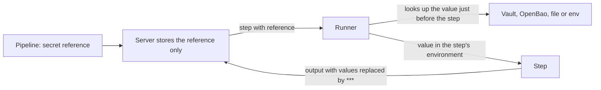

# Secrets

This guide gives pipelines passwords, tokens and keys without the Launchway server ever seeing
them: secret stores on Stations (environment variables, files, Vault or OpenBao), allow-lists,
masking, and what pull-request and draft runs may read. It is for operators who run servers and
Stations.

> **Verified** on 2026-11-19 against commit f717337: OpenBao 2.7.2 in dev mode in a container, with
> a token limited by a policy and with Kubernetes auth against a kind cluster (the Station on the
> host, reading a service account token from a file); a server's built-in Station reading a secret
> and printing it masked; the database dumped and searched for the value; `file` and `env` stores
> and every refusal shown below with `launchway run --secrets-config`; a draft run refused.
> **Not verified:** HashiCorp Vault itself (only OpenBao); Vault namespaces and `ca_file`; Kubernetes
> auth from inside a step pod (the path, `jwt_file` default and role were checked from the host);
> a pull-request run refused (the message is quoted from the code).

## What you need

- A Launchway server and at least one Station. The built-in Station counts. See
  [Install on one server](install-single-server.md) and [Connect a Station](connect-runner.md).
- For the `vault` store: a Vault or OpenBao server with a KV version 2 secrets engine, reachable from
  the Stations (not from the server).

## How it works



A step names the secrets it needs. Each becomes an environment variable of the step:

```yaml
steps:
  publish:
    image: alpine:3.22
    secrets:
      REGISTRY_PASSWORD: { store: bao, key: apps/demo/registry, field: password }
      NPM_TOKEN:         { store: mounted, key: npm-token }
    run: echo "$REGISTRY_PASSWORD" | some-login
```

The pipeline, the server, the database and the UI hold only the reference, written
`bao:apps/demo/registry#password`. The Station that takes the step looks the value up just before
the step runs, inside the network that owns the secret, and replaces it with `***` in the step's
log and outputs. The database never contains the value: after the Sortie (run) below, a dump of the whole
database had the reference twice and the value nowhere.

## Where stores are configured

Each Station has only the stores configured on it. Store names are lower-case letters, digits,
hyphens and underscores.

| Station | Where its stores are |
|---|---|
| The server's built-in Station | `runner.secrets` in the server's configuration |
| `launchway runner` | `secrets:` in its `--config` file, or a separate `--secrets-config FILE` |
| `launchway run` on your machine | `--secrets-config FILE`, plus an `env` store of your own environment |

A server or shared Station has an `env` store only if you define one, because it lets pipelines read
the Station's Airfield (environment). Settings are checked when the Station starts; unknown settings and
settings of another store type are refused.

## The env store

`key` is an environment variable of the Station process. Variables starting with `LAUNCHWAY_` can
never be read, so the Station's token stays out of reach.

```yaml
runner:
  secrets:
    env:
      type: env
      keys: [NPM_TOKEN, "DEPLOY_*"]
```

## The file store

`key` is a file name inside `dir`, such as a mounted Kubernetes Secret. One trailing newline is
removed. Nothing outside the directory can be read, symbolic links included.

```yaml
runner:
  secrets:
    mounted:
      type: file
      dir: /var/run/launchway-secrets
```

A key that leads outside is refused:

```text
secret X (mounted:../bao-token): key "../bao-token" must be a relative file name inside the store's directory
```

## The vault store with a token

This works with HashiCorp Vault and with OpenBao. `key` is a path in a KV version 2 engine and
`field` is required.

First give the Station a token that can only read what pipelines need. With OpenBao (`vault` takes
the same arguments):

```sh
export BAO_ADDR=https://openbao.example.com:8200
bao kv put secret/apps/demo/registry password='a-long-registry-password' user=robot
cat > launchway-read.hcl <<'EOF'
path "secret/data/apps/*" {
  capabilities = ["read"]
}
EOF
bao policy write launchway-read launchway-read.hcl
bao token create -policy=launchway-read -period=24h -field=token
```

Then configure the store, here on a server's built-in Station, with the token in an Airfield
variable:

```yaml
runner:
  secrets:
    bao:
      type: vault
      address: https://openbao.example.com:8200
      token_env: LW_BAO_TOKEN          # or token_file: /run/secrets/bao-token
      # mount: secret                  # the default
      # namespace: team-a              # sent as X-Vault-Namespace
      # ca_file: /etc/launchway/openbao-ca.pem
      projects: [app]
      keys: ["apps/*/*"]
```

```sh
LW_BAO_TOKEN='the token' launchway server --config launchway.yaml
```

Launchway does not renew tokens. A periodic token must be renewed by something else before its
period ends. With `token_file`, the Station reads the file again whenever the store answers `403`,
so a process that renews or replaces the token in that file keeps the Station working.

## The vault store with Kubernetes auth

A Station in a Kubernetes pod can log in with its service account instead of a token. Set up the
auth method once (the API server address and CA are your cluster's):

```sh
bao auth enable kubernetes
bao write auth/kubernetes/config \
  kubernetes_host=https://kubernetes.example.com:6443 \
  kubernetes_ca_cert=@cluster-ca.crt
bao write auth/kubernetes/role/launchway \
  bound_service_account_names=launchway-runner \
  bound_service_account_namespaces=launchway \
  token_policies=launchway-read ttl=1h
```

Without a `token_reviewer_jwt`, OpenBao checks each login with the Station's own token, so the
Station's service account needs the `system:auth-delegator` cluster role:

```sh
kubectl create clusterrolebinding launchway-runner-tokenreview \
  --clusterrole=system:auth-delegator --serviceaccount=launchway:launchway-runner
```

```yaml
# runner.yaml
secrets:
  bao:
    type: vault
    address: https://openbao.example.com:8200
    role: launchway
    # auth_path: kubernetes     # the default
    # jwt_file: /var/run/secrets/kubernetes.io/serviceaccount/token   # the default
    keys: ["apps/*/*"]
```

The Station logs in when it first needs a value, keeps the token it gets, and logs in again when
nine tenths of the token's lifetime have passed or when the store answers `403`.

## Allow-lists

Any pipeline can ask any store for any key, so limit each store. Both lists are checked on the
Station, before the store is asked:

- `projects`: the projects whose runs may read the store;
- `keys`: the keys they may read.

Patterns use `*`, which does not cross a `/`, `?` and `[...]`. An empty list allows everything.
`launchway run` uses the project name `local`.

```text
secret REGISTRY_PASSWORD (bao:apps/demo/registry#password): store "bao" does not allow project "payments-api" (projects: app)
secret X (bao:other/x#password): store "bao" does not allow key "other/x" (keys: apps/*/*)
```

Give the store's own credentials (the token's policy, the Kubernetes role) the same limits, so
the store refuses what the allow-list missed:

```text
secret X (open:other/x#password): permission denied reading secret/other/x
```

## Run a pipeline that reads a secret

With the `bao` store above, this pipeline:

```yaml
# .launchway/pipeline.yaml
pipeline: app
steps:
  hello:
    image: docker.io/library/alpine:3.22
    run: echo "hello from $LAUNCHWAY_COMMIT"
  publish:
    image: docker.io/library/alpine:3.22
    needs: hello
    secrets:
      REGISTRY_PASSWORD: { store: bao, key: apps/demo/registry, field: password }
    run: |
      echo "the password is $REGISTRY_PASSWORD"
      echo "it has ${#REGISTRY_PASSWORD} characters"
```

logs this for `publish`:

```text
Runner build-1 (built in), executor container (podman)
Secret REGISTRY_PASSWORD ← bao:apps/demo/registry#password
Using the run's workspace from an earlier step
Image docker.io/library/alpine:3.22
the password is ***
it has 20 characters
Succeeded in 300ms
```

To try stores on your own machine first, use the same map in a file:

```sh
LW_BAO_TOKEN='the token' launchway run --secrets-config secrets.yaml
```

## Masking

The Station replaces every secret value with `***` in the step's log and in its outputs, which later
steps receive and the server stores.

- A value of several lines is masked line by line.
- A value (or a line of one) shorter than 4 characters is not masked, and the log says so:
  `PIN has a value, or a line of one, shorter than 4 characters; it is not masked in the output`.
- Masking hides the exact text only. A step that prints the value changed (encoded, reversed, one
  character a line) leaks it. Treat a step that may read secrets as able to reveal them.

On Kubernetes, a step's Airfield, secrets included, is in memory in the Sortie's pod while the
step runs, where the Sortie's other containers could read it. Do not put containers you do not trust
in a pipeline that uses secrets.

## Pull requests and drafts

Pull-request runs may come from anyone who can open a pull request, and draft runs run text that is
not in Git. By default their steps may not read secrets: a step that asks for one fails without
running, and says why:

```text
not run: this is a draft run, and draft runs of imgapp may not read secrets (the step asks for REGISTRY_PASSWORD). Save the pipeline and run it from its branch, or ask an administrator to set drafts.secrets: true for the project
```

```text
not run: this run is for a pull request, whose code may come from anyone who can open one, and pull-request runs of <project> may not read secrets (the step asks for <names>). Guard the step with when: { event: [push, manual] }, or ask an administrator to set pull_requests.secrets: true for the project
```

Turn either on per project, only where you trust everyone who can open a pull request or start a
draft:

```yaml
pull_requests: { secrets: false }      # the server's default
drafts: { allow: operator, secrets: false }
projects:
  - name: internal-tools
    repo: https://git.example.com/team/internal-tools.git
    pull_requests: { secrets: true }
```

The `forbid_secrets` [policy rule](../reference/policy-rules.md) can also refuse such runs at the
start. Image steps never push from pull-request and draft runs.

## When a secret cannot be read

| What happened | The step | Example |
|---|---|---|
| The secret does not exist, or may not be read | fails, naming the store and key | `there is no secret at secret/apps/demo/nothing` |
| The store cannot be reached, is sealed or answers 5xx | the Station asks again for 30 seconds, then hands the step back to be run again later | `vault did not answer: ... connection refused. The step will be run again.` |

More messages and what to do about them are in [Troubleshooting](troubleshooting.md#secrets).

## What next

- [Connect a Station](connect-runner.md)
- [Pipeline reference: secrets](../reference/pipeline.md)
- [Station configuration reference](../reference/runner-config.md)
- [Trust model](../security/trust-model.md)
