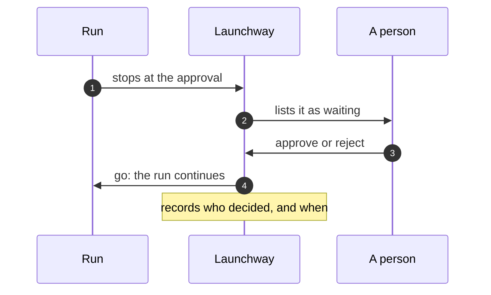

# Approvals

An **approval** is a step that stops a Sortie (run) until a person says go or no-go. Launchway's own word for it
is **clearance**. It is how you keep a person in charge of the moments that matter, such as the
change that reaches production.



## How it works

1. A pipeline has a step of `kind: approval`, with a message such as "Deploy this build to prod?".
2. When the Sortie reaches it, the Sortie pauses. The launch line shows an amber station.
3. The request appears under [Waiting for a decision](app:/activity/approvals), and as "Waiting for you" on Home
   for the people allowed to decide.
4. A person reads what the Sortie will do and says **Go** or **No-go** (Approve or Reject in the plain
   set of words). If nobody decides before the deadline
   the step sets, it is rejected.
5. The decision is recorded in the Logbook (the Logbook) with the person's name. Go, and the Sortie
   goes on; No-go, and it stops.

<!-- try -->
```yaml
pipeline: web
on:
  push: { branches: [main] }
steps:
  build:
    image: alpine:3.22
    run: echo build
  go-or-no-go:
    kind: approval
    needs: build
    message: Deploy this build to prod?
```

## Who may decide

With sign-in on, the person who started a Sortie cannot approve it themselves by default: a second
person looks at it. Which people may approve is set under [Approvals](app:/settings/approvals) and in
the roles of [People and access](app:/settings/access). A viewer can see a request but not decide it.

## Rules, not only people

An approval is one kind of gate. A **policy** is a rule that checks things automatically: for
example "no deployment to prod without passing tests". A policy can stop a step by itself, and an
administrator can waive a rule for a project for a limited time, with a reason. See
[Policies](../../guide/policies.md).

## Next

- [Approvals and re-runs](../../guide/approvals-and-reruns.md)
- [Deploy with approval and Return to base (rollback)](../../tutorials/deploy-with-approval.md)
