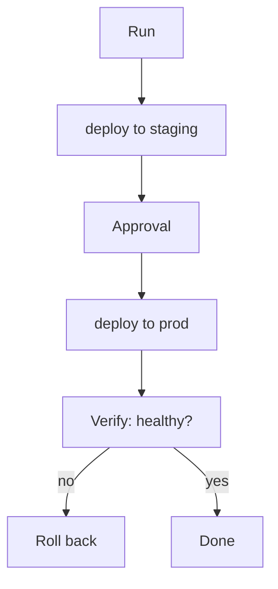

# Environments and deployments

An **environment** is a named place your software runs: `dev`, `staging`, `prod`. A **deployment** is
the record of one change arriving in one environment.



## What an environment holds

An environment says which deploy target serves it (for example a Kubernetes cluster), which projects may
deploy there and who may deploy, and whether it is **protected**. In a protected environment, the person
who started a run cannot be the one who promotes it. Add one with the
[Add an environment](app:/config/wizard/add-environment) wizard, and see them all under
[Environments](app:/deployments/environments).

## One at a time

Each service has one **lock** per environment. Two deployments of the same service to the same
environment never run at once: the second waits, and the run page says so ("Waiting for the staging lock").
This is why a change can sit and wait without anything being wrong.

## What a deploy step does

A deploy step hands the change to a **deploy runner**, which carries it out: it updates the application,
and Launchway then watches the result. If you add a **verify** step, Launchway checks metrics and logs from
a health source and decides whether the new version is healthy. If it is not, a rollback step puts the
last good version back.

A deploy step names the environment it goes to, and the steps that come after it can check the result:

```yaml
steps:
  deploy-prod:
    kind: deploy
    environment: prod      # an environment set up on this server
    needs: [smoke-staging]
  rollback-prod:
    kind: rollback
    deployment: deploy-prod
    needs: [smoke-prod]
```

The full list of keys is in the [pipeline reference](../../reference/pipeline.md#kind-deploy).

## Where to look

- [Deployments](app:/deployments): every environment, and what runs in it.
- A run's **environment station** on the [launch line](launch-line.md).
- Hosts and machine images: coming.

## Next

- [Deployments](../../guide/deployments.md), the full guide
- [Rollback after success](../../guide/rollback-after-success.md)
- [Deploy with approval and rollback](../../tutorials/deploy-with-approval.md), a tutorial
- [Approvals](approvals.md)

## Rolling back after it succeeded

A deployment can pass its checks and still turn out wrong. You can then roll the service back to an earlier
successful version: it is a run of its own that reverts the later changes in Git, takes the environment's
lock like any deployment, and records a new deployment of the restored version. The button is on the
application page, the environment page and the deployment's panel, and appears only where it will work. On a
protected environment it is an emergency action: no approval first, and an approver reviews it afterwards.
A rollback never restores a database. See [Rollback after success](../../guide/rollback-after-success.md).

## When a deployment fails

A failed deployment says why in one sentence, shows the evidence (for a failed check, which metric failed and
what it measured), and says what Launchway did next, such as rolling back. You can re-run from the failed step:
the earlier steps are reused, so nothing is rebuilt, and the deploy is made again as a new attempt of the same
version. A half-done deployment is never resumed.
