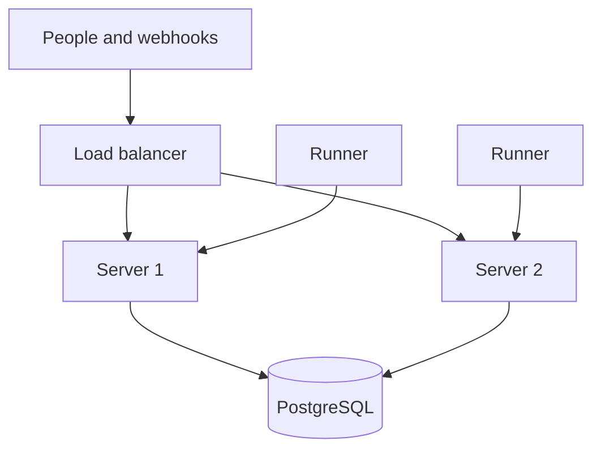

# High availability

**High availability** means a failure of one part does not stop the whole. This page explains how Launchway
behaves when a server, a runner or the database fails, and what you choose when you install it.

## Servers

Launchway servers are all active at once and share one database. Any server can answer any request, so
you can run two or three behind a load balancer, and a server can be restarted or replaced with no
downtime. A server that stops does not lose a run: a run's state is rebuilt from its recorded events,
and another server carries on. See [Running several servers](../../guide/high-availability.md).

## Runners

If a runner dies in the middle of a step, the step's lease runs out and the server hands the step to
another runner. A step that must not be run twice should be written so that running it again is safe. A
retry policy on the step decides how often to try.

## The database

The database is the one place that must be kept safe. With one server and a local database, a
failure of that machine stops everything until it is back, and you restore from a backup. For a higher
guarantee, run PostgreSQL with standby copies and automatic failover, so that no change Launchway
acknowledged is lost. Whether the database is replicated is a decision about your database, not
a setting inside Launchway.

## Choosing a level

| You have | You get | See |
|---|---|---|
| One server, local files | The simplest install. A failure means a pause, then a restore. | [Install on one server](../../howto/install-single-server.md) |
| Several servers, one PostgreSQL | Servers and runners can fail without a stop. | [Install on Kubernetes](../../howto/install-kubernetes.md) |
| Replicated PostgreSQL | A database failure does not lose acknowledged work. | [Backup, restore, upgrade](../../howto/backup-restore-upgrade.md) |

Coming: a check in the product that says plainly whether this installation is highly available, and a
guided way to promote a second site.

## Next

- [Running several servers](../../guide/high-availability.md)
- [Monitor Launchway](../../howto/monitoring.md)
