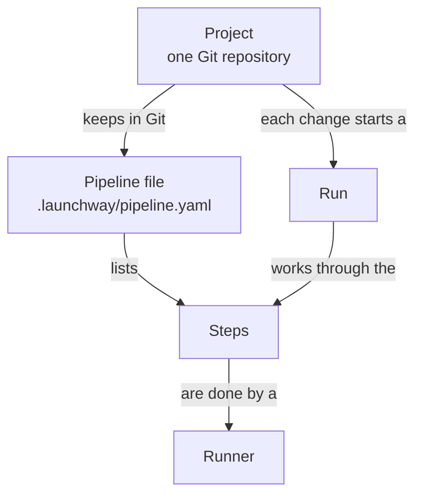

# Flights (codebase), pipelines, steps and runs {#projects-pipelines-steps-and-runs}

Four words carry most of Launchway. Once they are clear, the rest follows.



## Flight {#project}

A **Flight** is one piece of software, kept in one Git repository. Launchway watches the repository
for new commits and pull requests. Open a Flight to see its pipeline, its Sorties (runs), and where it is
running. Add one with the [Connect a repository](app:/config/wizard/connect-repository) wizard.

## Pipeline

A **pipeline** is the list of things to do for a change. It is a file in the repository,
`.launchway/pipeline.yaml`, so it is versioned with the code: a branch runs its own version of it, and
a pull request shows the pipeline change next to the code change. It says **when** to run (a push, a
pull request, a schedule, a webhook, or by hand) and **which steps** to run.

<!-- try -->
```yaml
pipeline: my-service
on:
  push: { branches: [main] }
steps:
  test:
    image: golang:1.27
    run: go test ./...
  build:
    image: golang:1.27
    needs: test
    run: go build ./...
```

## Step

A **step** is one unit of work. Most steps run a shell script in a container image. A step says which
other steps it **needs**: steps whose needs are met run side by side, and the rest wait their turn. Some
steps have a special kind: they build an image, wait for an approval, or deploy. See the
[pipeline reference](../../reference/pipeline.md#steps).

## Run

A **run** is one go through the pipeline, for one commit. Runs are numbered per Flight (#1, #2, and
so on). A Sortie starts when its pipeline says it should, or when a person starts it. A Sortie survives a
server restart, and you can resume it from the step that failed instead of starting over. Watch runs in
[Activity](app:/activity).

## Station (runner) {#runner}

A **Station** is the program that does the work of steps. It asks the server for work, runs each step in
a container (or a Kubernetes pod), streams the log back and reports the result. The server has one
built in, and you can add more on other machines. See [Stations](app:/settings/runners).

## Next

- [Pipelines](../../guide/pipelines.md) and the [pipeline reference](../../reference/pipeline.md)
- [Your first pipeline](../../tutorials/first-pipeline.md), a ten-minute tutorial
