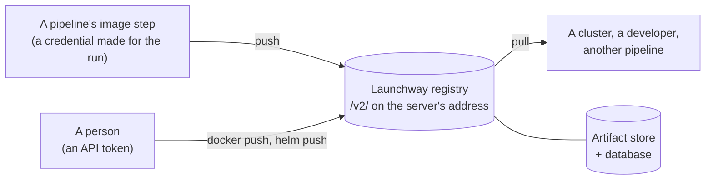
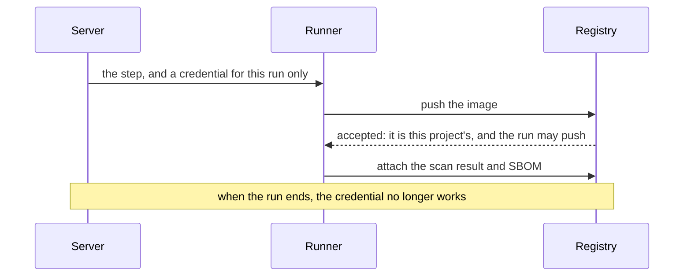

# The built-in registry

A **registry** is where finished images and charts are kept so that other machines can pull them. Launchway has
one built in, so a team that builds an image needs no second product to store it.

## One name, one project

Every repository starts with the project that owns it: `shop/api` belongs to the project `shop`. That one rule is how
the registry shares Launchway's permissions instead of adding new ones: a **viewer** of `shop` pulls, an **operator**
pushes, an **admin** deletes and sets the rules. Someone with no role on `shop` is told nothing about it, not even
that it exists. There is no anonymous pull anywhere.

## A run's own credential

A step does not carry a stored password. When an image step starts, the server gives it an address and a
credential **made for that run**: it can pull the project's images and push to the project's repositories, it never
pushes for a pull request, and it stops working when the run ends.

## What stays and what goes

Layers are stored once per organization and counted once against a project's quota. **Tags matching a pattern can
be made immutable** (`v*`), so a release cannot be quietly replaced. **Retention** rules say which images may be
deleted (keep the newest N, keep tags matching a pattern, delete untagged ones after D days) and you can **preview
exactly what would go** before anything does. An image an environment runs is never deleted. **Garbage collection**
then removes the bytes nothing refers to, never from under a push in progress.

## One honest limit

Launchway does not encrypt the registry's blobs itself yet. Encrypt the disk, database or bucket that holds the
artifact store; the guide says how and `launchway doctor registry` reminds you.

Next: [the registry guide](../../guide/registry.md), and [Variables](variables.md) for how a step gets its settings.
