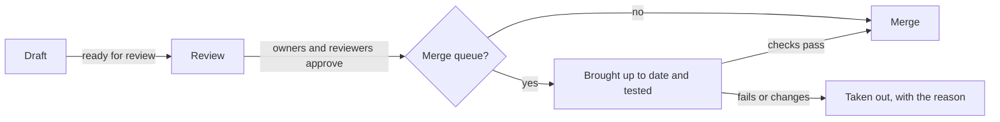

# Review and the merge queue

A **pull request** is a change waiting to join a branch. Launchway holds the whole conversation about it on
one page: the files, the comments on lines, the checks, and the single sentence that says why it cannot merge
yet. A pull-request review **approval** is a person saying the change is good. It is not a **clearance**, which is
the go or no-go on a delivery (see [Approvals](approvals.md)).

## How it works

1. A change starts as a **draft** if it is not ready; checks still run, but it cannot merge.
2. When it is ready, the **owners** of the changed files (from `.launchway/owners` on the target branch) are asked to
   review, if the repository says so. Reviewers comment on lines, **suggest changes** the author applies as a commit,
   and approve or ask for changes.
3. A **branch rule** says what the target needs: how many approvals, an approval from an owner of every changed
   file, the latest push approved by someone other than who pushed it, required checks (some only when matching
   files change), resolved threads. The server checks every one whenever anything tries to merge.
4. If the branch has a **merge queue**, the pull request joins it. One at a time, the front entry is brought up to
   date with the branch, tested there by its own required checks, and merged. A failure takes it out with the
   reason, and the next entry goes on.

## What needs you

The pull requests that wait on you (a review asked of you or your group, changes asked on your own, your own taken
out of the queue) are listed under **Needs you** on Home and by `launchway pr inbox`.

## Next

- [Pull requests and code review](../../guide/pull-requests.md)
- [Webhooks and events](../../guide/webhooks.md)
