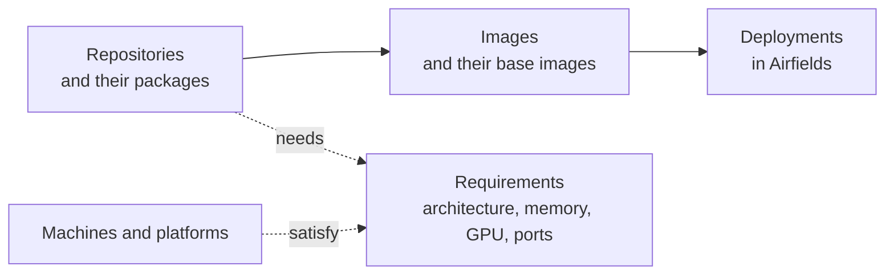

# The graph

The **graph** is one picture of your code, what is built from it, what it needs and where it runs. It answers
questions that would otherwise mean reading a dozen files: what is affected if this changes, in what order to build
these repositories, where this is running, and what can run it.

## How it works

1. Launchway reads what it already holds: the manifests and Containerfiles of your repositories, your pipelines,
   the results of Sorties and what each Launch delivered.
2. Each thing becomes a **node**; each relation becomes an **edge** that says where it was found, how sure Launchway
   is, and when it held. Repositories hosted by Launchway find each other by the names of their packages and images, so
   there is nothing to configure.
3. You ask a question, and the answer holds only what you may read.

## What you can ask

- **What does this affect?** A change to a package, a base image or a machine reaches components, images and the
  deployments that run them, with the way it gets there.
- **What order?** Repositories are built providers first. A cycle is shown with its path; you can add a correction
  (always with a reason) and Launchway shows it as yours.
- **Where is it running, and what is in it?** From a commit or a package to the Airfields and digests, and back from a
  deployment to its images, packages and commits.
- **What does it need, and what can run it?** Declared in `.launchway/requirements.yaml` or inferred, with the
  evidence. Launchway can write a machine specification for components that run together.

Open [the graph](app:/graph), or the **Graph** tab of a repository. The full guide is
[The graph: what depends on what](../../guide/software-graph.md).
