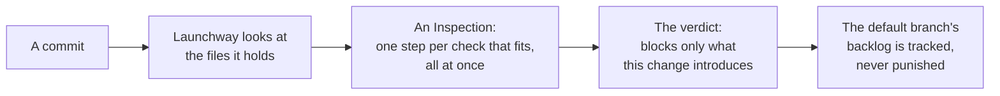

# Standing orders

**Standing orders** are the same scans and best-practice checks for every repository, on by default.
A new repository gets them without anyone asking, and a team can turn each one off or tighten it.

## What a Sortie (run) gains {#what-a-run-gains}

Every Sortie gets an **Inspection**: a step for each check that fits what the repository holds (secrets in the
history, known vulnerabilities in dependencies, insecure code patterns, licenses, Dockerfile and manifest
problems, unsafe pipeline files), followed by a verdict step. The repository changes nothing. The steps run
in the tool's own pinned container, see no secrets, and are drawn in the Sortie's graph as added by Standing
orders, with a link to the page that says why and how to change it.

## Old code does not punish new work

A pull request is compared with the default branch. Only what **it introduces** can block it, and only a
serious finding, with a fix available. What was already there is shown as existing, and tracked as a backlog:
when it was first seen, when it was fixed, how long fixing takes.

## Who decides

The team that owns the repository, within what the levels above allow. Settings come from the Base, a Wing,
a Squadron, the project and a file in the repository, `.launchway/standards.yaml`; the nearest wins and a level
above can **lock** a value, so no one below weakens it. A risk can be accepted with a reason and an end date;
when the date comes the finding counts again.

Read more: [Standing orders](../../guide/standing-orders.md), [the reference](../../reference/standing-orders.md).
