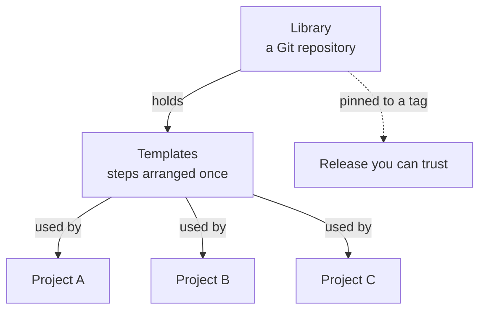

# Templates, libraries and Flight plans

Most Flights (codebase) in a company build, test and release in nearly the same way. Writing those steps again
in every Flight wastes time and drifts apart. Launchway lets you write them once and share them.



## What exists today

A **template** is a named arrangement of steps that takes a few inputs. A **library** is a Git
repository that holds templates and the scripts they run. A pipeline names a library and a version
(a Git tag, a branch or a commit) and uses a template as if it were a single step:

<!-- try -->
```yaml
pipeline: payments-api
on:
  push: { branches: [main] }
libraries:
  platform: { repo: platform, version: v2 }
steps:
  release:
    uses: platform/release
    with: { channel: stable }
```

Because the library is pinned, an update to the library never changes a Flight until the Flight
moves to the new version. Every Sortie (run) records the exact commit of the library it used, so you can always
answer "what did this Sortie use?". Browse the templates your installation knows in the
[Library](app:/library/templates). The page of each template shows its inputs and outputs.

Libraries are registered at a **level**. There are four: the Base (your installation), the Wing
(a Wing), an optional Squadron (a team or a department), and the Flight. An installation can
[rename them](../../guide/words.md). What you register at a level is available to
everything below it. See [Configuration and levels](../../guide/configuration.md#levels).

## Flight plans

A **flight plan** is the name for a ready-made pipeline for one kind of Flight: a service, a library, a
website. It is a template that also says when the pipeline starts. A Flight whose file only says "use the
service Flight plan, with these inputs" gets a complete pipeline without writing one.

Coming: flight plans as a separate kind of shared thing, and a button that copies a Flight plan into your
repository so you can change it. Today, a template can already describe a whole pipeline, and you can use
it with `uses:` as shown above.

## Next

- [Shared libraries](../../guide/libraries.md), the full guide
- [Templates from a library](../../tutorials/library-templates.md), a tutorial
- [Variables](variables.md): how a template's inputs get their values
