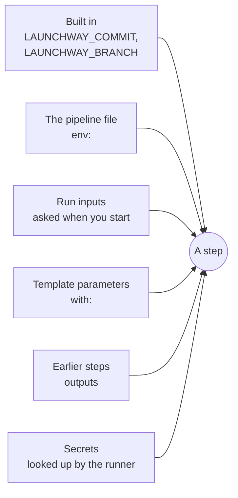
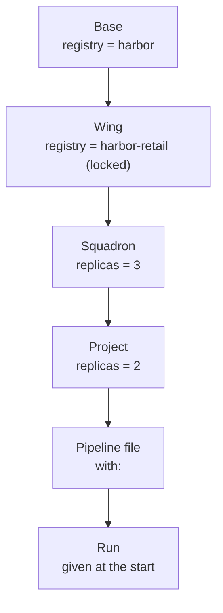

# Variables

A **variable** is a named setting a step can read, such as a registry address, a number of replicas or
a password. Launchway uses the word the way everyone does: a name with a value.

## Where a step's variables come from today

Every variable a step sees is an ordinary environment variable. There are six places they come from:

| Source | What it is | Example |
|---|---|---|
| **Built in** | Launchway sets them for every step: the commit, the branch, the run number. | `LAUNCHWAY_COMMIT` |
| **The pipeline file** | The `env:` key of a pipeline, a container or a step. | `env: { MODE: test }` |
| **Run inputs** | Questions a pipeline asks when a person starts a run: text, a choice, a list. | `inputs:` |
| **Template parameters** | What a pipeline passes to a template with `with:`. | `PARAM_CHANNEL` |
| **Outputs** | Small values an earlier step wrote, for the steps that need it. | `LAUNCHWAY_NEEDS_BUILD_DIGEST` |
| **Secrets** | Values a runner looks up from a secret store. They never reach the server and never appear in logs. | `secrets:` |

Run inputs are shown to everyone who can see the run, so they are never secrets.

## Secrets are different

A **secret** is a variable whose value must stay hidden: a token, a password, a key. A step names the
secret it needs, and the runner fetches the value from a store you configured at the moment the step
runs. The value is not written to the pipeline, the database or the log. See [Secrets](../../guide/secrets.md).

## Variables set at a level

The places above are inside one pipeline. A variable can also be set once at a **level**: the Base,
a Wing, a Squadron or a project. Everything below gets it. A nearer level can set the same name to
override it, and a level above can lock it so nothing below can change it.

The rule is one sentence:

**The nearest setting wins: what is given when a run starts, then the pipeline file's own `with:`, then the project, the squadron (unit), the wing (organization), the base (installation), then the template's own default; at the same level a variable set for the environment being deployed to beats the general one; and a lock set at a level beats everything below it.** Lists replace, never merge. Variables and locks never cross organizations.

If you write code, you already know it:

| In code | In Launchway |
|---|---|
| An **interface** | The inputs a template declares |
| An **abstract class** | A variable at a wider level that supplies a value |
| A **class** that overrides it | The same name set at a nearer level |
| **Override** | Setting the name again, nearer |
| **`final`** | A lock: nothing below may override it |

A pipeline takes a variable by naming it with `from:` on an input or a template parameter; nothing
reaches a step just because its name matches. A step that deploys to `production` sees the variable set for
`production` before the general one. A secret variable is a reference, never the secret.

The page for a project shows each variable with where it comes from, the values it overrides struck
through in order, and who locked it; the same panel sits beside the pipeline editor and in the form that
starts a run, and a finished run shows the variables it used as recorded. See
[Variables at levels](../../guide/variables.md) for the types, the locks and the commands.

## Next

- [Variables at levels: types, locks and commands](../../guide/variables.md)
- [The pipeline reference, value forms](../../reference/pipeline.md#value-forms)
- [Environment variables a step receives](../../reference/environment-variables.md)
