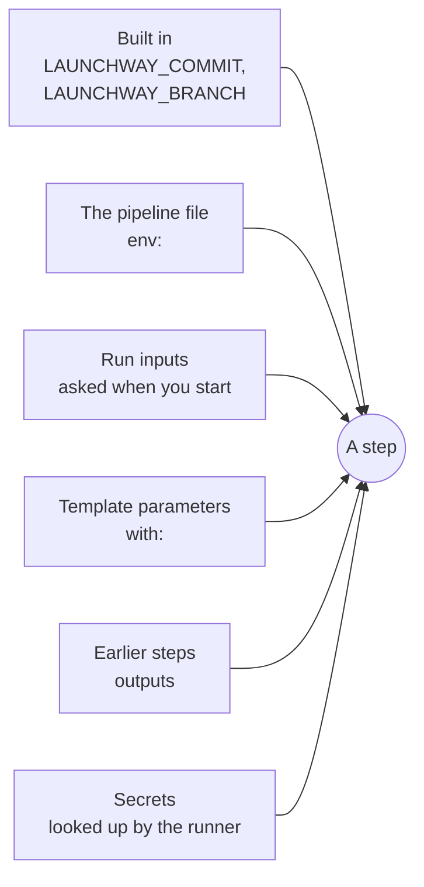

# Variables

A **variable** is a named setting a step can read, such as a registry address, a number of replicas or
a password. Launchway uses the word the way everyone does: a name with a value.

## Where a step's variables come from today

Every variable a step sees is an ordinary environment variable. There are six places they come from:

| Source | What it is | Example |
|---|---|---|
| **Built in** | Launchway sets them for every step: the commit, the branch, the run number. | `LAUNCHWAY_COMMIT` |
| **The pipeline file** | The `env:` key of a pipeline, a container or a step. | `env: { MODE: test }` |
| **Run inputs** | Questions a pipeline asks when a person starts a run: text, a choice, a list. | `inputs:` |
| **Template parameters** | What a pipeline passes to a template with `with:`. | `PARAM_CHANNEL` |
| **Outputs** | Small values an earlier step wrote, for the steps that need it. | `LAUNCHWAY_NEEDS_BUILD_DIGEST` |
| **Secrets** | Values a runner looks up from a secret store. They never reach the server and never appear in logs. | `secrets:` |

Run inputs are shown to everyone who can see the run, so they are never secrets.

## Secrets are different

A **secret** is a variable whose value must stay hidden: a token, a password, a key. A step names the
secret it needs, and the runner fetches the value from a store you configured at the moment the step
runs. The value is not written to the pipeline, the database or the log. See [Secrets](../../guide/secrets.md).

## Coming: variables set at a level

Today the places above are all inside one pipeline. Coming: variables you set once at the installation,
the organization, a unit or a project, which flow down to everything below. The nearest level would win,
and a level above could lock a variable so nothing below can change it. Until then, put shared values in a
library template, or in a secret store.

## Next

- [The pipeline reference, value forms](../../reference/pipeline.md#value-forms)
- [Environment variables a step receives](../../reference/environment-variables.md)
