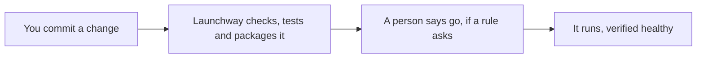

# Start here

This page walks you through Launchway in about ten minutes. You do not need to know anything about
it first. Each step says where to click, and what you should see.

## What Launchway does

You write software and keep it in Git. Launchway takes each change you make and carries it to the
people who use it: it checks the change, tests it, packages it, asks a person to say go when that
matters, and puts it into the place where it runs. The whole journey is drawn as one line, the
**launch line**, so you can always see where a change is and what it is waiting for.



## Seven steps

1. **Open Home.** Home is the first page. At the top it says either "All clear" or how many things
   need you. Under that are the changes on their way. See [the launch line](concepts/launch-line.md).
2. **Add a project.** A project is one piece of software, kept in one Git repository. The
   [Connect a repository](app:/config/wizard/connect-repository) wizard asks a few plain questions
   and checks your answers before it creates anything.
3. **Try a pipeline without saving.** A pipeline is the list of steps that Sortie (run) for a change.
   [Try a pipeline](app:/playground) checks the text as you type and draws the steps. Nothing
   runs and nothing is saved.
4. **Watch a Sortie.** Every change starts a **run**. Open [Activity](app:/activity), choose a Sortie, and
   watch the line fill in from left to right. Choose a step to read its log.
5. **Decide something.** When a rule needs a person, the Sortie stops and waits. It appears under
   [Waiting for a decision](app:/activity/approvals). Read what it will do, then approve or reject.
   See [approvals](concepts/approvals.md).
6. **See where it runs.** [Deployments](app:/deployments) shows each Airfield (environment) and what version
   is there.
7. **Find your way around.** The top bar has ten areas, in the order a change travels. The
   **Wingman** panel on the right says, in plain words, where you are and what you can do next.
   This Learn area is always one click away on the top bar.

<!-- try -->
```yaml
pipeline: hello
on:
  push: { branches: [main] }
steps:
  greet:
    image: alpine:3.22
    run: echo "Hello from Launchway"
```

That is a complete pipeline: it runs when someone pushes to `main`, and it has one step. Use the
button to open it in the playground and change it.

## Where to go next

- New to all of this: read the [concepts](concepts/index.md), one short page each.
- You write pipelines: start with [Pipelines](../guide/pipelines.md) and the
  [pipeline reference](../reference/pipeline.md).
- You deploy and look after running software: read
  [Airfields and deployments](concepts/environments-and-deployments.md).
- You set Launchway up for other people: read [First-run setup](../howto/setup-first-run.md).
