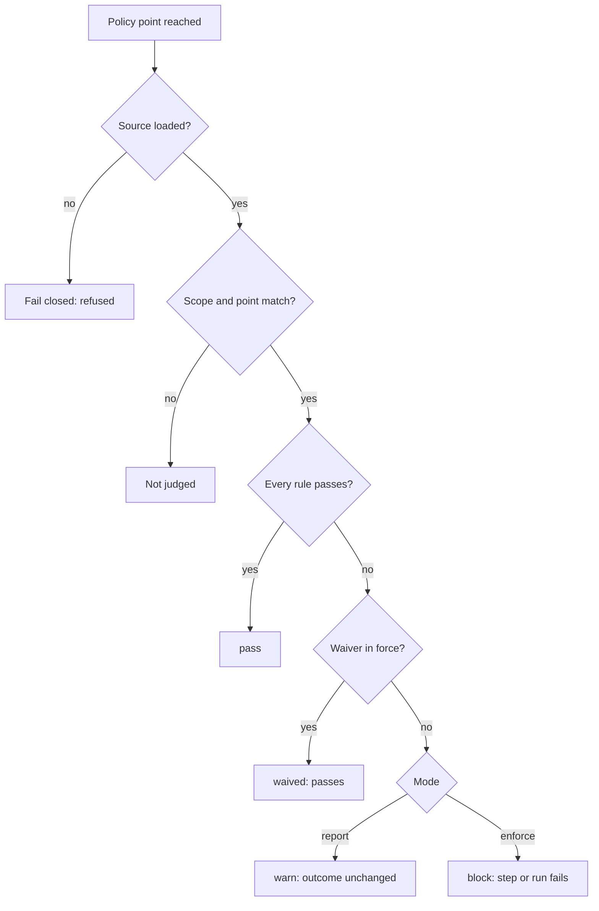

<!--
Drift check (internal/policy/docs_reference_test.go, TestDocsReferencePolicyRules):
- The rule catalogue table sits between the markers "rule-catalogue:start" and
  "rule-catalogue:end". Each row starts with "| `rule_name` |" and its third
  column is when the rule is judged: "run start", "before deploying" or
  "before an image push".
- Every rule in policy.Catalogue must have a row, with the right point, and the
  table must not name a rule the catalogue does not have.
Run it with: go test ./internal/policy/ -run DocsReference
-->

# Policy rules

This page lists every rule a Launchway policy can use, with its options, when it is judged and when it passes. It also covers scope, modes, waivers, policy sources in Git and the cases where policies fail closed. It is for platform and security teams who write policies, and for developers who need to know why a run was blocked.

> **Verified** on 2026-11-19 against commit f717337: every YAML example on this page was parsed with the server's own policy and configuration parsers (`policy.ParseFile` and `config.Load`, in a scratch test); a report-mode policy with `max_timeout`, `step_images` and `forbid_secrets` was judged on a local server (`launchway policy list`, `launchway policy run`); a waiver was granted, refused for a missing environment, an overlong expiry and a finding on another rule, and revoked, through `POST /api/v1/projects/{name}/waivers`. With OpenID Connect sign-in on, an operator's waiver was refused (`403`) and an admin's granted, from the command line. **Not verified:** the deploy and image-push rules against a real deployment or image push, environment-limited waiver checks, and policy sources loaded from Git.

A policy is a name, a scope, a mode and rules taken from a fixed catalog. There is no policy language: each rule is a typed setting with a fixed meaning. Policies live in the server's configuration (`policy.policies`) or in a Git repository the server reads at a pinned tag (`policy.sources`), never in the pipeline file, so a pipeline's authors cannot switch them off. See the [glossary](../glossary.md) for terms such as run, step and environment.

## Where policies are judged

Each rule is judged at one point. The decision is stored in the same database transaction as what it allows, so a decision and the step it lets through are stored together or not at all.

| Point | Value in records | When | What a blocking decision does |
|---|---|---|---|
| Run start | `run` | a run is created, re-run or resumed | each step of the run fails as it would start, saying why; nothing reaches a runner |
| Before deploying | `deploy` | a deploy step is about to take its environment's lock, or a rollout step is about to promote, promote fully or retry | the step fails before anything reaches the cluster or Git |
| Before an image push | `image` | an image step that would push is about to be handed to a runner | the step fails before any runner sees it |

Rollback steps and aborts are never judged. A run that no policy governs runs exactly as it would without policies.

The decision for a step records its action: `deploy`, `promote`, `promote-full` or `retry` before deploying, and `push` before an image push.



## The rule catalog

<!-- rule-catalogue:start -->
| Rule | Value | Judged | Passes when |
|---|---|---|---|
| `library_versions` | mapping | run start | every shared library the run uses, and every override, resolved to a tag or a full commit id; never a branch |
| `required_templates` | list | run start | a step uses each listed template of each listed library, at an allowed version that is a tag or a commit |
| `step_images` | mapping | run start | every image a step or container runs in is pinned by digest and/or comes from an allowed repository |
| `max_timeout` | duration | run start | no step's timeout is longer than this; approval waits are not counted |
| `forbid_secrets` | mapping | run start | a run of one of the listed events that may read secrets has no step that asks for one |
| `tests` | mapping | before deploying | the steps before the deploy step reported at least `min` test results, none failed or errored |
| `findings` | mapping | before deploying | the steps before the deploy step reported findings, none worse than allowed, and every required scanner reported |
| `sbom` | mapping | before deploying | a step before the deploy step made an SBOM of at least `min_components` components |
| `deployed_images` | mapping | before deploying | every image the deployment writes is pinned by digest, built by this run, signed and scanned, as asked |
| `approvals` | mapping | before deploying | at least `min` people other than the person who started the run approved an approval step before the deploy step |
| `allowed_failures` | mapping | before deploying | at most `max` (none by default) of the steps before the deploy step failed and were allowed to (`on_failure: continue`) |
| `refs` | mapping | before deploying | the run is of a branch or tag that matches the patterns |
| `image_push` | mapping | before an image push | an image step that pushes scans with `mode: enforce`, signs, makes an SBOM and provenance, and pushes only to allowed registries, as asked |
<!-- rule-catalogue:end -->

A rule that is written but empty is refused where the table below says it needs at least one option. A rule a server does not know is refused with the file and line, and the message lists the rules there are.

**Evidence** is what the run's events say: the summaries kept with each step attempt (test totals, findings by severity and by tool, the SBOM, what an image step built and signed), approvals and who gave them, and the resolved values of the deploy step's changes. "The steps before the deploy step" means every step the deploy step needs, directly or not. A step that a re-run reused is judged by what it reported in the run where it ran. Evidence that is missing never passes a rule.

### Library versions

`library_versions` checks how the run's shared libraries were pinned.

| Option | Type | Default | Values |
|---|---|---|---|
| `pinned` | text | `tag` | `tag`: a tag or a full commit id; `commit`: only a full commit id |

A pipeline that uses no shared library passes.

```yaml
policies:
  - name: pinned-libraries
    mode: enforce
    rules:
      library_versions: { pinned: tag }
```

### Required templates

`required_templates` is a list of templates the pipeline must use. It needs at least one entry.

| Option | Type | Default | Values |
|---|---|---|---|
| `library` | text, required | none | the server's name for the library, as `libraries:` in the server configuration lists it, not the name the pipeline gives it |
| `template` | text, required | none | the template's name |
| `versions` | list of patterns | any version | patterns the version used must match; the version must then also be a tag or a commit, never a branch |

```yaml
policies:
  - name: shared-scan
    mode: report
    rules:
      required_templates:
        - { library: ci-templates, template: security-scan, versions: ["v3", "v3.*"] }
```

### Step images

`step_images` checks every image a step or a named container runs in. Image, deploy, approval and template-use steps are not counted here; `image_push` covers image steps. Give `digest: true`, or `registries`, or both.

| Option | Type | Default | Values |
|---|---|---|---|
| `digest` | true or false | `false` | `true`: every image must be pinned as `name@sha256:<64 hex digits>` |
| `registries` | list of repository patterns | any | `host/path` patterns: `*` matches within one part, a final `/**` matches any depth below; no `://` |

Short names are completed as Docker does before matching: `alpine` is `docker.io/library/alpine`, and `team/app` is `docker.io/team/app`. A pattern without wildcards must match the repository exactly.

```yaml
policies:
  - name: trusted-images
    mode: enforce
    rules:
      step_images: { digest: true, registries: ["harbor.example.com/**", "docker.io/library/*"] }
```

### Max timeout

`max_timeout` is a duration, such as `2h` or `45m`, greater than zero and at most `720h`. No step's timeout may be longer. Approval steps are not counted.

```yaml
policies:
  - name: short-steps
    mode: report
    rules:
      max_timeout: 2h
```

### Forbid secrets

`forbid_secrets` stops runs of some events from reading secrets. A run of a listed event passes if its project does not let such runs read secrets anyway, or if no step asks for a secret. A signing key that an image step reads from a secret store counts as a secret.

| Option | Type | Default | Values |
|---|---|---|---|
| `events` | list, required | none | `push`, `manual`, `draft`, `pull_request`, `schedule`, `webhook` |

```yaml
policies:
  - name: no-secrets-in-untrusted-runs
    mode: enforce
    rules:
      forbid_secrets: { events: [pull_request, draft] }
```

### Tests

`tests` needs test results from the steps before the deploy step. It fails if no such step reported test results, if any test failed or errored, or if there are fewer than `min`. A step that declares test reports but kept none is named in a note.

| Option | Type | Default | Values |
|---|---|---|---|
| `min` | whole number | `1` | 1 to 10000000 |

```yaml
policies:
  - name: tested
    mode: enforce
    scope: { environments: [prod] }
    rules:
      tests: { min: 1 }
```

### Findings

`findings` judges the security findings the steps before the deploy step reported. No report is not "no findings": if no step reported findings, the rule fails. Give at least one option.

| Option | Type | Default | Values |
|---|---|---|---|
| `max_severity` | text | none | the worst severity allowed overall: `none`, `low`, `medium`, `high` or `critical`; `none` allows no finding at all |
| `per_tool` | mapping of tool name to severity | none | the worst severity allowed from each tool, by the tool's name as its SARIF report gives it (compared without regard to case) |
| `scanners` | list of tool names | none | tools that must have reported |

Severities from least to most severe are `low`, `medium`, `high`, `critical`. A finding of `unknown` severity counts only against `none`. A waiver may name one finding by its fingerprint; the rule then passes when every finding that breaks a threshold is waived (see [Waivers](#waivers)).

```yaml
policies:
  - name: clean-scan
    mode: enforce
    rules:
      findings: { max_severity: medium, per_tool: { gitleaks: none }, scanners: [semgrep, gitleaks] }
```

### SBOM

`sbom` needs a step before the deploy step to have made an SBOM.

| Option | Type | Default | Values |
|---|---|---|---|
| `min_components` | whole number | `1` | 1 to 10000000; the largest SBOM must have at least this many components |

```yaml
policies:
  - name: has-sbom
    mode: report
    rules:
      sbom: {}
```

### Deployed images

`deployed_images` judges every image reference the deployment writes. A deployment that writes no image reference fails the rule. Give at least one option as `true`.

| Option | Type | Default | Passes when |
|---|---|---|---|
| `digest` | true or false | `false` | each reference is pinned by digest, not a tag |
| `built_by_run` | true or false | `false` | an image step before the deploy step in this run built that digest (the image's digest or one of its platforms') |
| `signed` | true or false | `false` | the image step that built it signed it |
| `scanned` | true or false | `false` | the image step scanned it and the scan did not fail it |

`built_by_run`, `signed` and `scanned` need the reference to be a digest: a reference by tag cannot be matched to a built image. Signatures are recorded by the image step, not checked again at deploy time.

```yaml
policies:
  - name: our-images-only
    mode: enforce
    rules:
      deployed_images: { digest: true, built_by_run: true, signed: true, scanned: true }
```

### Approvals

`approvals` counts the distinct people who approved a succeeded approval step before the deploy step, leaving out the person who started the run.

| Option | Type | Default | Values |
|---|---|---|---|
| `min` | whole number | `1` | 1 to 20 |

A run started by a push records the commit's author as its starter, which anyone can set in Git.

```yaml
policies:
  - name: four-eyes
    mode: enforce
    rules:
      approvals: { min: 1 }
```

### Allowed failures

`allowed_failures` counts the steps before the deploy step that failed for good and whose pipeline tolerates that (`on_failure: continue`). Such a run shows as succeeded; this rule lets a protected environment refuse to deploy from one.

| Option | Type | Default | Values |
|---|---|---|---|
| `max` | whole number | `0` | 0 to 100 |

```yaml
policies:
  - name: clean-deploys
    mode: enforce
    rules:
      allowed_failures: { max: 0 }
```

### Refs

`refs` limits deployments to runs of some branches or tags. Give `branches`, `tags` or both. A pull-request or draft run is of neither, so it fails.

| Option | Type | Default | Values |
|---|---|---|---|
| `branches` | list of patterns | none | branch names such as `main` or `release/*` |
| `tags` | list of patterns | none | tag names such as `v*` |

```yaml
policies:
  - name: release-refs
    mode: enforce
    rules:
      refs: { branches: [main], tags: ["v*"] }
```

### Image push

`image_push` judges an image step that would push, before it is handed to a runner. A step that pushes nothing passes. Give at least one option.

| Option | Type | Default | Passes when |
|---|---|---|---|
| `scan` | text: `low`, `medium`, `high` or `critical` | none | the step scans with `mode: enforce` and a `fail_on` at this severity or a less severe one (stricter) |
| `sign` | text: `runner` or `any` | none | `runner`: the step signs with the runner's own key; `any`: it signs, with the runner's key or a key from a secret store |
| `sbom` | true or false | `false` | the step makes an SBOM |
| `provenance` | true or false | `false` | the step records provenance |
| `registries` | list of patterns | any | every registry the step pushes tags to, and its cache registry, matches; registries are named as the runner's `images.registries` names them |

```yaml
policies:
  - name: safe-pushes
    mode: enforce
    rules:
      image_push: { scan: high, sign: runner, sbom: true, provenance: true, registries: [harbor] }
```

## Policy keys

Each policy is a mapping with these keys. Unknown keys are refused.

| Key | Type | Default | Notes |
|---|---|---|---|
| `name` | text, required | none | lower-case letters, digits and hyphens, at most 63 characters; unique across the configuration and every source |
| `description` | text | none | at most 500 characters |
| `mode` | text, required | none | `enforce` or `report` |
| `scope` | mapping | every run | see [Scope](#scope) |
| `rules` | mapping, required | none | at least one rule from the catalog |

There may be at most 200 policies in one list, and at most 100 values in any list of patterns.

## Scope

`scope` narrows the runs a policy applies to. Every list that is given must match; an empty or missing list matches everything.

| Key | Values | Matching |
|---|---|---|
| `projects` | patterns | the run's project |
| `environments` | patterns | the deploy step's environment; only deploy rules may be scoped to environments |
| `branches` | patterns | the run's branch; a run without a branch (a tag or a pull request) does not match |
| `events` | `push`, `manual`, `draft`, `pull_request`, `schedule`, `webhook` | the run's event |

Patterns use `*` (any characters but `/`), `?` (one character) and `[...]`. A policy scoped to environments may not have rules judged at run start or before an image push: write those in a policy of their own.

```yaml
policies:
  - name: prod-evidence
    description: What reaches production shows passing tests and a second pair of eyes.
    mode: enforce
    scope: { projects: [shop, "pay-*"], environments: [prod], events: [push, manual] }
    rules:
      tests: { min: 1 }
      approvals: { min: 1 }
```

## Modes

| Mode | What a failing rule does |
|---|---|
| `enforce` | stops the step, or the run at run start; the decision's verdict is `block` |
| `report` | is judged, recorded and shown the same way, as a warning; it never changes an outcome; the verdict is `warn` |

A decision's verdict is `pass` when nothing failed or every failure was waived. Each policy's result is `pass`, `fail` or `waived`, and so is each rule's. Start new policies in `report` mode, watch their verdicts on the **Policy** page or with `launchway policy list`, then enforce them.

## Policies in the server configuration

Policies written in the server's configuration are checked when the file is read: a mistake stops the server from starting, with the file and line.

```yaml
policy:
  waivers:
    allow: admin
    max_days: 30
  policies:
    - name: prod-evidence
      mode: enforce
      scope: { environments: [prod] }
      rules:
        tests: { min: 1 }
        findings: { max_severity: medium }
        approvals: { min: 1 }
```

| Key | Default | Notes |
|---|---|---|
| `policy.policies` | none | a list of policies |
| `policy.sources` | none | Git sources; see [Policies from Git](#policies-from-git) |
| `policy.waivers.allow` | `admin` | `admin`, `operator` or `none`: the role needed on the project to grant or revoke a waiver; `none` turns waivers off |
| `policy.waivers.max_days` | `30` | the longest a waiver may last, 1 to 365 days |

Every server that shares a database must have the same policies; a server warns in its log if another one started recently with different ones. With the Helm chart, policies are `config.policy` in the values. Policies need database schema 16: configure them only once every server runs a release that knows them (see [migrations](../development/migrations.md)).

## Policies from Git

A source is one of the server's libraries, pinned to a tag or a full commit id, and a directory of policy files in it. Each file is a mapping with one key, `policies:`, holding a list of policies as above.

```yaml
libraries:
  - { name: org-policies, repo: https://git.example.com/platform/policies.git }
policy:
  sources:
    - name: org
      library: org-policies
      version: v3
      path: policies
      projects: ["*"]
      refresh: 1m
      stale_after: 1h
```

| Key | Default | Notes |
|---|---|---|
| `name` | required | lower-case letters, digits and hyphens; unique; not `config` |
| `library` | required | one of `libraries:` in the configuration |
| `version` | required | a tag or a full commit id; a branch is refused |
| `path` | `policies` | the directory; every `*.yaml` and `*.yml` file below it is read, in all subdirectories; may not contain `..` |
| `projects` | every project | patterns of the projects the source may govern |
| `refresh` | `1m` | how often each server looks at the version again, 10s to 168h |
| `stale_after` | `1h` | how long a version loaded earlier is still used while the repository cannot be reached, 10s to 168h |

A source may have at most 100 policy files of at most 256 KiB each. Changing policies is a reviewed commit and a new tag, then a change of `version` in the configuration. Every server loads each source and stores what it loaded in the database, and every server judges from what is stored, so all of them reach the same verdict from the same inputs.

## Failing closed

A source governs the projects it covers whatever is in it. When its policies cannot be known, every run of those projects is refused at every policy point, as an enforced failure of the rule `source` that names the source and the reason. The **Policy** page and `launchway policy list` show the source as failing closed. This happens when:

- no server has loaded the source yet, just after it is added;
- the version does not exist, or is a branch;
- the directory has no policy files, too many, or one that is too large;
- a file does not parse, or uses a rule or key this server does not know (the message names the file and line);
- two files or two sources define the same policy name;
- the version stored is not the one this server is configured with, during a change of `version`, until a server with the new setting loads it;
- the stored policies use something this server does not know, because a newer server loaded them;
- the source has not been confirmed for longer than `stale_after` because the repository cannot be reached.

A short outage of the repository does not refuse anything: the version loaded before stays in use until `stale_after`. A source that fails closed cannot be waived.

If a rule's facts were not recorded at all, which would be a fault in Launchway, the rule fails rather than passes.

## Waivers

A waiver lets one failing rule of one policy pass for one project until it expires. It may be narrowed further.

| Field | Required | Notes |
|---|---|---|
| `policy` | yes | a policy in force that applies to the project |
| `rule` | yes | a rule the policy has; never `source` |
| `reason` | yes | at most 500 characters; shown wherever the verdict is |
| `expires_in_hours` or `expires_at` | yes | hours from now, or Unix milliseconds; in the future and at most `policy.waivers.max_days` away |
| `run` | no | only this run of the project |
| `environment` | no | only this environment; deploy rules only; must be a configured environment |
| `finding` | no | only this finding, by its fingerprint; the `findings` rule only |

Grant one with `POST /api/v1/projects/{name}/waivers` and the fields above as JSON, and revoke one with `POST /api/v1/projects/{name}/waivers/{waiver}/revoke` and an optional `{"reason": "..."}`. The answer is the waiver with its `id`, `granted_by`, `granted_at`, `expires_at` and `state` (`active`, `expired` or `revoked`):

```json
{"id":"wvr_06gzdc7h6jffagj069w0","project":"demo-app","policy":"demo-shape","rule":"step_images","reason":"docs check","granted_by":"dana","granted_at":1795140153652,"expires_at":1795143753652,"state":"active"}
```

On the command line (see the [CLI reference](cli.md)):

```sh
launchway waivers grant demo-app --policy demo-shape --rule step_images --reason "base image pinned next sprint" --expires 72h
launchway waivers list --project demo-app --active
launchway waivers revoke demo-app wvr_06gzdc7h6jffagj069w0 --reason "fixed"
```

`--expires` is rounded up to whole hours. `waivers grant` also takes `--run`, `--environment` and `--finding`.

> [!NOTE]
> Against a server without sign-in (`auth.mode: none`), `waivers grant` and `waivers revoke` are refused with "the X-Launchway-CSRF header is missing": such a server ignores the API token, so it asks for the header that requests from its own pages carry, and the command line does not send it. Use the web UI, or call the API with the header `X-Launchway-CSRF: 1`, on such a server.

How waivers behave:

- Waivers are a log of grants and revocations. Each is written to the audit trail as `policy.waive` or `policy.revoke_waiver`, allowed or refused.
- A waiver counts only while it is in force: a decision made after it expires does not count it, even in a run that started before. A decision notes waivers that would have applied but had expired.
- A rule is judged again when the run is resumed or re-run, so the usual path is to grant a waiver, then resume the run.
- Who may waive is `policy.waivers.allow` on the project. A deploy rule needs that role on the environment too; a waiver that names no environment needs it from an access binding not limited to environments. A limited API token never grants more than its limits. See [roles](roles.md).
- On an environment with `protected: true`, the person who started a run may not waive its deploy rules, unless `approvals.allow_self` lets people approve their own runs: a waiver of theirs for that run is refused, and a project-wide waiver they granted is not applied to their runs there.

## What is recorded

Each decision is a `policy.evaluated` event in the run's event log (see [run events](events.md#run-events)). It holds the point, the step and action, the environment, the time, the verdict, every policy as judged with its source and version, each rule's verdict with what was found, what would satisfy it, the evidence and any waiver used, the facts judged and the waivers considered. A decision can therefore be reproduced from the log alone.

At run start a decision is recorded for every run of a governed project. Before deploying and before an image push, a decision is recorded only when some policy applies.

Read them with `GET /api/v1/runs/{id}/policy`, on the run's **Policy** tab, or on the command line:

```sh
launchway policy run run_06gzdc4xkndxsbjw21eg
```

```text
2026-11-19 20:02:12  run start: WARN
  demo-shape (report, config ): fail
    step_images        fail   container tools: docker.io/library/alpine:3.22 (not pinned by digest); ...
                              needs every step and container image pinned by digest (name@sha256:…)
    max_timeout        pass   every timeout is within 2h
    forbid_secrets     pass   this is a manual run
```

`GET /api/v1/policies` and `launchway policy list` show the catalog, the sources with their versions and errors, the policies in force and recent verdicts of the runs you may see. See the [HTTP API reference](http-api.md) for the request and response details.

## What policies do not protect against

Policies judge what Launchway does. A person with access to the cluster, the GitOps repository or the registry can still change what runs without Launchway, and Argo CD can sync a commit Launchway did not make. Facts come from what steps report: a step that writes a test report claiming tests passed, or a scanner configured to find nothing, satisfies the rules as far as the report goes. Keep scanning steps in shared templates that `required_templates` asks for. Running steps unrestricted is the runner's setting, never the pipeline's, so it is not a rule.
