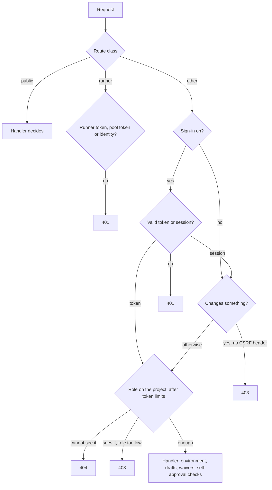

<!--
Machine-checked (internal/api/docs_reference_test.go, TestDocsReferenceRoles): this page has a
table row "| `class` |" for every access class of the route table, and names every role.
The call matrix below is generated from the route rows of http-api.md; keep them in step.
-->

# Roles and permissions

This page says who may do what in Launchway: the three roles, how the server works out a person's role for each request, and the settings that narrow it further. It is for operators who write the `auth.access` section of the server configuration, and for security reviewers.

> **Verified** on 2026-11-19 against commit f717337: a local server with OpenID Connect sign-in (a test provider) and bindings for an admin group, an operator group limited to one project and a viewer group; each refusal below (`404` for another team's project, `403` for a viewer starting a run, an operator waiving or reading the Logbook, a viewer-limited token starting a run, a cookie request without the CSRF header, a token making a token) was produced with `curl` and the command line. **Not verified:** environment-limited bindings and protected environments (they need deployments, which need Argo CD), and self-approval with sign-in on (described from the code and its tests).

## Roles

| Role | May |
|---|---|
| `viewer` | See a project and everything about its runs: logs, events, pipeline files, test results, findings, artifacts, images, policy decisions, approvals waiting. See the runners and their pools, the policies in force, verifications, and the health sources and AI models their projects may use. Check pipeline text. |
| `operator` | Everything a viewer may, and start, cancel, resume and re-run runs, approve and reject approvals, give deployment commands, mark a running verification passed or failed, ask a model to explain a failed step, delete artifacts, save pipelines from the editor, and start draft runs (if `drafts.allow` is `operator`, the default). |
| `admin` | Everything an operator may, and save a pipeline that has problems, start draft runs if `drafts.allow` is `admin`, and waive policy rules if `policy.waivers.allow` is `admin` (the default). An admin of every project also reads the Logbook, sees and revokes everyone's API tokens, and (by default, see `runner_admin`) makes join tokens and revokes and rotates runners. |

Each role includes the ones above it. Someone who signs in but has no role anywhere can sign in, sees no projects, and may still manage their own API tokens.

### Sign-in off

With `auth.mode: none`, every request acts as the configured `user`, with the `admin` role on every project. Two settings still apply: `drafts.allow: none` turns draft runs off, and `policy.waivers.allow: none` turns waivers off. The [CSRF header](http-api.md#csrf-header) is required all the same. A server without sign-in refuses to start unless it listens only on a loopback address, or `auth.allow_anonymous: true` says something in front of it decides who may reach it.

## Bindings

The `auth.access` list in the server configuration grants roles. Each entry has:

| Key | Meaning |
|---|---|
| `group` | A group from the provider's `groups_claim`. Give exactly one of `group` and `user`. |
| `user` | A user name from the provider's `username_claim`. |
| `role` | `viewer`, `operator` or `admin`. Required. |
| `projects` | Patterns of the projects the role is granted on. None means every project. |
| `environments` | Patterns of the environments the role covers for deployments. None means every environment. See [Environment-limited bindings](#environment-limited-bindings). |

```yaml
auth:
  access:
    - { group: platform-admins, role: admin }
    - { group: payments,        role: operator, projects: ["payments-*"] }
    - { group: everyone,        role: viewer }
    - { user: dana,             role: operator, projects: [web] }
```

Patterns use `*` (any characters except `/`), `?` (one character) and `[...]`. Where several entries match a person and a project, the highest role wins. A mistake in a binding (both or neither of `group` and `user`, a missing role, a pattern that does not parse) stops the server from starting.

Rights are worked out on every request, from the configuration and the groups the provider gave at the person's latest sign-in. The server checks them whatever the UI shows.

Some calls need a role "on every project": reading the Logbook and administering everyone's API tokens. Only an entry **without** `projects` counts for those, so `{ group: payments, role: admin, projects: ["payments-*"] }` makes someone admin of those projects but never lets them read the Logbook.

**Managing runners.** Making join tokens, listing them, and revoking or rotating runners need the role `runner_admin` names (`admin` by default; `operator` or `none`) on every project, as for the Logbook: only an entry without `projects` counts. With `none`, managing runners over the API is off. A token limited to projects, or to a lower role, cannot do it.

**The MCP endpoint.** `POST /mcp` gives an agent exactly what its API token allows: each tool calls the API above with the token, through the same checks. Browser session cookies are not accepted there. See [Agents (MCP)](../guide/agents.md).

## How a request is decided



In words:

1. **Public** routes (health, sign-in, webhooks) and **runner** routes have their own checks. See [the HTTP API](http-api.md#authentication).
2. With sign-in on, the request must carry a valid API token or session (`401` otherwise). An address that fails 20 times in a minute is refused with `429`.
3. A request that changes something and is not authenticated by an API token must carry the CSRF header (`403` otherwise).
4. The route's access class is checked against the person's role on the project in the path (or the run's project). A project or run the person cannot see answers `404`, as if it did not exist; one they can see but not change answers `403`.
5. The handler checks what depends on the request: the environment of a deployment, `drafts.allow`, `policy.waivers.allow`, force-saving, and whether the person started the run.
6. Calls that change something are recorded in the Logbook, allowed or refused. See [Events and audit trail](events.md#audit-trail).

## Access classes

Every route belongs to one class. [The HTTP API reference](http-api.md) gives each route's class.

| Class | Who passes |
|---|---|
| `public` | Anyone; the handler decides. |
| `runner` | A runner with the shared runner token, a runner pool's token or an enrolled runner's access token. |
| `signed-in` | Anyone signed in, with any role or none. Lists and the live stream contain only what the person may see. |
| `any-viewer` | Someone with at least `viewer` on at least one project. |
| `project-viewer` | `viewer` or more on the project in the path. |
| `project-operator` | `operator` or more on the project in the path. |
| `project-draft` | The role `drafts.allow` names on the project in the path. |
| `run-viewer` | `viewer` or more on the run's project. |
| `run-operator` | `operator` or more on the run's project. |
| `repo-viewer` | `viewer` or more on the repository, named `<owner>/<name>` to the bindings. Git hosting must be on (`404 feature_off` otherwise). A repository the caller may not read is reported as not existing. |
| `repo-operator` | `operator` or more on the repository: may push. |
| `repo-admin` | `admin` on the repository: may rename, archive, change who reads it and delete it. |
| `admin` | `admin` on every project. |

## Who may make which call

Generated from the route table. "yes" means a person with that role on the project (or, for `admin`-class calls, on every project) passes the class check; the last column is what the handler checks on top.

| Call | Class | `viewer` | `operator` | `admin` | Also needs |
|---|---|---|---|---|---|
| `GET /api/v1/me` | signed-in | yes | yes | yes |  |
| `GET /api/v1/projects` | signed-in | yes | yes | yes |  |
| `GET /api/v1/projects/{name}` | project-viewer | yes | yes | yes |  |
| `GET /api/v1/projects/{name}/refs` | project-viewer | yes | yes | yes |  |
| `GET /api/v1/projects/{name}/inputs` | project-viewer | yes | yes | yes |  |
| `GET /api/v1/projects/{name}/schedules` | project-viewer | yes | yes | yes |  |
| `POST /api/v1/projects/{name}/runs` | project-operator | no | yes | yes |  |
| `GET /api/v1/runs` | signed-in | yes | yes | yes |  |
| `GET /api/v1/runs/{id}` | run-viewer | yes | yes | yes |  |
| `GET /api/v1/runs/{id}/events` | run-viewer | yes | yes | yes |  |
| `GET /api/v1/runs/{id}/pipeline-file` | run-viewer | yes | yes | yes |  |
| `GET /api/v1/runs/{id}/steps/{step}/logs` | run-viewer | yes | yes | yes |  |
| `POST /api/v1/runs/{id}/cancel` | run-operator | no | yes | yes |  |
| `POST /api/v1/runs/{id}/resume` | run-operator | no | yes | yes | a draft run needs the `drafts.allow` role |
| `GET /api/v1/runs/{id}/rerun` | run-viewer | yes | yes | yes |  |
| `POST /api/v1/runs/{id}/rerun` | run-operator | no | yes | yes | a draft run needs the `drafts.allow` role |
| `GET /api/v1/approvals` | signed-in | yes | yes | yes |  |
| `POST /api/v1/runs/{id}/steps/{step}/approve` | run-operator | no | yes | yes | the operator role on the environment, if the approval names a deployment; not the run's starter unless `approvals.allow_self` |
| `POST /api/v1/runs/{id}/steps/{step}/reject` | run-operator | no | yes | yes | the operator role on the environment, if the approval names a deployment |
| `GET /api/v1/projects/{name}/pipeline` | project-viewer | yes | yes | yes |  |
| `POST /api/v1/projects/{name}/pipeline` | project-operator | no | yes | yes | `force: true` needs admin on the project; the project needs `push:` |
| `POST /api/v1/projects/{name}/draft-runs` | project-draft | no | yes | yes | the role `drafts.allow` names (operator by default) |
| `POST /api/v1/validate` | any-viewer | yes | yes | yes | the role on any project; `?project=` must be visible |
| `GET /api/v1/runs/{id}/tests` | run-viewer | yes | yes | yes |  |
| `GET /api/v1/runs/{id}/tests/cases` | run-viewer | yes | yes | yes |  |
| `GET /api/v1/runs/{id}/tests/cases/{case}` | run-viewer | yes | yes | yes |  |
| `GET /api/v1/projects/{name}/tests` | project-viewer | yes | yes | yes |  |
| `GET /api/v1/projects/{name}/tests/history` | project-viewer | yes | yes | yes |  |
| `GET /api/v1/runs/{id}/tests/compare` | run-viewer | yes | yes | yes |  |
| `GET /api/v1/runs/{id}/tests/cases/{case}/attachments/{n}` | run-viewer | yes | yes | yes |  |
| `GET /api/v1/runs/{id}/coverage` | run-viewer | yes | yes | yes |  |
| `GET /api/v1/runs/{id}/coverage/files` | run-viewer | yes | yes | yes |  |
| `GET /api/v1/projects/{name}/coverage` | project-viewer | yes | yes | yes |  |
| `GET /api/v1/runs/{id}/reports` | run-viewer | yes | yes | yes |  |
| `GET /api/v1/runs/{id}/artifacts` | run-viewer | yes | yes | yes |  |
| `GET /api/v1/artifact-store` | any-viewer | yes | yes | yes | the role on any project |
| `GET /api/v1/runs/{id}/artifacts/{artifact}/file` | run-viewer | yes | yes | yes |  |
| `GET /api/v1/runs/{id}/artifacts/{artifact}/archive` | run-viewer | yes | yes | yes |  |
| `DELETE /api/v1/runs/{id}/artifacts/{artifact}` | run-operator | no | yes | yes |  |
| `GET /api/v1/runs/{id}/findings` | run-viewer | yes | yes | yes |  |
| `GET /api/v1/projects/{name}/security` | project-viewer | yes | yes | yes |  |
| `GET /api/v1/components` | signed-in | yes | yes | yes |  |
| `GET /api/v1/runs/{id}/images` | run-viewer | yes | yes | yes |  |
| `GET /api/v1/images` | signed-in | yes | yes | yes |  |
| `GET /api/v1/environments` | signed-in | yes | yes | yes |  |
| `GET /api/v1/deployments` | signed-in | yes | yes | yes |  |
| `GET /api/v1/launch-lines` | signed-in | yes | yes | yes |  |
| `GET /api/v1/settings/approvals` | signed-in | yes | yes | yes |  |
| `GET /api/v1/runs/{id}/deployments/{dep}/controls` | run-viewer | yes | yes | yes |  |
| `POST /api/v1/runs/{id}/deployments/{dep}/promote` | run-operator | no | yes | yes | the operator role on the environment; on a protected environment, not the run's starter |
| `POST /api/v1/runs/{id}/deployments/{dep}/promote-full` | run-operator | no | yes | yes | the operator role on the environment; on a protected environment, not the run's starter |
| `POST /api/v1/runs/{id}/deployments/{dep}/abort` | run-operator | no | yes | yes | the operator role on the environment |
| `POST /api/v1/runs/{id}/deployments/{dep}/retry` | run-operator | no | yes | yes | the operator role on the environment; on a protected environment, not the run's starter |
| `POST /api/v1/runs/{id}/deployments/{dep}/commands/{cmd}/withdraw` | run-operator | no | yes | yes | the operator role on the environment |
| `GET /api/v1/libraries` | any-viewer | yes | yes | yes | the role on any project |
| `GET /api/v1/libraries/{library}/templates` | any-viewer | yes | yes | yes | the role on any project |
| `GET /api/v1/runs/{id}/verifications` | run-viewer | yes | yes | yes |  |
| `GET /api/v1/verifications` | signed-in | yes | yes | yes |  |
| `GET /api/v1/runs/{id}/steps/{step}/verify/controls` | run-viewer | yes | yes | yes |  |
| `POST /api/v1/runs/{id}/steps/{step}/verify/override` | run-operator | no | yes | yes | on a protected environment, not the run's starter marking it passed |
| `GET /api/v1/health-sources` | signed-in | yes | yes | yes | only the sources of projects the person may see |
| `GET /api/v1/ai/models` | signed-in | yes | yes | yes | only the models of projects the person may see |
| `GET /api/v1/runs/{id}/steps/{step}/explanations` | run-viewer | yes | yes | yes |  |
| `POST /api/v1/runs/{id}/steps/{step}/explain` | run-operator | no | yes | yes |  |
| `GET /api/v1/policies` | any-viewer | yes | yes | yes | the role on any project |
| `GET /api/v1/runs/{id}/policy` | run-viewer | yes | yes | yes |  |
| `GET /api/v1/waivers` | signed-in | yes | yes | yes |  |
| `POST /api/v1/projects/{name}/waivers` | project-viewer | yes | yes | yes | the role `policy.waivers.allow` names (admin by default); for a deploy rule, that role on the environment |
| `POST /api/v1/projects/{name}/waivers/{waiver}/revoke` | project-viewer | yes | yes | yes | as granting |
| `GET /api/v1/tokens` | signed-in | yes | yes | yes |  |
| `POST /api/v1/tokens` | signed-in | yes | yes | yes | a browser session, not a token |
| `DELETE /api/v1/tokens/{id}` | signed-in | yes | yes | yes |  |
| `GET /api/v1/tokens/limits` | signed-in | yes | yes | yes |  |
| `GET /api/v1/admin/tokens` | admin | no | no | yes | admin from an entry without `projects` |
| `DELETE /api/v1/admin/tokens/{id}` | admin | no | no | yes | admin from an entry without `projects` |
| `GET /api/v1/runners` | any-viewer | yes | yes | yes | the role on any project |
| `GET /api/v1/runner-pools` | any-viewer | yes | yes | yes | the role on any project |
| `GET /api/v1/runner-join-tokens` | signed-in | yes | yes | yes | the role `runner_admin` names (admin by default), on every project |
| `POST /api/v1/runner-join-tokens` | signed-in | yes | yes | yes | as listing |
| `POST /api/v1/runner-join-tokens/{id}/revoke` | signed-in | yes | yes | yes | as listing |
| `POST /api/v1/runners/{id}/revoke` | signed-in | yes | yes | yes | as listing |
| `POST /api/v1/runners/{id}/rotate` | signed-in | yes | yes | yes | as listing |
| `GET /api/v1/audit` | admin | no | no | yes | admin from an entry without `projects` |
| `GET /api/v1/stream` | signed-in | yes | yes | yes |  |

## Environment-limited bindings

An entry with `environments` grants its role on deployments to those environments only: the deployment commands (promote, promote fully, abort, retry, withdraw) and approvals that name a deployment. On its projects otherwise it grants as usual.

```yaml
auth:
  access:
    - { group: developers, role: operator, projects: [shop], environments: [staging] }
    - { group: sre,        role: operator, environments: [prod] }
```

Here a developer may start, cancel and approve runs of `shop`, and promote its deployments to `staging`, but a command on a `prod` deployment answers `403` with `you need the operator role on shop in environment prod to do this`. An entry without `environments` covers every environment.

Waiving a deploy rule (a rule judged before deploying) also needs the waiver role on the environment. A waiver that names no environment needs that role from an entry not limited to environments.

## API token limits

An API token acts as the person who made it, with their rights as of their latest sign-in, at the moment of each call. It may be limited further when it is made:

- **role**: `viewer`, `operator` or `admin`, no higher than the highest role its maker has anywhere. On each project the token acts with the lower of its role and its maker's.
- **projects**: up to 20 names or patterns such as `pay-*`. Elsewhere the token sees nothing, as if those projects did not exist.

A token limited to projects is never an admin of every project, so it cannot read the Logbook or other people's tokens. A token can only be made from a signed-in browser session, never with another token. A token that is refused (unknown, revoked, expired, or not allowed by its limits) is recorded in the Logbook as `token.use`. Every token expires: by default after 90 days, at most after `auth.tokens.max_days` (default 365, up to 3650).

A limited token works only on servers that know limits. An older server, during a rollback, refuses it rather than grant its owner's full rights.

## Draft runs

A draft run runs pipeline text from the editor that is not in Git. Who may start one is a setting of its own:

```yaml
drafts:
  allow: operator      # admin, operator (the default) or none
  secrets: false       # whether draft runs' steps may read secrets; default false
projects:
  - name: shop
    repo: https://git.example.com/shop.git
    drafts: { allow: admin }   # this project only; unset keys take the server's setting
```

`drafts.allow` is the role needed on the project. `none` turns draft runs off for everyone, with or without sign-in. Resuming or re-running a draft run needs the same role, and whether its steps may read secrets is decided again by the current setting. With `secrets: false`, a draft run's step that asks for a secret fails before any runner sees it.

## Policy waivers

```yaml
policy:
  waivers:
    allow: admin      # admin (the default), operator or none
    max_days: 30
```

`policy.waivers.allow` is the role needed on the project to grant or revoke a waiver; `none` turns waivers off. A deploy rule also needs the role on the environment, as above. On a protected environment, the person who started a run may not waive its deploy gate. See [Policy rules](policy-rules.md).

## Self-approval

```yaml
approvals:
  allow_self: false
```

`approvals.allow_self` says whether the person who started a run may approve its approval steps. The default is `false` with sign-in on, and `true` with sign-in off, where everyone is the same user. The starter may still reject. A refused self-approval answers `403` (`dana started this run, so someone else must approve it (you may still reject it)`) and is recorded in the Logbook as `denied`.

## Protected environments

```yaml
environments:
  - name: prod
    target: prod-cluster
    projects: [shop]
    protected: true
```

On an environment with `protected: true`, the person who started a run may not promote, promote fully or retry its deployment there, unless `approvals.allow_self` is `true`. Anyone with the operator role on the environment may abort it. Their waiver of the run's deploy gate there is refused, and a project-wide waiver they granted is not applied to their runs there.

## What next

- [Set up sign-in and roles](../howto/oidc-and-roles.md)
- [HTTP API](http-api.md)
- [Events and audit trail](events.md)
