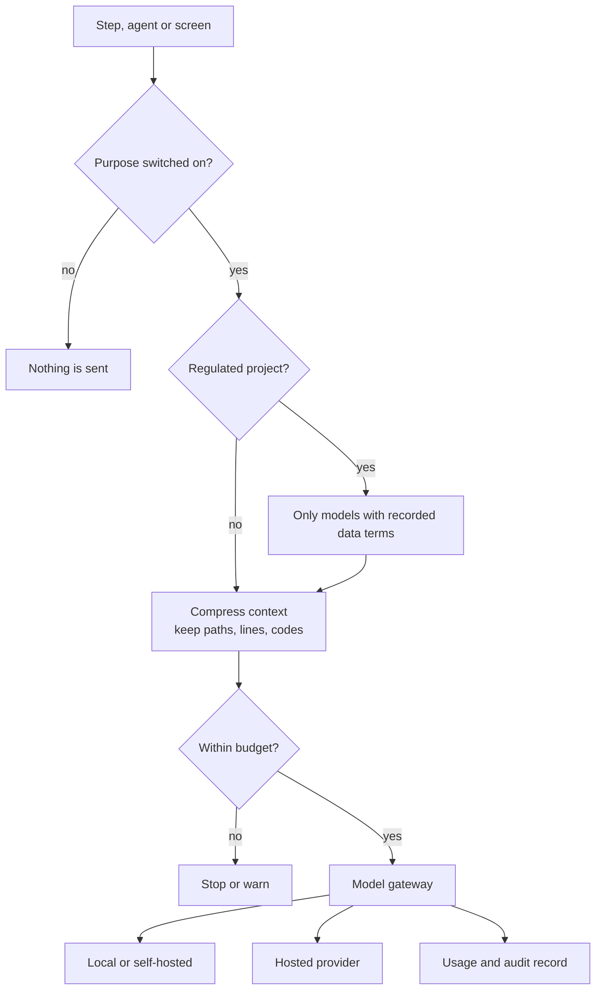

# AI as an optional helper

<a href="../roadmap.html">Roadmap</a> › Areas › AI · <a href="../roadmap-list.html">as a list</a>

AI wherever it saves effort, always optional, and never able to hide a failure. **Status:** models in steps and agents as users are available today ([AI models](../guide/ai.md), [agents](../guide/agents.md)); the gateway and the rest are planned in [Milestone 6](milestone-6.md).

## The path of every AI call

## Rules that do not bend

- Off until an administrator turns a purpose on.
- A model's verdict never overrides a failing check. AI analysis can trigger a rollback only where a verification step allows it, and production can require a person.
- Everything AI produced is labelled, and AI never approves or merges on its own.
- Local models are first-class, for data that cannot leave the building.
- Spending limits are in money, per model, project and purpose.

Go back to the [Roadmap](../public/roadmap.html).
