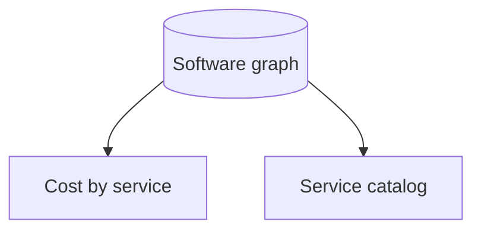

# Beyond delivery

<!-- Generated by scripts/docs/build-roadmap.mjs from docs/roadmap/roadmap.json. Do not edit by hand. -->

<a href="../roadmap.html">Roadmap</a> › Beyond · <a href="../roadmap-list.html">as a list</a>

Later 0 available · 0 in progress · 8 planned · 8 capabilities

Ideas that grow naturally from one connected platform. Planned, but behind everything above.

## What it is, and who it is for

These are ideas that grow from one connected platform. They are planned, but they come after everything above.

**Who it is for.** Teams that, once delivery is in one place, want to operate what they ship from the same place.

## What you will be able to do

- You see what each service costs next to what it delivers.
- A new engineer finds a service, its owner, its docs and its last deployment in one directory.

## How it fits together

*Each idea reuses data the earlier milestones already hold.*

**Builds on:** [Milestone 5: Software graph](milestone-5.md). 

## The capabilities

| Group | Capabilities | Available | In progress | Planned |
|---|---|---|---|---|
| [Operate what you ship](#g-operate-what-you-ship) | 8 | 0 | 0 | 8 |

### Operate what you ship {#g-operate-what-you-ship}

Ideas that grow naturally from one connected platform.

#### Cloud cost management {#cloud-cost-management}

○ Planned

See what each service, team and Airfield costs to run, next to what it delivers. Includes the cost of Flight lines.

**Depends on:** The software graph.

#### A developer portal and service catalog {#a-developer-portal-and-service-catalog}

○ Planned

A directory of every service with its owner, health, docs and deployments. Built on the same data as everything else.

**Depends on:** What is deployed where.

#### Smaller integrations {#smaller-integrations}

○ Planned

Chat approvals, feature-flag mitigation and more event sources. Added by demand.

#### Discussions and snippets {#discussions-and-snippets}

○ Planned

A forum for projects and shareable snippets. Optional and off by default.

**Depends on:** Built-in Git hosting.

#### Cloud development environments {#cloud-development-environments}

○ Planned

Ready-made Airfields to work on a project from a browser. Reuses preview Airfields.

**Depends on:** Preview Airfields.

#### Runtime and API protection {#runtime-and-api-protection}

○ Planned

Protect running services from known attack patterns. Builds on traffic protection.

**Depends on:** Rate limiting and traffic protection.

#### Ticket to code agent {#ticket-to-code-agent}

○ Planned

An agent that takes a work item to a proposed change. A person always reviews.

**Depends on:** Agents as users.

#### Attestation programme {#attestation-programme}

○ Planned

Publish signed attestations about how Launchway itself is built. Everyone can verify.

**Depends on:** Signed releases and installers.

## What done means

This milestone is done when all of these are true.

- Each item is its own small, optional feature that is off until chosen.

## What is deliberately not in it

- Anything earlier in the roadmap.
- Drill, which has moved into Milestone 8.

---

[← Milestone 14: Editors and extension points](milestone-14.md)
