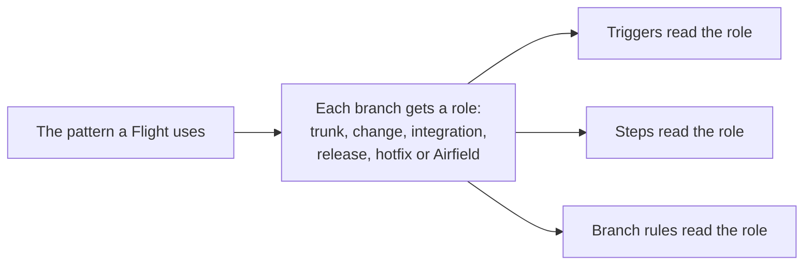
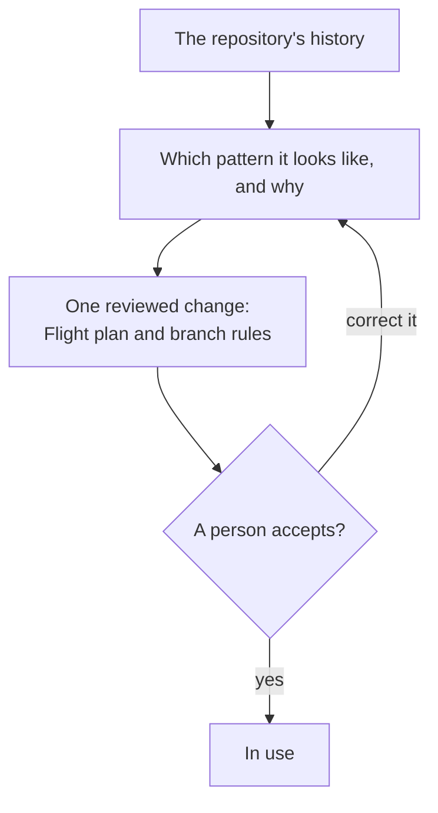

# Branching patterns

<a href="../roadmap.html">Roadmap</a> › Areas › Branching patterns · <a href="../roadmap-list.html">as a list</a>

Launchway supports every major way teams branch and release, recognizes the one a repository already uses, and lets a team move to another step by step without rewriting its pipelines. **Status:** branch rules, protected tags, the merge queue, forks and triggers on branches, tags and paths are **available today** (see [pull requests](../guide/pull-requests.md) and [forks](../guide/forks.md)); patterns as Flight plans, branch roles and recognition are planned in [Milestone 3](milestone-3.md).

## Branches have roles

A pattern is data, not a pipeline. Pipelines say what to do for a role, so changing pattern changes the roles, not the pipeline file.

## The patterns, as equals

Planned, each as a Flight plan: trunk-based development with short-lived branches; a main branch with feature branches and pull requests; release branches cut from main with fixes carried back; a long-lived integration branch with release and hotfix branches; a branch per Airfield (environment); forks with pull requests from outside contributors; many Flights in one repository; many repositories released together; tag-based releases for libraries and tools; and promotion by pull request. None is forced.

## Recognized from history

Planned: when a repository is created or brought in, Launchway reads its history, says which pattern it looks like and why, and offers the matching setup as one change a person reviews. When history is not enough, a few plain questions lead to the simplest pattern that fits. It helps and never enforces.

## What it will not do

Launchway does not rewrite your branches. Moving to another pattern is a plan of small reviewed changes, each one you accept.

Go back to the [Roadmap](../public/roadmap.html).
