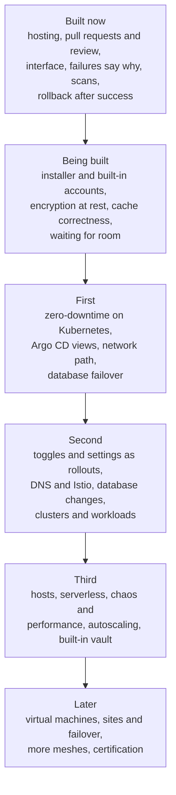
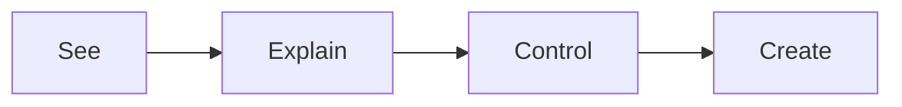

# How the build is ordered

<a href="../roadmap.html">Roadmap</a> › Areas › Build order · <a href="../roadmap-list.html">as a list</a>

The order follows what has to be true before what, and then what is most valuable. It is not a schedule: there are no dates, and plans change. An item moves to Available only when it is merged, tested and documented.

## The phases at a glance

Each phase uses the one before it. Delivery comes before the network and cluster views because their proofs and findings are what a deployment checks.

## Why this order

In nearly every area the order is the same: first see what is there, then explain what is wrong in a sentence, then control it safely, and last create and change it through Git. Seeing and explaining come first because that is what people ask for first, and control needs the access that seeing proves out.

## Where each part sits

| Part | Milestone | When |
|---|---|---|
| Host your code, run your pipelines | [1](milestone-1.md) | Now |
| Share and reuse across projects | [2](milestone-2.md) | Next |
| Zero-downtime delivery and Argo CD | [8](milestone-8.md) | Next |
| Installing Launchway | [1](milestone-1.md) | Now |
| Build tools and caches, the developer experience | [2](milestone-2.md) | Next |
| Configuration as code, platform services, the golden path | [3](milestone-3.md) | Next |
| Dependency order and releases | [5](milestone-5.md) | Later |
| Network and traffic | [9](milestone-9.md) | Next |
| Databases | [10](milestone-10.md) | Next |
| Kubernetes and virtual machines | [11](milestone-11.md) | Next |
| Security and trust | [12](milestone-12.md) | Next |
| Hosted service and protected demonstration | [7](milestone-7.md) | Later |

Go back to the [Roadmap](../public/roadmap.html).
