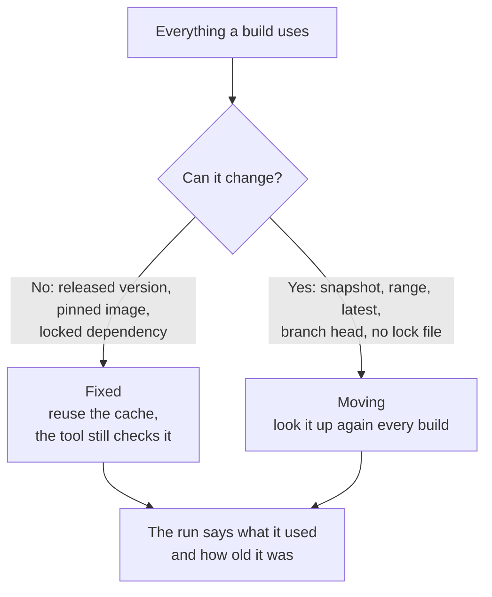

# Build tools and caches

<a href="../roadmap.html">Roadmap</a> › Areas › Build tools and caches · <a href="../roadmap-list.html">as a list</a>

Every popular build tool, with a cache that can make a build faster but never different. **Status:** the correctness fixes are in progress and the recipes are planned, in [Milestone 2](milestone-2.md). Caches already work today, with rules for who may read and write them.

## The rule: fixed things and moving things

A cache is a head start, never the answer. A build never silently uses an older copy of something it asked for the latest of, and deleting every cache must never change what a build produces, only how long it takes. Where Launchway cannot promise this for a path, the run says so and names the path and the reason.

## Recipes, scopes and shared caches

Recipes for Maven, Gradle, npm, pnpm, yarn, Go, Python and container images work out the cache key from the tool, its version, the platform and the lock file, so nobody writes keys by hand. What a pull request writes only that pull request reads, trusted branches share with their project, and forks are isolated. Where a tool has a build cache that verifies its inputs, Launchway hosts it. Android and iOS projects are built too, on runners that suit them.

Go back to the [Roadmap](../public/roadmap.html).
