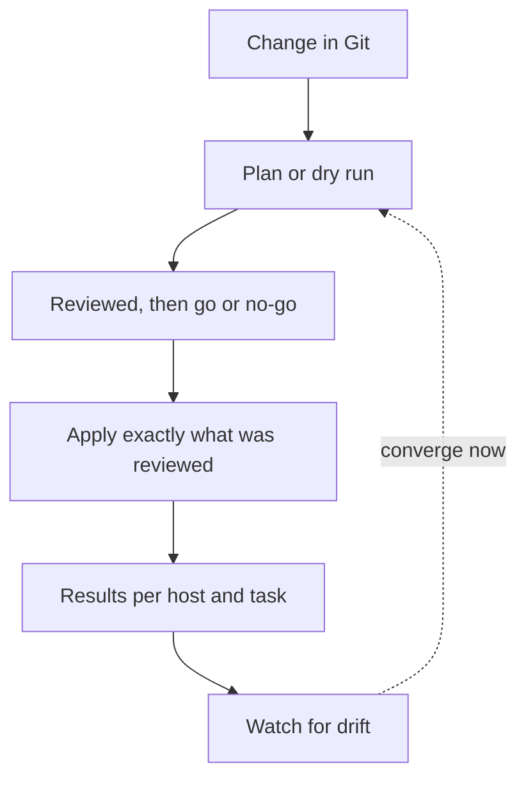

# Configuration as code

<a href="../roadmap.html">Roadmap</a> › Areas › Configuration as code · <a href="../roadmap-list.html">as a list</a>

Everything that configures a system is code in Git, and Launchway is the control center for it. **Status:** planned, in [Milestone 3](milestone-3.md). The tools stay the tools: Terraform, OpenTofu and Ansible run as themselves, and Chef follows by choice.

## A configuration change is a plan

## The control center

Inventories, Flight plans as job templates with a form for their inputs, schedules, credentials, role-based access and job output sit in one place. You see every host and every difference between what the code says and what is there.

## Honest limits

Ansible cannot apply a saved plan the way Terraform can, so a guard enforces it and the page says it is weaker. Check mode is not perfect in any tool. Some changes, such as a dropped database, cannot be undone by applying older code, so Launchway marks them before the apply.

Go back to the [Roadmap](../public/roadmap.html).
