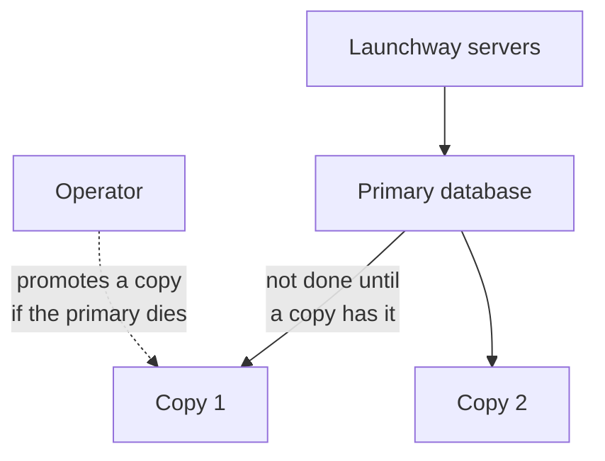
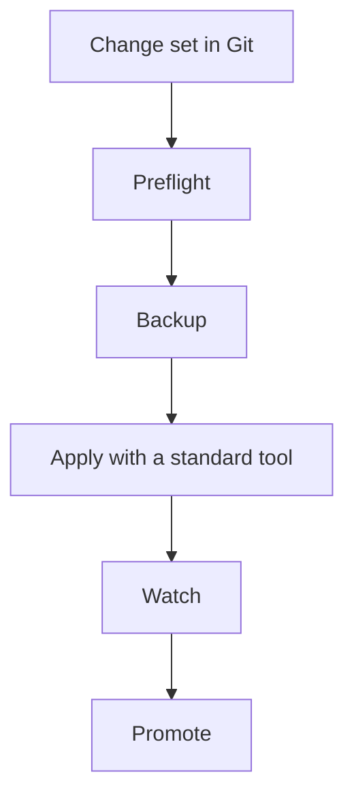

# Databases

<a href="../roadmap.html">Roadmap</a> › Areas › Databases · <a href="../roadmap-list.html">as a list</a>

Two jobs: keep Launchway working when a database machine fails, and deliver changes to your own databases safely. **Status:** the application side already rides through an outage; the rest is planned in [Milestone 10](milestone-10.md).

## One writer, always with an up-to-date copy

Launchway keeps one writer at a time because several decisions need one agreed order: which Sortie (run) takes a lane, what number a Sortie gets, who holds a lease. When the primary dies a copy is promoted without a person, and Launchway waits, retries and buffers meanwhile.

## A database change as a plan

A change set is checked before it runs: what it will run, what it will lock, and whether it removes something a running version still uses. Liquibase is the first supported tool. Return to base (rollback) for data means rolling forward, a compensating change, or a restore, and Launchway never claims a Return to base it cannot do.

Go back to the [Roadmap](../public/roadmap.html).
