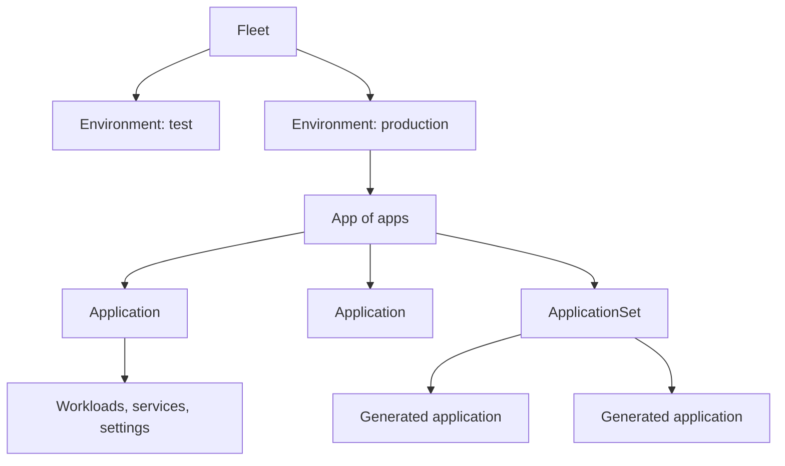
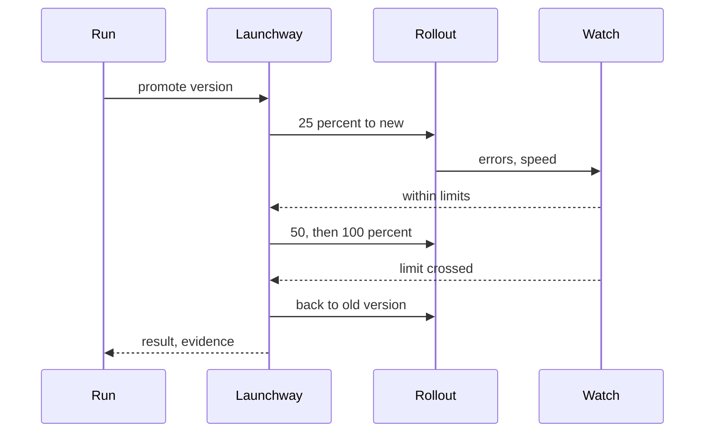
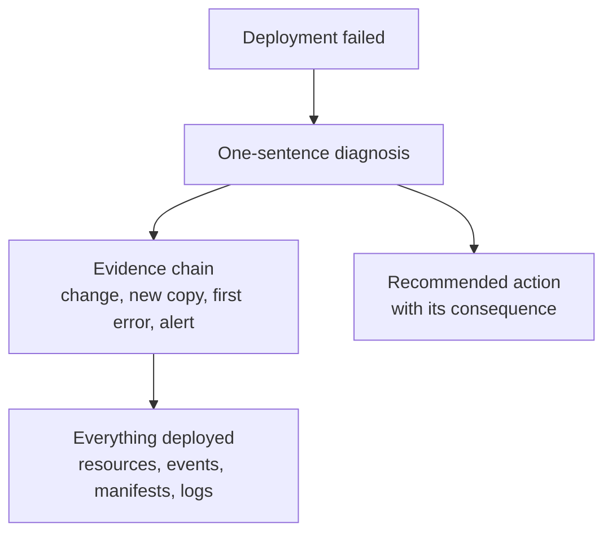
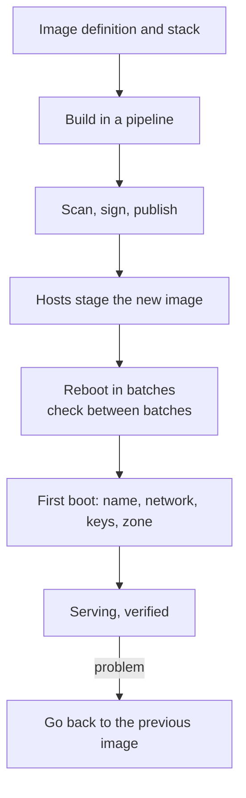

# Delivery: applications, rollouts and hosts

<a href="../roadmap.html">Roadmap</a> › Areas › Delivery · <a href="../roadmap-list.html">as a list</a>

Everything after the build: applications in clusters, virtual machines, image-based hosts and clouds, and finding out why something failed. **Status:** deploying with Argo CD, approvals, policy and verification is available today (see [deployments](../guide/deployments.md)); the depth described here is planned in [Milestone 3](milestone-3.md).

## The applications hierarchy

Every level shows status, sync, health, history and actions. Zoom out for the fleet, zoom in for the resources behind one application.

## A rollout, step by step

## Why did it fail

Each piece of evidence opens the resource where it shows. Secrets appear by name only.

## Machine images and image-based hosts

Hosts are managed like container images, built on bootc. The first-boot step may run a configuration playbook once, before the host takes traffic; running one on a host already serving traffic is refused because that is what brings drift back.

Capabilities: [Milestone 3](milestone-3.md). Go back to the [Roadmap](../public/roadmap.html).
