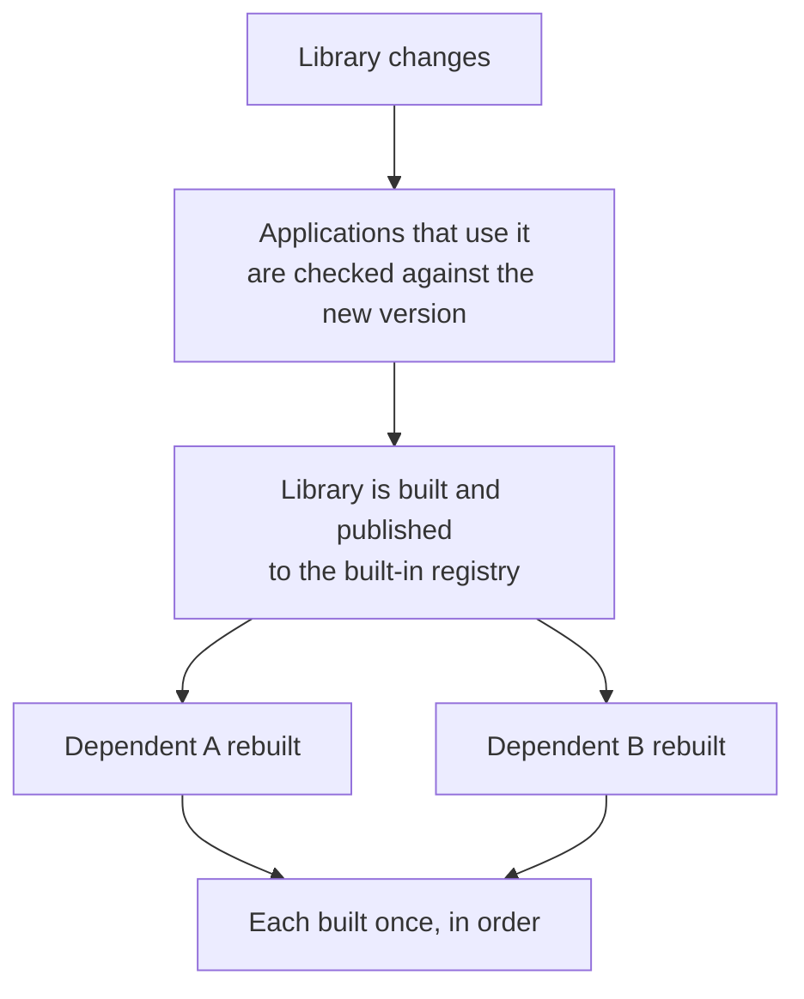

# Dependency order and releases

<a href="../roadmap.html">Roadmap</a> › Areas › Dependency order and releases · <a href="../roadmap-list.html">as a list</a>

Build and release in the right order, and start each repository on the right branching pattern. **Status:** planned, in [Milestone 5](milestone-5.md), with the Depot (registry) hand-off in [Milestone 4](milestone-4.md). Launchway works the order out from what your code says, and you can always correct it.

## A library changes

Every link in the graph says where it was found, how sure Launchway is, and lets you add a link, ignore a wrong one with a reason, or pin an order.

## Things that go together: Formations

A Formation is a release unit: a database change, two services and a configuration, say, delivered together. The database expands first, services follow in dependency order, and there is one go or no-go, one timeline, one watch, and one way back in reverse order.

## Not everything deploys

A library, command-line tool, image or chart is built, tested and published, and done means published and available. The built-in Depot is the hand-off, with native endpoints for package clients, short-lived credentials and a pull-through cache.

## Branching patterns

Trunk-based, short-lived branches with pull requests, the long-lived develop-and-release flow, release branches, tag-based releases, forks, promotion by pull request and monorepos each come as a Flight plan. A recommender asks six plain questions when a repository is created and suggests the simplest pattern that fits. It helps and never enforces.

Go back to the [Roadmap](../public/roadmap.html).
