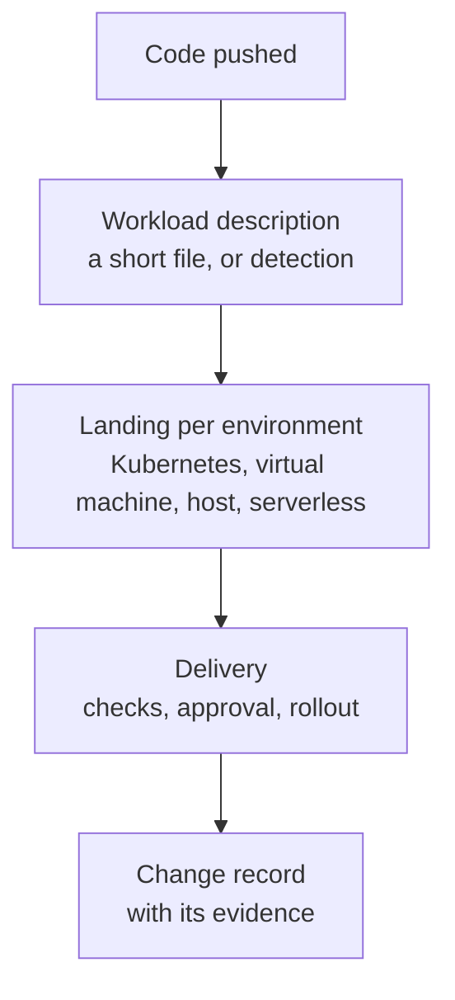

# The developer experience and the golden path

<a href="../roadmap.html">Roadmap</a> › Areas › Developer experience · <a href="../roadmap-list.html">as a list</a>

Push code, and Launchway does the rest. **Status:** planned, in [Milestone 3](milestone-3.md) and [Milestone 2](milestone-2.md); waiting reasons are in progress.

## The golden path

A developer says what an application is. The platform team says how things are delivered, once, for a level. Launchway joins the two, shows what it generated and lets a team eject. It never rewrites your repository without a pull request.

## Change records without friction

Every delivery becomes a change record. Standard changes are approved by a rule, normal changes go to the right people with the evidence in front of them, and emergency changes act first and are reviewed after. A security review is triggered only when the facts warrant it.

## In your editor and your assistant

A VS Code extension and a language server, and assistant tools shaped by jobs, show the same facts as the web page. The developer is first class: local runs that match the server, reproduce a failed step, flaky test quarantine, and team metrics that never rank people.

Go back to the [Roadmap](../public/roadmap.html).
