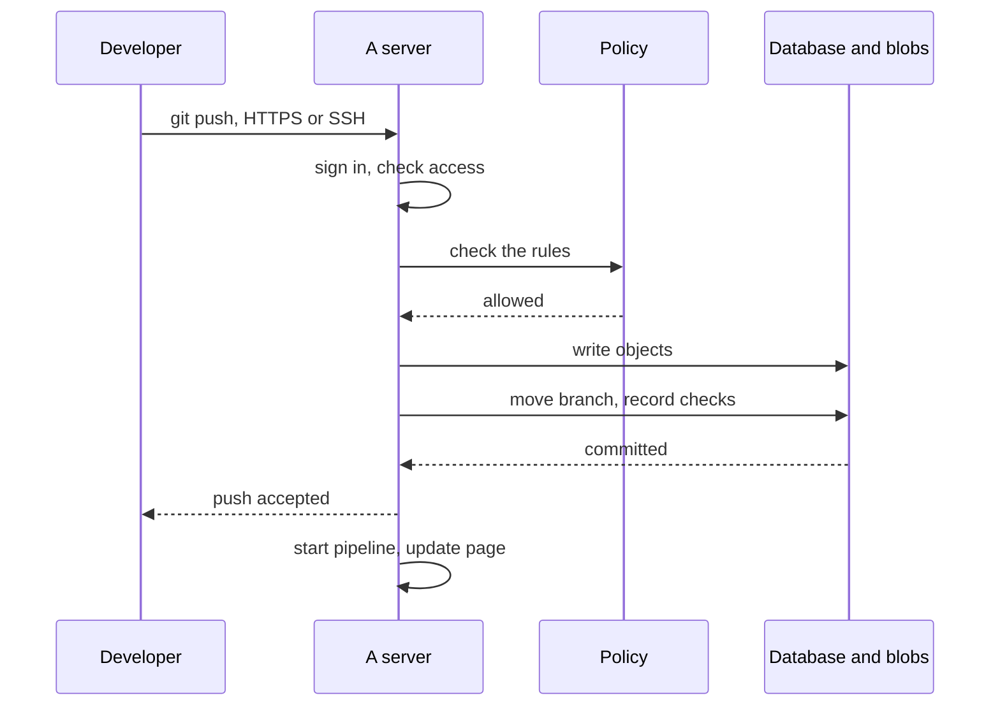
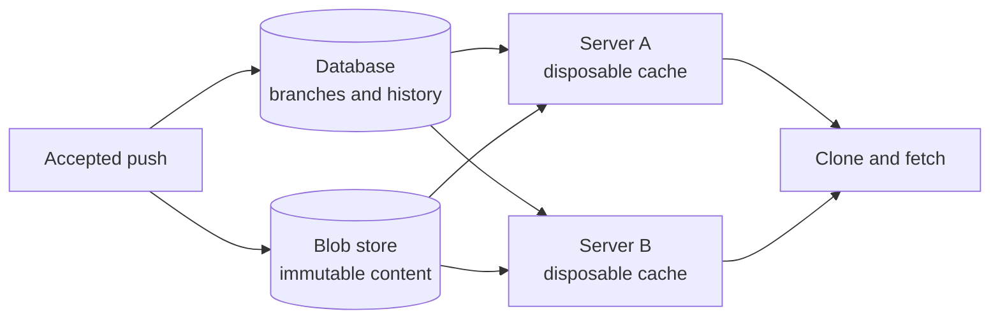
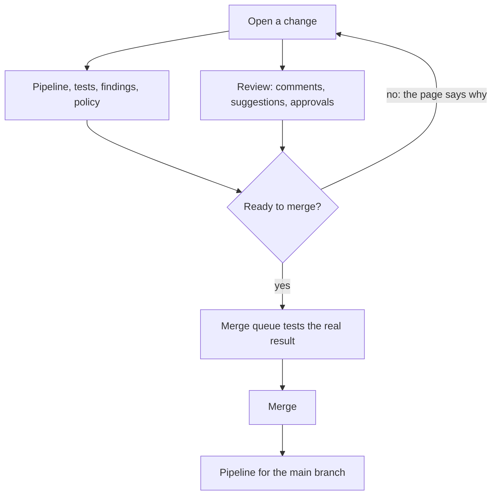

# Built-in Git hosting and change review

<a href="../roadmap.html">Roadmap</a> › Areas › Git hosting · <a href="../roadmap-list.html">as a list</a>

Launchway can host your Git repositories itself, so that one product and a database are enough. Hosting is optional: a connected Git host is first-class and looks the same to everything else. This page explains how it is meant to work. **Status:** serving over HTTPS is being built and is in progress; Git over SSH, review, work items and the rest are planned. Nothing on this page is available yet unless it says so. The capabilities are listed in [Milestone 1](milestone-1.md#g-host-your-code).

## How a push travels

The branch is moved and the checks a change is waiting for are recorded in the same step. That is why a change never looks mergeable before its checks exist, and why no webhook round trip is needed on the built-in host.

## Storage that never loses an acknowledged push

A push is acknowledged only after it is durable in the database and the blob store. Servers keep nothing that matters on their own disks, only caches that can be rebuilt, so a server can disappear at any moment. The pass mark for this design is a test that stops servers and the database mid-push and finds that nothing acknowledged is lost. Backups and restores are rehearsed in the same way.

## Reviewing and merging a change

The change page shows the Sortie (run), tests, coverage change, findings, policy verdict, preview Airfield (environment) and deployment together. A connected Git host gets the same result as a status on its own pull request, or as a comment and an approval where the host has no status feature.

## The groups of capability

| Area | What is in it |
|---|---|
| [Host your code](milestone-1.md#g-host-your-code) | HTTPS and SSH, storage, browsing, search, editing, mirrors, large files, forks, webhooks |
| [Review and merge changes](milestone-1.md#g-review-and-merge-changes) | Pull requests, suggestions, branch rules, code owners, merge queue, conflicts |
| [Work items and decisions](milestone-1.md#g-work-items-and-decisions) | Issues, boards, decision records, wiki, static pages, releases |
| [People and access on the host](milestone-1.md#g-people-and-access-on-the-host) | Teams, tokens, sign-in provider, administration |
| [Move your repositories in](milestone-1.md#g-move-your-repositories-in) | Importers, an acceptance suite, replacing a self-hosted server |
| [Keep your Git host, if you prefer](milestone-1.md#g-keep-your-git-host-if-you-prefer) | Equal support for every host, self-managed variants, hosts without webhooks |

## Deliberately not here

- Custom shell hooks on the server. Rules and policy on a push replace them, because they are checked and audited.
- A social network: stars, follows and a marketplace.
- Federation between hosts.

Go back to the [Roadmap](../public/roadmap.html).
