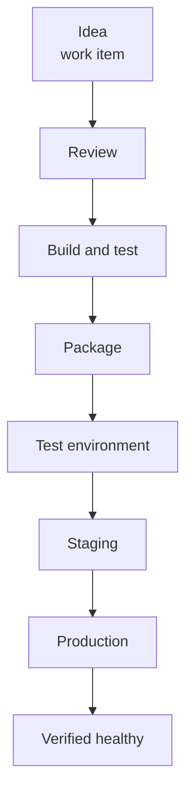
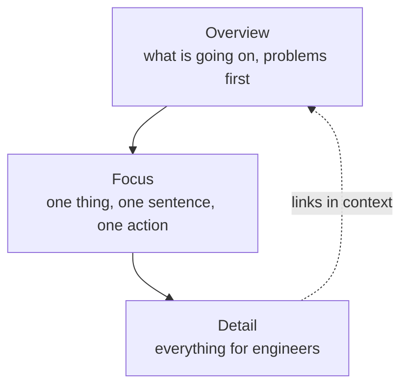
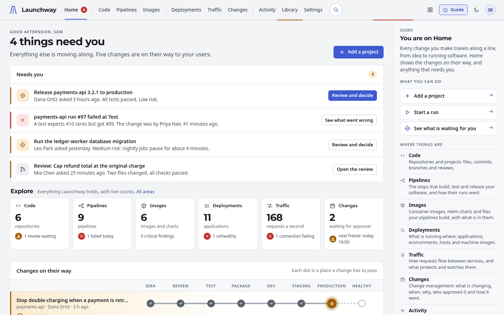
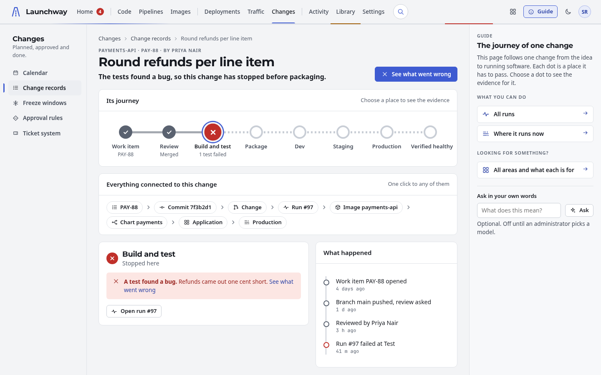
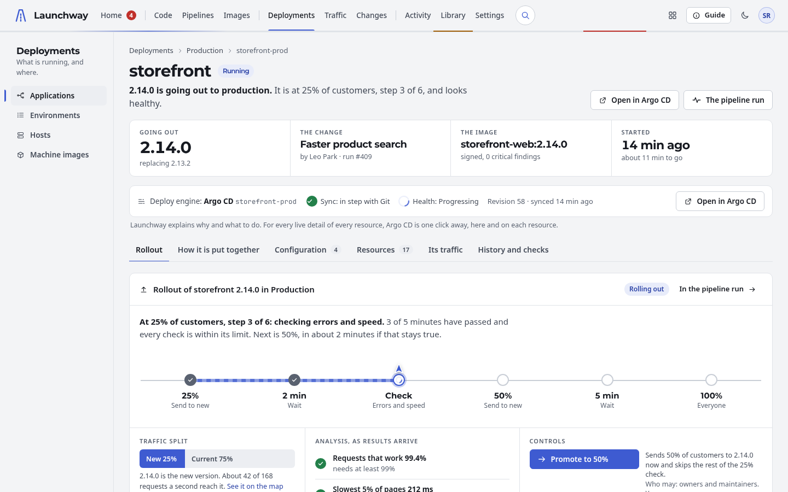

# The guided interface

<a href="../roadmap.html">Roadmap</a> › Areas › Guided interface · <a href="../roadmap-list.html">as a list</a>

An interface a complete beginner can use, that also keeps every detail an engineer needs. **Status:** guided setup wizards and a guided interface are available today in part (see the [demo](../demo.md)); the launch line and the rest below are in progress or planned in [Milestone 1](milestone-1.md#g-a-guided-interface-a-complete-beginner-can-use).

## Follow a change on its launch line

Each station is a place the change has to pass. Choose a station and its evidence opens beneath the line: the review, the tests, the image and its contents, the place and its health, or a decision card.

## Overview, focus, detail

Every topic uses the same three levels, and each page answers one question. Pages link to each other where the question lives: a toggle links to its application and its change, an alert to the timeline, an image to where it runs.

## Design previews

These are static pictures of the design with sample data. They show the direction, not a released product.

*Design preview: Home.*

*Design preview: the journey of one change.*

*Design preview: a rollout in progress.*

## Principles

- Six plainly named sections. Anything switched off is not shown.
- Every task is a wizard of a few short screens that says what each is for.
- No page tells you to edit a file.
- Nothing the current interface shows is lost.

Go back to the [Roadmap](../public/roadmap.html).
