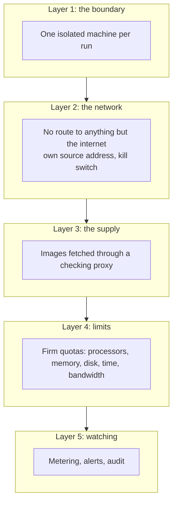

# The hosted service and sandboxed runners

<a href="../roadmap.html">Roadmap</a> › Areas › Hosted service · <a href="../roadmap-list.html">as a list</a>

Launchway as a service, with the controls enterprises and regulated teams ask for. **Status:** planned, in [Milestone 7](milestone-7.md). A local demo already runs from the [quick start](../start/quick-start.md).

## Two ways to run steps

With runners on your own servers or clusters, code and secrets stay inside your network.

## Isolation layers for hosted steps

Each layer assumes the one before it can fail. The same profile is available to any self-hosted server that wants to run untrusted work.

## Identity and audit

Organisations are isolated and tested for it. Directory groups, built-in accounts with passkeys, a tamper-evident audit trail, retention and legal hold, encryption at rest and a PCI DSS and HIPAA evidence pack are in the same milestone. Launchway supports compliance work; it is not a certification.

Go back to the [Roadmap](../public/roadmap.html).
