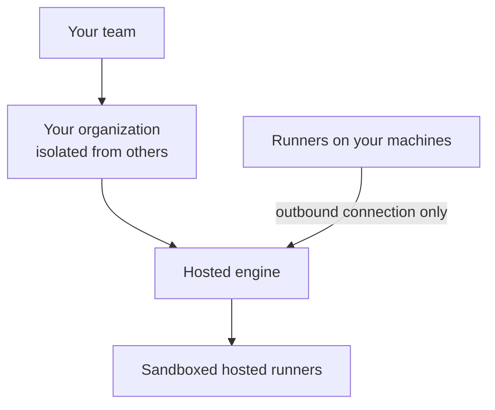
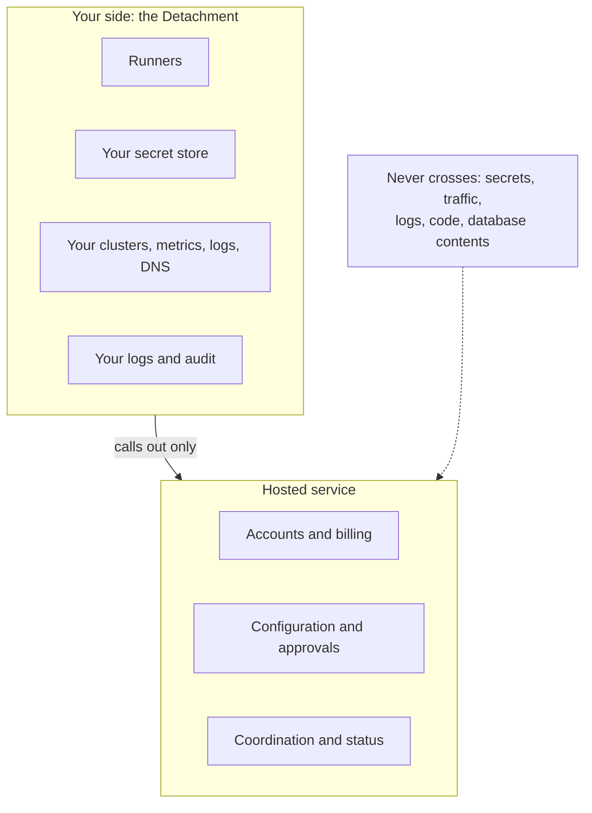
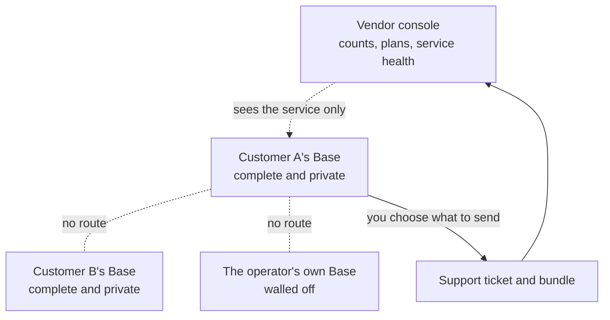
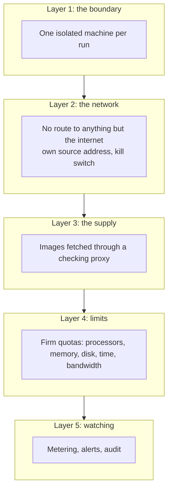
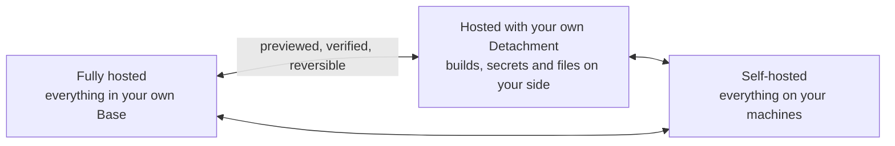
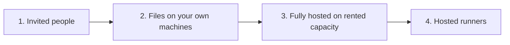

# The hosted service and sandboxed Stations (runners) {#the-hosted-service-and-sandboxed-runners}

<a href="../roadmap.html">Roadmap</a> › Areas › Hosted service · <a href="../roadmap-list.html">as a list</a>

Launchway as a service, with the controls enterprises and regulated teams ask for. **Status:** planned, in [Milestone 7](milestone-7.md), which also covers a protected demonstration that never shows the operator's own systems. A local demo already runs from the [quick start](../start/quick-start.md).

## Two ways to run steps

With Stations on your own servers or clusters, code and secrets stay inside your network.

## What stays with you, and what never crosses

The hosted service is the control plane: it remembers who you are, what you have configured and what should happen next. Your side does the work and holds the data. It sees names, states, counts and timings, and the pages you read are drawn in your browser from data fetched live from your Detachment. It has no way to open a connection into your network.

## Your own Base, and what the service sees

Every customer has its own Base, and the service operator’s own Base is a separate Base that no customer or demonstration visitor can see, list or guess. A suite of tests tries every route from one Base into another and gates every release. The vendor console shows how many Bases exist, plans, usage and the health of the hosted side, and never repositories, logs, secrets or traffic. Vendor access is a separate sign-in, entered on purpose with a reason and a time limit, and every vendor action appears in the customer’s own Logbook. When something is wrong you open a ticket and choose what goes in a support bundle, with a preview of exactly what will be sent.

## Isolation layers for hosted steps

Each layer assumes the one before it can fail. The same profile is available to any self-hosted server that wants to run untrusted work.

## Sign up and go

The first customers are start-ups, freelancers and small teams, so the front door is short: an email address or an existing account, proof of the address, a strong second factor (a passkey, or an authenticator app, with recovery codes shown once), a name for your Base, plain terms and a guided first project. Text-message codes are not offered on purpose, because they can be taken over. Recovery goes through your other factors or a waiting period with notices; staff cannot reset a second factor or let anyone in.

## Three ways to run, and easy moves between them

Fully hosted needs nothing installed, and the service says plainly that it then stores your code and secrets, encrypted in your own Base. If you would rather keep your files, one command on your machine connects it outward to the service: nothing is opened and no tunnel is set up. In the smallest form, two people each Sortie (run) that command and both reach the files through Launchway over an end-to-end encrypted session; the relay in the middle carries only ciphertext, and the hosted side keeps only accounts, who is on the team, which machines are online and opaque identifiers. With two machines every repository has a full copy on each; protected branches have one home at a time, and a true disagreement is kept visible, never overwritten.

Moving is one operation for one project or a whole Base, in either direction. It shows a preview first, mirrors the repositories while you keep working, verifies every reference, switches in seconds, keeps the old address redirecting and offers a Return to base (rollback) window before the source is deleted. Secret values travel re-sealed to the destination, never in the clear.

## Limits, and never a place to park files

Each hosted Base has a size ceiling. As a Base approaches it you get plain notices and a guided move, and at the ceiling only the growing kind of data stops: reading, cloning, exporting and moving always work, and nothing is deleted for being over. The hosted service is also never somewhere to store arbitrary files: nothing is public or anonymous, there is no general file storage, quotas and identity checks are strict, and there is a published way to report abuse, with takedown and suspension. Plans have every feature on; a plan changes limits, never features, and the spend limit starts at zero. Prices and numeric limits are not decided.

## Opening in stages

Each stage opens only when its checks and all earlier ones are green, including the tests that try every route from one Base into another, and an independent security test before the first public opening.

## Identity and audit

Bases are isolated and tested for it. Directory groups, built-in accounts with passkeys, a tamper-evident audit trail, retention and legal hold, encryption at rest and a PCI DSS and HIPAA evidence pack are in the same milestone. Launchway supports compliance work; it is not a certification.

Go back to the [Roadmap](../public/roadmap.html).
