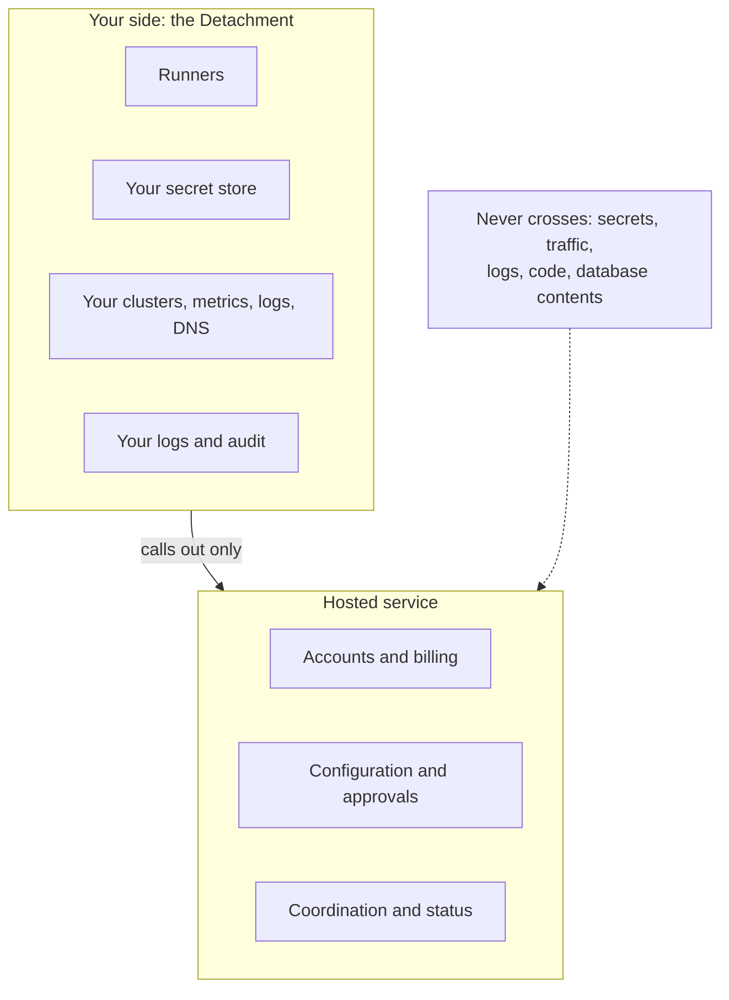
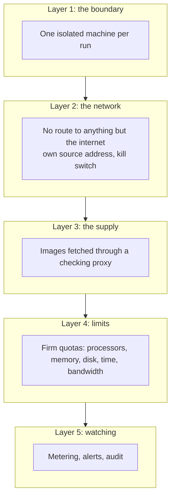

# The hosted service and sandboxed runners

<a href="../roadmap.html">Roadmap</a> › Areas › Hosted service · <a href="../roadmap-list.html">as a list</a>

Launchway as a service, with the controls enterprises and regulated teams ask for. **Status:** planned, in [Milestone 7](milestone-7.md), which also covers a protected demonstration that never shows the operator's own systems. A local demo already runs from the [quick start](../start/quick-start.md).

## Two ways to run steps

With runners on your own servers or clusters, code and secrets stay inside your network.

## What stays with you, and what never crosses

The hosted service is the control plane: it remembers who you are, what you have configured and what should happen next. Your side does the work and holds the data. It sees names, states, counts and timings, and the pages you read are drawn in your browser from data fetched live from your Detachment. It has no way to open a connection into your network.

## Isolation layers for hosted steps

Each layer assumes the one before it can fail. The same profile is available to any self-hosted server that wants to run untrusted work.

## Identity and audit

Organizations are isolated and tested for it. Directory groups, built-in accounts with passkeys, a tamper-evident audit trail, retention and legal hold, encryption at rest and a PCI DSS and HIPAA evidence pack are in the same milestone. Launchway supports compliance work; it is not a certification.

Go back to the [Roadmap](../public/roadmap.html).
