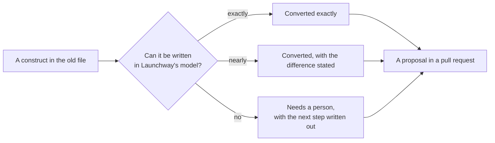
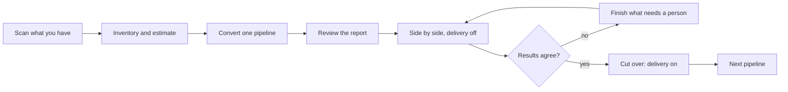

# Bringing work in

<a href="../roadmap.html">Roadmap</a> › Areas › Bringing work in · <a href="../roadmap-list.html">as a list</a>

Point Launchway at what you have and see it running here, with an honest account, construct by construct, of what came across. **Status:** a pipeline importer for five file formats, with a report of what converted, a dry mode that keeps delivery off, a web wizard, a command and an API call, is **available today** (see [move your pipelines over](../guide/move-your-pipelines.md)); importing templates, libraries, triggers, delivery and policies, and the side-by-side comparison page, are planned in [Milestone 2](milestone-2.md).

## Three outcomes, nothing dropped

Every construct ends in one of three outcomes. Nothing is dropped silently and no behavior is invented. The result is a proposal, checked by the same checker as any pipeline; your original files are never touched, and an unfinished import cannot launch anything.

## Scan, convert one, compare, cut over

Today a dry import writes every delivering step behind one input, `enable_delivery`, that is off by default, so both systems can run on every push. Planned: a page that pairs the two by commit and step and says where they agree or differ, with the reason.

## What comes across

Planned: pipelines and jobs, conditions and passed values, variables and the names of secrets, templates, packaged steps and shared libraries, triggers and Patrols (schedules), run forms, Airfields (environments), approvals that become Clearances, deployments that become Launch steps, and policies and freezes that become Standing orders and Holds. The repository itself can come first, with its issues, pull requests and releases, and Switches can come across from another service with a dry run.

## What it will not do

An import never claims more than it converted. A construct with no honest equivalent stays visible, marked for a person, rather than being guessed. No other product is named in the report; each source is described by the kind of file it is.

Go back to the [Roadmap](../public/roadmap.html).
