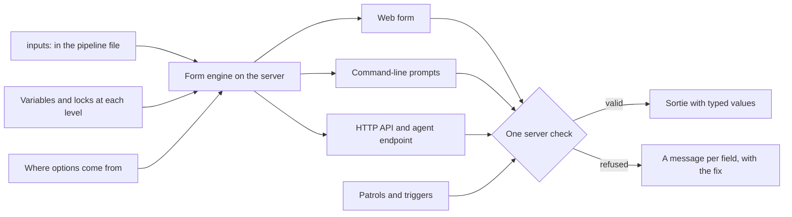
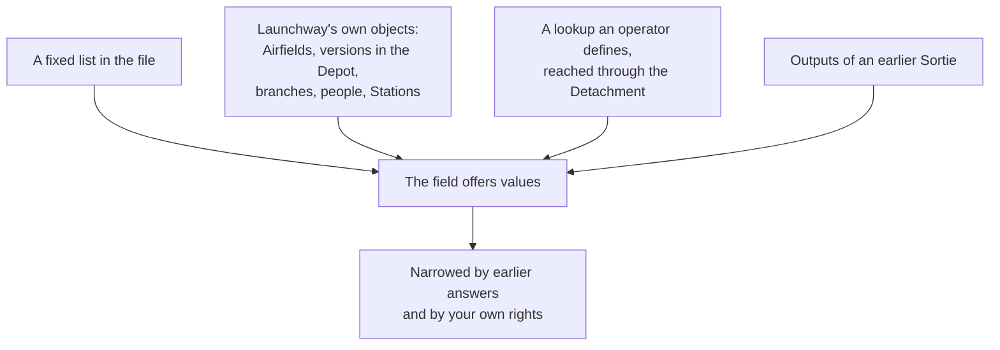

# Inputs and forms

<a href="../roadmap.html">Roadmap</a> › Areas › Inputs and forms · <a href="../roadmap-list.html">as a list</a>

A person should almost never type what Launchway can offer. One typed input definition in the pipeline file becomes a form that offers real values, reacts to earlier answers, checks every value as you go, and is checked again on the server whoever sends it. **Status:** typed inputs with a pattern, a minimum, a maximum, a default and a fixed list of choices are **available today** (see the [pipeline reference](../reference/pipeline.md)); pickers, fetched choices and one form engine are planned in [Milestone 1](milestone-1.md) and [Milestone 2](milestone-2.md).

## One definition, every way in

The definition is data, not a script in the browser. Options, defaults, which fields show and which values are allowed are worked out on the server from the definition and the answers so far, so the web form, the command line, the API, the agent endpoint, Patrols (schedules) and triggers all meet the same rules. A value a Patrol or a trigger supplies is checked exactly like a person's, and a refusal is written down, never replaced by a silent default.

## Where the choices come from

Planned: when you start a release of the `storefront` Flight (codebase), the Airfield (environment) is already the one you used last, the version list shows the newest images in the Depot with whether each passed its Inspection, and choosing `prod` adds the fields a protected Airfield needs. Free text is the last resort, and when it is used it has a pattern, a plain message and a live check.

## The same forms everywhere

The form engine that starts a Sortie (run) also asks for values halfway through, as a Clearance (approval) with fields, and draws every wizard in the product. The answers become typed values that later steps read, and the record says who gave them. A ready-made Flight plan can be offered as a job with a form, a Patrol and a "may start" right, under the same Clearance and Standing orders as everything else.

## What it will not do

A form cannot make a value true: a version that existed when you picked it is checked again when the Sortie starts. Options are only as fresh as their source, so each list says when it was read. Secrets are picked by name and never shown or typed.

Go back to the [Roadmap](../public/roadmap.html).
