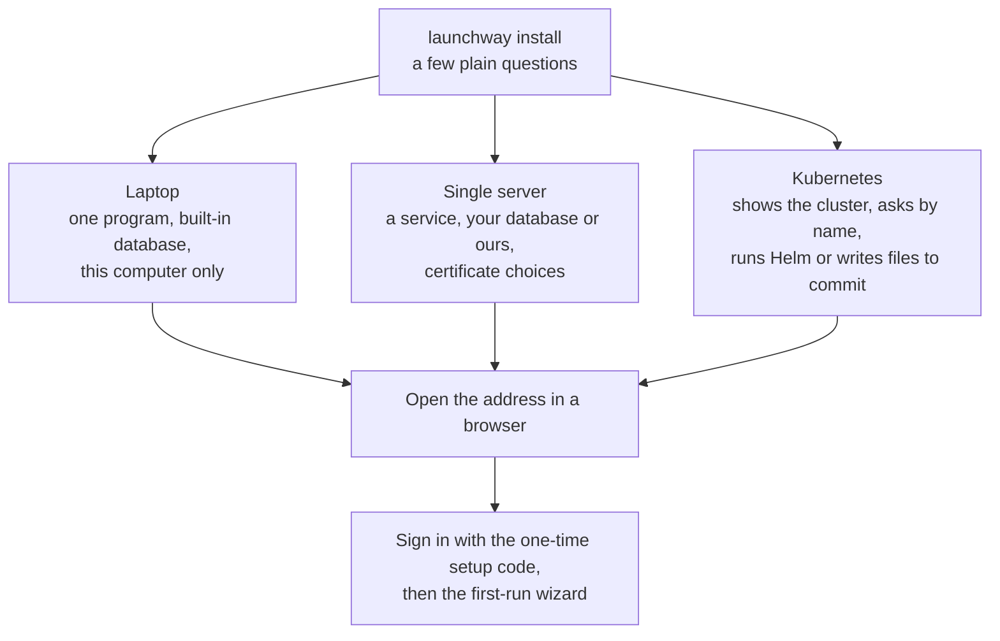

# Installing Launchway

<a href="../roadmap.html">Roadmap</a> › Areas › Installing Launchway · <a href="../roadmap-list.html">as a list</a>

Installing should be simple, and the same for everyone: open the address, sign in and be guided. **Status:** in progress, in [Milestone 1](milestone-1.md). Nothing is assumed: no secrets manager, no identity provider and no other tool.

## One command, three targets

Each target asks the same few questions. The installer is safe to run again and never regenerates keys. It ends by printing the address and the one-time step, then a plain security checklist.

## What the chart does for you

A handful of values starts a secure, working installation. The chart creates the root key, the database password and the first administrator’s setup once and keeps them across upgrades, even when a GitOps controller renders it. It ships default-deny network policies and restricted pods, and nothing is exposed publicly by default.

## Upgrades and rollbacks

The aim is that an upgrade is "change the version, nothing else", by `helm upgrade`, a GitOps controller, the image first or the chart first, and that a rollback works. `make test-upgrade` is the release gate: it upgrades the previous release to this one by each method on a throwaway cluster and rolls back, and a release is not cut unless it is green (see [Releasing](../development/releasing.md)). **What is true today:** the matrix runs against a simulated GitOps controller, not a real Argo CD, and against one network plugin (kind's default); the previous release's chart has a closed values schema, so a rollback to it needs unknown values removed first; installations upgraded onto a cluster that enforces policy must list what the servers reach in `extraEgress`. The first install-time check of a cluster's network policy exists (`launchway doctor network`); the server itself cannot see the cluster's policy objects, so its start-up warning names the check rather than running it.

## The first-run wizard

After the first sign-in, the browser walks through naming your organization, sign-in (keep the built-in accounts or connect a provider, tested before you switch), encryption status and a backup of the root key, a runner, Git hosting, importing repositories and a first pipeline.

## What comes next

A small bundled Kubernetes for a server with none, a check of every cluster feature Launchway needs with a fix or a labeled trial option for each one missing, and an offline bundle for networks with no internet. Anything not built yet is shown as coming, never as a choice that fails.

Go back to the [Roadmap](../public/roadmap.html).
