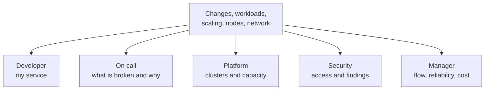
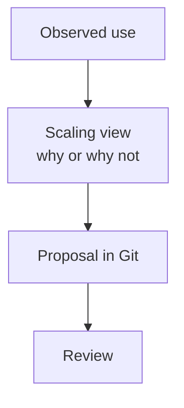

# Kubernetes and virtual machines

<a href="../roadmap.html">Roadmap</a> › Areas › Kubernetes and virtual machines · <a href="../roadmap-list.html">as a list</a>

Launchway starts from the change, not from the list of cluster objects. **Status:** planned, in [Milestone 11](milestone-11.md). Today it reads applications, rollouts and their analyses for one cluster.

## Five points of view on the same facts

The switcher changes what is shown first, never what a person may do.

## Autoscaling and serverless

Scaling is explained, including how several scalers interact, and advice arrives as a proposal. Serverless on-premises uses Knative, with KEDA for event-driven scaling.

## Virtual machines

A virtual machine on Kubernetes is a workload like any other: seen with its state, created by a change in Git, and released with the same plan, proofs and return as a container. KubeVirt comes first.

Go back to the [Roadmap](../public/roadmap.html).
