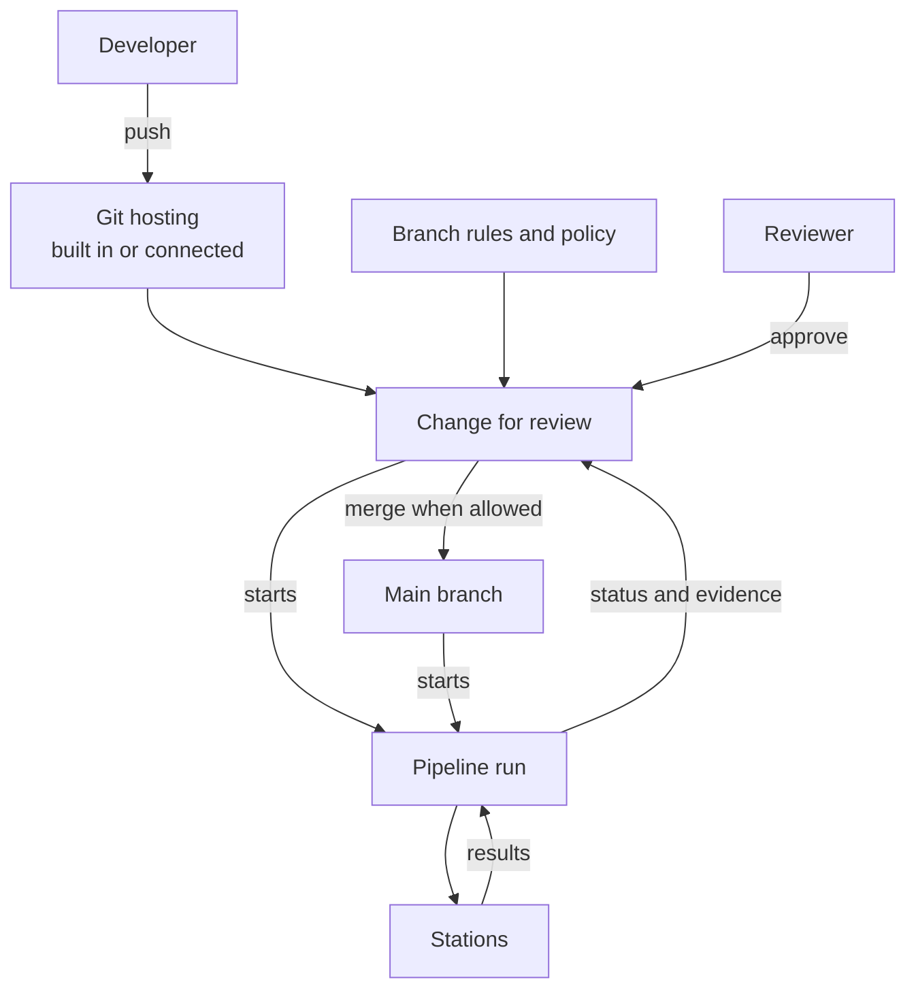

# Milestone 1: Host your code and run your pipelines in one place

<!-- Generated by scripts/docs/build-roadmap.mjs from docs/roadmap/roadmap.json. Do not edit by hand. -->

<a href="../roadmap.html">Roadmap</a> › Milestone 1 · <a href="../roadmap-list.html">as a list</a>

Now 61 available · 24 in progress · 57 planned · 142 capabilities

A team can keep its repositories in Launchway, review and merge there, and run every pipeline it has, with everything a hosted CI service offers and nothing else to install.

## What it is, and who it is for

Milestone 1 makes Launchway a complete home for day-to-day engineering. Code can live in Launchway or stay where it is; either way people review changes, see every check on the change, and run every pipeline they had on a hosted CI service. The interface follows a change from idea to running software so a beginner can find their way.

**Who it is for.** Teams that want one product for their code and their builds, and teams that keep their code on another host but want Launchway to run the pipelines and report back.

## What you will be able to do

- You push a branch and open a change. The page shows the pipeline running, the tests and findings as they arrive, and a plain sentence saying what stops it from merging.
- A teammate suggests a one-line fix in review and you apply it with one click; the checks run again by themselves.
- You keep your code on another host. Launchway runs the pipeline and writes the result back to the pull request, and a failing Sortie blocks the merge there too.
- You re-run a failed run from the third step, and the first two steps use what they produced last time.
- A new colleague opens Home and is told, in order, what to set up next.

## How it fits together

*A change from push to merge. The built-in host and a connected host look the same to the pipeline engine.*

**Builds on:** nothing; this is where it starts. **Leads to:** [Milestone 2: Pipeline power](milestone-2.md), [Milestone 3: Delivery depth](milestone-3.md), [Milestone 4: Registry](milestone-4.md), [Milestone 6: AI helper](milestone-6.md), [Milestone 7: Hosted service](milestone-7.md), [Milestone 12: Security and trust](milestone-12.md), [Milestone 13: Work, releases and health](milestone-13.md), [Milestone 14: Editors and extension points](milestone-14.md).

**Go deeper:** [Git hosting and change review](git-hosting.md) · [Pipelines and flow control](pipelines.md) · [The guided interface](guided-interface.md) · [Installing Launchway](installing.md).

## The capabilities

| Group | Capabilities | Available | In progress | Planned |
|---|---|---|---|---|
| [Host your code](#g-host-your-code) | 23 | 10 | 3 | 10 |
| [Review and merge changes](#g-review-and-merge-changes) | 11 | 5 | 3 | 3 |
| [Work items and decisions](#g-work-items-and-decisions) | 11 | 5 | 2 | 4 |
| [People and access on the host](#g-people-and-access-on-the-host) | 9 | 0 | 1 | 8 |
| [Move your repositories in](#g-move-your-repositories-in) | 5 | 2 | 1 | 2 |
| [Keep your Git host, if you prefer](#g-keep-your-git-host-if-you-prefer) | 8 | 0 | 3 | 5 |
| [Pipelines that match what teams expect from hosted CI](#g-pipelines-that-match-what-teams-expect-from-hosted-ci) | 13 | 10 | 1 | 2 |
| [Easy to start, easy to write](#g-easy-to-start-easy-to-write) | 8 | 6 | 2 | 0 |
| [A guided interface a complete beginner can use](#g-a-guided-interface-a-complete-beginner-can-use) | 9 | 3 | 2 | 4 |
| [Move your existing pipelines over](#g-move-your-existing-pipelines-over) | 2 | 1 | 1 | 0 |
| [Foundations that finish alongside](#g-foundations-that-finish-alongside) | 16 | 4 | 4 | 8 |
| [Install Launchway in minutes](#g-install-launchway-in-minutes) | 15 | 8 | 1 | 6 |
| [Organized, and yours to arrange](#g-organized-and-yours-to-arrange) | 10 | 7 | 0 | 3 |
| [Run forms that offer, not ask](#g-run-forms-that-offer-not-ask) | 2 | 0 | 0 | 2 |

### Host your code {#g-host-your-code}

Launchway stores your repositories and serves them, so one product and a database are enough.

#### Built-in Git hosting {#built-in-git-hosting}

✓ Available

Launchway stores your repositories and serves them over HTTPS and SSH, with storage designed so that no acknowledged push is ever lost. A push, over HTTPS or SSH, is acknowledged only once it is durable, and any server in a group can serve any repository because servers keep nothing that matters on their own disks. This is the Base every other hosting item stands on. Today repositories are served over HTTPS and SSH, and a push starts a Sortie.

**Depends on:** A database; the shared blob store that already exists.

[Read the documentation](../guide/git-over-ssh.md) · [Area page](git-hosting.md)

#### Safe storage and failover for repositories {#safe-storage-and-failover-for-repositories}

○ Planned

If a server or the database fails over, every acknowledged push is still there. Refs and their history live in the database with an atomic update, content lives in the blob store, and servers hold only disposable caches. A test kills servers mid-push and the pass mark is that nothing acknowledged is lost.

**Depends on:** Built-in Git hosting.

[Area page](git-hosting.md)

#### Git over SSH {#git-over-ssh}

✓ Available

Clone, fetch and push over SSH with your own keys, beside HTTPS. User keys and per-repository read-only deploy keys are listed and revocable in one place, the server proves itself with a protected host key that stays the same across servers, and SSH uses the same permissions, limits and audit as HTTPS. Run-scoped read-only credentials mean a pipeline holds a credential only while it runs. Today there are user keys, deploy keys, and a key page in the interface.

**Depends on:** Built-in Git hosting.

[Read the documentation](../guide/git-over-ssh.md) · [Area page](git-hosting.md)

#### Sign in from the command line through the browser {#sign-in-from-the-command-line-through-the-browser}

○ Planned

Git over HTTPS from the command line asks you to sign in in the browser instead of pasting a token. The browser shows what is being allowed and for how long, and the grant ends by itself.

[Area page](git-hosting.md)

#### Create, rename, archive and set visibility {#create-rename-archive-and-set-visibility}

◐ In progress

The everyday repository lifecycle: create, rename with redirects, transfer, archive as read-only, and private, internal or public visibility. The same wizard connects an existing repository from another host or creates a hosted one, so people do not need to learn two flows. Old addresses keep working after a rename. Built: rename and transfer with old addresses that keep working for Git, the API and the web pages, and never reveal where a private repository went. Still to confirm or build: archive as read-only and the single wizard that connects an existing repository or creates a hosted one.

**Depends on:** Built-in Git hosting.

[Read the documentation](../guide/renaming-repositories.md) · [Area page](git-hosting.md)

#### Browse and search your code {#browse-and-search-your-code}

✓ Available

History, file history, blame, raw files, archives, permanent links with line ranges, and a go-to-file finder. Reading code is where most of the time goes, so it has to be quick and linkable. The newest commit is drawn on its journey above the file tree, so you see where the change is, not only what it contains.

**Depends on:** Built-in Git hosting.

[Area page](git-hosting.md)

#### Search inside a repository {#search-inside-a-repository}

✓ Available

Find text, a regular expression or a file name in the branch, tag or commit you are looking at, narrowed by folder and extension. Search reads a disposable copy of the repository with bounded time and size and says when its results are partial, so there is no index to keep in step. Not yet: results for pipeline files, templates and steps as such, and search across repositories.

**Depends on:** Browse and search your code.

[Area page](git-hosting.md)

#### Show every kind of file properly {#show-every-kind-of-file-properly}

○ Planned

Markdown, diagrams, math, tables of data, images with before and after, documents and notebooks render in the browser. Pipeline files also render as a drawing beside the text. Rendering is sandboxed so a file can never run anything.

**Depends on:** Browse and search your code.

[Area page](git-hosting.md)

#### Edit in the browser, as a commit {#edit-in-the-browser-as-a-commit}

✓ Available

Edit, add or delete one file from the web page; every save is a real commit, on the branch or on a new branch with a pull request. It uses the same one-file commit path as the HTTP API, the CLI and the tools, with the branch rules of a push. Not yet: upload, cherry-pick, revert and patch download.

**Depends on:** Built-in Git hosting.

[Area page](git-hosting.md)

#### Verified commits and tags {#verified-commits-and-tags}

✓ Available

Verify signatures on commits and tags, manage signing keys, and let a rule require signed commits. A verified state is a fact a branch rule or a deployment policy can ask for, so an unsigned change cannot reach production if you say so. Built: SSH signing keys, the verdict on commits and annotated tags (verified, unknown key, bad signature, unsigned, key revoked or expired), shown on commit lists, the commit page, tags and pull requests, the merge rule and a push rule, and a signing key of the installation's own for the commits Launchway makes. Not built: OpenPGP and X.509 signatures, signing of commits made by editing in the web page.

**Depends on:** Branches, tags and rules.

[Read the documentation](../guide/verified-commits.md) · [Area page](git-hosting.md)

#### Repository maintenance and health {#repository-maintenance-and-health}

○ Planned

Scheduled housekeeping, an integrity check, a size report and a health note on the Tower. Problems appear in the same attention list as everything else instead of being found when a push is slow. Maintenance runs as separate programs, not inside the server.

**Depends on:** Built-in Git hosting.

[Area page](git-hosting.md)

#### Repository trash {#repository-trash}

◐ In progress

A deleted repository goes to a trash and can come back within a set time. Delete is reversible for a period you choose, and both the delete and the restore are in the Logbook. The guide documents the trash as working: a deleted repository keeps its refs, packs, pull requests, keys and rules until its day comes.

**Depends on:** Built-in Git hosting.

[Read the documentation](../guide/repository-trash.md) · [Area page](git-hosting.md)

#### Mirrors in and out {#mirrors-in-and-out}

✓ Available

Pull a repository from another host on a schedule, or push every change to another host as a safety copy. Status, last error and lag show on the Tower and raise an alert, so a stale mirror is noticed. A pull mirror lets teams move over at their own pace. Today both directions work, and a stale mirror is flagged.

**Depends on:** Built-in Git hosting.

[Area page](git-hosting.md)

#### Mirroring one release branch behind required checks {#mirroring-one-release-branch-behind-required-checks}

○ Planned

Publish a single release branch to a public mirror, and update the mirror only after the required checks have passed. The public copy then never gets a change that has not passed its checks. Today a push mirror sends every change.

[Area page](git-hosting.md)

#### Repository settings screens {#repository-settings-screens}

✓ Available

Collaborators, access, tokens, webhooks, merge options and feature switches, each as a plain screen. Features that are switched off are hidden, so a small setup stays small. Each screen explains what it does in a sentence.

**Depends on:** Built-in Git hosting.

[Area page](git-hosting.md)

#### Branch and tag manager {#branch-and-tag-manager}

○ Planned

List, rename, delete and restore branches, set the default, and delete merged branches automatically. It also shows the last pipeline result on every branch, so stale or broken branches are easy to spot.

**Depends on:** Built-in Git hosting.

[Area page](git-hosting.md)

#### Large files {#large-files}

○ Planned

Store large binary files outside the normal history, with locks and quotas. Quotas and usage are shown next to the repository. The Station image includes the tooling, so builds fetch large files without extra setup. Large files travel by the common Git large-file protocol, so existing clients work unchanged, and are kept by SHA-256 in the same blob store as the Depot, so a file stored twice costs once. Files matching the repository's lockable patterns are read-only until locked; a push that changes a file someone else has locked is refused with who holds it, and a pull request that changes a locked file shows the lock and cannot merge until it is released or the holder approves. Quotas and usage are shown next to the repository and come from the one quota model shared with the Depot, Cargo and logs. Cleanup is the Depot's mark and sweep: an object no ref, release or fork still points to goes after a grace period, with a preview. The Station image includes the tooling and fetches only the large files a step's paths need.

**Depends on:** Built-in Git hosting; Repository quotas and size limits

[Area page](git-hosting.md)

#### Forks and templates {#forks-and-templates}

◐ In progress

Fork a repository to propose changes from your own copy, and start new repositories from templates. A template can carry a pipeline and an Airfield setup, so a new repository arrives with a working path to production. Fork runs follow the rule that untrusted code never sees secrets. Built: forks with their parent, root and fork point, visibility never wider than the parent, sync, pull requests from a fork, maintainer edits, and restricted Sorties for fork pull requests with first-time contributors held for a person, over the API, the agent endpoint and the command line. Not built: the Fork button and fork line in the web interface, and template repositories that carry a pipeline and an Airfield setup.

**Depends on:** Pull requests on the built-in host.

[Read the documentation](../guide/forks.md) · [Area page](git-hosting.md)

#### Repository quotas and size limits {#repository-quotas-and-size-limits}

○ Planned

Limits on repository size, large-file storage and per-organization usage, shared with Cargo and log quotas. One quota model for everything that takes space, with warnings before a limit is reached.

**Depends on:** Built-in Git hosting.

[Area page](git-hosting.md)

#### Activity, language and topic information {#activity-language-and-topic-information}

○ Planned

Contributor activity, commit graphs, languages, topics and a repository picture. Delivery information such as deployment frequency and lead time sits on the same page, because Launchway already knows it.

**Depends on:** Built-in Git hosting.

[Area page](git-hosting.md)

#### Webhooks to other tools {#webhooks-to-other-tools}

✓ Available

Send repository events to chat tools and any web address, with a delivery log, retries and test deliveries. One notification channel set is shared with pipelines and approvals. Payloads are signed, and compatible shapes are offered so existing tools keep working. Today every delivery is logged with its result.

**Depends on:** Built-in Git hosting.

[Read the documentation](../guide/webhooks.md) · [Area page](git-hosting.md)

#### Notifications and email {#notifications-and-email}

✓ Available

An inbox, watching and muting, and email for mentions, reviews and failures, including replying by email. One inbox with read and done marks; e-mail with encryption required, a retry queue and a rate limit; per-person choices per kind, watch levels per repository and Flight, quiet hours and a daily digest; mail that carries only names and links for repositories that are not public; mute links that need no sign-in. Not built: replying by e-mail.

**Depends on:** Built-in Git hosting.

[Read the documentation](../guide/notifications-for-people.md) · [Area page](git-hosting.md)

#### A push that carries a secret is refused {#a-push-that-carries-a-secret-is-refused}

○ Planned

A push to a hosted repository that brings a new secret is refused with the file, the line and how to remove it, over HTTPS and SSH alike. It uses the secret check of the repository's Standing orders, at the same place a push is already checked for branch rules and verified commits. Only new secrets are refused; a person with the right role can let one through with a reason, recorded in the Logbook. Off, advice or block, like every other check.

**Depends on:** Built-in Git hosting; Vulnerability, secret, dependency and license checks.

[Area page](repository-standards.md)

### Review and merge changes {#g-review-and-merge-changes}

Pull requests that show the Sortie, the tests and the policy verdict on one page.

#### Pull requests on the built-in host {#pull-requests-on-the-built-in-host}

✓ Available

Open, review, discuss and merge changes inside Launchway, with branch rules that block a merge until required checks pass. Works in the web interface, the HTTP API, MCP and the launchway pr command. The page shows the latest Sortie's launch line, the required checks and the plain reason a change cannot merge yet. A push prints the address to open one, and git push -o pr.create opens it. Not built yet: pull requests from forks, and tests, coverage change, findings, policy verdict, preview Airfield and deployment on the same page.

**Depends on:** Built-in Git hosting.

[Area page](git-hosting.md)

#### Review with inline comments and suggestions {#review-with-inline-comments-and-suggestions}

✓ Available

Comment on lines and ranges, suggest a change the author can apply in one click, and resolve threads. Comments stay attached to the right lines when new revisions are pushed. Reviewers choose approve, request changes or comment, and the verdict belongs to a revision. Review requests can be added and taken back. Files can be marked as viewed, and several suggestions can be applied as one commit.

**Depends on:** Pull requests on the built-in host.

[Area page](git-hosting.md)

#### Branch rules and protected tags {#branch-rules-and-protected-tags}

◐ In progress

Required approvals, stale-approval dismissal, blocked merges, linear history, protected branches and tags that cannot move. Built: protected branches, required approvals (and from whom), required checks, up to date, resolved threads, no self-approval, stale-approval dismissal and an audited administrator bypass, set in the repository's Merge rules tab, the API, MCP and the CLI. The page says in plain words why a change cannot land yet. Rules that ask for verified commits, at merge and at push, are built (see Verified commits and tags). Not built: protected tags, linear history.

**Depends on:** Pull requests on the built-in host.

[Area page](git-hosting.md)

#### Code owners {#code-owners}

✓ Available

Name who must review changes to which paths, using people or groups. Owners can be the group that owns the deployment Airfield, so the people who run a service review the changes to it.

**Depends on:** Review with inline comments and suggestions.

[Area page](git-hosting.md)

#### Merge styles and auto-merge {#merge-styles-and-auto-merge}

✓ Available

Merge commit, squash and rebase, chosen per repository, and merge automatically when the rules pass. Auto-merge is driven by events, not polling. A manually merged marker handles changes landed outside Launchway. Fast-forward-only merging is not built.

**Depends on:** Branch rules and protected tags.

[Area page](git-hosting.md)

#### Merge queue {#merge-queue}

✓ Available

Queue approved changes and test the real merged result with the real pipeline before it lands. The Holding pattern is visible on each change, so people see where they stand and why a change was held back.

**Depends on:** Merge styles and auto-merge.

[Area page](git-hosting.md)

#### Resolve conflicts in the browser {#resolve-conflicts-in-the-browser}

◐ In progress

See the conflict, choose a side or edit, and finish the merge on the page. Conflict detection runs as soon as the target moves, so the page tells you early. Built: each conflict as data and the merge commit that resolves it, over the HTTP API, the agent endpoint and launchway pr, for pull requests inside a repository and from a fork. Not built: the editor page in the web interface. The resolving commit is a new commit like any other: the required checks run again on it and approvals given before it are dismissed where the repository dismisses stale approvals.

**Depends on:** Pull requests on the built-in host

[Read the documentation](../guide/resolving-conflicts.md) · [Area page](git-hosting.md)

#### Findings and failures on the diff {#findings-and-failures-on-the-diff}

○ Planned

Security findings and test failures appear as notes on the lines they concern. The same results feed the policy verdict, so what you read on the line is what blocks the merge. Also uncovered changed lines, code quality findings and accessibility issues where they can be placed, each marked new or existing.

**Depends on:** Pull requests on the built-in host.

[Area page](git-hosting.md)

#### Templates for changes and work {#templates-for-changes-and-work}

◐ In progress

Templates that pre-fill the description of a pull request or work item, and issue forms. Teams keep their expectations in one place and new contributors get a prompt instead of a blank box. Built: a pull request description starts from .launchway/pull_request_template.md on the target branch, from every way in. Labels, milestones and templates for work items are their own Available item. Not built: issue forms with typed fields.

**Depends on:** Pull requests on the built-in host.

[Read the documentation](../guide/pull-requests.md) · [Area page](git-hosting.md)

#### Pull-request status everywhere {#pull-request-status-everywhere}

○ Planned

Report each Sortie back to the pull request as a status and block a merge that does not pass, on the built-in host and on every connected one. Each run is reported back to the pull request as a status that can block a merge, on built-in and connected hosts. Built-in pull requests already show the latest Sortie and the required checks.

**Depends on:** Every Git host, equally.

#### Required results from outside tools {#required-results-from-outside-tools}

○ Planned

A branch rule can require a result that an outside system reports on the pull request, beside the results of Sorties. The outside system reports through a Hardpoint with a scoped token that may only post results for named checks; the rule names the check, and the plain reason a change cannot merge names it too. A result that never arrives holds the merge with a sentence, never silently.

**Depends on:** Branch rules and protected tags; Published extension points.

[Area page](git-hosting.md)

### Work items and decisions {#g-work-items-and-decisions}

Track work, decisions and releases next to the code.

#### Issues and work items {#issues-and-work-items}

✓ Available

Track work next to the code, with labels, milestones, assignees and links between items, and link every change to the reason for it. An item also traces to commits, runs and deployments, so the question which Airfield a request reached has a one-click answer.

**Depends on:** Built-in Git hosting.

[Area page](git-hosting.md)

#### Labels, milestones and templates for work {#labels-milestones-and-templates-for-work}

✓ Available

Colored and exclusive labels, milestones with progress, and templates and forms for new items. Labels and milestones are shared across Flights at the levels you choose.

**Depends on:** Issues and work items.

[Area page](git-hosting.md)

#### Dependencies and parent items {#dependencies-and-parent-items}

✓ Available

Mark that one item blocks another, and group items under a parent. A blocked item drops out of the list of what is ready next, for people and for agents.

**Depends on:** Issues and work items.

[Area page](git-hosting.md)

#### Boards that show delivery {#boards-that-show-delivery}

✓ Available

A board with custom columns whose cards show where the change is: in review, building, in a test environment, in production. The board is the same data as the list, drawn differently.

**Depends on:** Issues and work items.

[Area page](git-hosting.md)

#### Decision records {#decision-records}

○ Planned

A question, the options, a recommendation, what it blocks, and the answer with who gave it and when. Decisions are reviewed and answered in bulk in the interface. They are first-class records, so months later you can find why something was done.

**Depends on:** Issues and work items.

[Area page](git-hosting.md)

#### Import and sync from other trackers {#import-and-sync-from-other-trackers}

○ Planned

Bring issues in from other trackers, or keep them in sync in both directions while you switch. Six trackers are supported equally. A dry run reports counts before anything is written.

**Depends on:** Issues and work items.

[Area page](git-hosting.md)

#### Optional time tracking and due dates {#optional-time-tracking-and-due-dates}

◐ In progress

Estimates, timers and due dates, off until a Flight turns them on. Estimates and start and due dates are on the main branch. Missing: timers.

**Depends on:** Issues and work items.

[Area page](git-hosting.md)

#### Confidential items and links to the code {#confidential-items-and-links-to-the-code}

◐ In progress

Items visible only to chosen people, and branches started from an item that carry its reference. Confidential items, and links between an item and the commits, branches and pull requests that name it, are on the main branch. Missing: starting a branch from an item in one step.

**Depends on:** Issues and work items.

[Area page](git-hosting.md)

#### A wiki per repository {#a-wiki-per-repository}

○ Planned

A wiki that is itself a Git repository, with history, linked live to pipelines and deployments. Pages can show current status. A vault of notes can stay in step with it (see the Obsidian sync). The wiki is a repository beside the code with the code's permissions; a repository's own documents folder is shown the same way, with a table of contents. Live blocks (an Airfield's version, the last Sortie of a pipeline, a Launch, a Switch's state, open work) are typed and picked from lists, and each is drawn with the reader's permissions. Wiki edits are commits; a level can require a pull request for chosen pages. Code search covers wiki pages and documents, and the catalog of services reads each service's overview page.

**Depends on:** Built-in Git hosting

[Area page](git-hosting.md)

#### Static pages {#static-pages}

○ Planned

Publish a static site from a branch of a repository, built by a pipeline. The site is served by Launchway with its own address and the same access rules as the repository. A publish step stores the built site in the Depot as one item by digest; a branch serves the digest its latest Sortie published, so switching to a new version, or back to the one before, is one atomic change of a pointer, recorded like a Launch. Each pull request gets the site at its own preview address, reusing the preview Airfield and removed when the pull request closes. Your own domain is offered with certificates obtained and renewed automatically. Retention keeps every digest a branch or an open pull request serves.

**Depends on:** Built-in Git hosting; A built-in OCI registry; A preview address for every pull request

[Area page](git-hosting.md)

#### Releases with notes and evidence {#releases-with-notes-and-evidence}

✓ Available

Releases with tags, notes, attachments and drafts, with notes grouped by work item and marked with where each change reached. A release is a signed record of what was actually deployed, with its images, provenance and approvals attached automatically.

**Depends on:** Issues and work items.

[Area page](git-hosting.md)

### People and access on the host {#g-people-and-access-on-the-host}

Accounts, organizations, tokens and administration for the built-in host.

#### Wings, Squadrons and collaborators {#wings-squadrons-and-collaborators}

○ Planned

Teams with their own permissions on repositories, and invitations for people from outside. One permission model covers code, work items, pipelines and Airfields, so there is no second set of users to maintain.

**Depends on:** Built-in Git hosting.

[Area page](git-hosting.md)

#### Tokens and scoped access {#tokens-and-scoped-access}

○ Planned

Personal and service tokens limited to chosen repositories and actions. Tokens use the same audit trail and limits as sign-in sessions. Service accounts are for tools, not people.

**Depends on:** Built-in Git hosting.

[Area page](git-hosting.md)

#### Personal settings in one place {#personal-settings-in-one-place}

○ Planned

Your keys, and your tokens with their scopes and expiry, together on one page, with each one revocable. Today the SSH keys and the tokens are on separate pages.

[Area page](git-hosting.md)

#### Access tokens for one repository {#access-tokens-for-one-repository}

○ Planned

A token that works on one repository only, with the actions it may take, and a list of source addresses it may be used from. A stolen token then opens one repository, from the places you named, and nothing else. Today a token can be limited to a role and to Flights.

[Area page](git-hosting.md)

#### Launchway as a sign-in provider {#launchway-as-a-sign-in-provider}

○ Planned

Let other tools sign in with accounts that live in Launchway. Useful for small teams that run a handful of internal tools and want one place for identity.

**Depends on:** Built-in accounts with MFA.

[Area page](git-hosting.md)

#### Host administration screens {#host-administration-screens}

○ Planned

Users, repositories, queues, background tasks, a banner and a maintenance mode. Everything an administrator checks daily is on one set of pages, and it is also available through the API and the command line.

**Depends on:** Built-in Git hosting.

[Area page](git-hosting.md)

#### Compatible addresses and tools {#compatible-addresses-and-tools}

◐ In progress

Clone addresses, push events and read interfaces shaped like the common ones, so existing remotes, bots and editors keep working. This makes moving over a matter of changing a setting, not rewriting scripts.

**Depends on:** Built-in Git hosting.

[Area page](git-hosting.md)

#### Languages and themes {#languages-and-themes}

○ Planned

A translated interface, light and dark, and custom themes. Accessibility checks are part of the build, so a theme cannot ship with unreadable text.

**Depends on:** The guided interface.

[Area page](git-hosting.md)

#### Four roles, stored as four roles {#four-roles-stored-as-four-roles}

○ Planned

Commander, Controller, Pilot and Observer become four stored roles, so a team can give the right to start Sorties without the right to approve them, or the reverse. Today the server stores admin, operator and viewer, and the words page maps Commander to admin and both Controller and Pilot to operator. On upgrade, admin becomes owner and operator becomes both developer and approver, so nobody gains or loses a right. Environment-limited bindings, tokens and agents keep their rules: never more than their maker. Custom roles and directory groups build on the same four.

[Area page](git-hosting.md)

### Move your repositories in {#g-move-your-repositories-in}

A tested path from another Git host, so switching is a step and not a leap.

#### Move your repositories in {#move-your-repositories-in}

✓ Available

Import repositories, issues, pull requests, labels, milestones, releases and wikis from another Git host, and keep a mirror back while you switch. Counts are reported one for one and a dry run shows what would happen first. Moving can be done a team at a time. Today a connection to another host lists its repositories, and each can be imported or mirrored. Planned addition: the repository is the optional first step of the guided import; its verify report gates the pipeline scan; the mirror back keeps the old pipelines running during side by side; and the repository cut-over is a separate decision offered only after its pipelines have cut over.

**Depends on:** Built-in Git hosting

[Area page](git-hosting.md)

#### An acceptance suite for hosting {#an-acceptance-suite-for-hosting}

◐ In progress

A written end-to-end suite that hosting must pass before it is called ready, so that switching is a tested step, not a leap. Each requirement a team has of its current host becomes a check, run against Launchway before and after the switch. It is also the proof anyone can read.

**Depends on:** Built-in Git hosting.

#### A complete Git forge {#a-complete-git-forge}

○ Planned

Discussions, snippets, notifications, activity feeds and the rest of a hosted Git service, in order of value, with an interface that is better integrated than a stand-alone one. Everything here is optional and off until chosen. The point is that people who want a single place do not have to give up the usual features.

**Depends on:** Built-in Git hosting.

#### Replacing a self-hosted Git server {#replacing-a-self-hosted-git-server}

○ Planned

A guide and a checklist for retiring a self-hosted Git server in favor of Launchway. Covers moving, redirects, users, hooks, integrations, backups and a Return to base plan, with each step verified by the acceptance suite.

**Depends on:** An acceptance suite for hosting.

#### Full-ref import and a read-only issue archive {#full-ref-import-and-a-read-only-issue-archive}

✓ Available

Import brings every ref, including the source's pull request refs kept read-only, and the verify step reports ref by ref; another server's issues and comments are kept as a read-only archive. On the main branch. The archive can be promoted to live work items when work tracking lands.

[Area page](git-hosting.md)

### Keep your Git host, if you prefer {#g-keep-your-git-host-if-you-prefer}

Launchway works with the host you already use. Hosting is optional.

#### Every Git host, equally {#every-git-host-equally}

◐ In progress

First-class connections to every major Git host, including GitHub, AWS CodeCommit and self-managed ones, with each one's limits stated plainly in the docs and the wizards. Each host passes the same conformance suite as the built-in one. A host that has not yet passed is labelled so until it does. The first host, GitHub (the public service and self-managed installs), is built as a connection: choose a repository, run Sorties on it, commit statuses and one updated pull request comment, tags and releases made on the host, file changes by commit or pull request, and a host that says plainly what it cannot do. It passes the suite against a strict fake of the host; the run against the live service is pending, so it is labelled experimental. The other hosts follow on the same contract.

**Depends on:** A common provider model.

#### Self-managed variants of hosts {#self-managed-variants-of-hosts}

◐ In progress

Hosts you run yourself, with their own addresses and certificates, are first-class. Setup asks for the address and trust, nothing more. Each variant's differences are stated in the wizard. A self-managed GitHub install connects by its base address; the API and upload addresses follow from it.

**Depends on:** Every Git host, equally.

#### Hosts without webhooks {#hosts-without-webhooks}

◐ In progress

Hosts that cannot call Launchway are watched through polling or a bridge from their event service. The result is the same: a push starts a Sortie. Launchway posts status as a comment and an approval where the host has no status feature. The triggers page shows, per connected host, whether events arrive by webhook, by polling or by polling only, the median and slowest delay from push to Sortie over the last day, the last verified delivery, and a next step when polling has lasted over an hour; a long stretch of polling raises a notice.

**Depends on:** Every Git host, equally

[Area page](git-hosting.md)

#### One identity across hosts {#one-identity-across-hosts}

○ Planned

Map the same person on different hosts to one Launchway user. Reviews, approvals and audit entries are then attributed to a person, not to a host account.

**Depends on:** Every Git host, equally.

#### A common provider model {#a-common-provider-model}

○ Planned

One internal contract every host, including the built-in one, must satisfy. The built-in host is a provider like the others, so a feature that works on one works on all, or the docs say it does not.

#### Connect your repositories without moving them {#connect-your-repositories-without-moving-them}

○ Planned

Sign in with your code host account, pick repositories, and Launchway runs pipelines on your own machines and reports checks back to the pull request there. Moving the code into Launchway stays optional and can come later.

[Area page](git-hosting.md)

#### Run the hosted-CI workflow files you already have {#run-the-hosted-ci-workflow-files-you-already-have}

○ Planned

Read the common hosted workflow format and run the usual cases as they are, or convert them with a report of what did not map. Other popular formats come later.

[Area page](pipelines.md)

#### The code host a Flight uses, shown as served by {#the-code-host-a-flight-uses-shown-as-served-by}

○ Planned

Each Flight's code page says which provider serves its code, the built-in host or a named connection, what that provider adds and what it cannot do. Exactly one provider is in charge of a Flight's code. A second place is allowed only in a named role: a push mirror kept alongside for one stated purpose, or an import that is migrating and ends. Pipelines say pull_request and push, never the name of a host. Moving from one provider to the other is a guided step with a dry run and counts one for one.

**Depends on:** One provider in charge for each capability; A common provider model.

[Read the documentation](../guide/outside-host.md) · [Area page](git-hosting.md)

### Pipelines that match what teams expect from hosted CI {#g-pipelines-that-match-what-teams-expect-from-hosted-ci}

Everything a hosted CI service offers, in one place.

#### Conditions, retries, lanes and re-runs {#conditions-retries-lanes-and-re-runs}

✓ Available

Run a step only when it should, retry what is flaky, make runs take turns, and re-run from any step. Re-running from a step keeps what each earlier step was given, so a fix does not mean starting over.

[Read the documentation](../reference/pipeline.md#when) · [Area page](pipelines.md)

#### Warm builds with caches {#warm-builds-with-caches}

✓ Available

Keep dependencies between runs so builds start warm, with rules for who may read and write them. A pull request can write an entry the default branch never reads, which removes the cache-poisoning risk. Cache correctness is being tightened in Build tools and caches.

[Read the documentation](../guide/build-caches.md) · [Area page](pipelines.md)

#### Flow control, part two {#flow-control-part-two}

◐ In progress

Services with readiness checks and logs, a Station and workspace of their own per step, approval quorums, and loops that tolerate chosen members. This completes the control a complex pipeline needs without dropping into scripts. Readiness checks (a command, a TCP port or an HTTP path) are documented on Kubernetes and with the container executor. Still to come for services: a start order between services (after), a time limit for a service's whole life, each service's output kept as its own masked log shown as a tab beside the step's log, and readiness and stop events on the record.

[Area page](pipelines.md)

#### Platform matrices {#platform-matrices}

✓ Available

Run the same steps across versions, systems and architectures from one definition. Available today: for_each combinations with exclude, add, a cap, max_parallel and fail_fast, one log, cache and Debrief for each combination, a grid on the Sortie page, "3 of 4 passed" on the launch line, a pull request check that counts a matrix as one, and re-running one combination. Still to come: values read from an earlier step's output (see Fan-out over a list a step produced) or a file in the repository, and Stations with the right platform chosen automatically.

[Area page](pipelines.md)

#### Cloud sign-in per step {#cloud-sign-in-per-step}

○ Planned

Each step proves its identity to a cloud with short-lived tokens, so no long-lived cloud keys are stored. The trust is set up in the cloud once, and the token carries the Flight, branch and Airfield. One issuer in Launchway serves this item, Workload identity and dynamic credentials, and the short-lived credential a Sortie uses to publish to the Depot; tokens follow OpenID Connect, live no longer than the step's lease, are never stored, and are recorded as issued, never as the token.

[Area page](pipelines.md)

#### Re-run only what failed {#re-run-only-what-failed}

✓ Available

Re-run just the failed steps of a Sortie, with earlier results reused. Re-running from a chosen step already works. Combined with caches, a flaky test costs minutes instead of a full run. The approvals-and-re-runs guide documents re-running from several steps and Re-run failed steps.

[Read the documentation](../guide/approvals-and-reruns.md) · [Area page](pipelines.md)

#### Per-step runner and workspace {#per-step-runner-and-workspace}

○ Planned

Each step can choose its own image, Station and working area. A step that needs a large machine or special hardware asks for it without moving the whole pipeline.

[Area page](pipelines.md)

#### Parallel steps drawn as parallel {#parallel-steps-drawn-as-parallel}

✓ Available

Steps that run together are drawn side by side on the Sortie page, so the shape of a pipeline is the shape you see. Steps are drawn from their dependencies, so a Sortie reads like the pipeline you wrote.

[Area page](pipelines.md)

#### A step's user has an account entry {#a-step-s-user-has-an-account-entry}

✓ Available

The user a step runs as is known to the system inside the step, so tools that look up a user, such as secure shell, work. Applies to steps on Stations and on Kubernetes.

[Area page](pipelines.md)

#### Steps wait for room instead of failing {#steps-wait-for-room-instead-of-failing}

✓ Available

A full step namespace makes a step wait, with the reason, the Sorties that hold the room and its place in line, instead of failing the build. A step that cannot start because the namespace's quota is used up, or no node has space, stays queued with a plain reason and a stable code, is tried again after a growing pause, and fails only after a configurable longest wait (60 minutes by default). A step that asks for more than the whole quota fails at once with the numbers.

**Depends on:** Nothing beyond what runs pipelines today.

[Read the documentation](../guide/queues.md) · [Area page](pipelines.md)

#### Limits and a fair order for runs {#limits-and-a-fair-order-for-runs}

✓ Available

Runs over a limit are held with a reason, in a visible order, and the main build is never held. Limits on concurrent Sorties of a Flight, a pipeline, each kind of run and automation accounts, with defaults that stop a burst of dependency pull requests from starving the main build. Held runs go by priority, an operator can move one to the front, hold it or release it, and a new commit on a pull request cancels the older run of that pull request.

**Depends on:** Nothing beyond what runs pipelines today.

[Read the documentation](../guide/queues.md) · [Area page](pipelines.md)

#### Path filters on triggers and steps {#path-filters-on-triggers-and-steps}

✓ Available

A documentation-only change builds the docs and skips the image and the deploy approvals. paths and paths_ignore on push and pull-request triggers and when: { changed } on a step, with precise glob rules, the previous head or the merge base to compare with, and a Sortie that always starts when the change cannot be told. A skipped step says why and counts as passed for required checks.

**Depends on:** Nothing beyond what runs pipelines today.

[Read the documentation](../reference/pipeline.md#path-filters) · [Area page](pipelines.md)

#### Restricted runs for untrusted pull requests {#restricted-runs-for-untrusted-pull-requests}

✓ Available

Pull requests from automation accounts and forks run without secrets, deploys or write caches until a maintainer approves. A run from an automation account or a fork takes its pipeline from the default branch, reads no secrets, deploys nothing, saves no cache and pushes nothing to a Depot; a maintainer can choose Run with secrets, which is recorded. The Sortie page says which mode it is in and why.

**Depends on:** Nothing beyond what runs pipelines today.

[Read the documentation](../guide/pull-request-trust.md) · [Area page](pipelines.md)

### Easy to start, easy to write {#g-easy-to-start-easy-to-write}

Write a pipeline from a starter, from detection, or from nothing at all, and have the editor help. Being built now.

#### Shared step templates {#shared-step-templates}

◐ In progress

Write a step once as a template and use it in many pipelines, with its inputs checked. Being built now. Templates declare what they need and what they offer, so a mistake is caught before a Sortie.

[Area page](pipelines.md)

#### A built-in starter library for each language {#a-built-in-starter-library-for-each-language}

◐ In progress

Ready-made starting pipelines for the common languages, so a new repository starts from good practice, not a blank file. Built-in starters for the common languages are on the main branch. Missing: a starter for the scripting language self-hosted automation servers use for pipelines (one of the first languages named), assistant instruction files, formatter and linter configuration and a test layout written into the repository.

[Area page](developer-experience.md)

#### A pipeline with no file, by detection {#a-pipeline-with-no-file-by-detection}

✓ Available

Push a repository with no pipeline file and Launchway looks at what it holds and proposes the right pipeline, which you accept as it is or save into the repository to edit. The proposal is shown in full before anything runs.

[Area page](developer-experience.md)

#### A gallery of examples {#a-gallery-of-examples}

✓ Available

Browse working example pipelines for common jobs, copy one and see it run. Every example is tested, so a copied example works.

[Area page](developer-experience.md)

#### launchway init {#launchway-init}

✓ Available

One command in a repository that writes a first pipeline from what it finds there. It explains each choice in plain words and never overwrites a file you already have.

[Area page](developer-experience.md)

#### An editor schema for pipeline files {#an-editor-schema-for-pipeline-files}

✓ Available

A published description of the pipeline format that gives completion and inline errors in common editors. It is generated from the same definition the server checks, so they cannot disagree. A language server is separate and not built.

[Area page](developer-experience.md)

#### Validate pipelines offline {#validate-pipelines-offline}

✓ Available

Check a pipeline, with its templates and shared libraries expanded, on your own machine with no server. On the main branch: `launchway validate` checks a pipeline without a server, can name a library and a directory to check against, and shows the fully resolved result. `launchway validate --resolved` reads the locked library commits from the lockfile, through the server or a local mirror, so the expanded pipeline can be printed without a directory for each library.

**Depends on:** A lockfile for everything a pipeline borrows

[Area page](pipelines.md)

#### Notifications to webhooks and chat services {#notifications-to-webhooks-and-chat-services}

✓ Available

Rules that send a signed webhook or a chat message when a Sortie, a gate or a deployment changes, with a delivery log and retries. On the main branch: rules, signed webhook and chat channels, and a delivery log with retries. Email is separate and still planned.

[Area page](pipelines.md)

### A guided interface a complete beginner can use {#g-a-guided-interface-a-complete-beginner-can-use}

Everything by clicking, with every page saying what it is for and what to do next.

#### Follow a change on its launch line {#follow-a-change-on-its-launch-line}

✓ Available

A single line that shows one change traveling from idea to running software, with each station opening its evidence. Choose a station and its review, tests, image, place or decision opens underneath. This is the page that answers where is my change and is it all right. Today the interface is organized around it: Home, Activity, Pipelines, Code, Deployments, Images and Settings.

**Depends on:** The guided interface.

[Area page](guided-interface.md)

#### A Home that tells you what to do next {#a-home-that-tells-you-what-to-do-next}

✓ Available

One sentence about what needs you, rows with one recommended action each, and a checklist that disappears as you finish it. When nothing needs anyone it becomes a calm all-clear page with the board of changes in flight.

[Area page](guided-interface.md)

#### Six plainly named sections {#six-plainly-named-sections}

◐ In progress

A short, plainly named set of sections, with the ones that have nothing to show kept out of sight, replaces a long flat menu. Anything switched off is not shown, so a new installation is small and grows as you turn things on.

[Area page](guided-interface.md)

#### Overview, then focus, then detail {#overview-then-focus-then-detail}

○ Planned

Every topic follows one pattern: a picture of what is going on, one thing in focus, then everything about it for engineers. Pages link to each other in context, so you follow a problem instead of searching a menu.

**Depends on:** The guided interface.

[Area page](guided-interface.md)

#### Nothing lost for a nicer look {#nothing-lost-for-a-nicer-look}

○ Planned

Every detail the current interface shows is kept, and the new one adds to it. Each screen of today has a recorded place in the new layout, and a check confirms nothing has been dropped.

**Depends on:** The guided interface.

[Area page](guided-interface.md)

#### A do bar for every task {#a-do-bar-for-every-task}

◐ In progress

A search box that finds pages and starts guided actions such as turn a toggle off or why did this fail. One search box, opened with the slash key, finds pages, Sorties and repositories and starts common actions. Missing: a guided action for every task.

**Depends on:** The guided interface.

[Area page](guided-interface.md)

#### Decision cards that read on a phone {#decision-cards-that-read-on-a-phone}

✓ Available

An approval is a card with what, who, risk, evidence and what happens next, readable in seconds. Reject needs a reason. A decision can be undone until it has acted. Later, the same card shows the fields a Clearance asks the approver to fill.

**Depends on:** Approvals and protected Airfields.

[Area page](guided-interface.md)

#### Pipelines drawn as living lines {#pipelines-drawn-as-living-lines}

○ Planned

A pipeline appears as stations on tracks, with parallel steps splitting and joining, live while it runs. Parallel steps are already drawn side by side on the Sortie page. The rest, stations on tracks with live motion, is still to come.

**Depends on:** The guided interface.

[Area page](guided-interface.md)

#### Light, dark and phone widths {#light-dark-and-phone-widths}

○ Planned

The same interface in light and dark and on a phone, with an accessibility check as a build gate. Charts say where they came from and never rely on color alone.

**Depends on:** The guided interface.

[Area page](guided-interface.md)

### Move your existing pipelines over {#g-move-your-existing-pipelines-over}

Bring pipelines across in waves, without surprises.

#### A converter and a move-over guide {#a-converter-and-a-move-over-guide}

✓ Available

Bring pipelines written for other build systems across in waves, with a report of anything that needs a person. The converter says what it could not translate, and why. The guide covers running both side by side while you compare results. Built: five file formats (hosted workflow files, stage-based YAML, declarative files of a self-hosted automation server, job-based hosted configuration, task pipelines), 205 known constructs each classified as converted exactly, with a stated difference or needing a person, a dry mode that keeps delivery off, a web wizard, the command launchway import pipeline, an API call and an agent tool.

[Area page](pipelines.md)

#### Run old and new side by side {#run-old-and-new-side-by-side}

◐ In progress

Compare a Launchway run with the run it replaces and see where results differ. This is how a team gains confidence before switching. Built: a dry import writes every delivering step behind an enable_delivery input that is off by default, so both systems can run on every push. Missing: the comparison page, pairing by commit and step, and reading the old system's results from the code host's commit statuses.

**Depends on:** A converter and a move-over guide.

[Area page](pipelines.md)

### Foundations that finish alongside {#g-foundations-that-finish-alongside}

The groundwork that every other item stands on.

#### Terraform provider {#terraform-provider}

○ Planned

Every kind of setting managed as code, each new kind shipping with its resource, so nothing is reachable only by clicking. A test fails the build when an object exists without its Terraform resource. The provider ships beside the server.

[Read the documentation](../reference/config-objects.md#terraform)

#### Database failover and no lost push {#database-failover-and-no-lost-push}

◐ In progress

High availability that covers the database and repository storage as well as the servers. Failover is rehearsed in tests with writes in flight. Today the application side rides through an outage; the database side is Milestone 10.

#### Launchway builds and deploys itself {#launchway-builds-and-deploys-itself}

◐ In progress

Launchway is built, tested, signed and rolled out by Launchway, in a group of servers, with rollouts and checks. Stations on virtual machines and customer machines update themselves too (see the Station update item). The pipeline and the runbook are written and checked; a first real run, with its Return to base, is still to come.

[Read the documentation](../howto/self-deploy.md)

#### Fewer concepts to learn {#fewer-concepts-to-learn}

○ Planned

No pile of connectors, services and Airfields to define before anything works. Six words cover everyday use: Flight, pipeline, step, run, Airfield and Station.

#### Signed releases and installers {#signed-releases-and-installers}

◐ In progress

Reproducible release builds with SBOMs, deb and rpm packages, an install script for Stations and a runner-only Helm chart, with signing and provenance in the release workflow. All of it has been exercised on a machine of its own. The release workflow has not yet run for real, so no release is published; until then, build from source.

[Read the documentation](../security/verify-downloads.md)

#### Test like the pipeline {#test-like-the-pipeline}

✓ Available

Run Launchway's own checks locally in the same containers the pipeline uses, so a change that passes locally passes there. The local run gives each step the same user and files as the server run.

#### The upgrade gate {#the-upgrade-gate}

◐ In progress

An upgrade that cannot half-apply: the server learns which chart revision rendered it and warns when it is older than the binary expects, the encryption key is never generated on a shared database, and parent applications sync before their children. The first self-upgrade exposed ordering problems; they are fixed and guarded by tests, and the remaining gate work is in progress. The release gate also upgrades and returns to base through a real GitOps controller, not only a simulated one, and on a second network plugin, which the installing page lists as known gaps today.

[Area page](installing.md)

#### Install and upgrade never need hand-made network fixes {#install-and-upgrade-never-need-hand-made-network-fixes}

○ Planned

The installer and the deploy step detect network conditions, such as pod-to-pod and gateway reachability, and say plainly what to change, so nobody edits network rules by hand mid-deploy. Detection is planned and comes before the first outside user.

[Area page](installing.md)

#### A step killed for memory says so {#a-step-killed-for-memory-says-so}

✓ Available

The step log states the limit and the setting to raise, instead of a bare exit code. On the main branch.

[Area page](pipelines.md)

#### Recover from an empty encryption key {#recover-from-an-empty-encryption-key}

✓ Available

`launchway encryption recover` discards an empty key-encryption key that the configured root key cannot open, and the installer never generates a root key for a shared database. On the main branch.

[Area page](installing.md)

#### Audit lines for every sensitive action {#audit-lines-for-every-sensitive-action}

✓ Available

Audit entries also go to standard output as JSON lines with a request id, for any log collector. On the main branch.

[Area page](security-trust.md)

#### Servers grow on request load {#servers-grow-on-request-load}

○ Planned

Servers are added and removed on requests in flight and time to answer, inside a floor and a ceiling, with at least two always running on Kubernetes. Today the chart has a server autoscaler on processor and memory, off by default, with room for other metrics, and a disruption budget that lets one server go at a time. This item turns autoscaling on by default in the recommended shape, adds a request-load metric the servers publish themselves, and sets the floor and ceiling from measured numbers. The Stations' and builds' half is in Builds never take room from the platform and Stations added and removed by the steps waiting.

**Depends on:** Launchway's own footprint, measured.

[Area page](installing.md)

#### Launchway's own footprint, measured {#launchway-s-own-footprint-measured}

○ Planned

Real numbers for what Launchway itself uses: each server, the database and each Station, typical and peak, reserved against used, with trends and a forecast for a given load. Shown on the System page and available through the API, the command line and the agent endpoint, so a team can size an installation before it buys hardware and the floors and ceilings of autoscaling come from measurement, not guesses. Per-step and per-pipeline numbers are the Stations chapter's; this item covers the platform's own parts.

[Area page](installing.md)

#### A published description of the HTTP API {#a-published-description-of-the-http-api}

○ Planned

Every release publishes a description of the HTTP API in the open standard format for describing HTTP APIs, generated from the server's route table, so tools can read it, generate clients and check calls. Each route carries its access class, its Logbook action and its other ways in. The parity test fails when a route is missing from the description or an entry has no route, and the API tests are checked against it so it matches what the server really does. Every server serves the description for its version, and a list of what changed since the last release is published beside it.

**Depends on:** One capability, every interface.

[Read the documentation](../reference/http-api.md) · [Area page](developer-experience.md)

#### The web interface in the parity test {#the-web-interface-in-the-parity-test}

○ Planned

The parity table gains a web column naming the screen and action, or wizard, for each operation, checked in a browser both ways. A control is shown working only when the server's actions list says the action is available; a wizard's final call must be the row's route; Return to base and Abort can never be a gap; web gaps may only shrink.

**Depends on:** Fix actions with their consequence.

[Read the documentation](../reference/interface-parity.md) · [Area page](guided-interface.md)

#### A recorded accessibility check for every release {#a-recorded-accessibility-check-for-every-release}

○ Planned

A release is published only when its accessibility record is complete: the automated runs and a person's screen-reader and keyboard check, written down. The conformance statement is generated from the record. Today the person's check happens but is not written down per release.

[Read the documentation](../guide/accessibility.md) · [Area page](guided-interface.md)

### Install Launchway in minutes {#g-install-launchway-in-minutes}

One command and a few plain questions on a laptop, a server or Kubernetes, then a guided first sign-in in the browser. Nothing else is assumed to be installed.

#### A few values and nothing else {#a-few-values-and-nothing-else}

✓ Available

The chart starts a secure working installation from about ten lines or fewer: the address, the database choice and high availability on or off. Being built. Everything else is a secure default or is set in the product after first sign-in.

[Area page](installing.md)

#### Secrets made once and kept {#secrets-made-once-and-kept}

✓ Available

The chart creates the root key, the database password and the first administrator’s setup once, and keeps them across upgrades. Rehearsed on a throwaway cluster: the install hook Job made the root key once and left the Station token and the database password it found; installing again, and upgrading with unchanged values, kept them.

[Area page](installing.md)

#### Secure by default in the chart {#secure-by-default-in-the-chart}

✓ Available

Default-deny network policies, restricted pods and no public exposure come with the chart, so no folder of hand-written policy files is needed. Sign-in is required, secrets are sealed under a root key, the network policies deny by default and the pods run restricted; checked in a rehearsal on a throwaway cluster, fresh and as an upgrade with unchanged values.

[Area page](installing.md)

#### One-time setup code and built-in accounts {#one-time-setup-code-and-built-in-accounts}

✓ Available

A new installation requires sign-in from the first moment and offers a built-in first administrator with a second step. On the main branch: a one-time setup code is printed once, and the rest happens in the browser. Passkeys are planned and not built yet.

[Area page](installing.md)

#### One command, three targets {#one-command-three-targets}

✓ Available

launchway install asks the same few plain questions for a laptop, a single server or Kubernetes, and ends by printing the address and the one-time step. On the main branch: `launchway install` for this machine or a Kubernetes cluster. It is safe to run again and never regenerates keys.

[Area page](installing.md)

#### Asks before it touches a cluster {#asks-before-it-touches-a-cluster}

✓ Available

On Kubernetes the installer shows the cluster it will change and asks by name, then writes a small values file and runs Helm, or writes files to commit where a GitOps controller manages the cluster. On the main branch: the installer shows what it is about to do and asks first.

[Area page](installing.md)

#### A first-run wizard {#a-first-run-wizard}

✓ Available

After first sign-in a wizard names your organization, sets sign-in, shows encryption status, backs up the root key, adds a Station and Git hosting, imports repositories and starts a first pipeline. On the main branch: the first-run guide in the web interface. A new sign-in provider is tested before sign-in is switched to it.

[Area page](installing.md)

#### A security checklist at the end {#a-security-checklist-at-the-end}

✓ Available

The installer finishes with a plain checklist of what is protected and what to do next, and the doctor repeats it later. On the main branch: `launchway doctor security` prints the plain checklist the installer ends with.

[Area page](installing.md)

#### Nothing else to install {#nothing-else-to-install}

◐ In progress

The installer carries the chart, the exact image references of its own release and what it needs to talk to a cluster, so no other tool is required. Partly there: the installer needs no other tool, and a release image carries the chart. The single offline bundle is not built yet.

[Area page](installing.md)

#### A small Kubernetes on a server with none {#a-small-kubernetes-on-a-server-with-none}

○ Planned

On a server with no cluster the installer offers to run Launchway by itself or to set up a small bundled Kubernetes. Next in line after the three targets.

[Area page](installing.md)

#### Every cluster feature checked {#every-cluster-feature-checked}

○ Planned

On an existing cluster the installer checks storage, a way in, certificates, a name, policy enforcement and rights, and offers a fix or a labeled trial option for each one missing. Never a dead end; anything not yet built is shown as coming.

[Area page](installing.md)

#### An offline bundle {#an-offline-bundle}

○ Planned

One file with everything Launchway needs, for networks with no internet. The same walk-through, ending in the browser. The bundle holds the signed program and Station images for each architecture, the chart and installer, the optional small Kubernetes, the step images of the built-in steps and starters, the scanners with dated advisory data, Flight school, and a manifest, checksums, a bill of materials and a signature checked before anything installs. Images load into the built-in Depot. A release is not cut unless the bundle installs and runs a first Sortie on a cluster with outbound network denied.

[Area page](installing.md)

#### From one server to several, guided {#from-one-server-to-several-guided}

○ Planned

Move a single server from its built-in database to PostgreSQL, and then to several servers on Kubernetes, with a check at every step and a way back until the end. The wizard copies the data, verifies every Flight, Sortie, setting and repository against the source, switches in one step and keeps the old server ready to take back over until you confirm. The root key moves with it and is never generated a second time. Today the way up is a backup and a restore by hand.

**Depends on:** One command, three targets.

[Area page](installing.md)

#### An upgrade preview {#an-upgrade-preview}

○ Planned

Before an upgrade, see the version you run, the signed release you will get, whether a Return to base stays safe, whether a recent backup exists, and what is still connected on an older version. The preview changes nothing. It reads the migrations the new release would apply and says whether any is breaking, counts older servers and Stations, runs the network checks, and names the one thing to do first when something is missing. The same preview is in the interface, the command line, the API and the agent endpoint.

**Depends on:** The upgrade gate.

[Area page](installing.md)

#### Scheduled backups with a restore drill, on any installation {#scheduled-backups-with-a-restore-drill-on-any-installation}

○ Planned

Back up the database and stored files on a Patrol to storage you name, and prove every backup by restoring it into a throwaway installation that can run and send nothing. Works on SQLite and PostgreSQL before the highly available mode exists. The drill checks the schema, opens every sealed secret with the root key kept apart, verifies the record's chain to its recorded head, finds every stored file the record refers to and resolves every Git ref; it measures time to restore and how much would be lost, records a verdict, and shows it on the System page. A missing or failed drill is shown as 'Not proven' and sends a notice. Clean-up of stored files waits until no backup in the window can refer to them.

**Depends on:** Configuration in the database; Rides through outages.

[Area page](installing.md)

### Organized, and yours to arrange {#g-organized-and-yours-to-arrange}

Every list is a hierarchy you can search, and the Tower shows what needs a person.

#### Folders and search on every list {#folders-and-search-on-every-list}

✓ Available

Pipelines, repositories, Flights and runs sit in folders you can search, grouped by level. A long flat list gets cluttered; folders keep it findable.

[Area page](guided-interface.md)

#### Folders made from names {#folders-made-from-names}

✓ Available

Name a pipeline payments/api/build and the folders appear without anyone filing it. No setup: the name is the filing.

[Area page](guided-interface.md)

#### Shared layouts and personal layouts {#shared-layouts-and-personal-layouts}

✓ Available

A default layout per level, and your own on top: order, pins and hidden sections, with drag and drop, keyboard equivalents and a reset. Arrange for everyone and arrange for me are separate, explicit modes. A layout can be exported and kept in Git.

[Area page](guided-interface.md)

#### A home page that shows what needs a person {#a-home-page-that-shows-what-needs-a-person}

✓ Available

Cards by category, what is running, and what truly needs attention; a failure that is already being retried is not shown as needing you. The home page is calm when nothing needs you.

[Area page](guided-interface.md)

#### Home panels that you choose {#home-panels-that-you-choose}

✓ Available

Add the panels you want to the home page, including one that remembers what you were looking at and working on so you can go straight back. Panels are personal and can be shared as a default for a team.

[Area page](guided-interface.md)

#### Every view has an address {#every-view-has-an-address}

✓ Available

As you move around the interface the address changes, so any page, filter and tab can be bookmarked and shared. This includes the history view of a pipeline and each tab of a Sortie. A test walks the main pages to hold the rule.

[Area page](guided-interface.md)

#### Live streaming and time estimates {#live-streaming-and-time-estimates}

✓ Available

Runs and logs stream as they happen, and each step shows a typical time and the time left, learned from earlier Sorties. A queued step is never drawn as running, and the list, the launch line and the Sortie page agree.

[Area page](guided-interface.md)

#### Views that agree with each other {#views-that-agree-with-each-other}

○ Planned

The Sortie list, the Sortie page and the checks on a pull request always show the same state, and a check never stays open after its run has ended. An empty page says why it is empty: for example, the build cache page says what was stored and where, or why nothing has been.

[Area page](guided-interface.md)

#### A calmer look {#a-calmer-look}

○ Planned

Less green, more meaning in color, an overview first and detail one click down; pages do not need to look the same to be easy to read. Statuses always carry an icon and a word, never color alone.

[Area page](guided-interface.md)

#### You can approve what you started, if policy allows {#you-can-approve-what-you-started-if-policy-allows}

○ Planned

A person who starts a run on a one-person team can be allowed to approve it, with a plain note in the record; larger teams keep separation of duties. Pending approvals show up in the running list, so nothing waits where nobody looks, and the page says who can approve and why.

[Area page](guided-interface.md)

### Run forms that offer, not ask {#g-run-forms-that-offer-not-ask}

Starting a Sortie means choosing from real values, seeing what will run before it runs, and meeting the same checks from every way in.

#### A run form that offers real values {#a-run-form-that-offers-real-values}

○ Planned

Starting a Sortie means picking from real branches, tags, Depot images and the Airfields you may launch to, instead of typing names and versions. A pipeline input can take its options from the Flight's own repository, from the Depot, or from the Airfields the person may act on, and every list is filtered by the asker's rights: an option you may not see is absent. Lists are searched as you type, paged, and show when they were fetched with a refresh button. A source that is slow or down fails only its own field, after a time limit. Today options are a fixed list and a version must be typed.

**Depends on:** Pipelines as code.

[Area page](inputs-and-forms.md)

#### Plain messages for every input rule {#plain-messages-for-every-input-rule}

○ Planned

Every rule on an input has a sentence a person can act on, shown beside the field as they type and returned the same way by the server. A pattern carries its own message, and common patterns (semantic version, host name, email, identifier, commit) need no regular expression. Ranges, lengths, required-when, rules across fields, values that must still exist when the Sortie starts, and values that must be unique each name the field, the rule and the fix. A re-run is checked again with today's rules and says what changed.

**Depends on:** Pipelines as code.

[Area page](inputs-and-forms.md)

## What done means

This milestone is done when all of these are true.

- A repository can be created, cloned, pushed to, reviewed and merged in Launchway, and a deliberate failure of a server during a push never loses an acknowledged push.
- A written acceptance suite for hosting passes, including importing from another host.
- A pull request on a connected host receives a status from Launchway and cannot be merged when the Sortie fails.
- Every pipeline feature in the milestone has a reference page and a worked example.
- Every setting introduced has a command, an API call, an agent tool and a Terraform resource, checked by a test.
- A new user can complete setup from Home without editing a file.

## What is deliberately not in it

- Custom step languages, generated pipelines and the visual designer (Milestone 2).
- Deep application and host delivery (Milestone 3).
- The built-in Depot (Milestone 4).
- Hosted service and sandboxed Stations (Milestone 7).

---

[Milestone 2: Pipeline power →](milestone-2.md)
