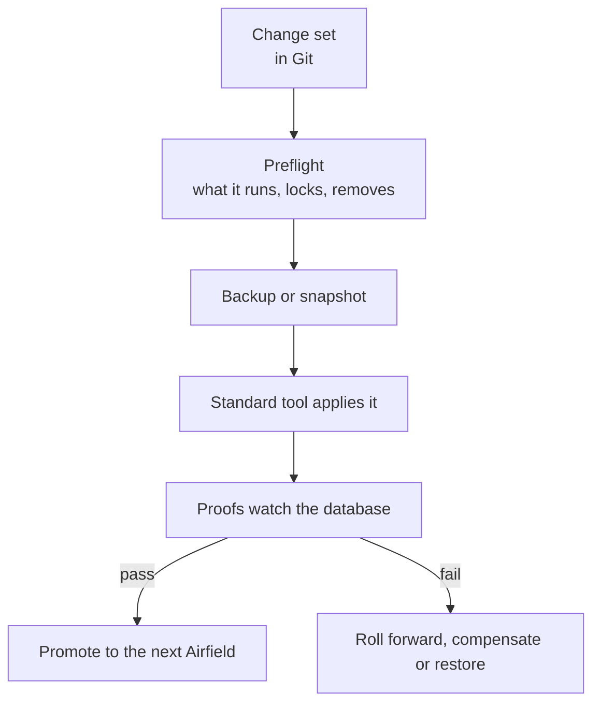

# Milestone 10: Databases that stay up, and database changes delivered like code

<!-- Generated by scripts/docs/build-roadmap.mjs from docs/roadmap/roadmap.json. Do not edit by hand. -->

<a href="../roadmap.html">Roadmap</a> › Milestone 10 · <a href="../roadmap-list.html">as a list</a>

Next 0 available · 1 in progress · 21 planned · 22 capabilities

Launchway keeps working when a database machine fails, loses no work it has acknowledged, and treats a change to your own databases as a first-class, checked, reversible part of a release.

## What it is, and who it is for

Milestone 10 has two halves. The first makes Launchway’s own database highly available: one writer at a time, always with a copy guaranteed to be up to date, and software that promotes that copy automatically while Launchway waits, retries and buffers. The second treats a customer’s database as a known thing in an Airfield: a change set is checked before it runs, a backup is taken first, a standard tool applies it, and proofs watch the database during and after. Launchway is honest about limits: Return to base for data means roll forward, a compensating change or a restore.

**Who it is for.** Teams that run Launchway for many people and teams whose releases include changes to their data.

## What you will be able to do

- A database machine dies mid-push. Launchway serves again within a minute, no acknowledged push is lost, and no step is run twice.
- You open a change set in a pull request and see the SQL it will run, what it will lock and whether it removes something a running version still uses.
- A change runs through test, then production, only if its checksum is unchanged since you cleared it.
- Two Airfields drift apart and Launchway shows exactly where.

## How it fits together

*A database change as a plan like any other. Launchway never claims a data Return to base it cannot do.*

**Builds on:** [Milestone 8: Zero downtime](milestone-8.md). 

**Go deeper:** [Databases](databases.md).

## The capabilities

| Group | Capabilities | Available | In progress | Planned |
|---|---|---|---|---|
| [Launchway’s own database stays up](#g-launchway-s-own-database-stays-up) | 9 | 0 | 1 | 8 |
| [Database changes as a delivery step](#g-database-changes-as-a-delivery-step) | 13 | 0 | 0 | 13 |

### Launchway’s own database stays up {#g-launchway-s-own-database-stays-up}

Near term. One writer at a time with a guaranteed up-to-date copy and automatic promotion.

#### Retries and buffering through a database failover {#retries-and-buffering-through-a-database-failover}

◐ In progress

Transient database errors are retried inside a stall budget, writes are safe to repeat, and Stations spool logs and results while the server is away. Today the first parts exist: store retries, repeat-safe Station writes, a Station spool and a database doctor. The rest is covered by the failure-injection tests.

[Area page](databases.md)

#### A highly available database mode {#a-highly-available-database-mode}

○ Planned

One chart setting gives one primary and two copies, with the primary not reporting a write as done until a copy has it. Launchway rides through up to two minutes without re-running a step or losing a log line.

**Depends on:** Retries and buffering through a database failover.

[Area page](databases.md)

#### Backups and point-in-time recovery {#backups-and-point-in-time-recovery}

○ Planned

Continuous archiving, point-in-time restore and an automatic restore drill that includes stored files. A restore that has not been tested is not counted. The drill restores the newest point daily and a random point in the window weekly into a throwaway installation, checks secrets, the record chain, stored files and Git refs, and reports time to restore and data at risk. A real restore is a wizard that picks the point on the record's timeline and lists by name the Sorties, pushes and setting changes that will be lost; it restores to a throwaway copy first. Builds on 'Scheduled backups with a restore drill, on any installation'.

**Depends on:** A highly available database mode

[Area page](databases.md)

#### The database status page and doctor {#the-database-status-page-and-doctor}

○ Planned

Whether the database is writable, how far behind the copies are, and what a failover would cost, in plain words. The doctor measures instead of guessing.

**Depends on:** A highly available database mode.

[Area page](databases.md)

#### Failure-injection tests and game days {#failure-injection-tests-and-game-days}

○ Planned

Kill the primary, partition the network, slow a copy and fail an ambiguous commit, then check an acknowledgment ledger for lost work. A game day is rehearsed on a production-like installation.

**Depends on:** A highly available database mode.

[Area page](databases.md)

#### Large files in their own database {#large-files-in-their-own-database}

○ Planned

Keep large stored files in a separate database or store so replication stays fast. The wizard asks the question that matters and explains it.

**Depends on:** A highly available database mode.

[Area page](databases.md)

#### Second site, rehearsed promotion {#second-site-rehearsed-promotion}

○ Planned

A standby installation in another site with a deliberate, rehearsed promotion and the replication lag on the status page. Automatic cross-site promotion is avoided to prevent split-brain. The standby accepts no Station and sends nothing until promoted. Promotion raises the record's generation number so the old primary, Stations and Launch Stations refuse older work; Stations and Detachments reconnect by address with their own keys and deliver spooled results; the wizard lists by name what the gap loses. An isolated promotion rehearsal runs weekly on a Patrol, and a full switch-over and back runs in a window under a Clearance.

**Depends on:** A highly available database mode

[Area page](databases.md)

#### Synchronous copy across sites {#synchronous-copy-across-sites}

○ Planned

Where the round trip allows, wait for the second site before reporting a write done. The doctor measures the round trip and recommends.

**Depends on:** Second site, rehearsed promotion.

[Area page](databases.md)

#### Cells for very large installations {#cells-for-very-large-installations}

○ Planned

Independent installations each owning a set of Wings, with a small directory above them. Not scheduled until a customer needs it.

**Depends on:** Second site, rehearsed promotion.

[Area page](databases.md)

### Database changes as a delivery step {#g-database-changes-as-a-delivery-step}

First phase. A change set is a plan like any other.

#### Databases in environments {#databases-in-environments}

○ Planned

A database is a known connection in an Airfield, with its engine, version and state. Credentials are least-privilege and audited.

**Depends on:** Shared connections.

[Area page](databases.md)

#### A database change step with Liquibase {#a-database-change-step-with-liquibase}

○ Planned

Apply a change set from your repository with Liquibase first, with dry run, apply and status. Other standard tools sit behind the same interface.

**Depends on:** Databases in Airfields.

[Area page](databases.md)

#### Preflight and clearance {#preflight-and-clearance}

○ Planned

See what the change will run and lock, and clear it; the clearance is void if the file changes afterward. A checksum is carried through every promotion.

**Depends on:** A database change step with Liquibase.

[Area page](databases.md)

#### Promotion through environments {#promotion-through-environments}

○ Planned

Move a change set from test to production only when it passed, unchanged. It uses the same approvals as other releases.

**Depends on:** Preflight and clearance.

[Area page](databases.md)

#### A Databases list and review page {#a-databases-list-and-review-page}

○ Planned

One list of every database and change, with a review page for each. It is also available in the API, the agent endpoint, the command line and Terraform.

**Depends on:** Databases in Airfields.

[Area page](databases.md)

#### Backward-compatibility lint {#backward-compatibility-lint}

○ Planned

Warn when a change removes or renames something a running version still uses. It depends on knowing which versions are running.

**Depends on:** Preflight and clearance.

[Area page](databases.md)

#### Lock and size estimates {#lock-and-size-estimates}

○ Planned

Estimate how long a change will lock a table and how large it is, from the engine’s own facts, before running. Launchway proposes an online method when a rewrite would block.

**Depends on:** Preflight and clearance.

[Area page](databases.md)

#### Backup before change {#backup-before-change}

○ Planned

Take a backup or snapshot before a change using your operator’s own mechanism, with the PostgreSQL operator most used on Kubernetes first. A restore is always a person’s decision.

**Depends on:** A database change step with Liquibase.

[Area page](databases.md)

#### Database proofs and the watch {#database-proofs-and-the-watch}

○ Planned

Watch the database during and after a change and, for changes marked reversible, propose a compensating change. Automatic compensation is off by default.

**Depends on:** Proofs.

[Area page](databases.md)

#### Drift between environments {#drift-between-environments}

○ Planned

Show where one Airfield’s schema differs from another’s and from Git. Drift is a finding with the exact difference.

**Depends on:** Promotion through Airfields.

[Area page](databases.md)

#### More change tools and online changes {#more-change-tools-and-online-changes}

○ Planned

Other standard change tools and online-change methods for large tables, behind the same interface. A customer’s own tool image can be used.

**Depends on:** A database change step with Liquibase.

[Area page](databases.md)

#### Masked and preview databases {#masked-and-preview-databases}

○ Planned

Short-lived databases for preview Airfields, with masking guidance for production-like data. Documented first, built if teams ask.

**Depends on:** More change tools and online changes.

[Area page](databases.md)

#### Database maintenance plans {#database-maintenance-plans}

○ Planned

Upgrades, vacuuming and restore drills as plans, with the engine’s estimators. It starts with PostgreSQL and widens.

**Depends on:** Backup before change.

[Area page](databases.md)

## What done means

This milestone is done when all of these are true.

- A seeded database failure is survived with no acknowledged work lost, measured and published.
- A change set is checked, backed up, applied by a standard tool, watched and promoted with its checksum verified.
- The Databases list shows each database in each Airfield, its state and its drift.

## What is deliberately not in it

- Making a long table rewrite zero-downtime by tooling alone: Launchway says so before running and proposes an online method.
- Claiming a data Return to base it cannot do.
- An active-active multi-writer database as the default: it would trade correctness for speed.

---

[← Milestone 9: Network and traffic](milestone-9.md) · [Milestone 11: Kubernetes and VMs →](milestone-11.md)
