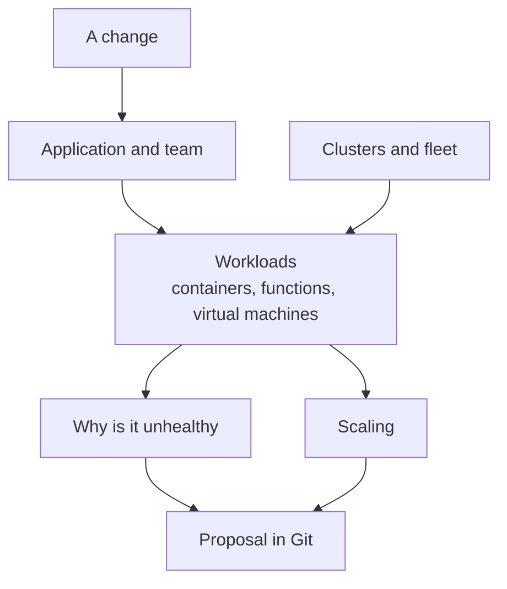

# Milestone 11: Kubernetes, autoscaling, serverless and virtual machines, seen as one

<!-- Generated by scripts/docs/build-roadmap.mjs from docs/roadmap/roadmap.json. Do not edit by hand. -->

<a href="../roadmap.html">Roadmap</a> › Milestone 11 · <a href="../roadmap-list.html">as a list</a>

Next 0 available · 0 in progress · 18 planned · 18 capabilities

Launchway shows each workload in the context of the change that made it, answers why it is not healthy in one sentence across delivery, autoscaling, nodes, network and virtual machines, and delivers every kind of workload the same safe way.

## What it is, and who it is for

Milestone 11 starts from the change, not from the list of cluster objects. It adds clusters and a fleet view, a model of workloads that covers every common kind, a catalog of reasons something is unhealthy, autoscaling as a first-class view with advice that arrives as proposals, serverless including on-premises, and virtual machines on Kubernetes with full lifecycle and delivery. Raw depth in specialist tools stays in those tools, linked from the exact object. Launchway helps and does not take over: right-sizing, scaling and upgrade advice arrive as Git proposals.

**Who it is for.** Application developers, on-call operators, platform engineers, security officers and managers, each of whom gets their own point of view on the same facts.

## What you will be able to do

- An on-call engineer opens a workload and reads one sentence: the new version cannot start because a node has no room, and the autoscaler cannot add one.
- A developer sees only their service, with its rollouts, scaling and logs; a manager sees delivery flow and cost by team.
- A scaling view shows why a workload is not scaling and proposes a change as a pull request.
- A virtual machine’s disk import fails, and Launchway says the source address returned an error.
- A virtual machine is released with the same plan, proofs and return as a container.

## How it fits together

*Everything starts from the change and its owner, and arrives at a proposal you can review.*

**Builds on:** [Milestone 8: Zero downtime](milestone-8.md). 

**Go deeper:** [Kubernetes and virtual machines](kubernetes-vms.md).

## The capabilities

| Group | Capabilities | Available | In progress | Planned |
|---|---|---|---|---|
| [Clusters, fleet and workloads](#g-clusters-fleet-and-workloads) | 7 | 0 | 0 | 7 |
| [Autoscaling and serverless](#g-autoscaling-and-serverless) | 5 | 0 | 0 | 5 |
| [Virtual machines on Kubernetes](#g-virtual-machines-on-kubernetes) | 6 | 0 | 0 | 6 |

### Clusters, fleet and workloads {#g-clusters-fleet-and-workloads}

First phase after the Argo CD work. Observe before anything else.

#### Clusters and the fleet {#clusters-and-the-fleet}

○ Planned

Register a cluster and see its health, capacity, versions, nodes, namespaces and quotas, with the fleet at a glance. The first level of access is read-only, and the interface says what a higher level would add.

**Depends on:** See every application and its tree.

[Area page](kubernetes-vms.md)

#### A model for every workload kind {#a-model-for-every-workload-kind}

○ Planned

Deployments, rollouts, jobs, stateful sets and more under one model with desired against live, logs, events and a shell where policy allows. Today Launchway reads four kinds of object; this widens it to the core set.

**Depends on:** Clusters and the fleet.

[Area page](kubernetes-vms.md)

#### Why is it not healthy {#why-is-it-not-healthy}

○ Planned

A catalog of reasons, across delivery, scaling, nodes, network and machines, answered in one sentence with the change that came just before. It is tested against seeded failures and says so when it cannot tell.

**Depends on:** A model for every workload kind.

[Area page](kubernetes-vms.md)

#### Perspectives {#perspectives}

○ Planned

A switcher gives a developer, an operator, a platform engineer, a security officer and a manager each their own start page. The switcher changes the view, never what a person is allowed to do.

**Depends on:** Clusters and the fleet.

[Area page](kubernetes-vms.md)

#### Upgrade readiness {#upgrade-readiness}

○ Planned

Which applications use deprecated interfaces before a cluster upgrade, listed by application and owner. Findings arrive as proposals.

**Depends on:** Clusters and the fleet.

[Area page](kubernetes-vms.md)

#### Cost, policy and backup in context {#cost-policy-and-backup-in-context}

○ Planned

Cost by application and team, policy results and backup status, read from the tools that own them. Deep screens stay in those tools and are linked.

**Depends on:** Clusters and the fleet.

[Area page](kubernetes-vms.md)

#### Fleet lifecycle and node upgrades {#fleet-lifecycle-and-node-upgrades}

○ Planned

Plans for node maintenance and cluster upgrades, and an adapter for the tool that provisions clusters. Edge and air-gapped bundles come in the same phase.

**Depends on:** Clusters and the fleet.

[Area page](kubernetes-vms.md)

### Autoscaling and serverless {#g-autoscaling-and-serverless}

Second phase. Scaling is explained, not just configured.

#### The scaling view {#the-scaling-view}

○ Planned

For each workload, what scales it, why it is or is not scaling, and how the horizontal, vertical, event-driven and node scalers interact. It names conflicts, such as two scalers acting on the same field.

**Depends on:** A model for every workload kind.

[Area page](kubernetes-vms.md)

#### An assistant for “make this scale” {#an-assistant-for-make-this-scale}

○ Planned

A few questions produce a scaling setup, proposed through Git. It supports the standard horizontal scaler and KEDA.

**Depends on:** The scaling view.

[Area page](kubernetes-vms.md)

#### Right-sizing proposals {#right-sizing-proposals}

○ Planned

Observed use against requested size, with a proposal to change it. Nothing is changed silently.

**Depends on:** The scaling view.

[Area page](kubernetes-vms.md)

#### Scaling during a rollout and a test {#scaling-during-a-rollout-and-a-test}

○ Planned

A rollout and a performance test understand the autoscaler and ask it for headroom instead of fighting it. It uses the temporary capacity step in Milestone 8.

**Depends on:** Temporary capacity for tests.

[Area page](kubernetes-vms.md)

#### Autoscalers in view during a Launch {#autoscalers-in-view-during-a-launch}

○ Planned

The Launch page shows what each autoscaler did while the Launch ran, per version, and why a share of traffic moved when it did. Copies wanted and running for the stable and the new version, each scaling event on the Launch timeline, a warning when the traffic split follows the ratio of copies and a scaler changes it, and a two-fleet swap that sizes the new fleet to the stable fleet's current copies rather than its minimum. Scale stays unavailable while an autoscaler manages the count, as today.

**Depends on:** The scaling view

[Area page](kubernetes-vms.md)

### Virtual machines on Kubernetes {#g-virtual-machines-on-kubernetes}

After autoscaling, or before it if virtual machines matter more to you. KubeVirt first.

#### See and create virtual machines through Git {#see-and-create-virtual-machines-through-git}

○ Planned

A virtual machine is a workload like any other: seen with its state and created by a change in Git. Disks, interfaces and run strategy are all shown.

**Depends on:** A model for every workload kind.

[Area page](kubernetes-vms.md)

#### Disks, imports and snapshots {#disks-imports-and-snapshots}

○ Planned

Import, clone and upload progress, failed imports with the reason, and snapshots and restores. A reason such as “the source returned an error” appears in the interface.

**Depends on:** See and create virtual machines through Git.

[Area page](kubernetes-vms.md)

#### Live migration and access {#live-migration-and-access}

○ Planned

Watch and control live migration, and open a console or an access session with the right permissions. Stuck migrations are explained.

**Depends on:** See and create virtual machines through Git.

[Area page](kubernetes-vms.md)

#### One list of all virtual machines and hosts {#one-list-of-all-virtual-machines-and-hosts}

○ Planned

Machines on Kubernetes and elsewhere in one inventory with what runs on each. Other hypervisors appear as hosts. The first version is the fleet page of Milestone 3, which already lists every fleet host with its release; this adds virtual machines on Kubernetes to the same list.

**Depends on:** See and create virtual machines through Git; Fleets held in the product

[Area page](kubernetes-vms.md)

#### Virtual machine delivery {#virtual-machine-delivery}

○ Planned

Release a machine with the same plan, proofs, watch and return as a container. It reuses the host pools of Milestone 8.

**Depends on:** Hosts and pools.

[Area page](kubernetes-vms.md)

#### Maintenance and hypervisor migration {#maintenance-and-hypervisor-migration}

○ Planned

Drain and upgrade nodes with virtual machines moved safely, and move machines between Airfields. Maintenance is a plan with a watch.

**Depends on:** Virtual machine delivery.

[Area page](kubernetes-vms.md)

## What done means

This milestone is done when all of these are true.

- A cluster registered with read access shows its health, capacity, nodes, namespaces and quotas, and every workload of the common kinds.
- The catalog of reasons something is unhealthy is tested on seeded failures.
- Autoscaling is shown with its causes and interactions, and right-sizing arrives as a proposal.
- Virtual machines on Kubernetes can be seen, created through Git, and delivered with the same plan and proofs.

## What is deliberately not in it

- Editing live objects by hand: Git is where change happens, with a deep link for the rare emergency.
- Writing a policy engine or a metrics store, or building a Kubernetes distribution.
- Managing hypervisors that are not on Kubernetes beyond listing them as hosts.

---

[← Milestone 10: Databases](milestone-10.md) · [Milestone 12: Security and trust →](milestone-12.md)
