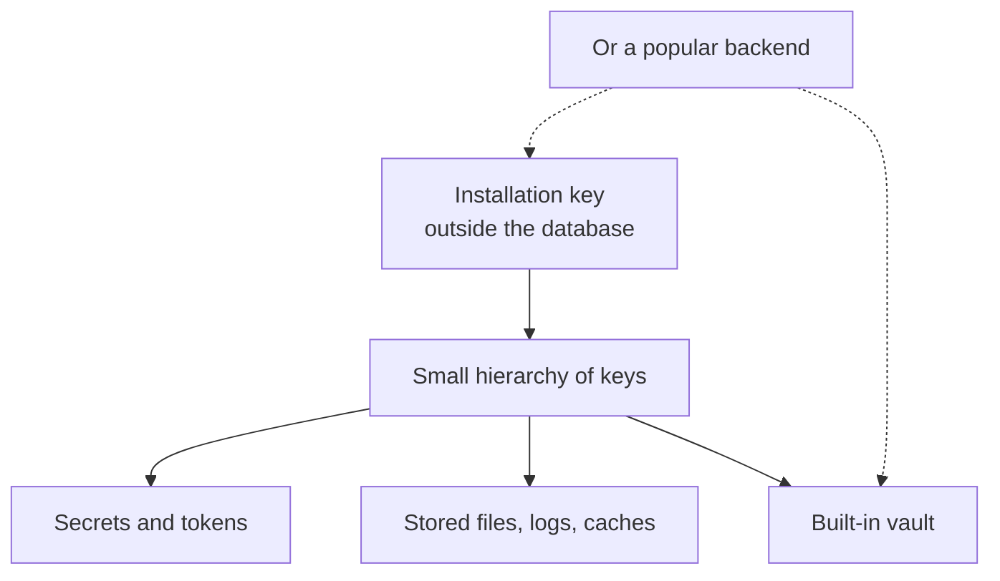

# Milestone 12: Security and trust: encrypted at rest, its own vault, and honest certification

<!-- Generated by scripts/docs/build-roadmap.mjs from docs/roadmap/roadmap.json. Do not edit by hand. -->

<a href="../roadmap.html">Roadmap</a> › Milestone 12 · <a href="../roadmap-list.html">as a list</a>

Next 2 available · 1 in progress · 20 planned · 23 capabilities

Everything Launchway holds is encrypted at rest with a key kept outside the database, an installation needs the fewest possible extra tools, and what is claimed about security is only what is true that day.

## What it is, and who it is for

Milestone 12 raises the foundation. A root key kept outside the database protects a small hierarchy of keys that protects every secret and stored file, so a database copy alone is useless. Launchway gets its own vault, and every built-in is optional: you can use a popular backend instead. Scans become gates with a stated policy, and the certification path is written down in an honest order.

**Who it is for.** Anyone who runs Launchway for a team that cares about security, and anyone evaluating it for a regulated environment.

## What you will be able to do

- Someone gets a copy of the database. Without the installation key it is unreadable.
- You rotate the installation key and nothing goes down.
- A team with no other secret store keeps its secrets in Launchway’s vault, sealed by the same key hierarchy.
- The doctor says plainly what is encrypted, what is not and how to fix it.
- A signed release carries its provenance and an SBOM that anyone can verify.

## How it fits together

*One root key, a few keys under it, and an option to use a backend you already run.*

**Builds on:** [Milestone 1: Host and run](milestone-1.md). 

**Go deeper:** [Security and trust](security-trust.md).

## The capabilities

| Group | Capabilities | Available | In progress | Planned |
|---|---|---|---|---|
| [Encryption at rest](#g-encryption-at-rest) | 9 | 0 | 1 | 8 |
| [Launchway’s own vault](#g-launchway-s-own-vault) | 4 | 0 | 0 | 4 |
| [The security program](#g-the-security-program) | 4 | 2 | 0 | 2 |
| [Certification, in an honest order](#g-certification-in-an-honest-order) | 6 | 0 | 0 | 6 |

### Encryption at rest {#g-encryption-at-rest}

First phase, in progress.

#### An installation key and a key hierarchy {#an-installation-key-and-a-key-hierarchy}

◐ In progress

A root key held outside the database protects a small hierarchy of keys that protect every secret and every stored file. Today the key library and the first adapter are being built; the default needs nothing installed (a key file or a passphrase-unsealed store).

[Area page](security-trust.md)

#### Key sources you choose {#key-sources-you-choose}

○ Planned

Take the installation key from a mounted secret, a passphrase, a cloud key service, a vault’s transit service, a hardware module or a platform chip. Each is an adapter behind one interface.

**Depends on:** An installation key and a key hierarchy.

[Area page](security-trust.md)

#### Encrypt stored secrets and tokens {#encrypt-stored-secrets-and-tokens}

○ Planned

Move the keys that sit in plaintext in the database today into encryption under the hierarchy. Reads work with both old and new forms during the move.

**Depends on:** An installation key and a key hierarchy.

[Area page](security-trust.md)

#### Encrypt stored files, logs and caches {#encrypt-stored-files-logs-and-caches}

○ Planned

Artifacts, caches, repository data and logs are encrypted as streams, re-encrypted lazily. Large files are never loaded whole.

**Depends on:** Encrypt stored secrets and tokens.

[Area page](security-trust.md)

#### Rotation without downtime {#rotation-without-downtime}

○ Planned

Rotate keys, re-wrap them and re-encrypt over time while Launchway keeps serving. Backups and restores keep working across rotations.

**Depends on:** Encrypt stored files, logs and caches.

[Area page](security-trust.md)

#### The doctor reports encryption plainly {#the-doctor-reports-encryption-plainly}

○ Planned

A plain report of what is encrypted, what is not, and the one step to fix each gap. It never says encrypted when it is not.

**Depends on:** Encrypt stored secrets and tokens.

[Area page](security-trust.md)

#### Tamper-evident audit trail {#tamper-evident-audit-trail}

○ Planned

The audit trail forms a chain so a deletion or an edit shows. The chain head can be exported for safekeeping.

**Depends on:** Encrypt stored secrets and tokens.

[Area page](security-trust.md)

#### Transport and sign-in hardening {#transport-and-sign-in-hardening}

○ Planned

Built-in transport encryption, refusal of unencrypted database connections, and sign-in rate limits with lockout. Safe defaults are on and your team can tune them.

[Area page](security-trust.md)

#### Customer-held keys and deletion by key destruction {#customer-held-keys-and-deletion-by-key-destruction}

○ Planned

For the hosted service, keep logs and artifacts under a key you hold, and prove deletion by destroying it. Leaving is complete.

**Depends on:** Rotation without downtime.

[Area page](security-trust.md)

### Launchway’s own vault {#g-launchway-s-own-vault}

After encryption at rest. A minimum to install, and always optional.

#### A built-in secret store {#a-built-in-secret-store}

○ Planned

Keep secrets in Launchway with policies and an audit trail, sealed by the same key hierarchy. It shares the database’s high availability.

**Depends on:** An installation key and a key hierarchy.

[Area page](security-trust.md)

#### Popular backends instead {#popular-backends-instead}

○ Planned

Use a popular secret backend instead, with the same behavior through one interface and a published parity matrix. Vault and OpenBao work today for runners; this widens it.

**Depends on:** A built-in secret store.

[Area page](security-trust.md)

#### Workload identity and dynamic credentials {#workload-identity-and-dynamic-credentials}

○ Planned

Short-lived credentials issued to a run for the time it needs them. A step never holds a long-lived secret.

**Depends on:** A built-in secret store.

[Area page](security-trust.md)

#### Built in by default, a backend by choice {#built-in-by-default-a-backend-by-choice}

○ Planned

Every dependency has a built-in default and a popular external option, with the trade-offs written down. The only things required remain a database and Git.

[Area page](security-trust.md)

### The security program {#g-the-security-program}

Ongoing. Scans are gates, releases are verifiable and the program is written down.

#### Security scans as a program {#security-scans-as-a-program}

✓ Available

Code, dependency, secret, image, chart and manifest scanning, fuzzing and security headers run on every change. Gates have a stated policy and an expiring exception process.

[Read the documentation](../security/how-launchway-is-scanned.md)

#### A security policy and threat model {#a-security-policy-and-threat-model}

✓ Available

A published policy for reporting a problem and a written threat model that shows what Launchway defends against. Both are kept current with the code.

[Read the documentation](../security/threat-model.md)

#### A hardening guide and installation benchmark {#a-hardening-guide-and-installation-benchmark}

○ Planned

A guide and an automated check for how to harden an installation, in the style of a standard benchmark. The doctor runs the check.

[Area page](security-trust.md)

#### Penetration testing and incident response {#penetration-testing-and-incident-response}

○ Planned

Independent testing, a response runbook and a public summary of what was found. Scheduled after encryption at rest and the vault ship.

**Depends on:** The security program.

[Area page](security-trust.md)

### Certification, in an honest order {#g-certification-in-an-honest-order}

Practices first, then certificates earned. Launchway never claims one it has not earned.

#### Open source security badges and a scorecard {#open-source-security-badges-and-a-scorecard}

○ Planned

The open-source security best-practices badge and a public scorecard with a target. Some checks need people and time and will lag honestly.

[Area page](security-trust.md)

#### Build provenance, level two now and three next {#build-provenance-level-two-now-and-three-next}

○ Planned

Signed provenance for every release, then a build platform that isolates runs and keeps signing keys from build steps. Anyone can verify it.

[Read the documentation](../security/supply-chain.md) · [Area page](security-trust.md)

#### An independent security audit {#an-independent-security-audit}

○ Planned

A specialist firm audits the server, sign-in, runner protocol, encryption and chart defaults, and a summary is published. It follows encryption at rest and the vault.

**Depends on:** An installation key and a key hierarchy.

[Area page](security-trust.md)

#### A validated cryptographic build {#a-validated-cryptographic-build}

○ Planned

A build variant that uses a validated cryptographic module, claimed only for that variant. The default build never claims it.

**Depends on:** Rotation without downtime.

[Area page](security-trust.md)

#### Hosted service attestation {#hosted-service-attestation}

○ Planned

An independent report on the hosted service’s controls, then a longer-period report. It follows once the hosted service has run.

**Depends on:** Hosted service that holds nothing sensitive.

[Area page](security-trust.md)

#### Responsibility matrix for regulated customers {#responsibility-matrix-for-regulated-customers}

○ Planned

A table of which payment-card and health-data requirements Launchway’s features help you meet and which remain yours. Launchway supports compliance work; it is not a certification.

[Read the documentation](../security/controls-and-compliance.md) · [Area page](security-trust.md)

## What done means

This milestone is done when all of these are true.

- Every secret and stored file is encrypted at rest, and a database dump alone cannot be read.
- Rotation and re-encryption happen without downtime, and an existing installation migrates without breaking.
- The built-in vault and the popular-backend adapters pass the same tests.
- Every scan the security community recommends runs as a gate with an expiring exception process.

## What is deliberately not in it

- Claiming certifications that have not been earned.
- Keeping a key in the same database it protects.

---

[← Milestone 11: Kubernetes and VMs](milestone-11.md) · [Beyond: Beyond →](beyond.md)
