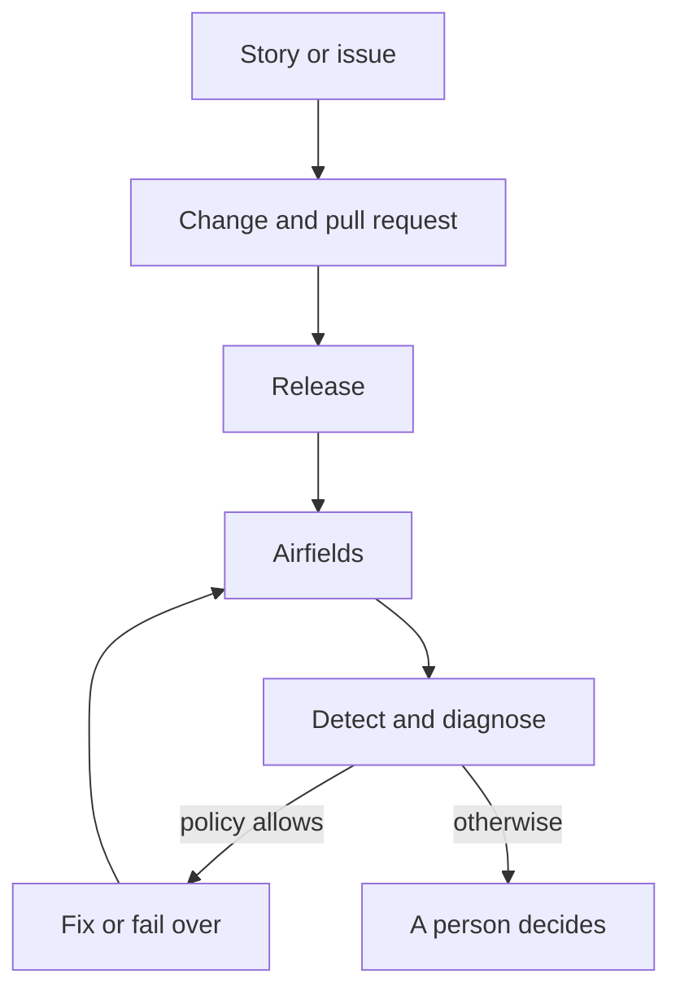

# Milestone 13: Plan the work, release it, and keep it healthy

<!-- Generated by scripts/docs/build-roadmap.mjs from docs/roadmap/roadmap.json. Do not edit by hand. -->

<a href="../roadmap.html">Roadmap</a> › Milestone 13 · <a href="../roadmap-list.html">as a list</a>

Next 3 available · 1 in progress · 17 planned · 21 capabilities

Work is planned and tracked beside the code, releases are managed as things that move through Airfields, and the services Launchway delivers are watched, diagnosed and, where you allow it, fixed.

## What it is, and who it is for

Milestone 13 adds the human side of delivery. Issues, stories, boards and sprints are linked to the commits and the running software that answer them. A release is a version with notes and assets that is promoted through Airfields with checklists, windows and freezes. A first scan of an imported repository files a small, grouped set of work. After delivery, Launchway detects trouble, explains it and, only where a policy allows, applies a fix, with traffic failing over automatically.

**Who it is for.** Teams that want planning, release management and operations in the same place as their code and their delivery.

## What you will be able to do

- You open a story and see the pull request, the Sortie, the release and the Airfield where the fix is running.
- A release moves from test to production with its checklist, its freeze windows and its approvals in one record.
- You import a repository and get a short, grouped list of things worth fixing, not a thousand tickets.
- An alert fires; Launchway shows what changed, proposes a fix, and applies it only if a policy you set allows it.

## How it fits together

*From a story to a running fix, and from an alert back to a decision.*

**Builds on:** [Milestone 1: Host and run](milestone-1.md), [Milestone 8: Zero downtime](milestone-8.md). 

## The capabilities

| Group | Capabilities | Available | In progress | Planned |
|---|---|---|---|---|
| [Work tracking](#g-work-tracking) | 7 | 1 | 1 | 5 |
| [Release management](#g-release-management) | 2 | 1 | 0 | 1 |
| [Keep it healthy](#g-keep-it-healthy) | 5 | 0 | 0 | 5 |
| [One home for insight and health](#g-one-home-for-insight-and-health) | 7 | 1 | 0 | 6 |

### Work tracking {#g-work-tracking}

Plan the work where the code and the delivery are.

#### Issues, stories, epics and boards {#issues-stories-epics-and-boards}

✓ Available

Plan, assign and follow work in the product, linked to commits, runs and the places where a fix is running. Backlog and sprints are included.

[Area page](git-hosting.md)

#### Import and archive other trackers {#import-and-archive-other-trackers}

◐ In progress

Bring another tracker's issues in as a read-only archive now, and promote them to live items later. The read-only archive is on the main branch; promotion needs work tracking to land.

[Area page](git-hosting.md)

#### A first look on import {#a-first-look-on-import}

○ Planned

When repositories are imported, and on demand afterwards, Launchway scans and analyzes them and shows what it found from day one: security findings, dependency and license problems, missing pipelines, unprotected default branches and missing owners. It files a small, grouped, reviewed set of work items instead of thousands.

[Area page](repository-standards.md)

#### Requirements from an outside tool, traced to evidence {#requirements-from-an-outside-tool-traced-to-evidence}

○ Planned

Connect a requirements tool as the provider in charge of requirements; items, tests and releases link to its requirements and the evidence is written back. Acceptance criteria on items are the built-in default. The tool owns requirement text and versions; Launchway reads keys, titles, versions and status live for pickers, and writes back linked items, pull requests, releases, the tests that verify each requirement with their latest results, and the Airfields where it runs. A changed requirement version flags what was verified against the old one. The evidence pack carries a requirement-to-test-to-release trace with gaps named. Rules read Launchway's own record, so nothing waits on the tool.

**Depends on:** Issues and work items; Releases with notes and evidence.

[Area page](git-hosting.md)

#### The launch line starts at the work item {#the-launch-line-starts-at-the-work-item}

○ Planned

An item shows the launch line of every change it carries, from branch to production, with each station opening its evidence. Today the item states its delivery status as a sentence and a line per Airfield. This draws the same facts with the launch line component, one line per change, and updates on a Return to base.

**Depends on:** Follow a change on its launch line; Issues and work items.

[Area page](guided-interface.md)

#### An outside tracker in charge of work {#an-outside-tracker-in-charge-of-work}

○ Planned

Choose an outside tracker as the provider in charge of work for a Squadron; code and delivery still link to its tickets. One provider in charge per Squadron, shown as served by. References in branches, commits and pull requests resolve to the outside keys, the delivery status is written back, release notes read the linked tickets, and agents claim through the same holding pattern. Both run at once only while migrating, with a visible end.

**Depends on:** Import and sync from other trackers.

[Area page](git-hosting.md)

#### Work item forms built from typed inputs {#work-item-forms-built-from-typed-inputs}

○ Planned

New items, issue forms and custom fields use the same typed forms as Sorties, so values are picked and checked, not typed. Assignees, sprints, parents, labels and select fields come from searchable lists; a required field and a wrong value are explained in a sentence beside the field.

**Depends on:** Templates for changes and work; One form engine for every wizard.

[Area page](inputs-and-forms.md)

### Release management {#g-release-management}

A release is what moves through Airfields.

#### Releases that are promoted {#releases-that-are-promoted}

✓ Available

A release has a version, notes and assets, is immutable once published, and is promoted through Airfields with checklists, windows, freezes and approvals. Things released together are grouped, and four delivery measures are reported.

[Area page](git-hosting.md)

#### Versions and release notes by branch role {#versions-and-release-notes-by-branch-role}

○ Planned

Each role has its version scheme: prereleases or calendar versions on the trunk, a version line per release branch, tags per component; notes for a release line say what was carried back. Builds on the version schemes and generated notes that exist today; a person still confirms each version.

**Depends on:** Branch roles that pipelines read

[Area page](branching.md)

### Keep it healthy {#g-keep-it-healthy}

Detect, diagnose, remediate: native, optional and gated by policy.

#### Detect and diagnose {#detect-and-diagnose}

○ Planned

Alerts on the services Launchway delivers come with the changes that preceded them, the evidence and a plain explanation. Builds on the watch after a deployment and the Airfield health view.

[Area page](zero-downtime.md)

#### Remediate, only where policy allows {#remediate-only-where-policy-allows}

○ Planned

Automatic fixes are off by default and start with returning to the last good version after a failed launch, in a shadow mode first; rules say what an agent may change. Every action is recorded and can be switched off.

[Area page](zero-downtime.md)

#### Automatic traffic failover {#automatic-traffic-failover}

○ Planned

When an Airfield or site is unhealthy, traffic moves to a healthy one under rules you set, and the move is shown and recorded. Optional; Launchway helps and does not enforce.

[Area page](network.md)

#### Notifications for what was done {#notifications-for-what-was-done}

○ Planned

Every detection and every automatic fix is announced to the channels you choose. Notification channels are on the main branch; the events are planned.

[Area page](pipelines.md)

#### On-call and incident tools, connected {#on-call-and-incident-tools-connected}

○ Planned

Alerts come in through a signed events Hardpoint, are linked to the nearest change, and the incident in your on-call tool is given the Launch, the timeline and the record. Paging, schedules, escalation and status pages stay in the connected tool. Time to restore is computed from Launchway's record.

**Depends on:** Cards and events in, notifications out.

[Area page](zero-downtime.md)

### One home for insight and health {#g-one-home-for-insight-and-health}

Launchway’s own numbers, delivery measures, cost and reliability targets in one place, each opening on the record behind it.

#### Panels from a connected dashboard tool {#panels-from-a-connected-dashboard-tool}

○ Planned

Pin a named panel from the dashboard tool a team runs on a Flight, Airfield or Launch page, drawn with the viewer's own permissions and with Launch, Switch and Clearance markers. The panel's query runs through the guarded query layer with selectors pinned to what the viewer may see; a panel that cannot be read or narrowed is shown as a link card with the reason. Never required; every panel names its source and opens in the tool.

**Depends on:** Signal sources; Guarded queries for monitoring data.

[Area page](delivery.md)

#### What AI work costs and what it delivered {#what-ai-work-costs-and-what-it-delivered}

○ Planned

Insights show model spend by purpose, model, Flight and agent against limits, and what AI work delivered: agent changes merged, reverted and returned to base, and cost per merged change. Read from the gateway's usage entries and the record. Agents may be compared; people never are, and a person sees only their own use. Every number opens the calls and changes behind it.

**Depends on:** Usage monitoring.

[Area page](ai.md)

#### Launchway's own metrics and traces, exported {#launchway-s-own-metrics-and-traces-exported}

✓ Available

Servers and Stations expose their metrics in the standard text format and can send traces to a collector, so any monitoring tool can watch Launchway. Labels come from small closed sets and never name a repository, branch, person or Sortie. The Sortie page links to its trace. Documented in the metrics reference and the server configuration.

[Read the documentation](../reference/metrics.md) · [Area page](delivery.md)

#### Lead time from request to production {#lead-time-from-request-to-production}

○ Planned

Measure from the work item's creation to its change running in production, beside the commit-based lead time. Uses the delivery status that items already carry; shows waiting and working time per station.

**Depends on:** Issues and work items; Releases that are promoted.

[Area page](delivery.md)

#### Cost sources, connected and named {#cost-sources-connected-and-named}

○ Planned

Connect the cost tool or cloud billing export a team already has, and see its numbers beside each Launch with the source named. One cost source in charge per Wing, shown as served by; resources map to Flights and Airfields through the software graph.

**Depends on:** The software graph.

[Area page](kubernetes-vms.md)

#### Error budgets that guard production Launches {#error-budgets-that-guard-production-launches}

○ Planned

A typed Standing order holds production Launches when a service's error budget is nearly spent, except fixes with a Clearance, and Overwatch watches the burn rate. Advance is held; a Return to base never is. The threshold is set per Airfield and can be locked from above.

**Depends on:** Service reliability targets; The watch.

[Area page](traffic.md)

#### A picture of each Squadron and Flight {#a-picture-of-each-squadron-and-flight}

○ Planned

A Squadron or Flight page made of cards: needs you, delivery measures, Sortie and test health, work velocity, applications, cost and recent releases. Built from the same cards as the Tower, with a shared layout per level and personal layouts on top.

**Depends on:** Shared layouts and personal layouts.

[Area page](guided-interface.md)

## What done means

This milestone is done when all of these are true.

- Issues, stories, boards and sprints exist, are linked to code and deployments, and can be assigned to people.
- A release is immutable once published and can be promoted with checklists, windows and freezes.
- Detect, diagnose and remediate are optional, off by default, and gated by policy; every action is recorded.

## What is deliberately not in it

- A full home-automation or security product for others.
- Anything that fixes without a policy that allows it.

---

[← Milestone 12: Security and trust](milestone-12.md) · [Milestone 14: Editors and extension points →](milestone-14.md)
