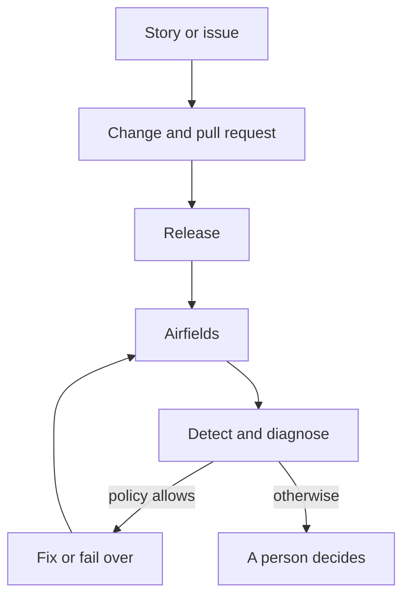

# Milestone 13: Plan the work, release it, and keep it healthy

<!-- Generated by scripts/docs/build-roadmap.mjs from docs/roadmap/roadmap.json. Do not edit by hand. -->

<a href="../roadmap.html">Roadmap</a> › Milestone 13 · <a href="../roadmap-list.html">as a list</a>

Next 2 available · 1 in progress · 5 planned · 8 capabilities

Work is planned and tracked beside the code, releases are managed as things that move through Airfields, and the services Launchway delivers are watched, diagnosed and, where you allow it, fixed.

## What it is, and who it is for

Milestone 13 adds the human side of delivery. Issues, stories, boards and sprints are linked to the commits and the running software that answer them. A release is a version with notes and assets that is promoted through Airfields with checklists, windows and freezes. A first scan of an imported repository files a small, grouped set of work. After delivery, Launchway detects trouble, explains it and, only where a policy allows, applies a fix, with traffic failing over automatically.

**Who it is for.** Teams that want planning, release management and operations in the same place as their code and their delivery.

## What you will be able to do

- You open a story and see the pull request, the Sortie, the release and the Airfield where the fix is running.
- A release moves from test to production with its checklist, its freeze windows and its approvals in one record.
- You import a repository and get a short, grouped list of things worth fixing, not a thousand tickets.
- An alert fires; Launchway shows what changed, proposes a fix, and applies it only if a policy you set allows it.

## How it fits together

*From a story to a running fix, and from an alert back to a decision.*

**Builds on:** [Milestone 1: Host and run](milestone-1.md), [Milestone 8: Zero downtime](milestone-8.md). 

## The capabilities

| Group | Capabilities | Available | In progress | Planned |
|---|---|---|---|---|
| [Work tracking](#g-work-tracking) | 3 | 1 | 1 | 1 |
| [Release management](#g-release-management) | 1 | 1 | 0 | 0 |
| [Keep it healthy](#g-keep-it-healthy) | 4 | 0 | 0 | 4 |

### Work tracking {#g-work-tracking}

Plan the work where the code and the delivery are.

#### Issues, stories, epics and boards {#issues-stories-epics-and-boards}

✓ Available

Plan, assign and follow work in the product, linked to commits, runs and the places where a fix is running. Backlog and sprints are included.

[Area page](git-hosting.md)

#### Import and archive other trackers {#import-and-archive-other-trackers}

◐ In progress

Bring another tracker's issues in as a read-only archive now, and promote them to live items later. The read-only archive is on the main branch; promotion needs work tracking to land.

[Area page](git-hosting.md)

#### A first look on import {#a-first-look-on-import}

○ Planned

When repositories are imported, and on demand afterwards, Launchway scans and analyzes them and shows what it found from day one: security findings, dependency and license problems, missing pipelines, unprotected default branches and missing owners. It files a small, grouped, reviewed set of work items instead of thousands.

[Area page](repository-standards.md)

### Release management {#g-release-management}

A release is what moves through Airfields.

#### Releases that are promoted {#releases-that-are-promoted}

✓ Available

A release has a version, notes and assets, is immutable once published, and is promoted through Airfields with checklists, windows, freezes and approvals. Things released together are grouped, and four delivery measures are reported.

[Area page](git-hosting.md)

### Keep it healthy {#g-keep-it-healthy}

Detect, diagnose, remediate: native, optional and gated by policy.

#### Detect and diagnose {#detect-and-diagnose}

○ Planned

Alerts on the services Launchway delivers come with the changes that preceded them, the evidence and a plain explanation. Builds on the watch after a deployment and the Airfield health view.

[Area page](zero-downtime.md)

#### Remediate, only where policy allows {#remediate-only-where-policy-allows}

○ Planned

Automatic fixes are off by default and start with returning to the last good version after a failed launch, in a shadow mode first; rules say what an agent may change. Every action is recorded and can be switched off.

[Area page](zero-downtime.md)

#### Automatic traffic failover {#automatic-traffic-failover}

○ Planned

When an Airfield or site is unhealthy, traffic moves to a healthy one under rules you set, and the move is shown and recorded. Optional; Launchway helps and does not enforce.

[Area page](network.md)

#### Notifications for what was done {#notifications-for-what-was-done}

○ Planned

Every detection and every automatic fix is announced to the channels you choose. Notification channels are on the main branch; the events are planned.

[Area page](pipelines.md)

## What done means

This milestone is done when all of these are true.

- Issues, stories, boards and sprints exist, are linked to code and deployments, and can be assigned to people.
- A release is immutable once published and can be promoted with checklists, windows and freezes.
- Detect, diagnose and remediate are optional, off by default, and gated by policy; every action is recorded.

## What is deliberately not in it

- A full home-automation or security product for others.
- Anything that fixes without a policy that allows it.

---

[← Milestone 12: Security and trust](milestone-12.md) · [Milestone 14: Editors and extension points →](milestone-14.md)
