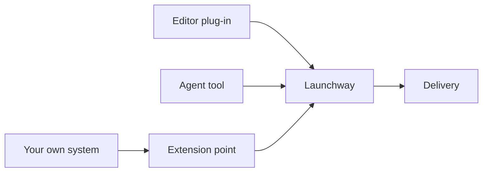

# Milestone 14: Your editor, and your own systems

<!-- Generated by scripts/docs/build-roadmap.mjs from docs/roadmap/roadmap.json. Do not edit by hand. -->

<a href="../roadmap.html">Roadmap</a> › Milestone 14 · <a href="../roadmap-list.html">as a list</a>

Next 0 available · 0 in progress · 6 planned · 6 capabilities

Developers use Launchway from the editor they already have, and companies connect their own systems through published extension points, so nothing in the product only its authors can use.

## What it is, and who it is for

Milestone 14 keeps Launchway out of the developer's way and out of your private business. Editor plug-ins and a one-step setup for agent tools put runs, findings and approvals where the developer already is. An optional development environment in the browser is available for those who want one. Everything specific to one company connects through extension points that run outside the product, with their own credentials, budgets and permissions.

**Who it is for.** Developers who live in an editor, and teams with systems of their own that should connect to delivery.

## What you will be able to do

- A developer starts a run, reads a failure and approves a change without leaving the editor.
- One command configures the agent tool you use, with read-only access by default.
- A team connects its own alerting or house systems through an extension point, and Launchway needs no code change.

## How it fits together

*Plug-ins, agent tools and your own systems reach the same interface under the same permissions.*

**Builds on:** [Milestone 1: Host and run](milestone-1.md). 

## The capabilities

| Group | Capabilities | Available | In progress | Planned |
|---|---|---|---|---|
| [The editor](#g-the-editor) | 3 | 0 | 0 | 3 |
| [Extension points](#g-extension-points) | 3 | 0 | 0 | 3 |

### The editor {#g-the-editor}

Launchway where you already work.

#### Editor plug-ins {#editor-plug-ins}

○ Planned

Plug-ins for the popular editors show runs, findings and decisions, and start runs, under the same permission rules as the web interface. Published from one signed package.

[Area page](developer-experience.md)

#### One-step setup for agent tools {#one-step-setup-for-agent-tools}

○ Planned

One command or one click configures an agent tool to use Launchway, with a viewer token by default and the capabilities shown. Tokens expire.

[Area page](developer-experience.md)

#### A development environment in the browser {#a-development-environment-in-the-browser}

○ Planned

An optional full editor workspace per developer, off by default, self-hosted and laptop first, with its own address. Made available, not copied.

[Area page](developer-experience.md)

### Extension points {#g-extension-points}

Your systems connect; the product stays general.

#### Published extension points {#published-extension-points}

○ Planned

Site-specific systems connect through documented, versioned extension points that run outside the product, so one company's special cases never live in it. A check in the build keeps company-specific names out of the product.

[Area page](developer-experience.md)

#### Other agents, safely {#other-agents-safely}

○ Planned

Agents that Launchway does not control connect with a lower autonomy ceiling, their own credential and a small budget. They cannot approve.

[Area page](ai.md)

#### Cards and events in, notifications out {#cards-and-events-in-notifications-out}

○ Planned

Identities, events and notifications are the first extension points; richer cards come later because they widen the attack surface. Order is deliberate.

[Area page](developer-experience.md)

## What done means

This milestone is done when all of these are true.

- Plug-ins exist for the common editors and are published from one signed package.
- Extension points are documented, versioned and checked by tests, and run out of process.
- Nothing in the product names or needs a particular company's systems.

## What is deliberately not in it

- Embedding or copying an editor product.
- In-process plug-ins.

---

[← Milestone 13: Work, releases and health](milestone-13.md) · [Beyond: Beyond →](beyond.md)
