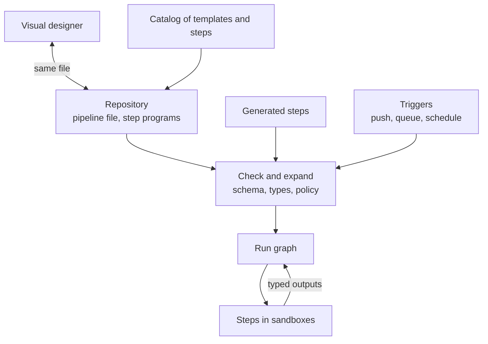

# Milestone 2: Deeper pipeline power, and a way off self-hosted automation servers

<!-- Generated by scripts/docs/build-roadmap.mjs from docs/roadmap/roadmap.json. Do not edit by hand. -->

<a href="../roadmap.html">Roadmap</a> › Milestone 2 · <a href="../roadmap-list.html">as a list</a>

Next 14 available · 8 in progress · 126 planned · 148 capabilities

Pipelines can be as dynamic as real code needs, and a team running an automation server can move its jobs without losing what it relies on.

## What it is, and who it is for

Milestone 2 makes pipelines as dynamic as real code needs without giving up checking. Steps become programs you test, pipelines can be generated, conditions are typed, and you can design visually. Teams on automation servers get a tested gap analysis and an importer.

**Who it is for.** Teams whose pipelines need real code, many repositories sharing logic, or a move away from a self-hosted automation server.

## What you will be able to do

- You write a deployment step in the language your team already uses, test it on your laptop, and share it as a pinned version.
- A step looks at the repository and prints the extra steps it needs; Launchway checks them and shows them on the Sortie.
- You drag a step onto a pipeline and see the exact lines it will change in Git before you save.
- A message on a Holding pattern starts a pipeline, and a rejected message is visible with the reason.
- You import jobs from an automation server and read a report of what needs a person.

## How it fits together

*Text, designer and generated steps all end in one checked definition.*

**Builds on:** [Milestone 1: Host and run](milestone-1.md). 

**Go deeper:** [Pipelines and flow control](pipelines.md) · [Build tools and caches](build-tools-caches.md) · [The developer experience and the golden path](developer-experience.md).

## The capabilities

| Group | Capabilities | Available | In progress | Planned |
|---|---|---|---|---|
| [Write pipelines your way](#g-write-pipelines-your-way) | 31 | 5 | 5 | 21 |
| [Builds use every machine sensibly](#g-builds-use-every-machine-sensibly) | 13 | 0 | 0 | 13 |
| [Reports people want to read](#g-reports-people-want-to-read) | 11 | 1 | 0 | 10 |
| [Design visually](#g-design-visually) | 4 | 0 | 0 | 4 |
| [Move off a self-hosted automation server](#g-move-off-a-self-hosted-automation-server) | 3 | 0 | 0 | 3 |
| [Share and reuse across projects](#g-share-and-reuse-across-projects) | 16 | 2 | 2 | 12 |
| [Every popular build tool, with a cache that is never stale](#g-every-popular-build-tool-with-a-cache-that-is-never-stale) | 14 | 5 | 0 | 9 |
| [The developer comes first](#g-the-developer-comes-first) | 22 | 1 | 1 | 20 |
| [One record for everything](#g-one-record-for-everything) | 4 | 0 | 0 | 4 |
| [Bring work in from any system](#g-bring-work-in-from-any-system) | 13 | 0 | 0 | 13 |
| [Run forms, complete](#g-run-forms-complete) | 2 | 0 | 0 | 2 |
| [The fastest safe path](#g-the-fastest-safe-path) | 7 | 0 | 0 | 7 |
| [What starts a Sortie](#g-what-starts-a-sortie) | 8 | 0 | 0 | 8 |

### Write pipelines your way {#g-write-pipelines-your-way}

Pipelines as real programs, checked before they run.

#### Custom steps in your own language {#custom-steps-in-your-own-language}

◐ In progress

A step is a program in your repository with typed inputs, outputs and secrets, runnable and testable on its own, so pipeline logic is ordinary tested code. A step is a directory with a manifest and code in any language, used as uses: library/step or uses: ./steps/name. Its inputs are typed and checked against the manifest before a Sortie starts, its outputs are typed, and its summary, notes, findings and test results come through a file a build tool cannot forge. Every use is recorded on the Sortie with the library and commit. Missing: a step cannot yet ask a person to decide in the middle of a Sortie (exit code 65 fails the step with the question), and outputs of one step are not yet checked against the inputs of the next before the Sortie starts. Each kit also gives tests a stand-in step context, and a library's pipeline records a passing test result for each step at each commit, which a Standing order can require.

**Depends on:** Pipelines as code.

[Area page](pipelines.md)

#### A step contract and starter kits {#a-step-contract-and-starter-kits}

✓ Available

A published contract for what a step receives and returns, with starter kits for common languages. The contract is versioned and documented, with a conformance checker, and launchway step new scaffolds a step with a manifest, the kit, a test and a README in Go, Python, TypeScript or shell. launchway step test runs it as a Station would and checks it.

[Area page](pipelines.md)

#### Steps run in a sandbox {#steps-run-in-a-sandbox}

◐ In progress

Custom steps run in an isolated container with only the secrets and network they declared. Built: no network unless the manifest lists hosts, a read-only root filesystem, only the secrets it names, dropped capabilities, and (on Podman and Docker) a read-only workspace except the paths it lists; on Kubernetes the pod carries labels the chart's network policies select on. Missing: a list of hosts is recorded and shown but not enforced by name (a policy has addresses), the list of writable paths is not enforced on Kubernetes, and the host executor enforces nothing and refuses custom steps unless the operator allows it. To finish: hosts enforced by name through a checking egress point the Station controls; writable paths enforced on Kubernetes by mounting the workspace read-only with the listed paths writable; a step's secrets mounted only into its own container; the chart's step network policy on by default where the cluster enforces it; and shared Ramps refuse the host executor, which automatic selection never falls back to. The result is one sandbox profile on every executor: a custom step gets exactly the hosts, paths and secrets it declared, whatever runs it.

**Depends on:** Custom steps in your own language.

[Area page](pipelines.md)

#### Share and pin steps and templates {#share-and-pin-steps-and-templates}

✓ Available

Publish a custom step, not only a template, from a repository and pin users to a tag, branch or commit. Pinning templates this way already works. A library holds custom steps beside its templates, pinned by tag or commit; a pinned step never changes under a pipeline, and every use is recorded.

[Area page](pipelines.md)

#### Generated pipelines {#generated-pipelines}

○ Planned

A step can print more steps in any language; Launchway checks them against the same schema and policy and shows them on the Sortie. This gives the freedom of a script with the safety of a checked definition, and it makes dynamic pipelines possible without file-first configuration.

**Depends on:** Custom steps in your own language.

[Area page](pipelines.md)

#### Expressions for conditions {#expressions-for-conditions}

○ Planned

A small typed expression language with no loops and no side effects, checked before the Sortie; today's conditions keep working. Because expressions cannot loop or change anything, a pipeline is always checkable without running it.

[Read the documentation](../reference/pipeline.md#when) · [Area page](pipelines.md)

#### Typed outputs between steps {#typed-outputs-between-steps}

◐ In progress

Any step declares what it passes on, and a reference to an output that does not exist fails before the Sortie, not in the middle of it. Built: a custom step declares the type of each output (string, number, boolean, list, record, secret), the Station checks what it wrote against them, and later steps receive them as text with the type recorded. Missing: a reference to an output that does not exist is not yet refused before the Sortie starts. To come: an outputs key on any step, not only custom steps, that can capture a value from a command's standard output, a file or a JSON document; named references such as steps.version.outputs.tag; and with values of a custom step taken from another step's output. Writing key=value to $LAUNCHWAY_OUTPUTS and reading LAUNCHWAY_NEEDS_ variables keep working.

[Area page](pipelines.md)

#### A browsable catalog of templates and steps {#a-browsable-catalog-of-templates-and-steps}

○ Planned

Shared libraries pinned by tag already work; the catalog lets you find, compare and update them from inside the product. Each entry shows who uses it, what it needs and which version is current, with an update shown as a change you can review. It also shows each version's test results, its permissions, whether it is deprecated and what replaces it, and adds an entry to a pipeline through a form that picks the version and fills inputs by type, previewing the changed lines and the lockfile.

**Depends on:** Shared libraries.

[Read the documentation](../guide/libraries.md) · [Area page](pipelines.md)

#### Update notices for shared libraries {#update-notices-for-shared-libraries}

◐ In progress

See which Flights use an old version of a template or step, what a newer version changes for each, and open the update as a reviewable change. Built for custom steps: a step's page and launchway steps get show, for every Flight that uses a version, the newer tag and what it changes in inputs, outputs and permissions, with a call-out when it asks for more. Missing: the same for templates, and opening the update as a reviewable change. Each change is classed as compatible, breaking, widening permissions or newly blocking; the reviewable change is a pull request that edits the version and the lockfile, with the differences in inputs, outputs and permissions in its description and a replay of recent Sorties attached; a level can require a Clearance to accept a widened permission. Every notice carries the expansion difference between the Flight's locked version and the offered one, computed on that Flight's own file; the editor and pipeline page gain an Expanded tab showing the final graph with each step's library, version and template.

**Depends on:** A browsable catalog of templates and steps; A lockfile for everything a pipeline borrows

[Area page](pipelines.md)

#### A triggers page {#a-triggers-page}

○ Planned

One page showing every trigger and exactly which pipelines it starts. You can answer what starts this pipeline and what does this trigger start without opening files. Each trigger shows where it is declared, its last decisions and, for Patrols, the next firings; the same view exists for a Flight, a Squadron and the Base as a graph, and a wizard adds a trigger by opening a reviewable change.

**Depends on:** Triggers.

[Area page](pipelines.md)

#### Event sources from queues and buses {#event-sources-from-queues-and-buses}

○ Planned

Start pipelines from message queues and event buses, with filters, and replies back. Filters, retries and a dead-letter view show what arrived and what was ignored.

**Depends on:** A triggers page.

[Area page](pipelines.md)

#### Steps as a graph of containers {#steps-as-a-graph-of-containers}

○ Planned

Lay steps out as a graph of containers with fan-out and join, for work that is not a straight line. Each node shows its own logs and result, and the graph is the same object whether drawn or written.

**Depends on:** Custom steps in your own language.

[Area page](pipelines.md)

#### Runners that keep themselves updated {#runners-that-keep-themselves-updated}

○ Planned

Stations on VMs and on customers' machines update under your policy, so the fleet never drifts. Hosted pools update automatically, self-hosted pools are notified, and Kubernetes Stations follow the chart. Updates are signed and checked against a key built into the Station; a Standing order at a level chooses automatic, notify or pinned to a version line, with a window and waves, and can be locked; a Station drains, swaps, keeps the previous version, and returns to it by itself if it does not enroll and pass a self-test within ten minutes.

**Depends on:** Station identity and pools

[Area page](pipelines.md)

#### Pipeline history and flaky tests {#pipeline-history-and-flaky-tests}

◐ In progress

Duration charts, pass rate and the slowest steps across runs, and flaky tests flagged on the pull request. Flaky detection and test history already work on the Sortie page. Flaky detection, test history and the Debrief are on the main branch. Missing: duration charts, pass rate and the slowest steps across Sorties.

**Depends on:** Test, coverage and HTML reports.

[Area page](pipelines.md)

#### Step pages {#step-pages}

✓ Available

Each step has a page: where its code lives, its inputs and types, and which pipelines use it. Each step of a library has a page generated from its manifest: description, inputs and outputs with types, what it may do, an example, its versions with what changed, and the Flights that use it.

[Area page](pipelines.md)

#### An event log that explains every decision {#an-event-log-that-explains-every-decision}

✓ Available

Every received event is listed with the decision for each trigger and why, can be replayed, and may come from a signed per-project webhook source with filters, deduplication and debouncing; a trigger can follow another Flight's result. A push that no trigger starts is listed with the reason, and a push that starts a Sortie is one entry, not two. Still to come: replay judged against today's triggers as well as repeated as before, and events kept for a period each Base chooses instead of a fixed count per Flight.

[Area page](pipelines.md)

#### Standing orders for every repository {#standing-orders-for-every-repository}

✓ Available

A profile of checks per language and ecosystem, set by level and kept in Git, with findings in one list; a gate that blocks only what a change introduces. Every repository gets the Inspection with no change to it; a team can turn each check off, advise or block, and a level above can set a floor.

[Area page](repository-standards.md)

#### Built-in steps on the one step contract {#built-in-steps-on-the-one-step-contract}

○ Planned

Image builds, Launches, verifications and every other built-in kind declare inputs, outputs, permissions and what they need from a Station in the same manifest as a custom step, so a new capability is one module. Today built-in kinds are written into the pipeline parser, the engine, the Station and the API one by one, and only custom steps use the manifest. Kinds move one at a time, the pipeline keys people write stay as they are, and each move ships with tests that the old and new forms give the same Sortie. Nothing a developer adds runs inside the server; capabilities the Launchway team adds are compiled in and pass the same contract.

**Depends on:** A step contract and starter kits.

[Area page](pipelines.md)

#### A step with more than one tool container {#a-step-with-more-than-one-tool-container}

○ Planned

A step names a main image and helper tool images that share its workspace, so a step that needs two toolchains does not need a custom image built first. The step's script runs in the main container and runs a command in a helper with one built-in command. Each container has its own memory limit, all of them are listed on the step's page with the digest of each image, and a Station's accepted-images list applies to every one.

[Area page](pipelines.md)

#### Declared responses to each kind of failure {#declared-responses-to-each-kind-of-failure}

○ Planned

Each typed kind of failure on a step gets its own declared response: retry, wait for a person without holding a Station, allow, stop, abort, or run recovery steps. Every failure is given a kind when it happens and recorded on the step: exit, timeout, infrastructure, station_lost, contract or refused. on_failure becomes a mapping from kind to response; today's single word stops and continues as before. hold puts the step in a server-settled 'Waiting for a person' state, releases its Station, keeps its logs and Cargo, and offers Retry, Allow, Stop and Run recovery on a decision card, with a time limit and what happens when it runs out. recover runs ordinary steps named in the file, then retries, allows or stops. abort cancels running steps and still runs clean-up. A refusal by a Standing order or a No-go can never be answered away. Launch steps return to base first, as today; a response may only add what happens after it. Every move is an event with its reason.

**Depends on:** Conditions, retries, lanes and re-runs; Expressions for conditions.

[Read the documentation](../reference/pipeline.md#retry) · [Area page](pipelines.md)

#### Retries by kind of failure, with back-off {#retries-by-kind-of-failure-with-back-off}

○ Planned

Retries answer the failures worth retrying, by default only when the machinery failed, with a growing pause and a cap. Available today: retry with times, wait, backoff and on: [exit, timeout, infrastructure], and lost Stations retried up to max_lost. Adds: station_lost and contract as kinds a pipeline can name; max_wait as the cap on the pause (today a fixed hour); retry.if, a test on the failure (failure.kind, failure.exit_code, failure.attempt); and, under the next schema version, a retry that does not write on retries only infrastructure and station_lost. Files on today's schema keep today's meaning, and launchway validate offers to write the old meaning out explicitly. A retried exit that passes is recorded as a flaky result.

**Depends on:** Declared responses to each kind of failure.

[Read the documentation](../reference/pipeline.md#retry) · [Area page](pipelines.md)

#### Clean-up steps that always run, even when a Station is lost {#clean-up-steps-that-always-run-even-when-a-station-is-lost}

○ Planned

Clean-up and reporting steps run whatever happened, read how the Sortie stands, and are run again elsewhere when their Station is lost. Available today: when: { upstream: always } and when: { upstream: failed }. Adds run.status (succeeded, failed or canceled so far) in expressions and as LAUNCHWAY_RUN_STATUS; needs: "*" for a step that ends the Sortie; a clean-up mark on the record; a clean-up step whose Station is lost is offered again to another Station of the same Ramp beyond max_lost until it ends or a person stops it, starting from the Sortie's workspace; if no Station takes it, the Sortie shows clean-up pending, holds its lane and Comms tells the Flight's on-call. Cancel runs clean-up; skipping it is a separate, recorded choice.

**Depends on:** Conditions, retries, lanes and re-runs.

[Area page](pipelines.md)

#### A step that waits for an outside answer {#a-step-that-waits-for-an-outside-answer}

○ Planned

A step can wait on the server for a signed call from another system, with a timeout, holding no machine, and turn the answer into typed outputs. kind: wait runs nothing and is settled on the server like a Clearance. The answer arrives through one of the Flight's event sources, so it is signed, fresh, accepted once and stored first. match is one expression over event and the outputs of needed steps; a call that matches nothing is kept and shown, and a call that arrives early is held for the step until the Sortie ends. outputs map the payload to typed values; a body without a schema gives untrusted outputs. Without a matching call by timeout the step fails with the kind timeout and follows on_failure.

**Depends on:** Expressions for conditions; Typed outputs between steps.

[Area page](pipelines.md)

#### Inline code limits, with a way out {#inline-code-limits-with-a-way-out}

○ Planned

Up to 10 lines of inline code in a pipeline and 3 in anything shared, so YAML holds glue and logic lives in tested code. Lines are counted without blanks and comments. Past 10 lines in a pipeline file a lint warns and offers to move the code into a custom step with a test; the Sortie still runs. Past 3 lines in a Maneuver, a Flight plan or any library is an error when the library is validated. A Standing order at any level can tighten either limit, down to no inline code, and can never loosen it.

**Depends on:** Validate pipelines offline.

[Area page](pipelines.md)

#### Inline glue in any interpreter the image has {#inline-glue-in-any-interpreter-the-image-has}

○ Planned

A short run block can be written in Python or any other interpreter the step's image holds, not only shell. The same limits apply. Values still reach the code only as environment variables. How the interpreter is named in the step is not decided.

**Depends on:** Inline code limits, with a way out.

[Area page](pipelines.md)

#### A stand-in step context in every kit {#a-stand-in-step-context-in-every-kit}

○ Planned

A unit test gives a custom step chosen inputs and secrets and reads back its outputs, results and failure, with no Station, network or secret store. Each kit (Go, Python, TypeScript, shell) has one, built from the step contract so it cannot drift from the real context. The scaffold's test shows it, and shows passing outside clients into the step so a test can use fakes.

**Depends on:** A step contract and starter kits.

[Area page](pipelines.md)

#### Values known before take-off and in flight {#values-known-before-take-off-and-in-flight}

○ Planned

The checker knows which values exist before a Sortie starts and which only while it flies, and refuses a value used too early, before anything runs. Run facts, inputs, variables, the Airfield, the event and written lists are known before take-off; step outputs, step results and lists a step produced are known in flight. Where a step may run, which Airfield a Launch lands on, timeouts, retries and lanes must be known before take-off, so the Holding pattern, locks, Clearances and Standing orders can be judged and shown. A flight-time value in such a field is an error on its line that says what to use instead.

**Depends on:** Expressions for conditions.

[Area page](pipelines.md)

#### Every condition explained before and after a Sortie {#every-condition-explained-before-and-after-a-sortie}

○ Planned

Before a Sortie each step shows as will run, will not run, or depends on a named value; afterwards a skipped step says why, with the values filled in. The checker folds in every value known before take-off and shows what remains. Each decision made in flight is recorded on the event record with the expression and the values it read, so the Sortie page, the command line, the agent endpoint and the Logbook give the same answer later. The pipeline editor shows the same labels for an event you pick.

**Depends on:** Expressions for conditions.

[Area page](pipelines.md)

#### Fan-out over a list a step produced {#fan-out-over-a-list-a-step-produced}

○ Planned

A for_each can take a list an earlier step wrote, so one step becomes as many steps as the data needs, each with its own log and Debrief. The producer must be needed and must declare the output as a list. When it ends, a recorded event adds the members, so every server rebuilds the same steps from the record. The plan shows the step as fanning out over the named output. The existing limits apply: 64 members by default, up to 500 by server setting, and safe member names; a list that breaks a rule fails the fan-out with the reason.

**Depends on:** Typed outputs between steps. Expressions for conditions.

[Area page](pipelines.md)

#### Pipeline outputs for later pipelines {#pipeline-outputs-for-later-pipelines}

○ Planned

A pipeline publishes typed outputs, such as an image digest, and a pipeline started by its result reads them as typed values. The top-level outputs key, refused today as not built, takes values from the pipeline's steps. A later pipeline started by this one's result reads them under event. Secret outputs cannot be pipeline outputs.

**Depends on:** Typed outputs between steps.

[Area page](pipelines.md)

#### Saved event filters moved to the one expression language {#saved-event-filters-moved-to-the-one-expression-language}

○ Planned

Event source filters, input mappings, deduplication keys and result trigger filters are written in the same language as pipeline conditions, so there is one syntax everywhere. Today these use a small hand-written language. The move: collect every saved expression with the events it judged; translate mechanically (glob becomes a function, default becomes ??, paths into bodies without a schema use optional steps, text comparisons get an explicit conversion); run both side by side for a release and note differences on each event; switch one source at a time with a Logbook entry; refuse the old syntax only in the next major release, offering the translation. Names move under event: body becomes event.body.

**Depends on:** Expressions for conditions.

[Area page](triggers.md)

### Builds use every machine sensibly {#g-builds-use-every-machine-sensibly}

A team’s machines share the work by what is free, and nobody’s laptop is taken over.

#### Builds placed by free processor and memory {#builds-placed-by-free-processor-and-memory}

○ Planned

A build can run on any of a team’s machines and is placed on one with room for it. Today a Station takes work when it has a free slot; placement by what is really free comes next.

**Depends on:** Station identity and pools.

[Area page](pipelines.md)

#### Runners on personal machines hold back when busy {#runners-on-personal-machines-hold-back-when-busy}

○ Planned

A Station on a laptop or workstation stops taking work while the machine is busy, and respects the limits its owner sets. This is the first piece of placement to be built, because it makes lending a personal machine safe.

**Depends on:** Station identity and pools.

[Area page](pipelines.md)

#### A build’s parallel steps spread across machines {#a-build-s-parallel-steps-spread-across-machines}

○ Planned

The parallel steps of one build can run on different machines, with their shared files moved safely between them. The pipeline stays one pipeline, drawn as it is; only where each step runs changes. The files move through the workspace hand-off between Stations, so no machine clones the repository a second time.

**Depends on:** Builds placed by free processor and memory; The workspace handed between Stations

[Area page](pipelines.md)

#### Size hints for steps {#size-hints-for-steps}

○ Planned

A step can say how much processor and memory it needs, and Launchway uses that, and what it has learned from earlier Sorties, to place it. The hints are advice; a wrong hint wastes time but never breaks a build. Launchway already measures each attempt's peak memory and processor use and shows it on the step. Next it reserves what recent successful attempts really used plus headroom, so nobody has to write numbers: a written size is a floor, a step killed for memory runs once more with more and the new figure is kept, and a second kill fails the step with a plain message instead of a loop.

**Depends on:** Builds placed by free processor and memory.

[Area page](pipelines.md)

#### Windows and macOS runners {#windows-and-macos-runners}

○ Planned

Stations that run on Windows and macOS, so a matrix can cover them and desktop builds have a place to run. This is a gap, listed honestly.

**Depends on:** Matrix builds.

[Area page](build-tools-caches.md)

#### Fair use between the people lending machines {#fair-use-between-the-people-lending-machines}

○ Planned

Work is shared out so that no one person’s machines carry the whole team, and everyone can see how much each machine did. The report is about machines and fairness, never a ranking of people.

**Depends on:** Builds placed by free processor and memory.

[Area page](pipelines.md)

#### Stations added and removed by the steps waiting {#stations-added-and-removed-by-the-steps-waiting}

○ Planned

A Ramp grows when steps wait for a Station and shrinks when Stations sit idle, inside a ceiling you set. The server works out how many Stations the waiting steps need, from what those steps used in earlier Sorties, and publishes that figure. A built-in scaler with a narrow right on the Stations' own workload acts on it by default; a team that prefers its cluster's autoscaler sets the Ramp to read the figure instead, and then the server only publishes it. A Station chosen for removal stops taking steps, finishes what it holds and leaves; a Station that runs a step is never removed. Today the Station chart has an optional autoscaler on processor use, off by default.

**Depends on:** Step sizes learned from measurement.

[Area page](pipelines.md)

#### Step groups for chains of short steps {#step-groups-for-chains-of-short-steps}

○ Planned

Short steps that run one after another can share one pod and one workspace, each in its own tool container, so a chain of quick checks pays for one pod start instead of one per step. A group is opt-in and named in the pipeline. Its steps never run at the same time, so no two of them compete for one memory limit, and each still has its own log, result, outputs and retry. The group holds its reservation for as long as it runs, which is the stated cost. It works the same whichever pod model an installation uses.

[Area page](pipelines.md)

#### Images warmed when a Sortie is planned {#images-warmed-when-a-sortie-is-planned}

○ Planned

When a Sortie is created, the images its steps will use are fetched ahead onto the machines likely to run them. Today an image is pulled when its step starts and reused when the machine already has it. Warming fetches the digest each step resolved to, never a moving tag, and is only a head start: a step whose image was not warmed pulls it as today. Warming counts against the same pull credentials and accepted-images lists as the step itself.

[Area page](pipelines.md)

#### Image pull time on every step {#image-pull-time-on-every-step}

○ Planned

Each step shows how long its image took to fetch, its pod or container took to start and its own work took, so a slow step says which part was slow. The three times are on the Sortie page, in the API and the command line, and summed per pipeline so a slow image is visible across Sorties.

[Area page](pipelines.md)

#### Builds never take room from the platform {#builds-never-take-room-from-the-platform}

○ Planned

Step pods run in their own namespace, at the lowest priority and with limits, so a busy day slows builds and never the servers, the database or the Stations. The installer creates three tiers, each with its own quota and priority, and says plainly which guarantee it can give on one shared node and which needs separate nodes. On one machine the same idea uses three resource slices. Today the chart can put step pods in their own namespace and give them a low priority class, and neither is on by default.

[Area page](pipelines.md)

#### Large workspaces and long steps on Ramps that opt in {#large-workspaces-and-long-steps-on-ramps-that-opt-in}

○ Planned

A Ramp can raise its workspace and Cargo limits for large game and media assets and allow steps of up to 24 hours, with the Station's own accept list agreeing. Large files in repositories are fetched once per Station and kept; Cargo over 1 GiB is uploaded in verified chunks that resume after a dropped connection; long steps keep the 90-second lease, and may write checkpoints to a declared cache so a retry starts from the last one.

**Depends on:** Large files; The workspace handed between Stations

[Area page](pipelines.md)

#### Capacity ready before the busy hour {#capacity-ready-before-the-busy-hour}

○ Planned

A Ramp can be at the size its Flights need a few minutes before their usual busy times, worked out from the record, and shrink after. Advice its owner turns on; never takes room from the platform; works with scaling on steps waiting.

**Depends on:** Builds placed by free processor and memory

[Area page](speed.md)

### Reports people want to read {#g-reports-people-want-to-read}

Test results that are a pleasure to read and easy to hand to someone else.

#### Polished test reports as HTML and PDF {#polished-test-reports-as-html-and-pdf}

✓ Available

Every run can produce a detailed, well-laid-out Debrief as a web page and as a PDF that can be sent to someone without an account. Builds on the thirteen test formats and coverage already available.

**Depends on:** Test, coverage and HTML reports.

[Area page](developer-experience.md)

#### Summaries and notes from any step {#summaries-and-notes-from-any-step}

○ Planned

Every step, including a plain script, can write a summary and typed notes on files and lines, shown on the Sortie page, the Debrief, the diff and the pull request. The step contract's results file is offered to every step; summaries are rendered without script, remote images or raw HTML, at most 64 KiB per step; notes carry file, line or range, level, title, message and kind, at most 1,000 per step with the rest counted; notes are marked new or existing against the default branch; a note never changes a step's result.

**Depends on:** A step contract and starter kits; Findings and failures on the diff

[Area page](quality-and-reports.md)

#### One Debrief for everything known about a change {#one-debrief-for-everything-known-about-a-change}

○ Planned

Tests, coverage, flaky history, performance, code quality, Inspection findings, licenses and accessibility in one Debrief, each as new, existing or fixed against the last good run. Each kind is a capability slot with a built-in default and a connection, one in charge, shown as served by; every number opens on the step, file and tool behind it.

**Depends on:** Test, coverage and HTML reports

[Area page](quality-and-reports.md)

#### Code quality measures in the Debrief {#code-quality-measures-in-the-debrief}

○ Planned

Complexity, duplication and style findings and measures per file, from each language profile's analyzers or a connected code-analysis service. Run as visible steps; judged on what a change introduces; trends by file show the hotspots.

**Depends on:** Language profiles

[Area page](quality-and-reports.md)

#### Accessibility checks in the Debrief {#accessibility-checks-in-the-debrief}

○ Planned

An accessibility check runs against a preview Airfield or built pages and reports issues by page and guideline success criterion, new and existing. Built-in default from an open-source engine in its own container, or a connected service; issues appear on the diff where they can be placed.

**Depends on:** One Debrief for everything known about a change

[Area page](quality-and-reports.md)

#### Coverage of changed lines on the diff {#coverage-of-changed-lines-on-the-diff}

○ Planned

Each changed line of a pull request is marked covered, not covered or not counted, beside the changed-line figure and its floor. Worked out from the line data coverage reports already carry; a report that cannot be read is cannot tell, never a pass.

**Depends on:** Test, coverage and HTML reports

[Area page](quality-and-reports.md)

#### A report for every Sortie, in one file {#a-report-for-every-sortie-in-one-file}

○ Planned

The whole Debrief, with what changed, what ran and what was reused, every kind of result and every Standing order verdict, as one HTML file with no script. Works offline, reads on a phone, accessible; extends the HTML export of test results that exists today.

**Depends on:** One Debrief for everything known about a change

[Area page](quality-and-reports.md)

#### A release report from commit to behavior in production {#a-release-report-from-commit-to-behavior-in-production}

○ Planned

One page per release: what changed, what was tested, what passed and failed with evidence, the comparison with what it replaced, who cleared it, where it launched and how it behaved. One self-contained file, offline, phone and accessible; compared with what it replaced in each Airfield; the same facts as the evidence pack.

**Depends on:** A report for every Sortie, in one file; Releases that are promoted

[Area page](quality-and-reports.md)

#### Reports that prove they are unedited {#reports-that-prove-they-are-unedited}

○ Planned

Each report carries the record events it was made from and a signature by the Base, and can be verified offline. launchway report verify says unedited or what differs; with access to the Base it also checks the events are still on the record. Signed with the same Base key as the evidence packs; a report with no signing key says so on its first line.

**Depends on:** A report for every Sortie, in one file

[Area page](quality-and-reports.md)

#### The report on the pull request {#the-report-on-the-pull-request}

○ Planned

A pull request gets a short summary of its Debrief and the report file; on a connected code host the summary travels with the status Launchway reports. Share links end on a date picked from a list, can be revoked, and every opening is recorded.

**Depends on:** A report for every Sortie, in one file; Pull-request status everywhere

[Area page](quality-and-reports.md)

#### Quality trends per Flight, Squadron and Airfield {#quality-trends-per-flight-squadron-and-airfield}

○ Planned

Pass rate, flaky rate, coverage, quality measures, findings and time to fix, accessibility, performance and how releases behaved, over time. Every chart has its table and opens on the Sorties and Launches behind it; nothing is shown per person except to that person.

**Depends on:** Pipeline history and flaky tests

[Area page](quality-and-reports.md)

### Design visually {#g-design-visually}

Draw it, read it as text, and see that both are the same thing.

#### A visual pipeline designer {#a-visual-pipeline-designer}

○ Planned

Drag built-in and custom steps into place; it edits the same pipeline file as the text editor, so the two are views of one thing. The designer shows the lines it will change in Git before you save, and saving is a reviewable change. Nothing is stored outside the file. It reads and writes with the same parser as the text editor and writes back only changed lines, keeping comments, key order and quoting, proven by a round-trip test over every example and Hangar pipeline; the WebAssembly checker runs on every change; references, failure responses and fan-out lists are picked from typed lists.

**Depends on:** Pipelines as code

[Area page](pipelines.md)

#### A drawing canvas and diagrams {#a-drawing-canvas-and-diagrams}

○ Planned

Architecture diagrams drawn in Launchway beside generated ones and Mermaid. Diagrams are saved as files in Git and exported safely, so documentation and architecture drawings live beside the code.

[Area page](pipelines.md)

#### Generated architecture views {#generated-architecture-views}

○ Planned

Views of your delivery and runtime drawn from what Launchway knows, always current. Applications, pipelines and Airfields appear as diagrams you can paste into a document.

[Area page](pipelines.md)

#### Two-way Obsidian sync {#two-way-obsidian-sync}

○ Planned

Export and import documents, and keep an Obsidian vault in step with Launchway documents in both directions. A plug-in is provided if the sync needs one. Conflicts are shown, not hidden.

[Area page](pipelines.md)

### Move off a self-hosted automation server {#g-move-off-a-self-hosted-automation-server}

Everything teams rely on such a server for, without its weaknesses.

#### A verified gap analysis {#a-verified-gap-analysis}

○ Planned

A tested list of what teams rely on automation servers for (dynamic pipelines, extensions, agents anywhere) with a plan for each gap. Each gap names the Launchway feature that closes it and a test that proves it.

#### Extensions without fragility {#extensions-without-fragility}

○ Planned

A step catalog and typed custom steps instead of plug-ins that run inside the server. Nothing a team adds can crash or compromise the server, and every extension has a version and an owner.

**Depends on:** Custom steps in your own language.

#### Agents anywhere {#agents-anywhere}

○ Planned

Guidance and checks that show Stations on any machine, in any network, replace the build agents teams rely on. Stations that connect outward, with pools and labels, already work. Equivalent to the build agents teams rely on, with identity and audit on every connection.

**Depends on:** Station identity and pools.

### Share and reuse across projects {#g-share-and-reuse-across-projects}

The right amount of sharing at the right level, with the fewest new ideas to learn: a template is an interface, code is what runs, and a nearer level always wins.

#### Templates and Flight plans by level {#templates-and-flight-plans-by-level}

✓ Available

Set a template or a Flight plan at the Wing or Squadron and every Flight beneath it uses it. Today a Flight plan can be bound at a level and a Flight can override what the level allows. A solo developer never has to open any of this.

[Read the documentation](../guide/libraries.md)

#### Overrides, locks and the hierarchy view {#overrides-locks-and-the-hierarchy-view}

✓ Available

Declare a variable lower down to override it, let a level above lock it, and see where each value comes from while building a pipeline. Today the hierarchy shows each variable’s source, what it overrides and what is locked, and every Sortie records the values it used.

[Read the documentation](../guide/variables.md)

#### Templates that read like code {#templates-that-read-like-code}

○ Planned

A template says what it needs and offers, can be built on another, and a Flight fills in or overrides only what is open. You will be able to see at a glance what a template fixes and what it leaves open, the way an interface and a class work in code.

**Depends on:** Shared pipeline templates and Flight plans.

[Area page](pipelines.md)

#### Language starters {#language-starters}

◐ In progress

Starter templates for common languages that set up best practice, naming standards and help for your AI coding assistants. Available today: built-in Flight plans for Go, Python, Node, Java, images, static sites and Helm charts, and a repository with no pipeline file runs the one that fits. On the main branch. Everything in a starter can be overridden; the default simply guides. Delivery runs for plain manifests and Helm values through GitOps write-back; it was exercised offline and against fakes, not yet end to end with a real image build and cluster. Still to come: assistant instruction files, formatter and linter configuration and a test layout written into the repository, findings of the analysis in the Security tab, bandit for library-only repositories, values read from an earlier step's output, and more languages.

**Depends on:** Templates that read like code.

[Area page](pipelines.md)

#### Light environments and services {#light-environments-and-services}

○ Planned

Airfields and services as short lists with sensible defaults, not another set of ideas to learn before anything works. You will be able to start with one Airfield and grow, with locks and defaults coming from the level above.

[Area page](pipelines.md)

#### Shared connections {#shared-connections}

○ Planned

A connection to a Depot, a cluster or a cloud set up once at a level and used below it, with its use shown. Secrets stay where they are; only the name of the connection is shared.

**Depends on:** Overrides, locks and the hierarchy view.

[Area page](pipelines.md)

#### See what is shared and who uses it {#see-what-is-shared-and-who-uses-it}

○ Planned

For any template, library or connection, a list of every Flight that uses it and what would change if it changed. A change to something shared is previewed before it is applied.

**Depends on:** Templates and Flight plans by level.

[Area page](pipelines.md)

#### Starters that deliver end to end {#starters-that-deliver-end-to-end}

◐ In progress

A library of starters per language and kind, proven through delivery, with detection, a gallery and `launchway init`. On the main branch.

[Area page](pipelines.md)

#### One inheritance rule for every setting {#one-inheritance-rule-for-every-setting}

○ Planned

Every kind of setting flows down the levels the same way: the nearest level wins, a lock from above wins over everything below, and a floor from above can be made stricter but never looser. Variables and repository standards already work this way. This item extends set, lock and floor to Ramps, Airfields, libraries, secret stores, health sources, AI models, capability choices and retention, with one hierarchy view that shows, for any setting, its value, where it comes from, what it overrides and who locked it.

**Depends on:** Overrides, locks and the hierarchy view.

[Area page](pipelines.md)

#### One provider in charge for each capability {#one-provider-in-charge-for-each-capability}

○ Planned

Every capability has one slot per Squadron with exactly one provider in charge, built in or connected, and its page says which one serves it. Pipelines name the capability, never the product, so changing provider changes a setting and not pipeline files. A second provider is allowed only in a named role: in front, alongside for one stated purpose, or migrating with a visible end. A connected product's extra features appear in place, marked with where they come from. A built-in that is switched off leaves no menu and no empty page.

**Depends on:** Shared connections.

[Area page](platform-services.md)

#### A guided move between providers {#a-guided-move-between-providers}

○ Planned

Connect the product you already have, import what it holds, run both in the migrating role with a visible end, then switch one off, as one guided task. The task works in both directions: from a connected product to the built-in one, and back. The migrating role shows its end date and what is left to move on the capability's page, and nothing is deleted from either side until a person confirms.

**Depends on:** One provider in charge for each capability.

[Area page](platform-services.md)

#### A lockfile for everything a pipeline borrows {#a-lockfile-for-everything-a-pipeline-borrows}

○ Planned

One file in the repository records the exact commit and manifest digest of every library, template and step a pipeline uses, and changes only through a reviewable update. Written by Launchway, never by hand: the library's server name, the version as written, the commit, a digest of the files a Sortie fetches, each library another library requires with the one that asked, each custom step's manifest digest and permissions, and the major version of each Hangar entry. A pin by branch or tag is resolved once and written to the file; Sorties use the file until a reviewable update changes it, and the update shows what changed in inputs, outputs and permissions. When a Sortie is created the server checks that each version still resolves to the locked commit and refuses it before take-off if a tag moved, naming both commits. Validation fails when the file and the pipeline disagree. A repository with no lockfile works as today; a Standing order can require one, and can require a Controller's Go when a permission widens. A pipeline may write a range (v4.*, v4.2.*) or a channel ({ channel: stable }, named in the library's library.yaml on its default branch). It is resolved once into the lockfile to the newest matching tag that passed the contribution checks, and moves only through an accepted update notice; a range or channel without a lockfile is refused with the command that writes one; a level's locked range bounds it.

**Depends on:** Share and pin steps and templates.

[Area page](pipelines.md)

#### Version rules checked on every library tag {#version-rules-checked-on-every-library-tag}

○ Planned

A library tag's version must match what changed: a breaking change to inputs, outputs or Flight plan stages needs a new major version. The check compares each tag's interfaces with the previous tag. Compatible changes (a new input with a default, a new output) may be minor; breaking ones (an input removed, renamed or made required, a type changed, an output or stage removed) must be major; a widened permission is always called out. A published version is never removed while a lockfile on the Base names it; it can be hidden from the catalog.

**Depends on:** Checks a shared step or template must pass.

[Area page](pipelines.md)

#### Deprecation with a named replacement {#deprecation-with-a-named-replacement}

○ Planned

An input, output or whole step or template can be marked deprecated with what to use instead, shown wherever it is used, and removed only in a later major version. launchway validate, the editor and the Debrief show the warning with the replacement. The update notice for the major version that removes it lists every line it affects in the Flight's own files.

**Depends on:** Version rules checked on every library tag.

[Area page](pipelines.md)

#### Library versions locked by level {#library-versions-locked-by-level}

○ Planned

A Wing or Squadron can lock a library to a version range, so every Flight beneath it stays inside it and update notices offer only versions inside it. A Flight that pins outside the range is refused at its line. The hierarchy view shows which level locked it and who. Required templates and pinned-version rules already exist as Standing orders and stay.

**Depends on:** Overrides, locks and the hierarchy view. A lockfile for everything a pipeline borrows.

[Area page](pipelines.md)

#### Publish a library to the catalog {#publish-a-library-to-the-catalog}

○ Planned

Allow a repository as a library for a level, name the Squadron that owns it, and every tag that passes the checks appears in the catalog as a version. A guided screen and the matching command, API call, agent tool and Terraform resource. A tag that fails is listed for its owners only, with the reason. Pipelines still name libraries by the server's name, never by an address.

**Depends on:** A browsable catalog of templates and steps. Checks a shared step or template must pass.

[Area page](pipelines.md)

### Every popular build tool, with a cache that is never stale {#g-every-popular-build-tool-with-a-cache-that-is-never-stale}

A cache may only make a build faster, never change its result. Build tools become ready-made recipes that work out the cache for you.

#### The cache rule {#the-cache-rule}

✓ Available

A build never silently uses an older copy of something it asked for the latest of, and a cache never changes what a build produces. A build never silently uses an older copy of something it asked for the latest of. Where Launchway cannot promise this for a path, the Sortie says so and names the path.

[Area page](build-tools-caches.md)

#### Fixed things reused, moving things looked up again {#fixed-things-reused-moving-things-looked-up-again}

✓ Available

Released versions, pinned images and locked dependencies are reused; snapshots, ranges and latest are re-checked on every build. A re-check is a cheap lookup, not a download.

[Area page](build-tools-caches.md)

#### Every restore is a head start, never the answer {#every-restore-is-a-head-start-never-the-answer}

✓ Available

What a cache restores seeds the build and the tool still checks it, so a stale folder cannot decide the result. Entries have generations and a maximum age.

[Area page](build-tools-caches.md)

#### Warnings for unsafe cache patterns {#warnings-for-unsafe-cache-patterns}

✓ Available

Validation and the pipeline editor flag cache settings that could serve stale or secret data, and propose a fix. The validator and the pipeline editor warn about the common cases; they are warnings, not refusals, except for a path that holds a credential.

[Area page](build-tools-caches.md)

#### Caches by trust scope {#caches-by-trust-scope}

✓ Available

What a pull request writes only that pull request reads; what a trusted branch writes the Flight reads; forks are isolated; image caches follow the same scopes. A fork reads nothing from the Flight's caches and writes none; a pull request's entries are its own. Entries are not signed or encrypted by Launchway yet.

[Area page](build-tools-caches.md)

#### What the run restored, and how old {#what-the-run-restored-and-how-old}

○ Planned

Every Sortie shows what it restored, how old it was, what it re-checked, and either “this build used no stale inputs” or the exact list it could not verify. Resolved versions are recorded, for example “resolved a snapshot to the build published four minutes ago”.

[Area page](build-tools-caches.md)

#### Build twice and compare {#build-twice-and-compare}

○ Planned

Run a build with and without cache and compare the results, or run without cache, or refresh the cache, with one choice. Also the self-test that deleting every cache never changes what a build produces.

[Area page](build-tools-caches.md)

#### Recipes for the popular tools {#recipes-for-the-popular-tools}

○ Planned

Maven, Gradle, npm, pnpm, yarn, Go, Python (pip, uv and Poetry) and container images are detected, get a ready Flight plan, a correct cache and Debriefs. No hand-written cache keys. First phase of the recipes.

[Area page](build-tools-caches.md)

#### Shared build caches Launchway hosts {#shared-build-caches-launchway-hosts}

○ Planned

Where a tool has a build cache that verifies its inputs, such as Gradle, Bazel and container layers, Launchway serves it itself instead of copying folders around. Output folders that depend on file times are not restored across commits unless you opt in. The cache speaks the open remote-cache protocols build tools use and the open container registry protocol for layers; build tools reach it through the Station on localhost, so no token enters a step; entries are content-addressed and checked on write and read, encrypted with the Base's key, shared by every Station of a Base and never between Bases, scoped by the same trust rules as caches (only trusted scopes may write action results), and sampled by Build twice and compare. It is its own server role; when it is away builds are slower, never wrong.

[Area page](build-tools-caches.md)

#### More build tools {#more-build-tools}

○ Planned

Bazel, sbt, .NET, Rust, C and C++, Ruby, PHP, Helm and Terraform follow the first recipes. Later phases.

[Area page](build-tools-caches.md)

#### Android builds {#android-builds}

○ Planned

Android Flights build with Gradle recipes, signing keys kept on your side, and results on the launch line. Follows the Gradle recipe. The Android toolchain comes as a Hangar image with a published list of contents; a step asks for a toolchain version by label; the keystore is a secret reference resolved on the Station into a temporary keystore deleted after the step.

[Area page](build-tools-caches.md)

#### iOS and macOS builds {#ios-and-macos-builds}

○ Planned

Apple Flights build on macOS Stations you provide, with signing kept on your side. The honest constraint: Apple builds need Apple hardware. A step names the platform toolchain version it needs and a macOS Station with several installed selects that one for the step only; certificates, keys and provisioning profiles are secret references placed in a temporary keychain made for the step and deleted when it ends. Hosted macOS capacity is optional, under the hosted Station sizes.

[Area page](build-tools-caches.md)

#### Cross-platform mobile frameworks {#cross-platform-mobile-frameworks}

○ Planned

Each cross-platform framework says which Station it needs, so a build lands on the right machine. Follows Android and iOS. Each framework has a Hangar recipe that declares its parts and the labels each part needs (operating system, toolchain), so the shared part, the Android part and the iOS part land on the right Ramps and join in one Debrief.

[Area page](build-tools-caches.md)

#### Store upload as a step {#store-upload-as-a-step}

○ Planned

A Hangar step sends a signed build to the phone makers' app stores or a game distribution service, with its credential by reference and typed inputs. Inputs for the track, release notes taken from the release, and rollout share; the result is recorded with the build's digest, so the release report says what reached which store.

**Depends on:** Signing material resolved on the Station for app builds

[Area page](build-tools-caches.md)

### The developer comes first {#g-the-developer-comes-first}

Whatever Launchway can do to help a developer ship the next feature quickly and safely, it does, in the editor, the terminal, the assistant and the pull request.

#### An editor extension {#an-editor-extension}

○ Planned

A VS Code extension shows your work, the launch line, run details and logs, and findings as problems in the file, with sign-in from the editor. Built on one editor-neutral core, so other editors can follow.

[Area page](developer-experience.md)

#### A language server and a schema for pipeline files {#a-language-server-and-a-schema-for-pipeline-files}

○ Planned

Pipeline files get completion and inline checks in any editor that speaks the language-server standard. The schema half is being built now (see the editor schema in Milestone 1); the language server follows. Both are generated from the same parser the server uses, so they cannot disagree.

[Area page](developer-experience.md)

#### Assistant tools shaped by jobs {#assistant-tools-shaped-by-jobs}

○ Planned

AI coding assistants get tools for jobs such as explaining a failure, checking a pull request and opening one, instead of one tool per API call. Each assistant is exactly as powerful as its user and no more.

[Area page](developer-experience.md)

#### Instruction files kept current {#instruction-files-kept-current}

○ Planned

Starter files that tell AI coding assistants your conventions are generated and kept up to date, and every one can be overridden. Language starters carry good practice and naming standards.

[Area page](developer-experience.md)

#### Run it locally, the same way {#run-it-locally-the-same-way}

○ Planned

launchway run uses the same step images, recipes and cache rules as the server, with a local cache that follows the same freshness rules. The command line already runs a pipeline on one machine; local caches come next.

[Area page](developer-experience.md)

#### Reproduce a failed step {#reproduce-a-failed-step}

○ Planned

Copy one command that reruns a failed step with the same image and inputs, or open a time-limited, recorded debug session in a fresh copy of its Airfield. Never with production secrets. Attaching to a failed step opens a shell in a fresh pod or container made from the failed attempt: the same image digest, the workspace as the step left it, the same inputs and no secrets unless a Controller allows the non-production ones. The session has a time limit, its commands are recorded in the Logbook, and the Station keeps the failed attempt's workspace only for that window.

[Area page](developer-experience.md)

#### Flaky tests quarantined, with an owner {#flaky-tests-quarantined-with-an-owner}

✓ Available

A flaky test still runs and reports but stops blocking, with an owner and an expiry, and a failure says whether it is new or known. A quarantined test has an owner and an expiry, and an expired quarantine excuses nothing.

[Area page](developer-experience.md)

#### A preview environment for every pull request {#a-preview-environment-for-every-pull-request}

○ Planned

An Airfield that expires by itself and has a cost cap, with its link posted on the pull request. A mobile equivalent is an install link per pull request. The pull request also shows the preview's spend against its cap, updated while it runs: an estimate from what it runs and for how long, replaced by the billed figure where a cost source is connected. At 80 percent of the cap the line becomes a warning; at the cap the preview scales to zero and wakes on the next visit or push, keeping its data until it expires.

[Area page](developer-experience.md)

#### Why is my run waiting {#why-is-my-run-waiting}

◐ In progress

One answer to why something is not moving: no Station with the capability, a Sortie ahead, a lock, an approval, a quota. The Sortie page says why a step waits for room and where it stands in the Holding pattern, and an approval says who must decide. Missing: one answer that covers every cause, such as a lock or a quota.

[Area page](developer-experience.md)

#### First signal fast {#first-signal-fast}

○ Planned

A time budget for the first result on a pull request, with fast checks first and deep checks later. Default: two minutes to the first result. It is one line of the pipeline's speed budget, and selected tests run before the rest.

[Area page](developer-experience.md)

#### A first green build in ten minutes {#a-first-green-build-in-ten-minutes}

○ Planned

Detect the tool, apply the recipe and its Flight plan, and get a green build, with the clock as a test. Includes mobile templates.

[Area page](developer-experience.md)

#### Team metrics, never people rankings {#team-metrics-never-people-rankings}

○ Planned

Lead time, failure rate, time to restore, queue time and flaky rate for teams; an individual sees only their own numbers. No per-person ranking anywhere.

[Area page](developer-experience.md)

#### A preview address for every pull request {#a-preview-address-for-every-pull-request}

○ Planned

Each pull request gets a live address to show a client or colleague, torn down when it closes. Static site starters with quality reports and static-host providers come with it.

[Area page](pipelines.md)

#### A Base per client, with hand-over {#a-base-per-client-with-hand-over}

○ Planned

Give each client their own space, invite them as viewer or approver, and hand over the whole thing (repository, pipelines, history, releases) at the end. Needs the wall between Bases.

[Area page](hosted-service.md)

#### Builds on macOS and Windows machines {#builds-on-macos-and-windows-machines}

○ Planned

Stations for Apple and Windows, signing and store upload, very large files and long builds, for mobile and games. A first basic version of the Station for each is a small step; signing and store upload come after.

[Area page](build-tools-caches.md)

#### A development environment in the browser, optional {#a-development-environment-in-the-browser-optional}

○ Planned

Use a full editor Airfield inside Launchway, turned on by choice and off by default; it is made available, not copied. Your normal editor stays as it is: the plug-in route gives it Launchway features.

[Area page](developer-experience.md)

#### Pick the fields and related objects an API answer carries {#pick-the-fields-and-related-objects-an-api-answer-carries}

○ Planned

A caller of the HTTP API can ask for only the fields it needs and for related objects in the same answer, saving round trips without a second API style. Checked by the parity test like every route; permissions apply to each related object. Recorded with the decision not to add a graph-query API.

**Depends on:** A published description of the HTTP API.

[Area page](developer-experience.md)

#### A quarantined test excuses only its known failure {#a-quarantined-test-excuses-only-its-known-failure}

○ Planned

A quarantine records the shape of the failures that made a test flaky; a failure of a new shape is a real failure. The message with numbers removed and the top of the stack; the Debrief says how the new failure differs.

**Depends on:** Flaky tests quarantined, with an owner

[Area page](quality-and-reports.md)

#### Quarantine proposed as a pull request {#quarantine-proposed-as-a-pull-request}

○ Planned

Quarantining a flaky test opens a pull request with the owner picked from the code owners and an end date picked from a short list. Launchway still never writes the file without a review; each Squadron sees its quarantine debt.

**Depends on:** Flaky tests quarantined, with an owner

[Area page](quality-and-reports.md)

#### Every wizard shows its other ways in {#every-wizard-shows-its-other-ways-in}

○ Planned

The last step of every wizard shows the same change as a command, an API call, an agent tool call and a Terraform resource, ready to copy. Generated from the same call the wizard makes, so it is always exact.

**Depends on:** Guided setup wizards.

[Area page](guided-interface.md)

#### Why not, and who can fix it {#why-not-and-who-can-fix-it}

○ Planned

Every unavailable action has a Why not? link: the permission or rule it needs, where it is set, each grant considered, and who can fix it. An administrator may ask it for another person. The same answer is given to the command line and the agent endpoint.

**Depends on:** Fix actions with their consequence.

[Area page](guided-interface.md)

#### A first Launch within the first hour {#a-first-launch-within-the-first-hour}

○ Planned

From install to a first Launch to a first Airfield in under an hour, every step a wizard, checked by a timed test on a throwaway cluster. Builds on the first green build in ten minutes; needs launching without a GitOps controller for teams that have none.

**Depends on:** A first green build in ten minutes; Delivery by choice.

[Area page](installing.md)

### One record for everything {#g-one-record-for-everything}

Every decision is an event with its reasons, and every page, report, number and piece of evidence is read from the same record.

#### One common event format and one catalog for every event {#one-common-event-format-and-one-catalog-for-every-event}

○ Planned

Every event Launchway records, from a trigger decision to a sign-in, can be read in one shape that says what happened, to what, where in the levels, who did it and why. A catalog lists every kind of event with its schema, fields, reasons, sensitive fields, retention class and who may read it. One read interface returns events from today's four streams (the Sortie log, the trigger log, the Logbook and repository events) in the common event format. Nothing changes in how they are stored, so older servers notice nothing.

[Area page](pipelines.md)

#### One record behind every view {#one-record-behind-every-view}

○ Planned

The four streams become one append-only record that every page, report, number and piece of evidence is read from. In stages, each additive: new events are written to the one record alongside their old table in the same transaction, then the readers move (Logbook, Events page, Debrief, metrics, notifications), then the writers, once no older server is seen. Each Base's record forms a chain from the first stage that writes it. Step output and stored reports stay beside the record, referenced from it.

**Depends on:** One common event format and one catalog for every event.

[Area page](pipelines.md)

#### Follow a change from push to Launch {#follow-a-change-from-push-to-launch}

○ Planned

From any event, follow the thread back to what caused it and forward to what it caused: a push, its trigger decision, its Sortie, its Clearance, its Launch and its Return to base. Every event carries the event that led to it. The record page and the agent endpoint walk the thread in both directions. Today a Sortie names its trigger and a replay points back to its event, but nothing links a push to a Launch.

**Depends on:** One record behind every view.

[Area page](pipelines.md)

#### A decision without reasons fails the build {#a-decision-without-reasons-fails-the-build}

○ Planned

Every kind of decision in the catalog must carry its reasons, and a test fails the build when one does not. A reason is a sentence and the facts behind it: the rule or condition, what was found, what was wanted and where the evidence is. The same test checks that each new event kind is in the reference documentation, as the documentation tests do today for run events and audit actions.

**Depends on:** One common event format and one catalog for every event.

[Area page](pipelines.md)

### Bring work in from any system {#g-bring-work-in-from-any-system}

Point Launchway at what you have and see it running here, with an honest account of what came across.

#### Import of existing jobs {#import-of-existing-jobs}

○ Planned

Convert job definitions and shared libraries, with a report of what needs a person, and none of the file-first configuration or fragile plug-ins. The import produces ordinary pipelines in Git and tells you what it could not convert. It covers declarative and scripted pipeline files (scripted ones read without running them), shared libraries (to a Launchway library at the same tag), and jobs kept only in the server's settings, read from its exported job configuration together with the names of its plug-ins and credentials.

**Depends on:** A verified gap analysis.

[Area page](pipelines.md)

#### Scan a Wing before converting anything {#scan-a-wing-before-converting-anything}

○ Planned

Before anything is converted, see every pipeline in a Wing, which system it was written for, the constructs and packaged steps it uses, the names it needs and what would convert fully. The scan reads through the code host connections Launchway already has, or an uploaded settings export, with read-only rights. It stores the report (counts, construct codes, files and lines), never the files. Each pipeline gets a size (small, medium, large) with the rule that set it, checked against how long finished imports took. It can be stopped and resumed.

**Depends on:** A converter and a move-over guide.

[Area page](importing.md)

#### Import findings kept on the record {#import-findings-kept-on-the-record}

○ Planned

Every import finding is an event on the record and an open item on its Flight until it is finished or accepted with a reason. The open-findings count is read from the record by the web interface, the command line, the API and the agent endpoint alike. A finding closes when the marked place is gone and the checker passes, or when a person with merge rights accepts it as is, with a recorded reason.

**Depends on:** A converter and a move-over guide.

[Area page](importing.md)

#### No Launch from an unfinished import {#no-launch-from-an-unfinished-import}

○ Planned

A pipeline that still has findings needing a person cannot launch anything, even if someone turns delivery on by hand. A default Standing order judged at the Launch decision point refuses a Launch from a pipeline with open import findings, in addition to the dry mode and the failing NEEDS A PERSON lines. A Standing order can tighten it, never switch it off for a protected Airfield.

**Depends on:** Import findings kept on the record.

[Area page](importing.md)

#### Outputs, fan-out and generated steps from imported pipelines {#outputs-fan-out-and-generated-steps-from-imported-pipelines}

○ Planned

Values passed between jobs, matrices built at run time and steps generated while a build runs convert, instead of needing a person. Values become typed outputs; run-time matrices become fan-out over a list a step produced; generators are lifted into a step that generates steps, converting old-format output at run time until the generator prints Launchway steps. Runs that must not overlap become lanes. Conditions are covered by Imported conditions in the pipeline language.

**Depends on:** Typed outputs between steps; Generated pipelines.

[Area page](importing.md)

#### Imported templates and libraries become Launchway libraries {#imported-templates-and-libraries-become-launchway-libraries}

○ Planned

Reusable pipelines, reusable pieces and shared libraries from other systems become Flight plans, Maneuvers and custom steps in a Launchway library, pinned by the same tag. A whole reusable pipeline becomes a Flight plan and a reusable piece a Maneuver; global steps whose bodies are glue become Maneuvers, bodies with logic become custom step skeletons with tests; pipelines that called the library are rewritten to use it. Files that live in other repositories are read when they are supplied, never fetched.

**Depends on:** Share and pin steps and templates; Custom steps in your own language.

[Area page](importing.md)

#### A catalog that maps packaged steps {#a-catalog-that-maps-packaged-steps}

○ Planned

Packaged steps from other systems map to a built-in step kind, a Hangar Maneuver or a library step, or become a skeleton that says what must be written. The catalog is data, matched by name and version range, with a test for every entry and an outcome stated per entry. The step's own metadata file is read when supplied to make the skeleton's manifest; the packaged step is never downloaded. The inventory shows how many uses in a Wing the catalog covers.

**Depends on:** Imported templates and libraries become Launchway libraries.

[Area page](importing.md)

#### Imported policies kept or matched to Standing orders {#imported-policies-kept-or-matched-to-standing-orders}

○ Planned

A policy written in an established open policy language is replaced by the matching Standing order, or kept as a rule and marked as needing a person. A match is exact only when the catalog rule means the same thing; the finding names the rule. Policies with no match are kept as files with the import and keep the pipeline grounded until a person decides, or until custom rules can run beside the catalog.

**Depends on:** Policy gates; Policy rules in an open language.

[Area page](importing.md)

#### Importers for agent-based and container-step pipelines {#importers-for-agent-based-and-container-step-pipelines}

○ Planned

Pipelines whose steps are uploaded while a build runs, and pipelines in which every step names a container image, convert with the same report. Covers command steps, waits, pause-for-input steps, plug-ins, concurrency limits, retries, matrices and services; uploaded steps land on generated steps and plug-ins on the packaged-step catalog. Each format ships with its classification table and a corpus of real pipelines.

**Depends on:** A catalog that maps packaged steps.

[Area page](importing.md)

#### Importers for build-chain servers and code-defined pipelines {#importers-for-build-chain-servers-and-code-defined-pipelines}

○ Planned

Build configurations, chains of dependent builds and shared configuration templates convert from exported settings, and a pipeline written with a code toolkit runs as a step on day one. Settings kept as code are read only from the export the server writes, never by running the code. A code-defined pipeline is wrapped whole as one custom step (a stated difference: one step, no graph) and then split by a person.

**Depends on:** Custom steps in your own language.

[Area page](importing.md)

#### Programs and generated pipelines handled without running them {#programs-and-generated-pipelines-handled-without-running-them}

○ Planned

Scripted pipelines, settings written as code and generators are read for the shapes that can be recognized, and the rest is kept beside a skeleton, never run by the importer. Stages, shell commands, parallel branches and common branch tests are read from the program text; everything else becomes a step that needs a person with the original kept line for line. A function call in a condition with no counterpart becomes a small custom step that computes a typed output.

**Depends on:** Import of existing jobs.

[Area page](importing.md)

#### Cut over one pipeline at a time {#cut-over-one-pipeline-at-a-time}

○ Planned

When results agree and no finding is open, one change turns delivery on and records the decision; removing the old files is a separate change you choose to make. Cut over stays unavailable until a set number of compared commits agree, three by default. Turning delivery off again is one line and recorded. The inventory shows which pipelines have moved.

**Depends on:** Compare old and new results by commit; No Launch from an unfinished import.

[Area page](importing.md)

#### A public measure of import quality {#a-public-measure-of-import-quality}

○ Planned

A generated public table of every format and construct with its outcome, tests from real pipelines, and the share converted exactly as a number that only goes up. Two numbers: by known construct (73 of 205 exactly today, 132 of 205 exactly or with a stated difference) and weighted by how often constructs appear in the corpus. Both sit in a quality baseline that may only rise. The corpus is taken from public repositories whose licenses allow it, with origin and license kept beside each file; every exact claim has a test file that is validated and run.

**Depends on:** A converter and a move-over guide.

[Area page](importing.md)

### Run forms, complete {#g-run-forms-complete}

Every kind of field a delivery needs, lookups an operator defines, and one form engine behind every wizard.

#### Options from an earlier Sortie {#options-from-an-earlier-sortie}

○ Planned

A field can offer what earlier Sorties produced, such as the images the last green builds made or the plan a dry run wrote. Options come from the record, filtered by result and pipeline, with the Sortie each one came from. Only outputs the person may read are offered.

**Depends on:** Typed outputs between steps.

[Area page](inputs-and-forms.md)

#### One form engine for every wizard {#one-form-engine-for-every-wizard}

○ Planned

Every wizard in the product is drawn by the same engine as run forms, so wizards get fetched options, fields that follow earlier answers, checks as you type and plain messages. A wizard step is a section of a form. Large run forms can use steps too, with a check per step. A field that is free text in a wizard today becomes a picker by changing its definition, not by writing a new screen.

**Depends on:** Fields that follow earlier answers.

[Area page](inputs-and-forms.md)

### The fastest safe path {#g-the-fastest-safe-path}

Only what a change can affect is built and tested, results that cannot differ are reused, and every pipeline keeps to a speed budget.

#### Where the time went, for every Sortie {#where-the-time-went-for-every-sortie}

○ Planned

Every Sortie shows its time split into waiting for a Station, starting, fetching, building, testing and waiting on people, along its critical path. Each part is a recorded fact; the step that bounds the Sortie is named in a sentence; the same split is summed per pipeline and Flight, with a table under every chart.

**Depends on:** Live streaming and time estimates

[Area page](speed.md)

#### Steps that declare what they read {#steps-that-declare-what-they-read}

○ Planned

A step can say which paths, outputs, variables and secret references its result depends on, checked before the Sortie starts. A step that declares nothing reads everything and runs every time, as today. The checker warns about declarations that are clearly too narrow.

**Depends on:** Typed outputs between steps

[Area page](speed.md)

#### Only what a change can affect is built and tested {#only-what-a-change-can-affect-is-built-and-tested}

○ Planned

Launchway works out from the software graph and declared reads which steps and tests a change can affect, shows the reason for each, and lets a person widen it. Will run, reused or will not run, with the files and graph links behind each verdict; a change that cannot be known runs everything; test selection on the default branch is followed by the full set, and a miss is reported.

**Depends on:** Steps that declare what they read; One dependency graph, with where each link came from

[Area page](speed.md)

#### Results reused when nothing they read has changed {#results-reused-when-nothing-they-read-has-changed}

○ Planned

A step whose declared inputs, image digest and upstream outputs match a recorded good result is not run again; its result is reused and says where it came from. Follows the cache trust scopes: the default branch never reuses a pull request's results; Launch, Clearance and Return to base steps are never reused; one reused step in twenty is run again and compared, and a difference turns reuse off for that step.

**Depends on:** Steps that declare what they read; Build twice and compare

[Area page](speed.md)

#### Tests split across Stations by their timing {#tests-split-across-stations-by-their-timing}

○ Planned

A test step names a target time and Launchway splits its tests into shares by recorded duration, choosing how many from the free Stations. Re-balanced every Sortie from history; new tests get the average; shares can take batches live where the tool allows; one Debrief for all shares. Builds on the split command that exists today.

**Depends on:** Pipeline history and flaky tests

[Area page](speed.md)

#### A speed budget for every pipeline {#a-speed-budget-for-every-pipeline}

○ Planned

Each pipeline has a time budget per kind of Sortie; going over it is reported like a failing test, with the steps that grew and the change that made them grow. Proposed from the pipeline's own history; noise-aware, with not enough data rather than pass; waiting for Stations and people reported apart; advise by default, block only where a Standing order says so.

**Depends on:** Where the time went, for every Sortie

[Area page](speed.md)

#### A workspace of only what a step reads {#a-workspace-of-only-what-a-step-reads}

○ Planned

A step that declares its paths gets those paths and what they need, not the whole repository, and its cache entries are fetched while its image is pulled. Where the step's kind allows it; a step with no declaration gets the full checkout as today.

**Depends on:** Steps that declare what they read

[Area page](speed.md)

### What starts a Sortie {#g-what-starts-a-sortie}

Every trigger declared beside the pipeline, filtered in one language, tried before it fires, and explained on the record.

#### Trust rules for every kind of trigger {#trust-rules-for-every-kind-of-trigger}

○ Planned

For every kind of trigger, Launchway states whose declaration counts, who the Sortie runs as and when it runs restricted, and a restricted Sortie can only ever lead to another restricted one. Anything the change itself did not cause is judged by the default branch's pipeline. Chains of triggers carry their chain; a cycle is refused at validation and a chain longer than the Base allows stops with a reason. Launchway's own write-back commits never start a Sortie. Today these rules exist for pull requests and triggers on results. Each trigger identity is a principal with its own role bindings set by the Flight's Commanders, at the Flight or for some Airfields, so a trigger never starts more than its grants allow; with no binding it may start Sorties of its own Flight only; the Logbook names it on every action.

**Depends on:** Every trigger declared beside the pipeline; Restricted runs for untrusted pull requests

[Area page](triggers.md)

#### A pull request's whole life as triggers {#a-pull-request-s-whole-life-as-triggers}

○ Planned

A pipeline can start when a pull request is opened, updated, labeled, reviewed, merged or closed, not only when its head moves. A label or review counts only when the person who gave it may write to the repository. Merged runs the pipeline at the merge commit; closed runs the default branch's pipeline. The default branch must ask for each moment, so a pull request cannot arm one for itself. A connected code host that cannot report a moment is shown as such on the triggers page. Today a pull request starts a Sortie when it is opened or its head moves. Moments: opened, updated, merged, closed, labeled, reviewed, and also ready_for_review, converted_to_draft, reopened, edited, unlabeled, review_requested, assigned, auto_merge_enabled and commented (for declared commands). Each moment has its trust rule (labels, reviews, edits, requests and assignments count only from people who may write; automatic merge only from people who may merge; forks and automation accounts run restricted) and says which hosts can report it; a moment the Flight's host cannot report is refused when the pipeline is checked.

**Depends on:** Every trigger declared beside the pipeline

[Area page](triggers.md)

#### Wait for a workflow on an outside engine {#wait-for-a-workflow-on-an-outside-engine}

○ Planned

A step starts a durable workflow on an outside engine through a connection, waits without holding a Station, and records its identifier, state changes and typed result. The answer arrives by the engine's callback through the events-in Hardpoint or by asking at intervals. Canceling the Sortie cancels the workflow unless the step says otherwise; a time limit ends the wait with the workflow's last state. Launchway states that it is not a durable workflow engine itself. When the engine's workers are launched, old workers keep serving the workflows they started until those finish or a stated time passes.

**Depends on:** Start another pipeline and wait for its answer

[Area page](triggers.md)

#### Triggers on releases and Airfields {#triggers-on-releases-and-airfields}

○ Planned

A pipeline can start when a release is published, promoted or returned, or when an Airfield's Hold starts or ends, drift is found or its settings change. These events come from inside Launchway, so they are authentic by construction and carry facts rather than a payload someone wrote. Today release and Hold events only send notifications.

**Depends on:** Every trigger declared beside the pipeline; Releases that are promoted.

[Area page](triggers.md)

#### When several things have happened {#when-several-things-have-happened}

○ Planned

A trigger can wait until several named events have all happened within a window, such as both halves of an application built from the same commit, and passes every one of them to the inputs. An event with no partner inside the window is recorded as waiting, then as filtered with the reason when the window closes. A condition on the whole can require the parts to agree, for example on the commit.

**Depends on:** One filter language for every trigger.

[Area page](triggers.md)

#### One filter language for every trigger {#one-filter-language-for-every-trigger}

○ Planned

Every trigger can carry one condition and map event data to inputs in the same expression language as steps and run forms, checked when the pipeline is validated. Branch, tag and path patterns stay. The home-grown expression language of event sources and the closed mapping of webhooks are read as the same language, so existing filters keep working. A condition with an error is recorded as an error with the value, never as a quiet false. Mapped values are checked like a person's answers.

**Depends on:** Expressions for conditions.

[Area page](triggers.md)

#### Start another pipeline and wait for its answer {#start-another-pipeline-and-wait-for-its-answer}

○ Planned

A step can start a pipeline of another Flight with typed inputs, wait without holding a Station, and read the outputs that pipeline declares. The called Flight must allow the caller. The called Sortie runs at home with its own Stations and secrets, and only declared outputs come back, never secrets, logs or files. It is shown inside the caller's step and on its own Flight. Canceling the caller cancels it unless the step says otherwise, and cycles are refused at validation. Today pipelines can only follow each other's results.

**Depends on:** Typed outputs between steps; Every trigger declared beside the pipeline.

[Area page](triggers.md)

#### Try an event before it arrives {#try-an-event-before-it-arrives}

○ Planned

Pick a past event or a sample and see what each trigger of a pipeline, as it is or as a change would make it, would decide and which inputs it would map, without starting anything. It works in the web, the command line, the API and the agent endpoint, and is the trigger half of testing a pipeline without running it. Event sources can already be tested with a sample body today.

**Depends on:** One filter language for every trigger.

[Area page](triggers.md)

## What done means

This milestone is done when all of these are true.

- A custom step in at least three languages runs from a published contract and is unit-tested outside Launchway.
- A generated pipeline is checked against the same schema and policy as a written one.
- Expressions are checked before a Sortie and have no loops or side effects.
- The designer and the text editor produce identical files for identical pipelines.
- The gap analysis lists every gap with a test, and each gap is closed or recorded as a decision.
- Stations on virtual machines update under policy without manual work.

## What is deliberately not in it

- Applications, hosts and traffic (Milestone 3).
- Hosted Stations (Milestone 7).

---

[← Milestone 1: Host and run](milestone-1.md) · [Milestone 3: Delivery depth →](milestone-3.md)
