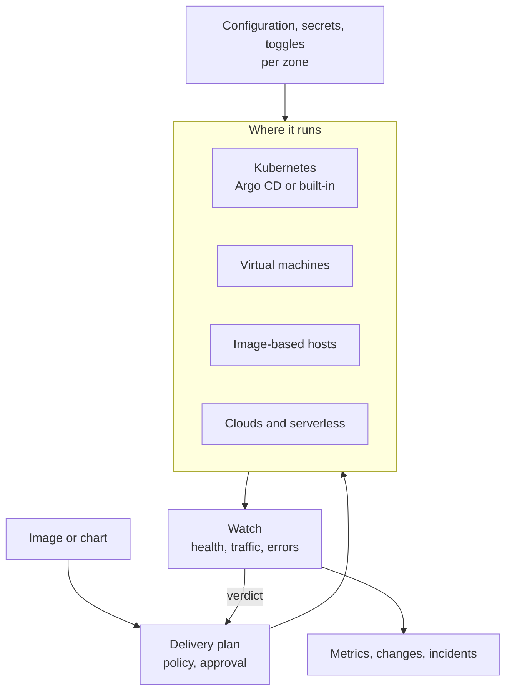

# Milestone 3: Delivery and GitOps depth

<!-- Generated by scripts/docs/build-roadmap.mjs from docs/roadmap/roadmap.json. Do not edit by hand. -->

<a href="../roadmap.html">Roadmap</a> › Milestone 3 · <a href="../roadmap-list.html">as a list</a>

Next 19 available · 9 in progress · 111 planned · 139 capabilities

See and control everything you run, whether it is an application in a cluster, a virtual machine or an image-based host, and deliver to it safely.

## What it is, and who it is for

Milestone 3 is about everything after the build. See every application and host in one place, find out why a deployment failed, roll out safely with weights and checks, run infrastructure as code with state kept for you, manage image-based hosts, and watch traffic, protection and reliability in the same views.

**Who it is for.** Teams that deploy to Kubernetes, virtual machines, machine images and clouds, and people who answer for what is running and whether it is healthy.

## What you will be able to do

- A deployment fails. Launchway says in one sentence why, shows the evidence, and offers to roll back the setting that caused it.
- You send ten percent of mobile traffic to a new version and watch errors on a map before widening it.
- You turn off a misbehaving feature with one button on a page that also shows its effect.
- A fleet of image-based hosts upgrades in batches with a check between each, and one batch pauses.
- A reviewer sees an automatically written change record with its risk and freeze status.

## How it fits together

*One plan, many targets, and a watch loop that can send a change back.*

**Builds on:** [Milestone 1: Host and run](milestone-1.md). **Leads to:** [Milestone 5: Software graph](milestone-5.md), [Milestone 8: Zero downtime](milestone-8.md), [Milestone 9: Network and traffic](milestone-9.md).

**Go deeper:** [Delivery: applications, rollouts and hosts](delivery.md) · [Live traffic, protection and reliability](traffic.md) · [The golden path](developer-experience.md) · [Built-in platform services](platform-services.md) · [Configuration as code](config-as-code.md).

## The capabilities

| Group | Capabilities | Available | In progress | Planned |
|---|---|---|---|---|
| [Applications and rollouts](#g-applications-and-rollouts) | 17 | 7 | 2 | 8 |
| [Debug a deployment, then see everything](#g-debug-a-deployment-then-see-everything) | 5 | 1 | 3 | 1 |
| [Where it deploys](#g-where-it-deploys) | 25 | 0 | 3 | 22 |
| [Infrastructure as code](#g-infrastructure-as-code) | 12 | 4 | 0 | 8 |
| [Runtime configuration](#g-runtime-configuration) | 6 | 1 | 0 | 5 |
| [Watch and protect](#g-watch-and-protect) | 10 | 0 | 0 | 10 |
| [Change and insight](#g-change-and-insight) | 6 | 0 | 0 | 6 |
| [Moving over from other delivery platforms](#g-moving-over-from-other-delivery-platforms) | 3 | 0 | 0 | 3 |
| [The golden path](#g-the-golden-path) | 13 | 0 | 0 | 13 |
| [Built-in platform services](#g-built-in-platform-services) | 8 | 0 | 0 | 8 |
| [Configuration as code and the automation control center](#g-configuration-as-code-and-the-automation-control-center) | 10 | 4 | 0 | 6 |
| [Standing orders: one choke point, no side doors](#g-standing-orders-one-choke-point-no-side-doors) | 12 | 0 | 0 | 12 |
| [Every way of branching](#g-every-way-of-branching) | 4 | 0 | 0 | 4 |
| [Switches](#g-switches) | 8 | 2 | 1 | 5 |

### Applications and rollouts {#g-applications-and-rollouts}

See and control everything you run, then deliver to it safely.

#### Argo CD in depth {#argo-cd-in-depth}

◐ In progress

Application hierarchy views (app-of-apps and ApplicationSet trees) with status, sync, health, history and actions, ready health checks, and a hosted or your own Argo CD. Launchway reads each application as the deploy engine sees it, shows drift, and lets you act with the same permissions as everything else. Argo CD is first-class, never required. Built: Launchway reads Argo CD applications, rollouts and their analyses through the Kubernetes API with the launch Station's own identity, lists the applications a Station has seen beside the Airfields, and shows the whole object tree of a Launch. Still to come here: hosted or your own Argo CD. The tree of every application, its context, the one-sentence diagnosis and safe control are in Milestone 8, group Argo CD, first class.

**Depends on:** GitOps with Argo CD

[Read the documentation](../guide/deployments.md) · [Area page](delivery.md)

#### Hosted or your own Argo CD {#hosted-or-your-own-argo-cd}

○ Planned

Use an Argo CD that Launchway runs for you, or connect one you already have. Both are equal in the interface. Teams that do not use Argo CD can use built-in deploys instead. Each is a served-by choice on the target, with one provider in charge: a second controller on the same namespaces is refused. A hosted controller is installed, upgraded and watched by Launchway; clusters connect outbound through their launch Station and the controller's access is limited to the Airfield's namespaces. Moving between the two is a wizard that adopts each application with a no-change dry run before the target switches.

**Depends on:** Argo CD in depth

[Area page](delivery.md)

#### Rollout control inside a run {#rollout-control-inside-a-run}

✓ Available

A pipeline watches a rollout, pauses at gates, promotes or aborts, and shows each step of the rollout as a station. Promote, abort and restart a rollout from the pipeline, and an Abort even after a rollout succeeded.

**Depends on:** Argo CD in depth.

[Read the documentation](../guide/deployments.md) · [Area page](delivery.md)

#### A single pane of glass {#a-single-pane-of-glass}

○ Planned

One fleet view of every application and every host: what runs where, its health, drift and evidence. Error rates, version, last change and owner are on one screen, and each tile opens the page that explains it.

**Depends on:** Argo CD in depth.

[Area page](delivery.md)

#### Weighted canaries and traffic control {#weighted-canaries-and-traffic-control}

○ Planned

Send a share of traffic, by client type, to a new version through the Gateway API or a service mesh, with mesh metrics as ready-made health checks. The overlay on the traffic map shows what share each version takes right now.

**Depends on:** Argo CD in depth.

[Area page](delivery.md)

#### Releases across services {#releases-across-services}

◐ In progress

Ship several services as one ordered, gated release with a promotion view across Airfields. Promotion moves the same digest, never a rebuild, and every step shows who approved it. Built: Formations that group releases of several Flights, checked all or nothing before they start and promoted in the order you write or in dependency order. Still to come: one Clearance, one Overwatch and a return in reverse order for the whole Formation (see One go or no-go, one watch, one way back).

**Depends on:** A single pane of glass

[Area page](delivery.md)

#### Promotion across environments {#promotion-across-environments}

○ Planned

Move a version from one Airfield to the next with checks and approvals in between. The matrix shows what runs where, which places are behind, and a button to move a version.

**Depends on:** Releases across services.

[Area page](delivery.md)

#### Post-deploy watch and incidents {#post-deploy-watch-and-incidents}

○ Planned

Keep watching after release, roll back automatically, and tie incidents to the change that caused them. An incident links back to the commit, run and setting change nearest to it. The watch, the stable state and the automatic return are detailed in Milestone 8.

**Depends on:** Verification after a deploy.

[Area page](delivery.md)

#### AI analysis as an optional rollback gate {#ai-analysis-as-an-optional-rollback-gate}

○ Planned

Let a verification step use AI analysis of metrics and logs to trigger automatic Return to base, off by default and able to require a person for production. Plain threshold checks remain the default, and AI can decide only where you allow it.

**Depends on:** A built-in model gateway.

[Area page](ai.md)

#### A health proof built into verification {#a-health-proof-built-into-verification}

✓ Available

A verify step can call the service it just deployed, over its window, with no monitoring series to set up; a failure says how many requests got which answer. HTTP and TCP checks from the deploy Station, limited to the hosts and namespaces its operator lists; credentials are secret references. gRPC health checks are not built in yet.

**Depends on:** Argo CD in depth.

[Read the documentation](../guide/verification.md) · [Area page](delivery.md)

#### GitOps write-back done right {#gitops-write-back-done-right}

✓ Available

Several pipelines may write one manifest at once, a tag can sit beside its digest, and a repository Launchway hosts is written with a credential made for that one deployment, directly or by pull request. Not yet: returning to base several deployments at once by pull request.

**Depends on:** Argo CD in depth.

[Read the documentation](../guide/gitops-write-back.md) · [Area page](delivery.md)

#### Delivery notifications {#delivery-notifications}

✓ Available

An approval that waits, a failed Sortie or deployment, a Return to base and a step that waited too long are told to a signed webhook or a chat channel, with a delivery log and retries. Email, per-person muting and a Return to base review on Home are not done yet.

**Depends on:** Argo CD in depth.

[Read the documentation](../guide/notifications.md) · [Area page](delivery.md)

#### Templates with derived defaults and optional parts {#templates-with-derived-defaults-and-optional-parts}

✓ Available

A parameter's default can follow another parameter, any step kind or list entry of a template can be left out by a parameter, and launchway validate expands templates from a library directory with no server. Defaults derive only for string parameters, from string parameters. The offline command does not know which libraries or Airfields a server allows.

**Depends on:** Argo CD in depth.

[Read the documentation](../guide/libraries.md) · [Area page](delivery.md)

#### Delivery by choice {#delivery-by-choice}

○ Planned

A pipeline names the Airfield; each Airfield chooses, per target, how it is served: through a GitOps controller (single application or parent with children), direct chart installs, plain manifests, a host fleet, an image-based fleet or a function platform; progressive delivery with or without the GitOps controller. None is required. The pipeline never names the machinery, so a platform team can move an Airfield from one way of serving to another without touching any pipeline; existing deploy steps that name Argo CD keep working. Short-lived Airfields for feature branches and pull requests use direct installs by default; long-lived branches and Airfields default to the GitOps path.

[Area page](delivery.md)

#### Progressive delivery without the GitOps controller {#progressive-delivery-without-the-gitops-controller}

○ Planned

Use the rollout controller alone, or plain chart installs, when the GitOps controller is not wanted. The rollout resource and its operator must be present; Launchway checks and says so.

[Area page](delivery.md)

#### Ordered GitOps sync, parent then child {#ordered-gitops-sync-parent-then-child}

✓ Available

An application and its values are written as two ordered commits, the values only once the cluster shows the new pin, and parents sync before children. The write-back and the ordered app-of-apps flow, with its guard, are on the main branch.

[Area page](delivery.md)

#### Drill down into everything a delivery created {#drill-down-into-everything-a-delivery-created}

✓ Available

From a pipeline's deploy step, see the live object tree: workloads, replica sets with their role, pods, services, routes with weights, configuration and test pods; open any object for status, events, manifest and logs; watch each proof and what test traffic sent and got back. New pods take no real traffic until they pass tests through a preview path; pause, resume, promote, abort, restart and return to base are always at hand, checked against permissions and audited.

[Area page](delivery.md)

### Debug a deployment, then see everything {#g-debug-a-deployment-then-see-everything}

Why did it fail, in one sentence, then every resource behind it.

#### Why did it fail to deploy {#why-did-it-fail-to-deploy}

✓ Available

A failed application opens with a diagnosis in one sentence, the evidence behind it and one recommended action. A failed deploy states its cause in one sentence with the evidence; a crash-looping pod fails the step with its own last words, and a stuck sync is named and ended (the last two are on the main branch).

**Depends on:** Argo CD in depth.

[Read the documentation](../guide/deployments.md) · [Area page](delivery.md)

#### A timeline of changes and symptoms {#a-timeline-of-changes-and-symptoms}

○ Planned

Changes, new copies starting, alerts and health on a single time line, with what changed since it last worked. A comparison with the last working version covers image, settings and manifests.

**Depends on:** Why did it fail to deploy.

[Area page](delivery.md)

#### Everything deployed {#everything-deployed}

◐ In progress

The whole resource tree: workloads, pods, containers, services, routes, settings, volumes, jobs and custom resources. Each node has overview, events, manifest with desired against live, and logs. Secrets show by name only. Built for the objects a Launch made: each with status, events and the live manifest, and Secrets by name only (see Drill down into everything a delivery created). Still to come: desired against live for each object, and the same tree for any application, not only a Launch's.

**Depends on:** Why did it fail to deploy

[Area page](delivery.md)

#### Logs where you need them {#logs-where-you-need-them}

◐ In progress

Container logs now and from before the last restart, with search, follow, a time range and jump to the first error. Restarts, exit codes and resource use sit beside the log. Built on the Launch page: any pod or all pods of a role, stable and Pathfinder side by side, follow, the earlier container, search, a time range and download, with redaction before anything leaves the Station. Still to come: jump to the first error, and the same for any application outside a Launch.

**Depends on:** Everything deployed

[Area page](delivery.md)

#### Fix actions with their consequence {#fix-actions-with-their-consequence}

◐ In progress

Roll a setting back, retry an update or open the failing pod, each saying in words what will happen. Every action is a guided change that can be undone and is audited. Today the server reports which actions can work, so no button is offered that cannot.

**Depends on:** Why did it fail to deploy.

[Area page](delivery.md)

### Where it deploys {#g-where-it-deploys}

Clusters, virtual machines, machine images, clouds and serverless.

#### Built-in Helm and Kubernetes deploys {#built-in-helm-and-kubernetes-deploys}

○ Planned

Deploy and return to base without Argo CD, from a chart or plain manifests with or without overlays; Argo CD stays first class for long-lived Airfields. The deploy is a typed step with a plan, a diff, health checks and a Return to base to the last good release. The launch Station renders the chart or manifests at their digest with the Airfield's values, shows the difference against the live cluster from a dry run, applies with server-side apply under Launchway's field manager, waits for every object to be ready, and prunes only objects this service owned and no longer renders. The rendered set is stored in the Depot by digest as the recorded previous state, so a Return to base re-applies the previous set exactly. Nothing is rendered or applied on the server.

**Depends on:** Container images

[Area page](delivery.md)

#### Preview environments {#preview-environments}

○ Planned

Every pull request or branch gets its own short-lived Airfield and address, tested and cleaned up on merge. The pull request page shows the address and the verification result, and when the preview expires. A preview is an Airfield made from a template Airfield the platform team names, with a time limit, a cost cap and a rule for pull requests from forks (no secrets and no Launch until a person says Go). On Kubernetes a preview is a namespace; on a serverless target it is a version with no share of live traffic and its own address, so it costs almost nothing until it is used; machines and image-based hosts use a throwaway virtual machine.

**Depends on:** Built-in Helm and Kubernetes deploys

[Area page](delivery.md)

#### VM deploys {#vm-deploys}

◐ In progress

Roll a change across virtual machines in batches over SSH, with verification between batches. Hosts appear next to applications on the fleet page, with what runs on each. Built and tested in code: batches of hosts drained from a load balancer, changed, health-checked and admitted, and every touched host returned to its previous release on a failed check. Not yet: the server refuses a Sortie that contains a fleet step, so it runs only from a Station's command line, outside the Airfield lock, the record, Clearance and Standing orders, and the hosts are a file rather than a fleet held in the product.

**Depends on:** Fleets held in the product; Fleet Launches scheduled by the server

[Area page](delivery.md)

#### Machine images with Packer {#machine-images-with-packer}

○ Planned

Bake machine images in a pipeline and roll them through instance groups. Images have contents, scan results and signatures like container images. Each image is boot-tested in a throwaway machine and given a digest over its contents list and disk manifest, with the map from that digest to each region's image identifier on the record. An instance-group Launch writes a new template version and replaces machines in batches Launchway drives, with proofs between batches and never below the floor, or swaps to a second group behind the same balancer. Machines started by scaling during the Launch take the template the Airfield wants. Return to base puts back the previous template and replaces changed machines; retention keeps every image a return may need, in every region.

**Depends on:** Packer builds as a first-class step; Cloud instance groups as fleets

[Area page](delivery.md)

#### Image-based hosts {#image-based-hosts}

◐ In progress

Machines that are really images (built on bootc), built, signed, upgraded and returned to base like container images, with host setup done at first boot. Staged upgrades, reboots in batches and a go-back button use the same runway as an application rollout. Built and tested in code, including a test that boots a real image in a throwaway virtual machine: switch by digest, stage, drain, reboot, check, admit, and go back to the previous image with one more reboot. Not yet: the server will not schedule it inside a Sortie, there is no host list or image catalog in the product, nothing records which host booted which digest, the host's own update timer is not handled, and host setup at first boot is still planned.

**Depends on:** Machine images with Packer; Fleet Launches scheduled by the server; Which host booted which digest; A host never updates itself behind a Launch

[Area page](delivery.md)

#### First boot owned by Launchway {#first-boot-owned-by-launchway}

○ Planned

The first-boot unit applies host name, network, keys and zone, and may run a configuration playbook once before the host takes traffic. Running a playbook on a host that is already serving traffic stays refused, because that is what brings drift back.

**Depends on:** Image-based hosts.

[Area page](delivery.md)

#### Configuration at build time {#configuration-at-build-time}

○ Planned

Ansible and image builders work together at build time to prepare images. What belongs in the image is baked, and what must differ per host is applied at first boot.

**Depends on:** Image-based hosts.

[Area page](delivery.md)

#### An infrastructure stack designer {#an-infrastructure-stack-designer}

○ Planned

Compose image, build and configuration blocks visually and have them turned into pipelines. The picture and the generated files stay in step, and the result is reviewable in Git.

**Depends on:** A drawing canvas and diagrams.

[Area page](delivery.md)

#### Image as a service for enterprise Linux teams {#image-as-a-service-for-enterprise-linux-teams}

○ Planned

Watch base images and advisories, rebuild, re-sign, re-scan and roll out across zones with verification. You can ask whether every production host runs an approved, signed and scanned image patched inside its deadline, and get a yes or a list.

**Depends on:** Image-based hosts.

[Area page](delivery.md)

#### Hosts and machine images in the interface {#hosts-and-machine-images-in-the-interface}

○ Planned

A catalog of images with contents and base, and a hosts page showing version, staged upgrade, drift and last seen. A host page draws first boot as a short line, with boot history and logs.

**Depends on:** Image-based hosts.

[Area page](delivery.md)

#### Cloud targets: AWS, Google Cloud and Azure {#cloud-targets-aws-google-cloud-and-azure}

○ Planned

Deploy to the three major clouds with their own features, with no stored cloud keys. Each target uses short-lived identity from the pipeline step.

**Depends on:** Cloud sign-in per step.

[Area page](delivery.md)

#### Every cloud and on-premises, within the limits of the environment {#every-cloud-and-on-premises-within-the-limits-of-the-environment}

○ Planned

The same behavior on the major clouds, on-premises hypervisors, bare metal and sites with no internet. Before acting, Launchway discovers what the Airfield allows (quotas, permissions, network reach, services, approved images and regions) and works inside it. Anything that cannot be done there is said plainly before it is attempted.

[Area page](delivery.md)

#### Delivery to machines over SSH {#delivery-to-machines-over-ssh}

◐ In progress

Roll a fleet in place with pinned host keys, audited commands and draining, and roll image-based hosts by digest with a staged reboot and automatic Return to base on a failed health check. Also boots a new operating-system image in a throwaway virtual machine as a test. The per-host sequence, pinned keys, audited commands, one open-source load balancer, a second group for stepped traffic, and a test that boots an operating-system image in a throwaway virtual machine are built and tested. They run today from the command line on a Station (launchway fleet run); the server does not schedule them inside a Sortie yet.

**Depends on:** Fleets held in the product; Fleet Launches scheduled by the server

[Area page](delivery.md)

#### Launch from one command, with the record kept {#launch-from-one-command-with-the-record-kept}

○ Planned

Push a program to servers you own with one command and nothing to run, using the same per-host sequence, and keep a signed record that becomes Launch records when a server exists. Host keys are shown for you to confirm and then pinned. Once a server is set, even the single-server shape, the same command becomes a Sortie: the hosts become a fleet held in the product and the lock, Standing orders and Clearance apply.

**Depends on:** Fleets held in the product

[Area page](delivery.md)

#### Containers on a host, by digest {#containers-on-a-host-by-digest}

○ Planned

Launch a container to a fleet of plain hosts, pinned by digest and run as a service the host restarts, with the same drain, check and way back as a binary. A moving tag is refused, as it is for image-based hosts. The previous digest stays on the host so the way back needs no download. The container runtime is a plug point: the host's open-standard runtime is found by a probe and driven through an adapter with the same verbs for each. The image is pulled before the drain. A host is admitted only when the container's own health check reports healthy and the fleet's check passes. Settings and secret references travel with the release.

**Depends on:** Fleet Launches scheduled by the server

[Area page](delivery.md)

#### A host never updates itself behind a Launch {#a-host-never-updates-itself-behind-a-launch}

○ Planned

Launchway pins each image-based host to a digest and turns off, or checks, the host's own update timer, so a host changes only when a Launch says so and a Return to base is never undone. Enrollment checks the timer and reports a host that would update itself as a finding. Pinning by digest makes the host's own upgrade command do nothing. A Standing order can require it for an Airfield.

**Depends on:** Which host booted which digest.

[Area page](delivery.md)

#### Boot test as a pipeline step {#boot-test-as-a-pipeline-step}

○ Planned

Boot a newly built operating-system image in a throwaway virtual machine inside a Sortie, check that its services come up, and use the result as a Preflight check before the image can fly. The boot test exists in code as a test of the fleet package; this makes it a step with a Debrief, run on a Ramp whose Stations can start virtual machines.

[Area page](delivery.md)

#### Applications pinned inside the image {#applications-pinned-inside-the-image}

○ Planned

Applications that ride on image-based hosts are pinned by digest: baked into the image, pulled with it before the reboot, or launched on their own as containers, never left on a moving tag. The release of an image-based host lists the image digest and every application digest it carries. Launching the image and an application together is a Formation.

**Depends on:** Image-based hosts; Containers on a host, by digest.

[Area page](delivery.md)

#### What an image cannot take back {#what-an-image-cannot-take-back}

○ Planned

Before an image Launch, Launchway says what going back will not undo: data that persists across images, and configuration changed on the host since the last image. It checks the image for content placed where only the first install applies it, and lists host files changed by hand, with a choice to reset them to the image or carry them into the next image.

**Depends on:** Which host booted which digest.

[Area page](delivery.md)

#### Several clusters in one Airfield {#several-clusters-in-one-airfield}

○ Planned

An Airfield can hold several clusters, and one Launch reaches them in waves with one record, one lock and one Return to base. Each cluster is a target served by its own launch Station. The first wave is a single cluster or a share of clusters; the rest follow only when its verdict passes. Overwatch judges each cluster and the whole. A Return to base returns every cluster the Launch touched. Today an Airfield has one target, a rollout on another target is refused, and several clusters mean several Airfields.

**Depends on:** Delivery by choice

[Area page](delivery.md)

#### Fleets held in the product {#fleets-held-in-the-product}

○ Planned

A fleet is a named set of hosts inside an Airfield, kept in the database with its groups, labels, pinned keys, load balancer and floor, and changed from every way in. The web interface, the HTTP API, the command line, the agent endpoint and Terraform all read and write the same fleet; a parity test keeps them equal. On a protected Airfield, adding or removing a host is a change that needs Clearance. The store already exists in code with no caller; this wires it.

[Area page](delivery.md)

#### Hosts added from an inventory source {#hosts-added-from-an-inventory-source}

○ Planned

Add hosts to a fleet by picking them from a hypervisor, a public cloud, the outputs of an infrastructure stack or an existing inventory file, instead of typing them. The source is read by a Station inside the network, so no platform credential reaches the server. Each host's public key is fetched and shown for you to confirm before it is pinned. A source can keep the fleet in step, with additions and removals proposed for review rather than applied silently.

**Depends on:** Fleets held in the product.

[Area page](delivery.md)

#### Hosts that enroll themselves {#hosts-that-enroll-themselves}

○ Planned

A host joins a fleet by running one command with a one-time code; it appears as waiting until a person with the right role admits it. The code is single-use, short-lived and bound to one fleet. Enrollment gives the host its own identity, never a shared key. On a protected Airfield admitting a host needs Clearance.

**Depends on:** A host agent that pulls its work.

[Area page](delivery.md)

#### A host agent that pulls its work {#a-host-agent-that-pulls-its-work}

○ Planned

For hosts behind a firewall or often offline, a small agent on the host connects outward, takes the Launch meant for it, performs only the host actions on its allow-list, and reports back. Proposed as the Station program running in a host mode, so enrollment, identity, updates and the step contract are the ones Stations already have. Reach is a choice per fleet: pushed by a launch Station over SSH, or pulled by the host agent. A host that was away takes the release its Airfield currently wants when it returns.

**Depends on:** Fleets held in the product.

[Area page](delivery.md)

#### Packages as a Launch payload {#packages-as-a-launch-payload}

○ Planned

Launch an operating-system package from the Depot to a fleet, identified by version and checksum, with the previous version kept for the way back. Launchway says plainly when a package's own scripts make the way back unclean, and the Launch page shows the package manager's output per host.

**Depends on:** Fleet Launches scheduled by the server.

[Area page](delivery.md)

### Infrastructure as code {#g-infrastructure-as-code}

State, plans and checks you can trust.

#### Terraform and OpenTofu {#terraform-and-opentofu}

✓ Available

Reviewed plans, applies that run only the reviewed plan, state kept and locked inside Launchway, and drift detection. Users never wonder where state goes, and Launchway guides them to good practice by default.

[Area page](config-as-code.md)

#### State and locking built in {#state-and-locking-built-in}

✓ Available

Terraform and OpenTofu state is stored, versioned, encrypted and locked inside Launchway, with access rules. The HTTP backend with locks, 50 sealed versions with who, when and which run, Return to base, and run-scoped credentials; the API, command line and MCP server show no value. Not yet: diff between versions, import wizard, the S3 way, per-environment mapping.

**Depends on:** Terraform and OpenTofu.

[Area page](platform-services.md)

#### Ansible {#ansible}

✓ Available

Typed steps with per-host results and a check mode before apply. Results show per host, with the check result shown before anything is changed.

[Area page](config-as-code.md)

#### Chef {#chef}

○ Planned

A real step with per-node results where Chef reports them, check mode before apply, and templates. Later and by choice: a real step with per-node results where Chef reports them, a check before apply, and tests as checks.

[Area page](config-as-code.md)

#### Packer builds as a first-class step {#packer-builds-as-a-first-class-step}

○ Planned

Run image builds with their results, logs and Cargo attached to the Sortie. Output images go to the Depot or the image store with provenance.

[Area page](delivery.md)

#### Adopt a machine that already exists {#adopt-a-machine-that-already-exists}

○ Planned

Scan a running system read-only, understand its configuration, generate the playbooks that describe it as a pull request, prove them with a no-change check, then manage it. Nothing is changed on the machine until you approve.

[Area page](delivery.md)

#### Convert a server to an image-based system {#convert-a-server-to-an-image-based-system}

○ Planned

A guided path from a conventionally installed server to an image-based one that is built, tested and returned to base like a container image. Needs the adopt step first.

[Area page](delivery.md)

#### Configuration as code, first slice {#configuration-as-code-first-slice}

✓ Available

Ansible run reports, plan reports and a built-in state backend for OpenTofu, with runs that show hosts by plays, drift and plan. This is the first slice: a built-in state backend for OpenTofu, plan and Ansible reports, and drift per host.

[Area page](delivery.md)

#### Standing orders over infrastructure plans {#standing-orders-over-infrastructure-plans}

○ Planned

Rules read what an infrastructure plan destroys, replaces or makes public and what it will cost, and the Clearance card shows the plan and its cost. Typed plan facts are recorded by the plan step; the estimated monthly cost comes from the cost capability (a connected source or an estimate step, one in charge); a missing estimate is cannot tell, never pass; the same judging covers database statement facts from Preflight. The reviewed digest is still the only thing applied.

**Depends on:** A configuration change is a plan

[Area page](config-as-code.md)

#### Infrastructure stacks as Airfield targets {#infrastructure-stacks-as-airfield-targets}

○ Planned

An infrastructure stack is a kind of target in an Airfield, with its own variables, state, lock and drift in every Airfield it is placed in. One stack in code becomes one instance per Airfield (dev, staging, prod), which is what other tools call a workspace. Standing orders, Holds and Clearances that guard the Airfield guard the stack. A Patrol runs a refresh-only plan for every instance and shows drift on the Airfield page as a finding; Converge now is an ordinary stack Launch of the current commit under the same Clearance, and Take into code opens a pull request that writes the change into the stack. Outputs become typed values for later steps and a source of hosts for fleets. Return to base plans the last good commit and applies it, never held by a lock, a Hold or a Clearance; a plan that would destroy or replace a resource holding data asks the person to tick each one.

**Depends on:** Terraform and OpenTofu; State and locking built in; Drift and converge now

[Area page](config-as-code.md)

#### Infrastructure plans kept by digest, with cost on the Clearance {#infrastructure-plans-kept-by-digest-with-cost-on-the-clearance}

○ Planned

A plan is stored as Cargo by digest with a masked difference, typed plan facts and an estimated cost change; the Go is given on that digest and the apply refuses anything else. The plan step runs on a Station with a short-lived cloud identity and stores the plan, encrypted, in the Depot. Beside it: a readable difference with sensitive values shown as changed and hidden, and typed facts (resources added, changed, replaced and destroyed by kind, anything newly reachable from the internet, estimated monthly cost before and after, labeled as an estimate). The facts are judged by Standing orders at Preflight. The Clearance card shows destroyed and replaced resources first. The apply fetches the plan by digest and refuses if the digest, the state version it was made from, the commit or the inputs differ from what was cleared.

**Depends on:** A configuration change is a plan; Infrastructure stacks as Airfield targets

[Area page](config-as-code.md)

#### State versions compared, secrets masked {#state-versions-compared-secrets-masked}

○ Planned

Compare any two versions of a stack's state with sensitive values masked, and choose per stack whether state is served built in or by your own backend. State stays stored, versioned, encrypted and locked inside Launchway with who, when and which Sortie made each version. The difference between two versions lists resources and attributes added, changed and removed, never a raw value marked sensitive. A stack may instead be served by a connected backend, one provider in charge and shown as served by; Launchway still records plans and applies, and shows versions where the backend lets it read them.

**Depends on:** State and locking built in

[Area page](platform-services.md)

### Runtime configuration {#g-runtime-configuration}

Settings, keys and toggles managed together, per zone and Airfield.

#### Feature toggles {#feature-toggles}

✓ Available

A built-in toggle service that applications and agents read through the OpenFeature standard, per Airfield, with percentages and rules. It speaks an open protocol, so existing applications can read it with no Launchway library. How toggles join the zero-downtime model is in Milestone 8.

[Area page](platform-services.md)

#### Configuration, keys and toggles per zone {#configuration-keys-and-toggles-per-zone}

○ Planned

Manage settings and secrets together per zone and Airfield, for virtual machines and Kubernetes alike. A zone is a named place and failure domain such as a region or a cluster. The nearest owner wins unless a higher level has enforced the value.

[Area page](traffic.md)

#### Routing by client attributes {#routing-by-client-attributes}

○ Planned

Decide which version a request gets from who sent it, such as a share of mobile clients, inside the application or at the network. The effective exposure of route share times toggle share is always shown.

**Depends on:** Switches.

[Area page](traffic.md)

#### A guided change for every lever {#a-guided-change-for-every-lever}

○ Planned

Preview, policy check, approval where required, applied and audited, with an undo, for toggles, weights and limits. Moving a lever to its safe state is never gated, and moving away from it always is.

**Depends on:** Switches.

[Area page](traffic.md)

#### Secrets with an external store {#secrets-with-an-external-store}

○ Planned

Read secrets from more external stores, such as the cloud providers’ own secret services. Vault, OpenBao, files and the Airfield already work. The store stays authoritative and values never reach the control plane. The cloud secret services are reached with the step's short-lived identity and must pass the same conformance suite as every backend.

**Depends on:** Secrets that stay with Stations

[Area page](traffic.md)

#### Service mesh support including VMs {#service-mesh-support-including-vms}

○ Planned

Traffic, identity and policy for services on a mesh, and for virtual machines that join it. Machines outside the mesh still appear on the map as declared.

**Depends on:** Weighted Pathfinders and traffic control.

[Area page](traffic.md)

### Watch and protect {#g-watch-and-protect}

See traffic, protect it, and know whether each service is meeting its target.

#### A live traffic map {#a-live-traffic-map}

○ Planned

See how traffic flows between services, workloads and virtual machines, with rates, errors and latency. Each connection says whether it was observed, declared or not observed, and no number is ever made up for one that is not observed.

**Depends on:** Service mesh support including VMs.

[Area page](traffic.md)

#### Diagnose along a flow {#diagnose-along-a-flow}

○ Planned

From a red connection, a one-sentence diagnosis, the failing requests, the pod, the change that caused it and the logs. You go from symptom to cause without changing tools.

**Depends on:** A live traffic map.

[Area page](traffic.md)

#### Replay the last hours {#replay-the-last-hours}

○ Planned

A time slider that replays the last twelve hours of the map with incidents and rollouts marked. Useful for what changed when errors began.

**Depends on:** A live traffic map.

[Area page](traffic.md)

#### Inject delays and errors safely {#inject-delays-and-errors-safely}

○ Planned

Add a delay or an error to a share of requests on a healthy connection, with a hard limit on share and time. The dialog shows who is affected, and conditions stop the test early.

**Depends on:** A live traffic map.

[Area page](traffic.md)

#### Rate limiting and traffic protection {#rate-limiting-and-traffic-protection}

○ Planned

Limits per client, route and customer, connection limits, timeouts, retries and circuit breakers, shown with how close traffic is to each. Changing one is a guided change with a preview that replays the last hour against the new value.

**Depends on:** A live traffic map.

[Area page](traffic.md)

#### Attack and abuse signals {#attack-and-abuse-signals}

○ Planned

Signs of attack or abuse as plain sentences with evidence and three actions: limit, block or ignore with a reason. Each signal says honestly where it came from.

**Depends on:** Rate limiting and traffic protection.

[Area page](traffic.md)

#### Reliability pages {#reliability-pages}

○ Planned

Services ranked by error budget, saturation and restarts, with deploys, settings, toggles and scaling marked on the charts. Cause and effect are visible on one time line.

**Depends on:** Service reliability targets.

[Area page](traffic.md)

#### Signal sources {#signal-sources}

○ Planned

Connect metrics, logs, analytics, traces, the mesh, a firewall and the toggle service, with a test for each. Every chart names its source and links to the query. Sources join in an order of value: the built-in health proof, metrics stores that speak the Prometheus query language, log stores, SQL, analytics and HTTP sources, load balancers in front of host pools, Gateway API gateways, service meshes, tracing stores using the open standard for traces, serverless and edge platforms' metrics, edge providers and DNS, then commercial monitoring services through connection adapters. Each is read only through the guarded query layer, tested with a known query when saved and on a Patrol, and covered by a contract test that replays recorded answers.

**Depends on:** Guarded queries for monitoring data

[Area page](traffic.md)

#### Service reliability targets {#service-reliability-targets}

○ Planned

Set targets for the services you run and see whether a release is spending the budget. Targets can be imported and exported in an open format.

[Area page](traffic.md)

#### An error tracker as a signal for Overwatch {#an-error-tracker-as-a-signal-for-overwatch}

○ Planned

Connect the error tracker a team uses; each Launch sends it a release marker, and new error groups in the new version become an Overwatch proof linked to the line, pull request and work item behind them. The tracker keeps grouping, storage and alerting; Launchway reads group identifiers, titles, counts per version and top frames through the guarded query layer, never payloads or user details. One tracker in charge per Squadron, shown as served by. A tracker that does not answer gives 'not enough data', never a pass. New groups appear on the timeline and in the connected incident.

**Depends on:** Signal sources; The watch.

[Area page](traffic.md)

### Change and insight {#g-change-and-insight}

Know what changed, who approved it, and how delivery is going.

#### Change management {#change-management}

○ Planned

Automatic change records with risk scores, freezes and approvals, and optional two-way sync with an IT service tool. Works standalone, so a team without such a tool still has records.

**Depends on:** Approvals and protected Airfields.

[Area page](delivery.md)

#### Connections to ServiceNow and Jira Service Management {#connections-to-servicenow-and-jira-service-management}

○ Planned

Create and update change records in ServiceNow or Jira Service Management and take their approval back. Optional and equal to the built-in records.

**Depends on:** Change management.

[Area page](delivery.md)

#### Delivery metrics and executive dashboards {#delivery-metrics-and-executive-dashboards}

○ Planned

Deployment frequency, lead time, change failure rate and time to restore, with drill-down to the Sorties behind each number. Graphs are meant for people who do not use Launchway daily. Shown per Flight, Squadron, Wing and Airfield, with where lead time goes; never a ranking of people.

[Area page](delivery.md)

#### Test intelligence and flow insights {#test-intelligence-and-flow-insights}

○ Planned

Find slow and flaky tests, bottlenecks in review and idle time in delivery. Suggestions are shown with the evidence. Test selection from the record and the graph, and speed suggestions, are the first slice (Milestone 2).

**Depends on:** Delivery metrics and executive dashboards

[Area page](delivery.md)

#### Policy rules in an open language {#policy-rules-in-an-open-language}

○ Planned

Write extra policy rules in an open policy language alongside the built-in rules. Rules run at the same decision point and are shown in the verdict. Accepted as an import or judged through a connection at the same points, shown in the same verdict, with the same waivers.

**Depends on:** Policy gates

[Area page](delivery.md)

#### Portfolio bill of materials {#portfolio-bill-of-materials}

○ Planned

A bill of materials across every image as well as every Flight, with export. Searching components across Flights already works. Pairs with the software graph.

**Depends on:** Findings and SBOMs per Sortie.

[Area page](delivery.md)

### Moving over from other delivery platforms {#g-moving-over-from-other-delivery-platforms}

Importers and proof for teams that already have a delivery platform.

#### Importers for other delivery platforms {#importers-for-other-delivery-platforms}

○ Planned

Convert pipelines, services and Airfields from other delivery and GitOps platforms, with a report of what needs a person. The report is honest about gaps.

#### Published proof points {#published-proof-points}

○ Planned

Measured comparisons of footprint, speed and capabilities that anyone can reproduce. Methods and results are published.

#### Enterprise readiness checklist {#enterprise-readiness-checklist}

○ Planned

Answers to the questions an enterprise reviewer asks, with a support bundle and an evidence page. Close the gaps that gate adoption.

### The golden path {#g-the-golden-path}

A developer describes what an application is in a short file, or in nothing at all; the platform team says how things are delivered once; Launchway does the rest and records the evidence.

#### A small workload description {#a-small-workload-description}

○ Planned

A short file in the repository says what an application is: how it listens, its health check, its backing services and the names of its secrets. Detection can fill it in. Launchway derives the pipeline, checks and rollout plan from it.

[Area page](developer-experience.md)

#### Import from and export to Score {#import-from-and-export-to-score}

○ Planned

The workload description reads and writes the open Score specification, so you are never locked in. First landing: Kubernetes with Argo CD.

[Area page](developer-experience.md)

#### Landings chosen per environment {#landings-chosen-per-environment}

○ Planned

The platform team chooses where each Airfield lands, and the same description is delivered there. Kubernetes first.

[Area page](developer-experience.md)

#### Virtual machine and bootable-container landings {#virtual-machine-and-bootable-container-landings}

○ Planned

The same description can land as a package or machine image on virtual machines, or on a fleet of bootable-container hosts. Second phase.

[Area page](developer-experience.md)

#### Serverless and managed container landings {#serverless-and-managed-container-landings}

○ Planned

The same description can land as a function or a managed container service. Later phase. It lands through the Milestone 8 group 'Serverless, one kind of target'.

**Depends on:** Serverless and managed container services

[Area page](developer-experience.md)

#### Show what was generated, and eject {#show-what-was-generated-and-eject}

○ Planned

Everything Launchway generates can be shown, and a team can take ownership of the generated files for one landing. Never a black box and never a silent rewrite of your repository.

[Area page](developer-experience.md)

#### Automatic change records {#automatic-change-records}

○ Planned

Every delivery becomes a change record with its evidence, without anyone filling in a form. Facts come from the pipeline, the proofs and the approvals: the change record is the release's evidence pack plus its change type; a connected change system receives it and its approval comes back as a Clearance.

[Area page](developer-experience.md)

#### Standard, normal and emergency changes {#standard-normal-and-emergency-changes}

○ Planned

A repeatable low-risk change is approved by a rule; a normal change goes to the right people with the evidence; an emergency change acts first and is reviewed after. Risk is computed from facts and shown with its reasoning.

[Area page](developer-experience.md)

#### Separation of duties {#separation-of-duties}

○ Planned

The author of a change is never its only approver, and nobody approves a rule that applies to them. An unavailable action says why.

[Area page](developer-experience.md)

#### Freezes and a release calendar {#freezes-and-a-release-calendar}

○ Planned

A hold blocks approval and the production step for a time, while work continues up to it, and a calendar shows windows and scheduled changes. Emergency changes use their own path.

[Area page](developer-experience.md)

#### An external change system, optional {#an-external-change-system-optional}

○ Planned

Change records can be sent to and approved in an external change management system through an adapter. The built-in changes area works with no adapter.

[Area page](developer-experience.md)

#### A security review only when the facts warrant it {#a-security-review-only-when-the-facts-warrant-it}

○ Planned

A lightweight review is triggered by facts such as a new public route or a new kind of data, not on every change. Continuous checks run on every change regardless.

[Area page](developer-experience.md)

#### Golden path health for the platform team {#golden-path-health-for-the-platform-team}

○ Planned

See how many deliveries follow the path, where developers leave it and which standard stops the most. A view for the platform owner.

[Area page](developer-experience.md)

### Built-in platform services {#g-built-in-platform-services}

Four things that sit next to your pipelines are built in and optional: object storage, Terraform and OpenTofu state, a managed cache and Switches. Each can be swapped for the product you already run.

#### S3-compatible object storage {#s3-compatible-object-storage}

○ Planned

A small S3-compatible front door on the storage Launchway already has, speaking the part of S3 that Terraform, Depots, backup tools and build caches use. Promised for Launchway’s own data and your pipelines. For production application data you connect your own bucket, or bundle a managed server.

[Area page](platform-services.md)

#### Short-lived storage credentials {#short-lived-storage-credentials}

○ Planned

A step proves its identity and gets a temporary key, so a pipeline never holds a stored storage key. Part of the first phase.

[Area page](platform-services.md)

#### Versioning, lifecycle and events for storage {#versioning-lifecycle-and-events-for-storage}

○ Planned

Keep versions, expire objects by rule and send events when objects change. Second phase.

[Area page](platform-services.md)

#### State you can read safely {#state-you-can-read-safely}

○ Planned

Terraform and OpenTofu state is shown as a difference with secrets masked and never as raw text, with history and Return to base. Second phase, after state and locking.

**Depends on:** State and locking built in.

[Area page](platform-services.md)

#### A managed cache as a backing service {#a-managed-cache-as-a-backing-service}

○ Planned

Give an application a cache in an Airfield: a managed Valkey, installed through GitOps, with its credentials in the vault. Launchway is not a database vendor, and says so. PostgreSQL covers Launchway’s own needs.

[Area page](platform-services.md)

#### Give this app a backing service {#give-this-app-a-backing-service}

○ Planned

The same pattern provisions a cache, a database, a Holding pattern or object storage for an application and wires it in as a connection. Third phase.

[Area page](platform-services.md)

#### Toggles keep working when Launchway is down {#toggles-keep-working-when-launchway-is-down}

○ Planned

Providers keep the last known values and verify signed rules, so an outage never flips a feature. Also evaluation counts for hygiene.

[Area page](platform-services.md)

#### Bring your own backend {#bring-your-own-backend}

○ Planned

Each platform service has a built-in default and a popular backend you can use instead, without losing data. What you install: Launchway, and PostgreSQL for production.

[Area page](platform-services.md)

### Configuration as code and the automation control center {#g-configuration-as-code-and-the-automation-control-center}

Everything that configures a system is code in Git, reviewed like code, applied from a plan, and watched for drift.

#### A configuration change is a plan {#a-configuration-change-is-a-plan}

✓ Available

A dry run is its first proof, people give go or no-go on the reviewed plan, Launchway applies exactly what was reviewed, and the way back is the previous version. For OpenTofu the plan file is applied exactly. For Ansible the reviewed thing is the check run: the apply is not forced to match it, and the page says so.

[Area page](config-as-code.md)

#### Inventories {#inventories}

✓ Available

Hosts come from a static list first, then from clusters, clouds and other sources, with search over what is known about each. Inventory stays on your side on the hosted service.

[Area page](config-as-code.md)

#### Flight plans as job templates, with a form {#flight-plans-as-job-templates-with-a-form}

○ Planned

A stack or playbook becomes a Flight plan with a form for its inputs, a schedule, credentials and role-based access. A wizard writes the pipeline for a repository it finds.

[Area page](config-as-code.md)

#### Results for every host {#results-for-every-host}

✓ Available

See per host and per task what changed, with the tool’s own output kept alongside. Launchway keeps the tool’s own output beside a readable summary.

[Area page](config-as-code.md)

#### Drift and converge now {#drift-and-converge-now}

✓ Available

See which hosts and resources differ from their code and why, and press converge with the same clearance as any change. Drift is checked on a schedule and shown per host.

[Area page](config-as-code.md)

#### Short-lived access to hosts {#short-lived-access-to-hosts}

○ Planned

Runs use workload identity or per-run secure shell certificates, never a stored cloud key. Least privilege for hosts and secrets.

[Area page](config-as-code.md)

#### Launchway’s own settings as code, both ways {#launchway-s-own-settings-as-code-both-ways}

○ Planned

Change settings on screen or in Git; each way produces a visible, reviewable change in the other. Built on the Terraform provider. A level names its settings repository and the kinds kept there. A pull request gets a check with the difference and the Standing order verdicts; a merge is applied through the same route as configuration apply, all or none, and the result is posted back. A screen change becomes a pull request ('Git leads') or is committed after it is live ('screen leads'). Every change carries the version it read, so an outdated merge is refused with a three-way difference. Changes made outside Git show as drift. The parity table says per kind whether it may live in Git.

**Depends on:** Terraform provider

[Area page](config-as-code.md)

#### Event-driven fixes {#event-driven-fixes}

○ Planned

An alert or a drift report can start a reviewed fix, with limits so it cannot run away. Second phase.

[Area page](config-as-code.md)

#### Other configuration tools later {#other-configuration-tools-later}

○ Planned

Agent-based tools and other infrastructure tools join through one common interface. Third phase.

[Area page](config-as-code.md)

#### A configuration apply bound to its check run {#a-configuration-apply-bound-to-its-check-run}

○ Planned

A playbook apply runs the commit, playbook digest, inputs and hosts of the check run that was cleared, refuses if any changed, and reports any task that changed without being shown by the check. The check run records its commit, playbook digest, inputs, host list and result digest, and the Clearance is given on it. Run again on the failed hosts keeps the binding while the Clearance is valid.

**Depends on:** Ansible; A configuration change is a plan

[Area page](config-as-code.md)

### Standing orders: one choke point, no side doors {#g-standing-orders-one-choke-point-no-side-doors}

Rules judged at every fixed point on the path to production, set by level with locks, with Clearance as a verdict and no way around.

#### Standing orders judged when a change merges {#standing-orders-judged-when-a-change-merges}

○ Planned

Merging into a protected branch becomes one of the fixed points where Standing orders are judged: branch rules and Standing orders give one verdict on the pull request, with its reasons on the record. The branch rules that exist become the merge point's rules, settable by level with locks, and the Inspection verdict joins them; a level can require, through Standing orders, what every merge must show (signed commits, no new blocking findings, an owner's approval, a passing Debrief). The same rule is judged for a pull request on the built-in host and for the status Launchway posts to a connected host, where the verdict is a required status. A review approval is recorded with the same fields as a Clearance (who, which role, on which revision, under which rule), so evidence for a release reads one kind of decision.

**Depends on:** Branch rules and protected tags; Pull requests on the built-in host; Policy gates

[Area page](policy-and-governance.md)

#### Standing orders judged when a setting changes {#standing-orders-judged-when-a-setting-changes}

○ Planned

A change to a secret's version, a variable, a Switch or a traffic route is judged like a Launch. A Master switch moved to its safe value is never judged.

**Depends on:** Configuration and secrets as rollouts

[Area page](policy-and-governance.md)

#### Cluster admission generated from Standing orders {#cluster-admission-generated-from-standing-orders}

○ Planned

The cluster itself refuses images the Base's Standing orders would refuse, whoever asks it to run them, so nothing reaches an Airfield's namespaces by a side door. Launchway generates rules in the cluster's built-in admission policy, or hands them to a connected policy engine, only for the namespaces the Airfield owns, and proposes them as a change to the Base's GitOps repository that the platform team reviews; no policy engine runs in the server. Each Launch carries a signed statement of release, Airfield and Launch that the rules check, so a hand-applied image is refused while a Return to base to an earlier Launch passes. A refusal is shown as a finding with the object and the rule. An emergency path exists, and every use is in the Logbook.

**Depends on:** Signing and verification; Clusters and the fleet

[Area page](policy-and-governance.md)

#### Require a Clearance as a verdict {#require-a-clearance-as-a-verdict}

○ Planned

A rule can route a risky change to a person instead of stopping it. Four answers: allow, warn, require a Clearance, deny; the strictest wins.

**Depends on:** Policy gates

[Area page](policy-and-governance.md)

#### Try a rule against the record {#try-a-rule-against-the-record}

○ Planned

See what a new rule would have stopped last month before you turn it on. Judged from the facts stored with past verdicts; a missing fact says cannot tell, never pass.

**Depends on:** Policy gates

[Area page](policy-and-governance.md)

#### Standing orders by level, with locks {#standing-orders-by-level-with-locks}

○ Planned

Set a rule once at the Base, Wing or Squadron; levels below add or tighten, never loosen a lock. Edited on screen or kept as files the level owns, kept in step; who may waive a locked rule is set with the lock.

**Depends on:** Overrides, locks and the hierarchy view

[Area page](policy-and-governance.md)

#### One Standing orders area {#one-standing-orders-area}

○ Planned

Rules and Inspection settings in one place, with one verdict list. An Inspection check set to block is judged as a rule at the merge and Sortie-start points.

**Depends on:** Standing orders for every repository

[Area page](policy-and-governance.md)

#### Outside checks before a Launch, run on a Station {#outside-checks-before-a-launch-run-on-a-station}

○ Planned

Ask a monitor, a ticket system, a business-hours calendar or your own script before a Launch, and keep its typed answer on the record. A check step runs on a Station in your network, returns pass, wait or fail with typed fields, asks again until its timeout without holding a Station, and is recorded as an event; a Standing order requires it with a freshness limit, and the server adds it when a pipeline lacks it. A timeout is never a pass.

**Depends on:** Policy gates

[Area page](policy-and-governance.md)

#### Go now, launch at a set time {#go-now-launch-at-a-set-time}

○ Planned

A Controller can say Go now and have the Launch start at a chosen time or in the next change window, and older waiting Sorties are closed as superseded. The Sortie waits without a Station and shows on the calendar; at the time the before-Launch point judges again and the Go is bound to the digest; a Hold past the grace lapses the Go; a newer Sortie for the same Airfield closes older waiting ones with a recorded reason. Return to base is never superseded.

**Depends on:** Clearances that show what they clear and ask for typed fields

[Area page](policy-and-governance.md)

#### Checks owned by a connection or Ramp {#checks-owned-by-a-connection-or-ramp}

○ Planned

The owner of a Ramp, a connection, a secret store or an Airfield attaches rules every pipeline that uses it must meet. A Standing order's scope can name a resource; the pipeline's author cannot remove its rules; Who uses this and the replay are shown before a rule is attached; only the resource's owner or a level above waives them.

**Depends on:** Standing orders by level, with locks

[Area page](policy-and-governance.md)

#### Scheduled checks required from a level above {#scheduled-checks-required-from-a-level-above}

○ Planned

A level imposes a Patrol on every Flight below it, such as a nightly full Inspection, and a Launch can require its last result to be fresh. The Patrol runs a pinned Maneuver or Flight plan as its own identity, is marked as added by the Standing order, cannot be removed or slowed below, records missed runs as missed, and feeds the scheduled_checks rule and a coverage view.

**Depends on:** Standing orders by level, with locks

[Area page](policy-and-governance.md)

#### Standing orders judged when a trigger or connection is saved {#standing-orders-judged-when-a-trigger-or-connection-is-saved}

○ Planned

A trigger, connection, secret store or token is judged by the Standing orders when it is saved, and again when a Sortie first uses it. Adds the save point and the connections, secret_release, triggers and token_lifetime rules; facts include the identity a trigger runs as, the Flights, Airfields and Ramps a connection serves, and a token's life and address limits.

**Depends on:** Standing orders judged when a setting changes

[Area page](policy-and-governance.md)

### Every way of branching {#g-every-way-of-branching}

Launchway recognizes the branching pattern a repository uses, offers what fits it, and helps a team move to another without rewriting its pipelines.

#### A recommender for the branching pattern {#a-recommender-for-the-branching-pattern}

○ Planned

When a repository is created or imported, six plain questions lead to the simplest pattern that fits, with the reason and the trade-offs, set up in one step. Help, never enforcement. For an imported repository, recognition from history comes first and the questions are asked only when history is not enough.

**Depends on:** Branching patterns as Flight plans

[Area page](dependency-order.md)

#### Branch rules set by the pattern {#branch-rules-set-by-the-pattern}

○ Planned

Each role gets its branch rules and protected tags from the pattern, with two Standing orders where needed: fixes first on the trunk, and nothing skips an Airfield. Written through the code host's connection where a repository is hosted elsewhere, saying plainly which rules that host cannot hold.

**Depends on:** Branch rules and protected tags

[Area page](branching.md)

#### Fixes carried back as pull requests {#fixes-carried-back-as-pull-requests}

○ Planned

A fix on the trunk opens a carry-back pull request into every supported line that contains the bug and lacks the fix, tracked until it has launched. The lines are found from the software graph and the record of what runs where; conflicts are marked for a person with the lines.

**Depends on:** Branch roles that pipelines read

[Area page](branching.md)

#### Drift from the chosen pattern, as advice {#drift-from-the-chosen-pattern-as-advice}

○ Planned

Findings say when practice drifts from the pattern: long-lived change branches, fixes not carried back, release lines past support, moved tags, roles nothing triggers. Each with the evidence and a proposed fix; none blocks unless a level above makes it a rule.

**Depends on:** Branch roles that pipelines read

[Area page](branching.md)

### Switches {#g-switches}

The built-in Switch service in one home: changes as pipeline steps and events, a file read from the repository, and an outside service as an equal choice.

#### Experiments with toggles {#experiments-with-toggles}

○ Planned

Compare outcomes between users with a toggle on and off. Results join delivery data, so you see effect and cost. An experiment is a Switch of the experiment kind with two or more typed variants assigned by the same sticky buckets as percentages. Outcome metrics are picked from the measures the guarded query layer offers, counted per variant, so no user data leaves the application. Before it starts you see the sample needed for the smallest effect you care about. The verdict uses the same statistics as Overwatch, with a test that stays valid when looked at every interval, and states the effect, its interval, the confidence and the sample; an uneven split between variants makes the verdict untrustworthy. Guard metrics such as errors and latency are watched by Overwatch the whole time and end the experiment early if they worsen. Every experiment has an end: the sample reached, the time limit, or a guard; the winner is then kept and the Switch becomes due for retirement.

**Depends on:** Switches; Guarded queries for monitoring data

[Area page](traffic.md)

#### A toggle service in the model {#a-toggle-service-in-the-model}

✓ Available

Toggles are known to Launchway, shown beside deployments on an Airfield's timeline, and offered for reverting with a Return to base. Rolling a toggle out in steps by a plan with proofs between them, and returning it with the rest of one stable-state record, are still to come (see Switch rollouts in steps, with proofs between them).

**Depends on:** Switches.

[Read the documentation](../guide/feature-toggles.md) · [Area page](zero-downtime.md)

#### Stale-toggle hygiene {#stale-toggle-hygiene}

✓ Available

Toggles that have served one value to everyone for a month, have not been evaluated, or are past their removal date are noted on their page, never changed. A suggested pull request that removes the check and the toggle is still to come (see A pull request that retires a finished Switch).

**Depends on:** A toggle service in the model.

[Read the documentation](../guide/feature-toggles.md) · [Area page](zero-downtime.md)

#### Toggles in context {#toggles-in-context}

○ Planned

Which features are on where and for whom, with the effect of a toggle shown and one button to turn it off. Toggle first, roll back second, in seconds. Shown on the traffic view as well as the Switches area.

**Depends on:** Switches.

[Area page](traffic.md)

#### Toggle providers for the main languages {#toggle-providers-for-the-main-languages}

◐ In progress

Thin OpenFeature providers for Go, Java, JavaScript and TypeScript, Python and .NET read toggles from Launchway. Rules evaluate inside the application, so personal data never leaves it. Built and tested in the repository: client libraries for Go and TypeScript (server and browser) and OpenFeature providers for Go and TypeScript, passing the same test vectors as the server. Not yet: Java, Python and .NET, and publishing the libraries to package registries.

[Read the documentation](../guide/toggles-sdks.md) · [Area page](platform-services.md)

#### A pull request that retires a finished Switch {#a-pull-request-that-retires-a-finished-switch}

○ Planned

When a Switch is stale, Launchway finds where the code reads it and proposes a pull request that removes the check and keeps the branch that won. Launchway never edits silently: the pull request is judged by the same pipeline and review as any other. After it merges, deleting the Switch is offered, and the deletion can be reverted.

**Depends on:** Stale-toggle hygiene; Code search across repositories.

[Area page](zero-downtime.md)

#### An outside Switch service as an equal choice {#an-outside-switch-service-as-an-equal-choice}

○ Planned

A Squadron can be served by an outside feature-flag service instead of the built-in one, read through OpenFeature, with its changes, Clearances and Overwatch the same. The Switches page says served by. Changes made in Launchway are sent to the outside service; changes made there arrive as events and are recorded. An import copies Switches, rules and segments from another service with a dry run and counts one for one.

**Depends on:** One provider in charge for each capability; Bring your own backend.

[Area page](platform-services.md)

#### Switches in Terraform {#switches-in-terraform}

○ Planned

Switches, segments, safeguards and SDK key metadata are Terraform resources, beside the web, API, command line and agent endpoint. The interface-parity page lists these resources as planned. A key's secret value is never a Terraform output.

**Depends on:** Terraform provider.

[Area page](platform-services.md)

## What done means

This milestone is done when all of these are true.

- An application, a virtual machine and an image-based host can each be deployed, verified and returned to base from the interface.
- A failed deployment shows a diagnosis, its evidence and the full resource tree with logs.
- Pathfinder weights by client type work on the gateway and on a mesh, and the map shows them.
- State for infrastructure code is stored, locked and recoverable inside Launchway.
- Toggles, settings and secrets resolve per zone with one clear rule.
- Every lever change goes through preview, policy and audit, with an undo.

## What is deliberately not in it

- The built-in Depot (Milestone 4).
- The software graph and patching loop (Milestone 5).
- Hosted-service features (Milestone 7).

---

[← Milestone 2: Pipeline power](milestone-2.md) · [Milestone 4: Registry →](milestone-4.md)
